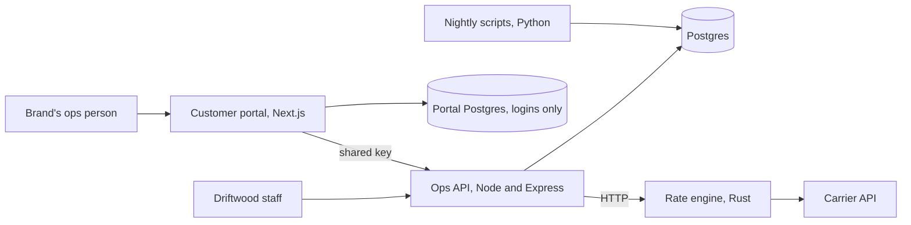

# Meet Driftwood: The Codebase You're Inheriting

> **In this lesson:** you'll clone Driftwood, get the API and the customer portal running, and use your agent to build a map of a system you've never seen. Then you'll check that map against the code, because the first thing an agent hands you is a confident summary.

## The company

Driftwood Logistics is a third-party logistics company. Online brands send it their products. Driftwood stores them in three warehouses (Portland, Atlanta, Dallas) and ships orders to the brands' customers.

So there are two kinds of users:

- **Driftwood staff.** Support and warehouse leads, who use the internal ops API.
- **Driftwood's customers.** Brands like BrightGear and Fulfillco, who log in to a portal to see their orders and tracking.

## The people

You'll see these names in tickets, docs and code comments. Knowing who owns what tells you whose word to trust on a topic.

| Who | Role | What they know |
| --- | --- | --- |
| Priya Nair | Backend engineer | The API, and how orders and inventory flow |
| Tom Vasquez | Infra | Deploys, CI, the cron box under his desk |
| Sarah Kim | Product | Billing tiers and pricing rules |
| Dana Osei | Support lead | What customers actually run into. Files most bugs |
| Jake | Contractor, gone | Wrote the rate engine. Not reachable |

You can't message any of them. That's realistic too. Most of the time the person with the answer is busy, on vacation or gone, and you have the code and whatever they wrote down.

## The system



| Folder | What it is | Language |
| --- | --- | --- |
| `apps/api` | The ops API: customers, orders, inventory, shipments | TypeScript |
| `apps/portal` | Customer portal. Owns logins, fetches everything else from the API | TypeScript, Next.js |
| `services/rate-engine` | Quotes shipping prices and delivery estimates | Rust |
| `scripts/` | Nightly inventory reconciliation and an old CSV importer | Python |
| `db/` | SQL migrations and seed data | SQL |
| `docs/exercises/` | The backlog. These are your tickets | Markdown |
| `docs/linear-export/`, `docs/notion-export/` | Old tickets, an incident write-up, design notes. Some of it is stale | Markdown |

## Get it running

```bash
git clone https://github.com/projectshft/driftwood-ops.git driftwood
cd driftwood
docker compose up -d postgres

cd apps/api
cp ../../.env.example .env
npm install
npm run migrate
npm run seed
npm run dev
```

That's the API on port 4000. In a second terminal:

```bash
cd driftwood/apps/portal
cp .env.example .env
npm install
npm run db:push
npm run db:seed
npm run dev
```

Open http://localhost:3000 and log in as `hello@brightgear.example` with the password `password123`. You should see BrightGear's orders. Click one.

To call the API directly you need a staff token:

```bash
cd apps/api
curl -H "Authorization: Bearer $(npm run -s token)" localhost:4000/customers
```

Leave the rate engine alone for now. Getting it running is your first ticket.

If setup fights you for more than 20 minutes, paste the exact error into your agent and ask what's wrong. That's the job now too.

## Lab: make a map, then check it

Start your agent in the `driftwood` folder.

1. Ask it for a tour. Something like: "Explain how this system fits together. Which services exist, what talks to what, and where does an order's total get calculated? Name the files."
2. **Check three of its claims.** Open the files it named. Is the function there? Does it do what the agent said?
3. Ask it what port the API runs on, what the test command is and which package manager the repo uses. Then check the answers against `apps/api/package.json` and what you just ran. Did it get all three right? If it didn't, where did the wrong answer come from?
4. Ask it to trace one request end to end: you click an order in the portal, and a total shows up on screen. Which files does that pass through, in which order?
5. Write five lines of your own about the system. Yours, in your words. You'll want them later.

Step 3 is a trap, and you should walk into it on purpose. The repo has a file that many agents read before anything else, and a lot of what it says is wrong. You'll deal with that file properly later in the course. For now just notice how confidently a wrong answer arrives.

```quiz
[
  {
    "q": "Your agent says the API listens on port 3000. You started it yourself and it came up on 4000. What's the most useful next question?",
    "options": ["Where did you get 3000 from? Show me the file and line", "Are you sure?", "Please be more careful", "Nothing. Ports don't matter"],
    "answer": 0,
    "explain": "Asking for the source turns a confident claim into something you can check, and it shows you which document is feeding the agent bad information."
  },
  {
    "q": "The portal shows order data. Where does that data live?",
    "options": ["In the ops API's database. The portal fetches it over HTTP with a shared key", "In the portal's own database", "In the rate engine", "In a JSON file in the portal"],
    "answer": 0,
    "explain": "The portal's database only holds logins. Orders, shipments and prices come from the ops API through its /portal routes. That boundary matters when you build a feature across both."
  },
  {
    "q": "Jake wrote the rate engine and can't be reached. What's your best source of truth for how it prices a shipment?",
    "options": ["The code in services/rate-engine", "The Notion export about the rate engine", "Whatever the agent summarizes first", "The README at the repo root"],
    "answer": 0,
    "explain": "Docs describe what someone believed when they wrote them. The code is what actually runs. In this repo several docs say so themselves."
  }
]
```

## Key takeaways

- An agent's first summary of a codebase is a draft. Check the parts you're about to rely on.
- "Show me the file and line" is the cheapest verification there is.
- Agents read instruction files and comments before they read code, and they believe them.
- Write your own short map of the system. You steer better when the picture is also in your head.

## Work with AI

```ai-prompt
title: Tour the codebase, with receipts
---
I'm new to this repo. Give me a tour of how the system fits together: each app or
service, what it owns, what it calls, and how a customer's order goes from the
database to their screen in the portal. For every claim, cite the file and line you
got it from. Where a document and the code disagree, tell me both and say which one
you trust and why. End with a list of anything you could not verify from the code.
```
