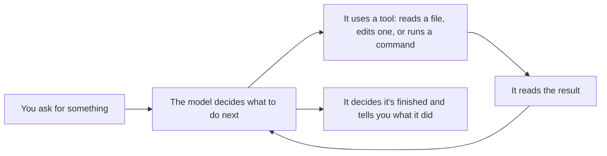

# Working with an Agent: Setting One Up

> **In this lesson:** you install a coding agent and learn what it actually is: a model that can read your files and run commands, in a loop. You'll see how it reads a repository, how to read every command it asks to run before you allow it, and what a $20 plan does and doesn't buy you. Nothing is handed in. Everything after this depends on it.

## Words you need first

- **Coding agent.** A program that takes a request in plain words, then reads files, edits them and runs commands on your computer to carry it out.
- **Model.** The AI underneath the agent. It reads text and writes text. On its own it can't touch your computer. The agent is what gives it hands.
- **Context.** Everything the model can see at one moment: your messages, its replies, and every file and command output it has read so far. It has a size limit.
- **Permission prompt.** The agent stopping to ask "may I do this?" before it edits a file or runs a command.
- **Instructions file.** A file in your repository that the agent reads at the start of every session, so you don't have to repeat your rules.

## What an agent is, underneath

A chat assistant answers in a window. You copy the code out, paste it somewhere and run it yourself.

A coding agent closes that gap. It has a few tools it's allowed to use: read a file, search for text, edit a file, run a terminal command. It works in a loop:



Three things follow from that picture, and they shape everything about working with one.

**It doesn't know your project.** Every session starts blank. It finds out what's in your repository the same way you would, by opening files. If a rule only lives in your head, the agent doesn't have it.

**It acts on your real computer.** The commands it runs are real commands, in your real folders. A wrong `rm` deletes real files.

**"I'm finished" is a claim.** The loop stops when the model decides it's done. That's a decision it made, and it can be wrong. Checking it is your job, and the next lesson is about how.

## Pick one and install it

Claude Code is what we recommend and what the examples use. Codex CLI and Cursor are fine too. The ideas in these lessons work in all three.

| Agent | Where it runs | Plan to start with |
| --- | --- | --- |
| Claude Code | Your terminal | Claude Pro, about $20 a month |
| Codex CLI | Your terminal | ChatGPT Plus, about $20 a month |
| Cursor | Its own editor, a version of VS Code | Cursor's paid plan, about $20 a month |

To install Claude Code, you need Node, which you already have:

```bash
npm install -g @anthropic-ai/claude-code
claude --version
```

`npm install -g` installs a program for your whole computer, as opposed to inside one project. If the command fails, follow the official setup page from Anthropic, which may list a newer way. If you're stuck for more than 30 minutes, stop and bring it to office hours.

Start it from inside your labs repository:

```bash
cd parsity-labs
claude
```

The first time, it opens your browser so you can sign in with your Claude account. After that you'll see a prompt where you type requests in plain words.

The folder you start it in matters. The agent works inside that folder and the folders below it. Starting it in your home folder gives it your whole computer to wander around in, so always start it in the project you mean.

## Watch it read before you let it write

Your first requests change nothing. Type this:

```text
What's in this repository? Give me one line per top-level folder. Don't change anything.
```

Watch what it does before it answers. You'll see it list folders and open files. That's the loop: it's reading the way you'd read.

Now ask about something you wrote yourself:

```text
Explain how the Queue in toolkit/structures/structures.js takes an item off the
front, and why that stays fast on a long queue. Point at the exact lines.
```

You built that queue by hand, so you're the expert here. Read its answer the way a reviewer would. Is it right? Did it point at the real lines? Did it say anything confident that isn't true?

That's the habit for the rest of the program. You will often know less than the agent about syntax. You must never know less than it about what your code is supposed to do.

## Context: the agent's working memory

Everything in one session piles up in the context: what you said, what it read, every command's output. Two things go wrong as it fills.

- **Earlier details get lost.** In a long session the agent starts forgetting rules you gave at the start, or mixing up files.
- **It costs more.** Every new message makes the model reread the whole pile. A bigger pile uses up your plan faster.

So start a fresh session for each new task. In Claude Code, `/clear` empties the context and keeps you in the same folder. Anything that should survive between sessions belongs in a file, never in the chat.

## Your instructions file

Since the agent starts blank, you give it your rules in a file it reads every time. Claude Code reads `CLAUDE.md`. Codex and Cursor read `AGENTS.md`.

Your labs repository has a rule the agent can't guess: some folders are by hand. Write this file yourself, at the top of `parsity-labs`, and name it `CLAUDE.md`. If you use Codex or Cursor, also save a copy named `AGENTS.md`.

```markdown
# parsity-labs

My labs repository for the Parsity program. I'm learning, so explain what you
do in plain words.

## By-hand folders: never write code here

basics-one/, basics-two/, toolkit/ and problems/ are mine to write. You may
explain ideas and point at lines. Don't write or edit code in these folders,
even if I ask in passing. Remind me of this rule instead.

## Project folders

From http-server/ on, you may write code once I've written a plan in that
folder's PLAN.md.

## How to work

- Plain JavaScript with require. Node 22. Tests use node:test.
- Don't add npm packages without asking me first.
- Before you say something works, run its tests and show me the output.
- Small changes, one thing at a time.
```

Commit it:

```bash
git add CLAUDE.md
git commit -m "Tell the agent which folders are by hand"
```

Now test it. Run `/clear`, then ask:

```text
Add a clear() method to the Stack in toolkit/structures.
```

A good result is the agent pointing at your rule and declining. If it starts editing anyway, say no at the permission prompt, then make the rule in `CLAUDE.md` plainer and try again.

Notice what just happened. **An instructions file is advice.** The agent usually follows it, and sometimes it doesn't. The only real lock is you, reading what it wants to do before you say yes.

## Permission prompts: read before you allow

By default Claude Code asks before it edits a file or runs a command, and shows you exactly what it wants to do. You answer yes, no, or yes and don't ask again for this kind of thing.

Your terminal lessons are why you can do this now. Read the command. If you can't say what it does, ask the agent to explain it before you allow it. Saying no costs nothing. The agent will try another way or ask you what you want.

Some rules of thumb:

| Kind of command | Examples | What to do |
| --- | --- | --- |
| Only reads | `ls`, `cat server.js`, `git status`, `git diff`, `git log` | Fine to allow |
| Runs your code | `node --test`, `node start.js` | Fine, in a project you trust |
| Changes what's installed or saved | `npm install something`, `git commit`, `git push` | Ask why first. Is it something you asked for? |
| Can't be undone | `rm -rf`, `git reset --hard`, `git push --force`, `git clean` | Stop. Find out what it's trying to fix |
| Touches secrets or your whole computer | `cat .env`, anything with `sudo`, anything outside this folder | No, unless you understand exactly why |

Claude Code also has modes you switch between with Shift+Tab. One accepts every edit without asking. Leave that off for now. You'll earn it once reading diffs is a habit, and in some repositories you'll never turn it on.

If the agent heads somewhere you didn't want, press Esc. It stops, and you can tell it what to do instead.

```match
{
  "title": "What does this command do?",
  "note": "Tap the command, then what it does.",
  "pairs": [
    { "left": "node --test", "right": "Runs the tests in this folder. Safe to allow" },
    { "left": "git diff", "right": "Shows every line changed since the last commit. Only reads" },
    { "left": "npm install left-pad", "right": "Downloads someone else's code into the project" },
    { "left": "rm -rf toolkit", "right": "Deletes a folder and everything in it, with no undo" },
    { "left": "git push --force", "right": "Replaces the history on GitHub with yours" },
    { "left": "cat .env", "right": "Prints the file where secrets like API keys usually live" }
  ]
}
```

```scenario
{
  "who": "Your agent",
  "setting": "You asked it to fix a failing test in your http-server folder. Partway through, it stops at a permission prompt.",
  "ask": "To get back to a clean state, I'll run git reset --hard HEAD~3. Allow?",
  "note": "HEAD~3 means three commits back.",
  "options": [
    { "text": "No. Ask what it's trying to undo, and tell it to show you those three commits with git log first.", "verdict": "best", "feedback": "git reset --hard throws away those three commits and any changes you haven't committed. You don't know yet whether that's your morning's work. Making it explain and show you the commits turns a gamble into a decision you can make." },
    { "text": "Allow it. Git keeps everything, so you can always get it back.", "verdict": "weak", "feedback": "Partly true: thrown-away commits can often be recovered for a while, if you know how. Changes you never committed are gone for good. 'I can probably undo it' isn't a reason to allow something you can't explain." },
    { "text": "Allow it. The agent knows Git better than you do.", "verdict": "weak", "feedback": "It may know more commands. It doesn't know which of those commits matter to you. Knowing Git is different from knowing what you want to keep." },
    { "text": "No, and start a fresh session, because the agent is confused.", "verdict": "ok", "feedback": "Refusing is right, and a fresh session sometimes helps. But you threw away what the agent knew without finding out what went wrong. Ask first. Then decide whether to start over." }
  ],
  "debrief": "Anything that can't be undone gets a question before it gets a yes. Ask what it's for, and ask to see what it would destroy."
}
```

## Secrets

An agent can read any file in the folder you started it in. That includes a `.env` file holding API keys and passwords, and whatever it reads goes to the model company's servers as part of the context.

Two habits from today:

- Never paste a key or password into the chat.
- Keep secrets in files the agent has no reason to open, and say no if it asks to print one. You'll set up secrets properly in the shipping lessons.

## What a $20 plan gets you, honestly

A $20 plan is enough to do this program. It is not unlimited, and pretending otherwise sets you up for a bad evening.

- **There's a usage allowance.** It refills every few hours, and there's also a weekly cap. The exact numbers change, so check your plan's page.
- **Bigger contexts use it faster.** Long sessions, huge files and pasting whole logs all count against you. A vague request that sends the agent reading half your repository costs more than a precise one.
- **When you hit the limit, you wait.** Work stops until it refills, or you carry on by hand.

How to make it last:

- Plan before you ask. A clear request with the files named and the cases listed gets it right in fewer rounds.
- One task per session. `/clear` between tasks.
- Ask for one small piece at a time, and review it before you ask for the next.
- Commit what you've reviewed often, so that hitting the limit mid-task leaves you somewhere clean.

The $10 of API credit included in the program is for calling a model from your own code, later on. It doesn't pay for your agent.

```quiz
[
  {
    "q": "You told the agent yesterday that toolkit/ is written by hand. Today, in a new session, it starts editing a file in toolkit/. What's the most likely reason?",
    "options": ["Each session starts blank, and the rule was only said in yesterday's chat, never written in CLAUDE.md", "The agent ignores rules on purpose", "Your plan ran out", "toolkit/ is a protected folder"],
    "answer": 0,
    "explain": "The agent doesn't remember past sessions. Rules that must last go in the instructions file it reads every time, and even then you check."
  },
  {
    "q": "The agent asks to run npm install express in your http-server folder. What should you do?",
    "options": ["Say no and ask why it wants it, because this project rules out Express and you didn't ask for a package", "Allow it, packages are normal", "Allow it, then delete the package later", "Allow it and turn on accept-every-edit so it stops asking"],
    "answer": 0,
    "explain": "Installing a package is a decision. Here it also breaks the project's rules. The prompt is your chance to catch that before it happens."
  },
  {
    "q": "You are deep into one long session and the agent keeps forgetting a rule you gave at the start. What's the best move?",
    "options": ["Put the rule in CLAUDE.md, commit what you've reviewed, and start a fresh session", "Repeat the rule in capital letters", "Keep going, it will remember eventually", "Switch to a different agent"],
    "answer": 0,
    "explain": "A full context loses early details and burns your allowance. A fresh session that reads the rule from a file starts sharp."
  }
]
```

## Key takeaways

- An agent is a model with tools in a loop: read, edit, run, read the result, repeat. It acts on your real computer.
- It starts every session blank. Rules that matter go in `CLAUDE.md` or `AGENTS.md`. It usually follows them, and you still check.
- Read every command before you allow it. Anything that can't be undone gets a question first.
- Context fills up. One task per session, and `/clear` between them.
- A $20 plan has real limits. Plan first, ask small, commit often.

## Work with AI

```ai-prompt
title: Would you allow this command?
---
I'm a beginner who just set up a coding agent. I have to approve every command it
wants to run in my project. Show me one terminal command at a time, the kind an
agent might ask to run in a small Node.js project, along with the reason the agent
gives. Ask me whether I'd allow it, and why. Wait for my answer. Then tell me what
the command really does, what could go wrong, and whether my reasoning held up. Do
ten, mixing harmless ones with risky ones. Include at least one where the command is
fine but the reason given doesn't match what I asked for.
```
