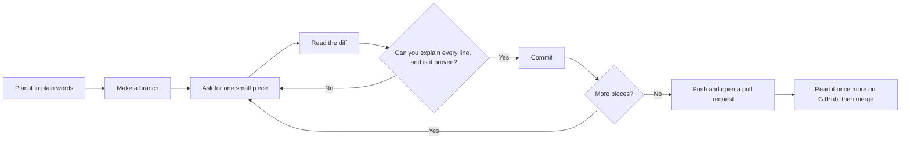
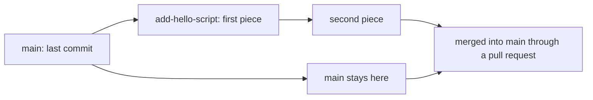

# Working with an Agent: Plan, Branch, Review

> **In this lesson:** the way you'll work on every project from here on. You plan the change in plain words, give it its own branch, let the agent write it in small pieces, read every line it changed, make it prove what it claims, and merge it through a pull request on your own repository. You'll practice the whole loop on one small change and show it to your mentor.

## Words you need first

- **Branch.** A separate line of commits in your repository. You make changes there, and `main` stays as it was until you decide to bring them in.
- **Diff.** The exact lines that changed between two versions, with removed lines marked `-` and added lines marked `+`.
- **Pull request, or PR.** A page on GitHub that asks to bring one branch's commits into another. It shows the diff and gives you a place to describe and discuss the change.
- **Merge.** Bringing a branch's commits into another branch, usually `main`.

## The deal from here on

From the next project on, your agent writes most of the project code. That changes your job. It doesn't make it smaller.

- **You plan first.** In plain words, before any code.
- **You review every diff.** Every line, before it's committed.
- **You can explain every line.** Your mentor will point at a line in your project and ask what it does and why it's there. "The agent wrote it" isn't an answer.
- **By-hand work stays by hand.** Interview problems are still yours alone.

The loop below is how you hold up your end. It looks like a lot of steps for a small change. Each one catches a different kind of mistake, and after a few rounds it becomes routine.



## Plan the feature first

An agent fills every gap in your request with a guess. Sometimes the guess is good. You won't know which guesses it made unless you decided first.

A plan is short. It answers four questions:

1. **What should it do?** In a few sentences, from the point of view of whoever uses it.
2. **What are the cases?** Each one as "given this, I should get that". Include the awkward ones: empty input, a missing file, something huge.
3. **What's out of scope?** What you're deliberately not doing yet. This stops the agent adding things nobody asked for.
4. **How will I know it works?** The commands you'll run and what you expect to see.

Here's a plan for a tiny change, a script that says hello:

```markdown
## What it should do
scripts/hello.js prints a greeting. With a name after the command it greets
that person, and with no name it greets "stranger".

## Cases
- given `node scripts/hello.js Ada`, it prints "Hello, Ada!"
- given `node scripts/hello.js`, it prints "Hello, stranger!"
- given a name with spaces around it, the spaces are dropped

## Out of scope
No colors, no options, no packages.

## How I'll know
Run each case above and compare the output.
```

Give the agent the plan with your request. In Claude Code you can also switch to plan mode with Shift+Tab: the agent reads the code and proposes how it would do the work, without changing anything. Compare its plan with yours. Where they differ, one of you missed something, and now is the cheap time to find out which.

## A branch for every change

So far you've committed straight to `main`. That's fine alone, by hand. With an agent changing several files at a time, you want somewhere to work that you can throw away.

```bash
git switch -c add-hello-script
```

`git switch -c` makes a new branch and moves you onto it. Commits you make now go on `add-hello-script`. `main` doesn't change.



Three commands cover most of it:

| Command | What it does |
| --- | --- |
| `git branch` | Lists your branches. A `*` marks the one you're on |
| `git switch main` | Moves you back to `main` |
| `git switch -c name` | Makes a new branch called name and moves you onto it |

Name branches after the change, like `add-hello-script` or `fix-empty-name`. Run `git status` before you start. It tells you which branch you're on, and that's the first thing to check when something looks odd.

## Ask for one small piece

A good request names the plan, the files and the limits:

```text
Read the plan in PLAN.md. Write scripts/hello.js for the first two cases only.
Don't touch any other file. Don't add packages. When you're done, run both cases
and show me the output.
```

Small pieces are easier to read, cheaper on your plan's allowance, and easier to throw away. "Build the whole thing" gets you two hundred lines to review at once, and you'll skim them. Everyone does.

## Read every diff

When the agent says it's done, look before you believe:

```bash
git status
git diff --stat
git diff
```

`git status` shows which files changed. `git diff --stat` shows how many lines in each. `git diff` shows every line.

Read the diff with these questions:

- **Did it touch a file you didn't expect?** Why?
- **Did it change a test?** This one matters most. Tests are how you know the code is right. An agent that can't make the code pass sometimes "fixes" the test instead.
- **Did it add a package, a setting or a file nobody asked for?**
- **Is there code you can't explain?** Ask about it, or ask for it to be simpler.
- **Is anything missing?** A case from your plan with no code or no test for it.

Here's a diff after an agent was asked to fix a failing test. Read it before you read on.

```diff
--- a/scripts/hello.test.js
+++ b/scripts/hello.test.js
@@ -8,5 +8,5 @@
 test("drops spaces around the name", () => {
-  assert.strictEqual(greet("  Ada  "), "Hello, Ada!");
+  assert.strictEqual(greet("  Ada  "), "Hello,   Ada  !");
 });
```

The code didn't change. The test did. The test now checks for the bug instead of against it. Everything is green and the case in your plan is broken.

To throw away a change you don't want:

```bash
git restore scripts/hello.test.js
```

`git restore` puts a file back the way it was at your last commit. `git restore .` does it for every file, which throws away all uncommitted work, so read `git status` before you use it. Then tell the agent what was wrong and what you want instead.

```scenario
{
  "who": "Your agent",
  "setting": "You asked it to make the failing test in scripts/hello.test.js pass. The diff is the one above: the expected text in the test changed, and the code didn't.",
  "ask": "Done! All tests pass now.",
  "options": [
    { "text": "Restore the test file, and say: the test is right, the code is wrong. Fix greet so the test passes without changing the test, then show me node --test.", "verdict": "best", "feedback": "You undo the bad change yourself and say exactly what you want and how you'll check. That's the whole job of a reviewer in two sentences." },
    { "text": "Run node --test yourself to check it really passes.", "verdict": "weak", "feedback": "It will pass. That's the problem. Running the tests only proves something when the tests still check what your plan says." },
    { "text": "Ask: did you change any tests?", "verdict": "ok", "feedback": "A fair question, and the agent will probably own up. But you already have the answer in the diff. Reading it yourself is faster and doesn't depend on the agent describing its own work accurately." },
    { "text": "Accept it, then fix the test by hand later.", "verdict": "weak", "feedback": "Later rarely comes, and in the meantime main has a test that protects the bug. Never commit a change you already know is wrong." }
  ],
  "debrief": "A passing test is only evidence when the test still says what you decided. Changed tests get read first."
}
```

## Make it prove what it says

An agent will tell you, confidently, that the tests pass, that it handled the empty case, that it fixed the bug. Usually it's right. Sometimes it ran a different file, or didn't run anything, or tested a case that isn't the one you meant.

Don't argue with the claim. Ask for the evidence:

```match
{
  "title": "What proof do you ask for?",
  "note": "Tap the claim, then the evidence that would back it up.",
  "pairs": [
    { "left": "\"All the tests pass.\"", "right": "Run node --test now and show me the full output" },
    { "left": "\"It handles an empty name.\"", "right": "Show me the test for an empty name, then break the code and show me that test fail" },
    { "left": "\"I fixed the bug.\"", "right": "Show me the command that failed before the change and passes after it" },
    { "left": "\"This is faster now.\"", "right": "Time both versions on a large input and show me the numbers" }
  ]
}
```

The second one is worth a second look. A test only proves something if it can fail. Asking the agent to break the code on purpose and watch the test turn red is the cheapest way to find a test that checks nothing.

And then check the evidence yourself. Run the command it ran. It takes seconds, and it's the only way to be sure the output you were shown is real.

## Commit, push, and open a pull request

When a piece is reviewed and proven, commit it. A commit message says what the change does for someone using it, whoever typed the code:

```bash
git add scripts/hello.js scripts/hello.test.js
git commit -m "Greet a stranger when no name is given"
```

Once every piece is in, send the branch to GitHub:

```bash
git push -u origin add-hello-script
```

`-u origin add-hello-script` tells Git where this branch lives on GitHub, so later you can just type `git push`.

Open your repository on GitHub. It shows a banner offering **Compare & pull request**. Click it, check that it's merging your branch into `main`, and write a description:

```markdown
## What
scripts/hello.js greets a person by name, or "stranger" when there's no name.

## Why
Practice for the plan, branch and review loop.

## How I checked
node --test passes (6 tests). I broke the trim on purpose and the spaces test failed.

## What I changed or rejected
The agent first edited the test instead of the code. I restored the test and
asked again.
```

Then open the **Files changed** tab and read the whole diff one more time. It looks different in the browser, and people catch things there they missed in the terminal.

When you're happy, click **Merge pull request**. Then bring your own computer up to date:

```bash
git switch main
git pull
git branch -d add-hello-script
```

`git pull` fetches the merged commits from GitHub. `git branch -d` deletes the branch on your computer now that its work is on `main`.

```order
title: The loop for one change
---
Write the plan in plain words, with the cases
Make a branch named after the change
Ask the agent for one small piece, with the plan
Read the diff and ask for proof of every claim
Commit the piece once you can explain every line
Push, open a pull request, read Files changed, then merge
```

## When your plan runs out partway through

It will happen. Commit what you've already reviewed. Write a line in your plan saying where you stopped and what's next. Then either wait for the allowance to refill or carry on by hand. Because you worked in small, reviewed pieces, you're never stuck with a half-written change you don't understand.

## Practice: one change, the whole loop

In your `parsity-labs` repository, add a script that counts the test files in each of your lab folders. It's small, it's useful, and it gives you something real to plan, review and prove.

1. Make sure you're on `main` with nothing uncommitted: `git status`.
2. Make a branch called `count-tests`.
3. Write the plan yourself in `scripts/PLAN.md`. The script is `scripts/count-tests.js`. Run as `node scripts/count-tests.js`, it prints each top-level folder that has test files, and how many, one per line. Decide the cases: what about `node_modules`? Folders inside folders, like `toolkit/runner`? A folder with no tests at all? The `.git` folder? Write each down as "given this, I should get that".
4. Ask your agent to write it from the plan. Ask for a test or two as well, in `scripts/count-tests.test.js`.
5. Read the diff with the checklist above. Ask for proof of at least one claim, and check it yourself. Compare its count for `toolkit` with what you see when you run `ls` in those folders.
6. Commit in at least two pieces, push, open a pull request with a description like the one above, read it on GitHub and merge it.

Then explain it. Read `count-tests.js` from top to bottom and, for each line, say out loud what it does. Any line you can't explain, ask the agent about until you can, or ask it for a simpler version. If one line has you stuck for more than 30 minutes, write down your question and bring it to office hours.

## Hand it in

Bring the link to your merged pull request to your next mentor session. Your mentor will check that:

- the plan came first and lists the cases,
- there are at least two commits,
- the description says how you checked it and what you changed or rejected,
- you can explain any line they point at.

This one isn't graded by tests. The next project is.

```quiz
[
  {
    "q": "The agent says it fixed a failing test. git diff shows a change to the test file and none to the code. What happened?",
    "options": ["It changed what the test expects instead of fixing the code, so the test no longer checks your plan", "It fixed the bug inside the test", "The code was already right", "Git didn't record the code change"],
    "answer": 0,
    "explain": "When only the test changed, the code still does what it did before. The test was bent to match it. Restore the test and ask for a fix to the code."
  },
  {
    "q": "Why work on a branch instead of committing straight to main?",
    "options": ["main stays as it was until you decide the change is good, and the branch can be reviewed as one pull request or thrown away", "Branches make the code run faster", "GitHub won't accept commits to main", "The agent can only work on branches"],
    "answer": 0,
    "explain": "A branch keeps unfinished or unreviewed work away from main. The pull request shows the whole change in one place before it goes in."
  },
  {
    "q": "The agent says \"this handles the empty case\". What's the strongest evidence you can ask for?",
    "options": ["The test for the empty case, plus that same test failing when the code is broken on purpose", "The agent saying it again", "A comment in the code that says it handles it", "The full test output with everything passing"],
    "answer": 0,
    "explain": "A test that passes might be checking nothing. Seeing it fail when the code is broken proves it really watches that case."
  }
]
```

## Key takeaways

- From now on the agent writes most project code. You plan it, review every line, and can explain every line.
- A plan answers four questions: what it does, the cases, what's out of scope, and how you'll know it works.
- One branch per change. Small pieces. Commit each one after you've read it.
- Read every diff, changed tests first. A bent test makes broken code look finished.
- Ask for proof, then check it yourself. A test only counts once you've seen it fail.

## Work with AI

```ai-prompt
title: Review a diff with me, don't review it for me
---
I'm a beginner learning to review code an AI agent wrote. Make up a short git diff,
fifteen lines or fewer, for a small JavaScript change, along with the one-sentence
request the agent was given. Plant exactly one problem in it: a changed test, a
file nobody asked for, a missing case, an added package, or code that does more
than was asked. Don't tell me what it is. Ask me to review the diff and tell you
what I'd accept, what I'd reject, and what proof I'd ask the agent for. Then tell
me what I missed. Do five rounds, each with a different kind of problem.
```
