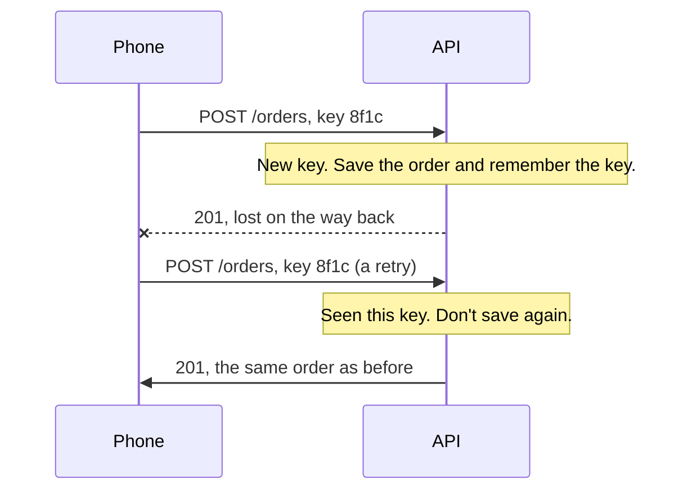

# Designing an API

> **In this lesson:** how to design the routes, inputs and errors of an API that other people's code will call. You'll learn to name resources, check input at the door, pick the right status code, make a retry safe, hand back data a page at a time, and turn away a caller who sends too much. Nothing to hand in. The next lesson starts a project that uses every idea here.

## Words you need first

- **API.** The set of requests a server accepts and the answers it gives back. Short for application programming interface. Here it means an HTTP API.
- **Resource.** A kind of thing your API manages, like a product, a customer or an order.
- **Validation.** Checking that a request makes sense before doing any work with it.
- **Idempotent.** Safe to repeat. Sending the same request twice has the same effect as sending it once.
- **Rate limit.** A cap on how many requests one caller may send in a stretch of time.

## An API is a promise to strangers

When you built a web server, you wrote both sides. You sent the request with curl and you read the response yourself.

An API is different. Other people's code calls it: a mobile app, a partner's server, a script someone wrote at midnight. You never see that code. They never see yours. The only thing you share is the **contract**: which requests exist, what each one expects, and what comes back.

Two things follow from that.

- **Callers will send you anything.** Missing fields, text where you wanted a number, the same request three times. Your API has to cope with all of it.
- **A published API is hard to change.** Once a phone app in a million pockets calls `GET /orders/42`, renaming that route breaks every copy of the app that hasn't updated. Adding a new field is safe. Removing or renaming one is not.

So design matters more here than almost anywhere else. A messy function inside your app can be fixed in an afternoon. A messy API lives for years.

## Resources and routes

Good APIs are built around **nouns**: the things the business cares about. The HTTP method says what you're doing to the thing.

| Method and path | Means |
| --- | --- |
| `GET /products` | List products |
| `POST /products` | Create a product |
| `GET /products/7` | Read product 7 |
| `PATCH /products/7` | Change some fields of product 7 |
| `DELETE /products/7` | Remove product 7 |

A path with no id, like `/products`, is the **collection**. A path with an id, like `/products/7`, is one **item** in it.

When one thing belongs to another, you can nest it: `GET /customers/3/orders` lists customer 3's orders. Keep nesting to one level. `/customers/3/orders/9/items/2` is hard to read and harder to change.

Some actions aren't create, read, update or delete. Cancelling an order changes its status, gives stock back and maybe refunds money. Model it as an action on the order:

```
POST /orders/9/cancel
```

That reads clearly, and it leaves room for the action to do several things at once.

Things to avoid:

- **Verbs in paths for ordinary reads and writes.** `POST /createProduct` and `GET /getOrder?id=9` repeat what the method already says.
- **Two names for one thing.** If it's `customerId` in one place, it's `customerId` everywhere. Not `customer_id` here and `userId` there.
- **Decimals for money.** Store and send money as whole cents: `2500`, not `25.00`. Decimals in JavaScript drift. Try `0.1 + 0.2` in Node and see what you get.

## Six checkpoints for every request

Every request to a real API runs the same gauntlet before any work happens. Each layer can stop it early and answer straight away. Pick a request below and watch where it stops.

```visual
api-request-lifecycle | One request, six checkpoints
```

The order matters. The cheapest checks go first. Counting a caller's requests costs almost nothing, so the rate limit runs before anything reads the body. Validation runs before the handler, so the handler only ever sees sensible input. The database, the most expensive step, runs last.

```order
title: Put the checkpoints in the order a request meets them
---
Rate limit: has this caller sent too many requests?
Authentication: do we know who is calling?
Authorization: are they allowed to do this?
Validation: does the input make sense?
Handler: do the work
Database: read or write the data
```

You'll build authentication and authorization later in the program. For now, the four you need are rate limits, validation, the handler and the database.

## Validation: check at the door

**Never trust input from outside your server.** Not from a form, not from your own front end, not from a partner. Anyone can send any bytes to an open port with curl.

Validation answers four questions about every field:

| Question | Example of a failure |
| --- | --- |
| Is it there? | No `qty` at all |
| Is it the right type? | `"qty": "2"`, a string, where a number was expected |
| Is it in range? | `"qty": 0`, or `"qty": -5` |
| Does it fit with the rest? | The same product twice in one order |

Here's validation for one field, written out:

```js
function checkQty(qty) {
  if (typeof qty !== "number" || !Number.isInteger(qty)) {
    return "qty must be a whole number";
  }
  if (qty < 1) {
    return "qty must be 1 or more";
  }
  return null;
}
```

Watch for a trap that agents fall into all the time: **converting instead of checking.** `Number("2")` turns the string into `2`, so the request quietly works. `Number("")` is `0`. `Number(null)` is `0`. `parseInt("5 lamps")` is `5`. Converting hides bad input and lets nonsense through. Check the type, and reject what's wrong.

When validation fails, answer `400 Bad Request` with a message that says exactly what to fix:

```json
{ "error": "items[1].qty must be a whole number, 1 or more" }
```

That message is for the developer calling your API. "Invalid input" makes them guess. "items[1].qty must be..." tells them which field, in which item, and what you wanted.

## Status codes say who has to act

You met status codes when you learned HTTP. In an API, they carry one more message: **who has to change something.**

- **2xx**: it worked.
- **4xx**: the caller has to change something. Fixing their request, logging in or waiting will help.
- **5xx**: the server has to change something. Retrying the same request may not help.

The ones you'll use most:

| Code | Name | Use it when |
| --- | --- | --- |
| 200 | OK | A read or an action worked |
| 201 | Created | A new resource was made. Send it back. |
| 400 | Bad Request | The input fails validation, or isn't valid JSON |
| 401 | Unauthorized | We don't know who you are |
| 403 | Forbidden | We know who you are, and you may not do this |
| 404 | Not Found | The thing in the path doesn't exist |
| 405 | Method Not Allowed | The path exists, but not with this method |
| 409 | Conflict | The request is fine, but the current state says no: out of stock, already cancelled, email taken |
| 422 | Unprocessable Content | The request is well formed but can't be used as sent, for example a retry key reused with a different body |
| 429 | Too Many Requests | The caller hit a rate limit |
| 500 | Internal Server Error | A bug. Nothing else. |

Two habits make an API easy to work with:

- **One error shape everywhere.** Every error is JSON with the same field, like `{ "error": "..." }`. A caller writes one piece of code to read errors, and it always works.
- **Never send a stack trace.** It tells an attacker what your code looks like and tells a normal caller nothing useful. Log it on the server. Send `{ "error": "internal error" }`.

A 500 means you have a bug, so a server that catches its own errors and answers 500 is doing its job. A server that crashes on a bad request has a worse bug: one caller just took it down for everyone.

```match
{
  "title": "Which status code?",
  "note": "Tap the situation, then the code.",
  "pairs": [
    { "left": "A new order was saved", "right": "201" },
    { "left": "The body says qty is -3", "right": "400" },
    { "left": "GET /orders/99999 and there is no such order", "right": "404" },
    { "left": "The last lamp was sold a second ago", "right": "409" },
    { "left": "The handler read a property of undefined and threw", "right": "500" },
    { "left": "The 600th request this minute from one caller", "right": "429" }
  ]
}
```

## Idempotency: making a retry safe

Here's a problem every API meets. A phone sends `POST /orders` on a weak connection. The server saves the order and sends back `201`. The response gets lost on the way back. The phone sees a timeout.

What should the phone do? If it gives up, the customer thinks the order failed when it didn't. If it retries, the customer may get charged twice.

Some methods are safe to repeat by definition. `GET` changes nothing. `PUT /products/7` with the same body leaves the product in the same state however often you send it. `DELETE /products/7` twice leaves it deleted. These are **idempotent**.

`POST` isn't. Each `POST /orders` makes a new order.

The standard fix is an **idempotency key**. The client makes up a unique string for each thing it means to do, and sends it as a header:

```
POST /orders
Idempotency-Key: 8f1c2d4e-checkout-1
```

The server remembers each key it has seen and what happened:



The rules that make it work:

- **Same key, same request:** answer with the original result. Do the work zero more times.
- **Same key, different request:** something is wrong on the client. Answer with an error, usually `422`, and do nothing.
- **Remember keys somewhere that survives a restart.** A key kept only in memory is forgotten the moment the server restarts, which is exactly when clients retry.

Payment companies require this on every request that moves money. You'll build it.

## Pagination: a page at a time

`GET /orders` works fine with 12 orders. With 4 million, it tries to load all of them, turn them into one enormous JSON string and send it. The server runs out of memory or the client gives up.

So list routes return a **page**: a limited number of items, plus a way to ask for the next page.

There are two common ways to say "the next page".

**Offset**: "skip 20, give me 20". Easy, and it breaks when the list changes. Say a customer's orders are listed newest first:

| Moment | What happens |
| --- | --- |
| You ask for page 1 | You get orders 50 to 31 |
| The customer places order 51 | Everything shifts down one place |
| You ask to skip 20 | You get orders 31 to 12. Order 31 shows up twice. |

**Cursor**: "give me 20 after the last one I saw". The server hands back a **cursor**, a marker for where the page ended, and the client sends it back to get the next page:

```json
{ "items": [ ... ], "nextCursor": "MzE" }
```

```
GET /customers/3/orders?limit=20&cursor=MzE
```

The server reads the cursor, sees "older than order 31", and carries on from there. New orders at the top can't push anything into the next page. When there are no more pages, `nextCursor` is `null`.

Three details:

- **Cap the page size.** Let callers pick `limit`, up to a maximum like 100. Otherwise someone asks for `limit=10000000`.
- **Keep the cursor opaque.** Encode it so clients don't try to build their own. Then you can change what's inside it later without breaking anyone.
- **Reject a cursor you didn't hand out** with a 400.

## Rate limits: one caller can't take everything

One misbehaving script can send thousands of requests a second. Without a limit, that one caller slows the API down for every other caller, or runs up your bill.

A rate limit counts requests per caller (by API key, by account, or by IP address) over a window of time. Past the limit, the server answers straight away:

```
429 Too Many Requests
Retry-After: 30
```

`Retry-After` tells a well-behaved client how many seconds to wait. The check is so cheap that it runs first, before the server spends anything on the request.

You'll build a rate limiter yourself later in the program, with the two common designs. For now, know where it sits and what it answers.

```scenario
{
  "who": "A product manager",
  "setting": "A support call. Three customers were charged twice for one order this week.",
  "ask": "The mobile team says it only happens on bad wifi. Can we just tell the app to stop retrying?",
  "note": "Pick the reply you'd give.",
  "options": [
    {
      "text": "If the app never retries, people on bad connections see an error for orders that actually went through, and they'll place them again by hand. The fix is to let the app retry safely: it sends a unique key with each order, and the server returns the first result for a key it has already seen.",
      "verdict": "best",
      "feedback": "This names the real cause, a lost response, and a fix that works at both ends. It also explains why the obvious fix moves the problem to the customer instead of solving it."
    },
    {
      "text": "Yes. If the app doesn't retry, there can't be duplicates.",
      "verdict": "weak",
      "feedback": "True and harmful. The order still goes through when the response is lost, and now the customer sees an error and orders again themselves. You've traded a double charge for a confused customer who causes one."
    },
    {
      "text": "We can block a second order from the same customer for the same items within a minute.",
      "verdict": "ok",
      "feedback": "It catches many duplicates, and it also blocks a customer who really does want two orders. A guess based on timing is weaker than an explicit key from the client saying these two requests are one."
    }
  ],
  "debrief": "Networks lose responses. Clients will retry. The job of the API is to make the retry harmless, and an idempotency key is the standard way to do it."
}
```

## Try it: design one on paper

Before the project, design a small API by hand. A yoga studio wants an API for classes and bookings:

- Staff create classes with a name, a start time and a number of spaces.
- Members book a space and can cancel a booking.
- A member can see their own bookings, newest first.
- A class can't be overbooked.

Write down, for each route: the method and path, the body, the success code, and every error code it can return with one example of each. Then pick which routes need pagination and which need an idempotency key.

Don't spend more than 30 minutes on it. Then compare with this.

<details>
<summary>One reasonable design</summary>

| Route | Body | Success | Errors |
| --- | --- | --- | --- |
| `POST /classes` | `{ name, startsAt, spaces }` | 201, the class | 400 if spaces isn't a whole number of 1 or more |
| `GET /classes?limit=&cursor=` | | 200, a page | 400 for a bad limit or cursor |
| `GET /classes/:id` | | 200 | 404 |
| `POST /classes/:id/bookings` | `{ memberId }` | 201, the booking | 400 for an unknown member, 404 for an unknown class, 409 if the class is full or the member already booked |
| `POST /bookings/:id/cancel` | | 200 | 404, and 409 if it's already cancelled |
| `GET /members/:id/bookings?limit=&cursor=` | | 200, a page, newest first | 404 |

Booking a space creates something, so it should accept an `Idempotency-Key`. Both list routes need pagination, and the member's bookings need a cursor because new ones arrive at the top.

Yours doesn't have to match. What matters is that every route has an answer for every kind of failure.

</details>

```quiz
[
  {
    "q": "An agent's validation code does `const qty = Number(body.qty)` and then checks `qty >= 1`. A caller sends `\"qty\": \"3\"`. What happens, and is that a problem?",
    "options": ["It's accepted as 3, and that's a problem: converting hides bad input, and Number turns empty strings and null into 0 without complaint", "It's rejected, which is correct", "It's accepted, and that's fine because the value was sensible", "The server crashes"],
    "answer": 0,
    "explain": "Number happily converts strings, so the wrong type slips through. Check typeof and Number.isInteger, and reject what doesn't match. The caller learns about their bug instead of you learning about it later."
  },
  {
    "q": "A list of a customer's orders is shown newest first, using offset pagination. Between page 1 and page 2, the customer places a new order. What does the client see?",
    "options": ["One order appears on both pages, because everything shifted down by one", "The new order on page 2", "Nothing changes", "An error"],
    "answer": 0,
    "explain": "Skipping 20 now skips to a different place. A cursor says 'after the last one I saw', which doesn't move when new items arrive at the top."
  },
  {
    "q": "A request to place an order is valid, but the product has 0 left. Which status code fits best?",
    "options": ["409 Conflict, because the request is fine and the current state says no", "400 Bad Request, because the order can't be filled", "404 Not Found, because there's no stock", "500 Internal Server Error"],
    "answer": 0,
    "explain": "Nothing about the request is malformed. The same request would succeed after a restock. That's a conflict with the current state."
  }
]
```

## Key takeaways

- An API is a contract with code you'll never see. Adding is safe. Removing or renaming breaks callers.
- Name resources with nouns, let the method say the action, and model special actions like cancel as their own route.
- Validate every field at the door: present, right type, in range, consistent. Check types instead of converting them.
- 4xx means the caller must change something. 5xx means you have a bug. Use one JSON error shape with a message that says what to fix.
- An idempotency key makes retries safe. Remember keys somewhere that survives a restart.
- Return lists a page at a time, with a capped limit and a cursor that doesn't drift when new items arrive.

## Work with AI

```ai-prompt
title: Poke holes in my API design
---
I'm learning API design. I designed a small HTTP API for a yoga studio: classes,
bookings and members. I'll paste my routes, bodies, success codes and error codes.
Don't redesign it for me. Act as a caller trying to break it. For each route, ask me
one pointed question about a case I may have missed: a missing or wrong-typed field,
a retry after a lost response, two people booking the last space, a page of results
that changes while I read it, or a status code that tells the caller the wrong thing.
Ask one question at a time and wait for my answer. At the end, list the two
weakest spots in my design in plain words.
```
