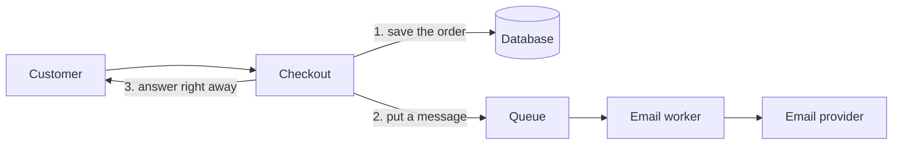

# Architecture: One App, Services or Functions

> **In this lesson:** the big shapes a system can take, and how to choose between them for a real team and a real budget. You'll learn what changes when a function call becomes a network call, and the three tools that show up in almost every design: queues, caches and a clear choice about consistency. No code to hand in. This is the thinking every design question after it builds on.

## Words you need first

- **Architecture.** How a system is split into parts, and how those parts talk to each other.
- **Monolith.** One app, deployed as one piece, usually with one database.
- **Service.** A part of a system that runs as its own app, with its own deploy, and talks to the others over the network.
- **Cache.** A fast copy of data kept closer to where it's needed, so you don't have to fetch or compute it again.
- **Consistency.** Whether everyone who reads a piece of data sees the latest version of it.

## Three shapes for the same product

Take the order system you built: orders, inventory, shipping and emails. There are three common ways to arrange it.

**One app, a monolith.** Orders, inventory, shipping and email are folders in one codebase. One deploy ships all of it. When checkout needs to reserve stock, it calls a function. One database holds everything.

**Services.** Orders, inventory and shipping are each their own app, with their own deploy and usually their own database. When checkout needs to reserve stock, the orders service sends an HTTP request to the inventory service. Work that can wait goes through a queue.

**Serverless functions.** `createOrder`, `reserveStock` and `sendEmail` are separate functions. The host starts each one when it's called. A managed database sits behind them all.

Try each shape against a bad day. Pick a shape, then a scenario, and read what happens:

```visual
architecture-three-ways | One product, three architectures, five bad days
```

Notice that no shape wins every row. Each one is a set of costs you choose to pay.

## What actually decides it

People argue about architecture as if it were a matter of taste. It mostly comes down to a few plain questions.

| Question | Points toward one app | Points toward services |
| --- | --- | --- |
| How many engineers? | A handful, who all know the codebase | Several teams who keep waiting for each other |
| Do the parts scale differently? | Roughly together | One part gets far more traffic than the rest |
| What happens when one part fails? | It's fine if the whole app is down briefly | One part must keep working while another is broken |
| How mature is the product? | Still changing shape every month | Stable boundaries that rarely move |
| Who runs it at 3am? | One person can understand all of it | Each team runs and is woken up for its own |

And serverless sits to the side of that table. It's a way of running code, and you can run one app or several services on it. It shines with spiky or low traffic and small teams who don't want to manage servers, and it's limited by time caps, cold starts and database connections.

**The usual advice is to start with one app**, kept tidy inside: clear folders for each part, each part reaching the others only through a few functions, no reaching into another part's tables. That's sometimes called a modular monolith. When a real reason from the table above shows up, a part with tidy edges can be split out. A part with no edges can't, and teams that split too early spend their time on the network between services instead of the product.

## A function call is not a network call

Inside one app, `reserveStock(order)` either returns or throws. It takes nanoseconds. It never half happens.

Turn it into a request to another service and all of that changes:

- **It's slow.** Even within one data center, a request costs a fraction of a millisecond to several milliseconds. A function call takes a few billionths of a second, so the network call is tens of thousands of times slower, or more. Ten of them in a row add up.
- **It can fail in new ways.** The other service is down, being deployed, or overloaded. The network drops the request.
- **It can fail halfway.** The request reached inventory and stock was reserved, but the reply was lost. Did it work? You don't know. If you try again, you might reserve twice.
- **It needs a timeout.** Without one, a service that hangs makes you hang, and then whoever called you hangs.

Every answer to these is more code and more thinking: timeouts, retries with waits between them, and making repeated requests safe. Making a request safe to repeat is called **idempotency**, and you'll build it in the webhooks project. That's the price of services. Sometimes it's worth paying.

## Queues: work that can wait

You built a queue as a data structure: first in, first out. A **message queue** is the same idea running as its own program between other programs. One part, the **producer**, puts a message in, such as "send the confirmation email for order 1042". Another part, a **worker**, takes messages out and does the work.



What it buys you:

- **Speed for the user.** Checkout answers as soon as the order is saved. The email goes out a moment later.
- **A shock absorber.** A sale brings ten times the orders. Messages pile up in the queue and workers get through them at their own pace, instead of the email provider being hit all at once.
- **Survival.** If the email provider is down, messages wait in the queue and are retried. The checkout never knew.

What it costs:

- **Later, not now.** The email might arrive a minute late. Anything the user needs in the response can't go through a queue.
- **Duplicates.** Most queues promise each message is delivered *at least* once. Sometimes it's twice. A worker that sends the email twice sends two emails, so workers must be safe to repeat.
- **One more thing to run and watch.** A queue that silently fills up is an outage nobody has noticed yet.

## Caching: remembering answers

A **cache** keeps a copy of something that's expensive to get, so the next request is cheap. You've met the idea already, when you kept a set of what you'd seen so you didn't have to search again. In a system, caches sit at several levels:

| Where | What it holds | Example |
| --- | --- | --- |
| The browser | Files and responses it was told it may keep | Your logo, a stylesheet |
| A CDN, a network of servers around the world | Copies of files and pages, near the user | Product images, a public product page |
| The app's own memory | Values in a variable | Settings, a list of countries |
| A shared cache server | Values any copy of the app can read | A product's details, a user's session |
| The database | Recently read data, automatically | Rows read a moment ago |

The most common pattern is **cache-aside**: look in the cache first. If it's there, called a hit, use it. If not, a miss, read the database and put a copy in the cache with an expiry time, called a **TTL**, time to live.

```js
async function getProduct(id) {
  const cached = await cache.get(`product:${id}`);
  if (cached) return cached;
  const product = await db.findProduct(id);
  await cache.set(`product:${id}`, product, { ttlSeconds: 60 });
  return product;
}
```

The arithmetic is why caches matter. If 90% of product reads are hits, the database sees one read in ten. That's ten times the traffic before the database becomes the problem.

The hard part is staleness. For up to 60 seconds after a price change, some customers see the old price. Is that acceptable? For a product description, yes. For the stock count at the moment of checkout, no: that has to come from the database, inside the transaction, every time. Deciding what may be stale, and for how long, is the actual design work. Choosing a cache library is the easy part.

## Consistency: who sees what, when

With one database, a write is visible to everyone straight away. That's **strong consistency**, and you've been relying on it.

Once there are copies, a cache, a second database that copies the first for reading, a service with its own data, a write takes time to reach every copy. Until it does, different people can see different answers. If every copy catches up eventually, that's called **eventual consistency**.

Neither is better. The question is what each piece of data can tolerate:

- A bank balance, the last item in stock, who owns a username: strong. Two people must never both win.
- A like count, a follower count, a "recently viewed" list: eventual is fine. Nobody is hurt by a number that's a few seconds behind.

One rule users notice: **read your own writes.** If I change my profile picture and the next page shows the old one, the system looks broken, even if it catches up in two seconds. A common fix is to read from the main database for a short while after a user writes, or to show the user their own change directly.

There's also a hard limit behind all this. When the network between two copies breaks, each copy has a choice: keep answering, possibly with stale data, or refuse until it can check with the other. It can't do both. Systems that keep answering choose availability. Systems that refuse choose consistency. Which one fits depends, again, on the data.

```match
{
  "title": "Pick the tool",
  "note": "Tap the situation, then what fits it best.",
  "pairs": [
    { "left": "Send a receipt email after checkout without making the customer wait", "right": "A queue and a worker" },
    { "left": "The product page is read 50,000 times for every change to it", "right": "A cache with a short expiry" },
    { "left": "Two customers try to buy the last ticket at the same moment", "right": "Strong consistency, in one database transaction" },
    { "left": "Search gets ten times the traffic of everything else, and needs different hardware", "right": "Split it into its own service" },
    { "left": "A team of three building a product that changes every month", "right": "One tidy app, deployed as one piece" }
  ]
}
```

```scenario
{
  "who": "A new technical cofounder",
  "setting": "Planning the first version of a marketplace. No users yet. Three engineers.",
  "ask": "Let's do microservices from the start. That's how the big companies scale, and we won't have to rewrite later.",
  "options": [
    { "text": "I'd start with one app, split into clear modules that only talk through a few functions. With three of us, services would mean we spend our time on deploys, network failures and keeping data in sync instead of the product. If one part later needs to scale or deploy on its own, a clean module can be pulled out then.", "verdict": "best", "feedback": "It takes the worry about rewriting seriously and answers it with a plan, and it names the real costs for a team this size." },
    { "text": "Microservices are overhyped. Monoliths are always better.", "verdict": "weak", "feedback": "'Always' doesn't survive the follow-up. Big companies do split for real reasons: many teams, parts that scale differently. The point is that those reasons don't apply yet." },
    { "text": "Sure, if that's what scales. Let's draw the services.", "verdict": "weak", "feedback": "Agreeing commits three people to running a distributed system before they know where the product's boundaries are. The boundaries drawn today will probably be wrong." },
    { "text": "Let's use serverless functions for everything instead. No servers to manage at all.", "verdict": "ok", "feedback": "It could be a sensible way to run the first version, and it doesn't answer the question. You can deploy one app or many services on serverless. The split is a separate decision." }
  ]
}
```

```quiz
[
  {
    "q": "The orders service calls the inventory service to reserve stock. The request times out. What do you actually know?",
    "options": ["Nothing for sure: the stock may or may not have been reserved", "The stock was not reserved", "The stock was reserved", "The inventory service is down"],
    "answer": 0,
    "explain": "A timeout means you didn't get an answer. The request may have done its work and the reply was lost. That's why retries need to be safe to repeat."
  },
  {
    "q": "A product page is cached for five minutes. A price drops and customers complain they still see the old price. What's the honest description of the problem?",
    "options": ["The cache allows data up to five minutes stale, and price was a field that couldn't tolerate that", "The cache is broken", "The database is slow", "Caches should never be used for products"],
    "answer": 0,
    "explain": "The cache did what it was told. The design decision was how stale each field may be. Price might need a shorter expiry, or the cache cleared when it changes."
  },
  {
    "q": "Which of these fits eventual consistency best?",
    "options": ["The number of likes on a post", "The last seat on a flight", "Whether a username is already taken", "A bank account balance"],
    "answer": 0,
    "explain": "Nobody is harmed if a like count is a few seconds behind. The others need one right answer at the moment of the write."
  }
]
```

## Key takeaways

- One app, services and serverless are each a set of costs. Choose by team size, how parts scale and fail, and who runs it.
- Start with one tidy app. Split a part out when a real reason appears, and keep the edges clean so you can.
- A network call is slow, can fail, and can fail halfway. Timeouts, retries and requests that are safe to repeat are the price.
- A queue makes work wait so users don't. It delivers at least once, so workers must handle duplicates.
- A cache trades freshness for speed. Decide how stale each piece of data may be.
- Strong consistency for things two people can't both win. Eventual for counts and feeds. Always let users read their own writes.

## Work with AI

```ai-prompt
title: Argue the other side
---
I'm learning software architecture: monoliths, services, serverless, queues, caches
and consistency. Give me a short description of a product, its team and its traffic.
Ask me which shape I'd choose and why. Whatever I choose, argue convincingly for a
different shape, using real costs: team size, failure, deploys, cost when idle,
debugging. Wait for my reply. Then add one change to the situation, such as a traffic
spike, a new team, or a part that must never be stale, and ask whether I'd change my
mind. Do this three times with different products. Don't tell me the right answer
until I've committed to mine.
```
