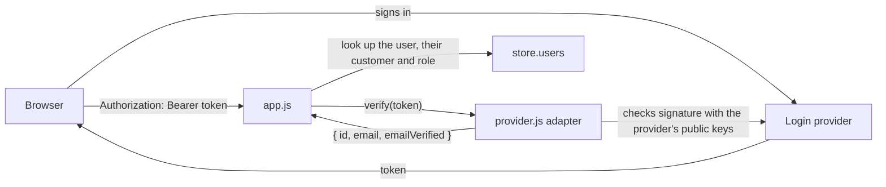

# Project: Auth Three Ways. A Login Provider

> **In this lesson:** you replace your own login with an off-the-shelf login provider, learned from its documentation and nothing else. You'll wrap it in a small adapter so your app can be tested without it, keep every customer and role check in your own code, and finish with the decision memo: build login yourself, or buy it. This is the last of three parts.

## Words you need first

- **Login provider.** A company whose product is signing people in, such as Clerk, Auth0, WorkOS, Supabase Auth or Firebase Authentication. Also called an identity provider.
- **Adapter.** A small piece of code that sits between your app and someone else's library, so the rest of your app only ever talks to the adapter.
- **Fake.** A stand-in your tests use in place of a real service. It behaves the same way from the outside and needs no network.
- **Lock-in.** How hard it would be to stop using a product once you depend on it.
- **Public key.** Half of a pair of keys. The provider signs tokens with its private half and publishes the public half, so anyone can check a signature but only the provider can make one.

## Why buy login at all

You've now built login twice. Here's what you didn't build, and what a real product needs:

- Password reset emails, with links that expire and can't be reused
- Checking that someone really owns their email address
- Two-factor login with an app or a text message
- "Log in with Google" and the other social logins
- Slowing down bots that try thousands of passwords
- Refusing passwords that already appeared in public leaks
- Seeing and ending your sessions on other devices

Each of those is a small project with its own attacks. A login provider does all of them, and its whole company depends on doing them well. The price is money every month, an outage you can't fix, and lock-in.

Notice what's missing from that list. The provider tells you who someone is. It can't know that Sam is staff at BrightGear and must never see Fernleaf's orders. **Your tenants and roles stay yours.** That's most of the code you wrote in the first milestone, and it all survives this one.

## Learning from the docs alone

On a job, you'll be handed tools you've never seen, and the documentation will be the only teacher in the room. This milestone practices that.

The rule: **set it up from the provider's own documentation.** No video tutorials, no blog walkthroughs, and no asking an agent how this provider works. Agents often describe an older version of a library with total confidence. You can use your agent to write code once you know what the code should do, and when you do, point it at the exact doc page.

Pick one provider. All of these have a free tier for a project this size, so check the pricing page yourself, because prices change.

| Provider | Worth knowing |
| --- | --- |
| Clerk | Strong ready-made sign-in pages. Popular with Next.js |
| Auth0 | Long-established, many options, a lot of settings |
| WorkOS | Aimed at selling to businesses, with company single sign-on |
| Supabase Auth | Part of Supabase, which also offers Postgres |
| Firebase Authentication | Part of Google's Firebase |

Then find these in the docs, and write each one in your plan with the link to the page you found it on:

1. How to create an application and get your keys.
2. How a user signs in and how your front end gets a token for them. Most providers have a ready-made sign-in page or component.
3. How a **back end** checks that token. Look for "verify a session token", "validate an access token" or "JWKS", which is the address where the provider publishes its public keys.
4. What the checked token tells you: the user's ID at the provider, their email, and whether that email is verified.
5. What happens to the token when the user signs out, and how long it lasts.

If you're stuck in the docs for more than 30 minutes on one of these, write down what you searched for and where you looked, and bring it to office hours. Getting unstuck in someone else's docs is the skill, so a clear question counts as progress.

## The shape of it



`provider.js` is the only file that knows which provider you chose. It gives back an object with one method, `verify(token)`, which resolves to `{ id, email, emailVerified }`, or `null` for a bad token, and throws when the provider can't be reached.

`app.js` never requires `provider.js`. Instead, `createApp` receives the adapter as `provider`, and `server.js` builds the real one. That one decision buys you three things:

- **Tests run with no network.** The tests hand `createApp` a fake that answers from a list.
- **Switching providers later** means rewriting one small file.
- **You decide what an outage means**, in one place.

## The rules your app follows

From the README's milestone 3 section, in plain words:

- **Who someone is** comes from the provider. **Their customer and role** come from `store.users`.
- **Invited users only.** An admin adds a user by email first. Someone the provider knows but you don't gets 403, and no account is created for them.
- **Link on first sign-in, by verified email only.** The first time an invited person signs in, find them by email and save the provider's `id` on their record. If the provider says the email isn't verified, refuse. Otherwise anyone could sign up at the provider with your admin's email address.
- **After that, find them by the provider's `id`.** Emails change. The ID doesn't.
- **Ignore anything else the provider sends.** If its token says `role: "admin"`, that's not your data.
- **If the provider is down, nobody gets in.** Answer 503. Letting people in because you couldn't check is how outages become breaches.
- **The old way is off.** With a provider configured, `/login` and `/token` answer 404, and your own tokens stop working.

```scenario
{
  "who": "A teammate",
  "setting": "You're planning the switch to the provider together.",
  "ask": "Why keep a users table at all? The provider has users. Let's put the role and customer in its metadata and read them from the token.",
  "note": "More than one answer is defensible. Pick the one you'd actually say.",
  "options": [
    { "text": "Roles and customers decide what data people can touch, so I want them in our database, next to the data, where our tests and our admins can see and change them. The provider tells us who someone is, and we decide what they may do.", "verdict": "best", "feedback": "That keeps the security-critical decision in code and data you control and can test. It also keeps a role change instant, rather than waiting for a new token." },
    { "text": "Good idea. Fewer tables.", "verdict": "weak", "feedback": "Fewer tables, but now a role change waits for the next token, your tests need the provider's format, and leaving the provider means migrating permissions as well as logins." },
    { "text": "Some teams do that, and it can work. I'd rather not tie our permissions to one vendor's format, since that makes switching providers much harder.", "verdict": "ok", "feedback": "True, and lock-in is a fair reason. The stronger reason is that permissions belong next to the data they protect." }
  ],
  "debrief": "Use the provider for identity. Keep permissions in your own data, where your code and tests can see them."
}
```

## Plan it

Add a "Provider" section to `PLAN.md`: the provider you chose, the five answers from the docs with their links, how `verify` turns the provider's token into `{ id, email, emailVerified }`, and your attack tests as names. Include at least: an uninvited person, an unverified email, a provider that sends a role, a provider that's down, and the old `/login`.

## Build it

1. Turn on the milestone 3 tests: in `test/provider.test.js`, change the `MILESTONE_3` line near the top to `const MILESTONE_3 = {};`. They fail.
2. In `app.js`, when `provider` is passed: read the bearer token, call `provider.verify`, and map the result to a user in `store.users` by the rules above. Switch off `/login` and `/token`. Every route's customer and role checks stay as they are.
3. Write at least six attack tests of your own using `fakeProvider` from `support/harness.js`, so you have 24 or more. A fake person whose value is `"down"` makes `verify` throw.
4. In `provider.js`, build the real adapter from your provider's docs. If you install its package, commit `package.json` and `package-lock.json`, and never `node_modules`. The grader installs from your lockfile.
5. In `server.js`, build the adapter from environment variables and pass it to `createApp`. Keys go in environment variables, never in a committed file.

Check every diff for a `require("./provider.js")` inside `app.js`. If one sneaks in, your tests start needing the network.

## Try it for real

The grader has no network, so it can't sign in to your provider. It checks everything behind the adapter with a fake. The live login is checked by your mentor, so get it working end to end:

1. Add yourself as an admin user in the seed data, with the email you'll sign in with.
2. Start the server with your provider's keys in environment variables.
3. Sign in through the provider's sign-in page and get a token, the way its docs describe for testing a back end.
4. Call your API with it:

```bash
curl -s localhost:3000/me -H "Authorization: Bearer $TOKEN"
curl -s localhost:3000/orders -H "Authorization: Bearer $TOKEN"
```

5. Sign in as a second account that isn't in the seed data, and check you get 403.

## Write the memo

Open `auth/MEMO.md` and answer its five questions in your own words: sessions or tokens, how logout works in each version, build or buy, what still belongs to you, and the attack you nearly missed.

The build-or-buy answer is the one interviewers love. Make it concrete: what the provider does that you'd otherwise build, what it costs per month at 1,000 users and at 100,000 according to its pricing page today, what your app does when the provider is down, and what leaving would involve. Say where you land, and what would change your mind.

Same rules as every memo: your own words, say what each choice costs, and keep it short.

## Hand it in

```submit
assignment: auth-3
```

We need `src/provider.js` and `MEMO.md` in `auth`, and at least 24 passing tests of yours. Then the attack suite runs against your app with a fake provider: signing in, uninvited people, unverified emails, a role or customer sent by the provider, a provider that can't be reached, the old password login, and customers and roles behind the provider. One stretch category checks that a second provider account using the same email can't take over a linked user.

Your mentor checks the rest:

- A live sign-in through your provider, loading your orders, and a second account being refused.
- Your memo, with follow-up questions.
- Your plan's doc links, and how you found your way around the docs.

## Tell the story

At your next mentor session, tell this project's story without notes: what you built in two sentences, the hardest part, and one decision with what it cost. You've got three versions of the same feature, so you have a better answer than most people to "how would you handle login?"

```quiz
[
  {
    "q": "The provider's token for a new person is valid, their email is verified, and nobody in your app has invited them. What should your app do?",
    "options": ["Refuse with 403 and create nothing", "Create them as a viewer in the first customer", "Create them as an admin of a new customer", "Let them in with no customer"],
    "answer": 0,
    "explain": "The provider proved who they are. Nobody decided what they may do, so they get nothing. Creating accounts automatically puts strangers inside someone's tenant."
  },
  {
    "q": "Why does the adapter live in its own file that app.js never requires?",
    "options": ["So tests can pass a fake, and switching providers only changes one file", "Because Node can't load two files that use crypto", "To make the app run faster", "Because providers forbid importing their library"],
    "answer": 0,
    "explain": "The app depends only on a small shape, verify(token). Tests use a fake with that shape and no network, and a new provider is one new adapter."
  },
  {
    "q": "During a provider outage, verify throws for every token. What should your API answer?",
    "options": ["503, and nobody gets in until the provider is back", "200, letting everyone with a token through", "500, and let the server crash", "401, and switch back to password login automatically"],
    "answer": 0,
    "explain": "If you can't check who someone is, you can't let them in. 503 tells clients it's temporary. Falling back to something weaker during an outage is exactly what an attacker would wait for."
  }
]
```

## Key takeaways

- A login provider handles the hard parts of identity: resets, verification, two-factor, social login and bots. It never decides what someone may do in your app.
- Keep the provider behind an adapter with one method. Tests use a fake, and switching providers is one file.
- Invited users only, linked on first sign-in by verified email, then found by the provider's ID.
- If the provider can't be reached, fail closed with 503.
- Learning a tool from its docs alone is a skill you'll use in every job. Write down where you found each answer.

## Work with AI

```ai-prompt
title: Cross-examine my build-or-buy memo
---
I finished a project where I built login three ways: my own sessions, my own signed
tokens, then a login provider. I'll paste my decision memo. Don't rewrite it and don't
add ideas of your own. Act as an engineering manager deciding whether to approve the
provider's cost. Ask me one hard question at a time about a claim in my memo, such as a
cost, an outage, lock-in or what we'd still have to build, and wait for my answer. After
five questions, tell me which claim in the memo is best supported and which needs
evidence I haven't given, quoting the sentence.
```
