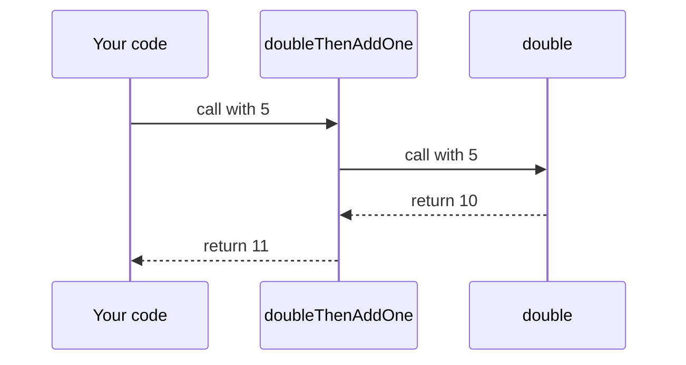

# Basics by Hand: Functions and Scope

> **In this lesson:** how functions take values in and hand values back, where a variable can be seen from, and how the computer keeps track of which function it's in. At the end you hand in your first set of exercises.

## Words you need first

- **Call.** To run a function. `greet("Ada")` calls `greet`.
- **Argument.** A value you pass in when you call a function.
- **Return.** To hand a value back to whoever called the function.
- **Scope.** The part of the code where a variable can be seen.

## In and out

A function is a small machine. Values go in, one value comes out.

```js
function area(width, height) {
  return width * height;
}

const room = area(3, 4);   // 12
```

`width` and `height` are the function's names for whatever gets passed in. `return` hands the answer back and ends the function right there.

Two mistakes every beginner makes:

**Forgetting `return`.** A function with no `return` gives back `undefined`.

```js
function area(width, height) {
  width * height;      // worked out, then thrown away
}
area(3, 4);            // undefined
```

**Printing when you meant to return.** `console.log` shows a value to a person. `return` gives a value to the code that called the function. A test can only check what a function returns.

## Scope: who can see what

A variable made inside a function only exists inside that function.

```js
function makeGreeting() {
  const message = "hello";
  return message;
}

makeGreeting();
console.log(message);   // error: message is not defined
```

This is a good thing. It means two functions can both have a variable called `total` and never get in each other's way.

Code inside a function can see variables outside it. Code outside can't see in. Think of one-way glass.

## The call stack

When one function calls another, the computer has to remember where to come back to. It keeps a pile of "I was in the middle of this" notes. That pile is the **call stack**.

```js
function double(n) {
  return n * 2;
}

function doubleThenAddOne(n) {
  const d = double(n);
  return d + 1;
}

doubleThenAddOne(5);   // 11
```



`doubleThenAddOne` pauses on its first line, waits for `double` to finish, then carries on. The newest call always finishes first.

You've already seen the stack without knowing it. When a program crashes, the error lists function names with line numbers. That list is the stack at the moment it broke, newest call on top. Read it from the top.

## Functions are values too

You can store a function in a variable and pass it to another function, the same as a number.

```js
function shout(text) {
  return text.toUpperCase() + "!";
}

function runIt(fn, value) {
  return fn(value);
}

runIt(shout, "hi");   // "HI!"
```

Notice `shout` has no brackets when it's passed in. `shout` is the function itself. `shout("hi")` runs it and gives you the result.

There's a shorter way to write a small function, called an arrow function. These two do the same thing:

```js
function double(n) { return n * 2; }
const double = (n) => n * 2;
```

You'll see both everywhere. Agents love the arrow form.

## A function that remembers

A function can return another function. The inner one keeps access to the variables around it, even after the outer one has finished.

```js
function makeGreeter(greeting) {
  return function (name) {
    return greeting + ", " + name;
  };
}

const hello = makeGreeter("Hello");
const howdy = makeGreeter("Howdy");
hello("Ada");    // "Hello, Ada"
howdy("Ada");    // "Howdy, Ada"
```

Each call to `makeGreeter` makes a fresh `greeting` that only its own inner function can reach. This has a name, **closure**, and it's how a lot of real code keeps private state.

```blanks
{
  "title": "What comes back?",
  "note": "Think about return, and about what each name refers to.",
  "code": "function add(a, b) {\n  a + b;\n}\nconst x = add(2, 3);        // x is ___1___\n\nconst twice = (n) => n * 2;\nconst y = twice;            // y is ___2___\nconst z = twice(4);         // z is ___3___",
  "blanks": [
    { "options": ["undefined", "5", "an error"], "answer": "undefined", "explain": "There's no return, so the sum is worked out and thrown away. A function with no return gives undefined." },
    { "options": ["the function itself", "8", "undefined"], "answer": "the function itself", "explain": "No brackets, so nothing ran. y is now another name for the same function." },
    { "options": ["8", "the function itself", "4"], "answer": "8", "explain": "The brackets call the function with 4, and it returns 8." }
  ]
}
```

## Your exercises

Open `basics-one/functions.js` in your labs repository and fill in:

- `clamp`: keep a number inside a range.
- `applyTwice`: take a function and run it two times.
- `makeCounter`: return a function that counts up, and remembers its count.

`makeCounter` is the hard one. Go back to `makeGreeter` above and ask: where does the variable have to live so that each counter gets its own?

```bash
node --test functions.test.js
```

## Hand it in

When all three files are done, run every test in the folder at once:

```bash
node --test
```

All 20 should pass. Commit, push, and paste the link to your `parsity-labs` repository here.

```submit
assignment: basics-one
```

We run the tests you can see, and more of our own. If one of ours fails, you'll get the kind of case it was, such as "ticket prices at the exact age limits". Work out what your code does in that case, fix it, push, and submit again.

One rule about our tests: don't delete or weaken the ones you were given. Adding your own is welcome.

```quiz
[
  {
    "q": "A function works out the right answer and prints it with console.log, but the test says it got undefined. Why?",
    "options": ["Printing shows a value to a person. The test checks what the function returns", "Tests can't read numbers", "console.log is broken in tests", "The function ran twice"],
    "answer": 0,
    "explain": "console.log and return are different things. With no return, the function gives back undefined, whatever it printed."
  },
  {
    "q": "A program crashes and the error lists five function names with line numbers. Where do you look first?",
    "options": ["The top one. It's the most recent call, where the error happened", "The bottom one", "The middle one", "None. Run it again"],
    "answer": 0,
    "explain": "That list is the call stack, newest on top. The top line is where it broke. The lines below show how the program got there."
  },
  {
    "q": "You write a counter with `let count = 0` at the top of the file, outside makeCounter. What goes wrong?",
    "options": ["Every counter shares the same count", "Nothing, it works", "count can't be changed", "The function can't see count"],
    "answer": 0,
    "explain": "A variable outside the function exists once, so all counters use it. Put it inside makeCounter and each call gets its own."
  }
]
```

## Key takeaways

- A function takes arguments in and returns one value. No `return` means `undefined`.
- `console.log` is for people. `return` is for code.
- A variable made inside a function can't be seen from outside it.
- The call stack is how the computer remembers where to go back to. A crash prints it.
- Functions are values. You can pass them around and return them.

## Work with AI

```ai-prompt
title: Make me explain scope
---
I'm a beginner who just learned functions, scope and the call stack in JavaScript.
Show me a short piece of code, twelve lines or fewer, with two or three functions and
variables at different levels. Ask me three questions about it, one at a time: what a
particular line can and can't see, what the call stack looks like at a given moment,
and what the whole thing returns. Correct me in plain words. Then do it again with a
function that returns a function.
```
