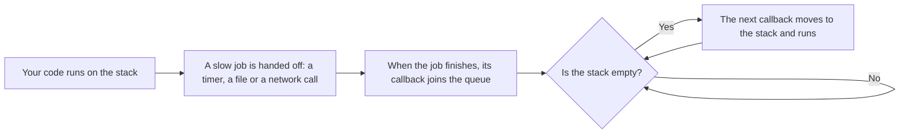

# Basics by Hand: Code That Waits

> **In this lesson:** what a program does while it waits for something slow, like a file, a timer or another computer. You'll learn callbacks, promises and `async`/`await`, and why the order your code runs in isn't always the order it's written in. Then you hand in the second set of exercises.

## Words you need first

- **Synchronous.** One thing at a time, each line waiting for the one before it.
- **Asynchronous.** Start something slow, carry on, and deal with the result when it arrives. Usually shortened to "async".
- **Callback.** A function you hand over to be called later.
- **Promise.** A value that stands in for a result that isn't ready yet.

## Why waiting is a problem

Everything you've written so far finishes in a blink. Real programs spend most of their time waiting: for a database, for another company's server, for a person to click.

Compared with the processor, those waits are enormous. If one instruction took one second, a reply from a server across the country would take years.

JavaScript runs your code on a single track. It does one thing at a time. If it stopped dead for every slow thing, a web server could help exactly one person at a time and everyone else would queue.

So it doesn't stop. It starts the slow thing, moves on, and comes back when the answer is ready.

## Callbacks: call me when it's done

`setTimeout` starts a timer and takes a function to run when the timer ends.

```js
console.log("one");
setTimeout(() => {
  console.log("two");
}, 1000);
console.log("three");
```

This prints `one`, `three`, and a second later, `two`.

The function you handed over is a **callback**. JavaScript didn't wait on line 2. It set the timer, kept going, and ran your callback later.

Here is the surprising part. This prints in the same order:

```js
console.log("one");
setTimeout(() => console.log("two"), 0);
console.log("three");
```

Zero milliseconds, and `two` still comes last. To see why, you need one picture.

## The event loop

JavaScript keeps two things:

- The **call stack**: what it's running right now. You met it already.
- A **queue**: callbacks that are ready and waiting their turn.

The rule is short. **A waiting callback only runs when the stack is empty.**



With a timer of 0, the callback joins the queue almost at once. But line 3 is still on the stack, so the callback waits. Your current code always finishes first.

The part that keeps checking "is the stack empty, and is anything waiting?" is called the **event loop**. That's all it is.

One consequence is worth remembering: if your code runs a long loop, nothing else can happen until it's done. No timers, no replies. A slow function on a server blocks every user, which is one more reason the previous lesson matters.

## Promises: an IOU for a value

Callbacks get messy when one slow thing depends on another. A **promise** is tidier. It's an object that stands for a result you don't have yet.

A promise is in one of three states:

| State | Meaning |
| --- | --- |
| Pending | Still waiting |
| Fulfilled | It worked, and here's the value |
| Rejected | It failed, and here's the error |

You make one by wrapping something slow:

```js
function wait(ms) {
  return new Promise((resolve) => {
    setTimeout(() => resolve("done"), ms);
  });
}
```

`resolve` is a function you call when the result is ready. Whatever you pass to it becomes the promise's value.

You use one with `.then`, which takes a callback for the value:

```js
wait(500).then((value) => {
  console.log(value);   // "done", after half a second
});
```

## async and await: the readable way

`await` pauses *your function* until a promise finishes, and gives you its value. It only works inside a function marked `async`.

```js
async function run() {
  console.log("starting");
  const value = await wait(500);
  console.log(value);     // "done"
}
```

This reads top to bottom like the code you already know. Under the surface it's the same promises and the same event loop. While `run` is paused, the stack is free and other work carries on.

Two things to know:

- An `async` function always returns a promise, so whoever calls it has to `await` it too.
- A rejected promise throws an error at the `await`. Catch it with `try` and `catch`:

```js
async function load() {
  try {
    const data = await fetchSomething();
    return data;
  } catch (err) {
    console.log("it failed:", err.message);
    return null;
  }
}
```

**The most common async bug is a missing `await`.** Without it you get the promise, not the value:

```js
const value = wait(500);
console.log(value);   // Promise { <pending> }
```

Agents make this mistake too, and it often passes a quick look.

## One at a time, or all at once

Awaiting inside a loop runs the jobs one after another. Each waits for the one before:

```js
for (const job of jobs) {
  await job();
}
```

`Promise.all` starts them all and waits for the lot:

```js
await Promise.all(jobs.map((job) => job()));
```

Neither is "right". All at once is faster. One at a time is what you need when order matters, or when the thing you're calling can't take everything at once. Knowing which you've written is the skill.

```order
title: What order do these print in?   console.log("A"); setTimeout(() => console.log("B"), 0); wait(10).then(() => console.log("C")); console.log("D");
---
A prints, because it's the first line and runs straight away
The timer for B is handed off, and its callback will wait in the queue
The 10 millisecond wait for C is handed off
D prints, because the current code always finishes first
The stack is empty, so B's callback runs and prints
About 10 milliseconds later, C's callback runs and prints
```

## Your exercises

Open `basics-two/waiting.js` in your labs repository and fill in:

- `after`: a promise that finishes with a value after a delay.
- `inOrder`: run a list of async jobs one at a time and collect the results.
- `retry`: run a job that might fail, and try again up to a limit.

```bash
node --test waiting.test.js
```

`retry` is the stretch here. It's also real: you'll write the same idea again when you build something that calls a server that's sometimes down.

If you're stuck for more than 20 minutes, write out in plain words what should happen on each try before you write code. Then ask an agent to explain the idea you're missing, not write it.

## Hand it in

Run every test in `basics-two`:

```bash
node --test
```

All 19 should pass. Commit, push, and paste the link to your `parsity-labs` repository.

```submit
assignment: basics-two
```

Ours check the same functions with harder cases: very large lists, empty input, and jobs that fail partway through. If a category fails, think about what your code does in that case, fix it, and submit again.

## Explain it out loud

This is your first explanation video. Record your screen and yourself talking through this, in your own words:

> What prints, and in what order, when you run the three-line `setTimeout` example with a delay of 0? Why?

Draw the stack and the queue as you go. Paper held up to the camera is fine. Keep it under five minutes. If you can't explain it without reading, that's useful news: go back to the event loop section and try again tomorrow.

Bring the recording to your next mentor session.

```quiz
[
  {
    "q": "A setTimeout callback has a delay of 0. When does it run?",
    "options": ["After the code that's currently running has finished and the stack is empty", "Immediately, before the next line", "Never", "At a random time"],
    "answer": 0,
    "explain": "A waiting callback only runs when the stack is empty. The current code always finishes first, whatever the delay."
  },
  {
    "q": "A function logs `Promise { <pending> }` where you expected a user's name. What's the most likely cause?",
    "options": ["A missing await, so you have the promise and not its value", "The database is empty", "console.log can't print names", "The function ran twice"],
    "answer": 0,
    "explain": "Calling an async function gives you a promise. You need await, or .then, to get the value out."
  },
  {
    "q": "You need to send 500 emails through a service that allows 5 requests per second. Which shape fits?",
    "options": ["One at a time, or in small groups, because the service can't take them all at once", "Promise.all on all 500, because it's fastest", "A loop with no await", "It makes no difference"],
    "answer": 0,
    "explain": "Promise.all starts everything at once and would break the limit. When the other side has a limit, you control the pace."
  }
]
```

## Key takeaways

- JavaScript does one thing at a time. It hands slow work off and keeps going.
- A callback waiting in the queue only runs when the stack is empty. That's the event loop.
- A promise stands for a value that isn't ready. `await` pauses your function until it is.
- A missing `await` gives you a promise where you wanted a value.
- Awaiting in a loop runs jobs one at a time. `Promise.all` runs them together. Know which you wrote.

## Work with AI

```ai-prompt
title: What prints, and in what order?
---
I'm a beginner who just learned the JavaScript event loop, callbacks, promises and
async/await. Show me a short snippet, twelve lines or fewer, that mixes console.log,
setTimeout and promises. Ask me to predict the exact order of the output and explain
why, using the words "stack" and "queue". Wait for my answer. If I'm wrong, show me
which line I misjudged and why. Do six of these, getting harder, and include at least
one with a missing await for me to spot.
```
