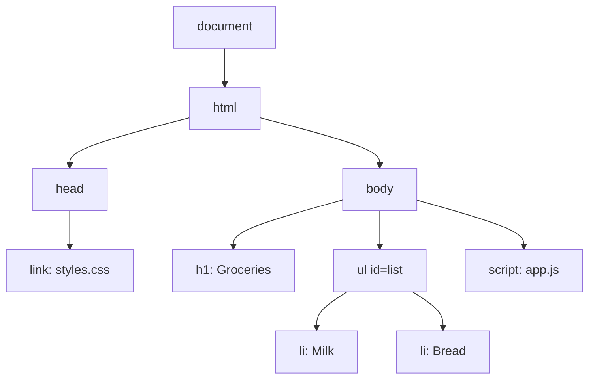

# The Browser: The DOM, Events and Storage

> **In this lesson:** what a browser does with the HTML it gets back, how JavaScript reads and changes the page, how a page reacts to clicks and typing, and where a page can keep data. You'll also learn the DevTools panels you'll use every day, and build a small page by hand to try it all.

## Words you need first

- **DOM.** Short for Document Object Model. The browser's live copy of the page, held as a tree of objects that JavaScript can read and change.
- **Element.** One thing on the page, such as a heading, a button or a list. Each one is an object in the DOM.
- **Event.** A signal that something happened, such as a click, a key press or a form being sent.
- **Render.** For a browser, to work out where everything goes and draw it on the screen.
- **DevTools.** The developer tools built into every browser. Open them with F12, or Cmd+Option+I on a Mac.

## From HTML to pixels

You already know what happens up to the moment a server answers: the request, the status code, the body. When the body is HTML, the browser's work is just starting.

```html
<!doctype html>
<html>
  <head>
    <link rel="stylesheet" href="styles.css" />
  </head>
  <body>
    <h1>Groceries</h1>
    <ul id="list">
      <li>Milk</li>
      <li>Bread</li>
    </ul>
    <script type="module" src="app.js"></script>
  </body>
</html>
```

The browser reads that text top to bottom and turns it into a tree:



That tree is the DOM. The HTML file was only the starting point. From now on the page on screen is drawn from the tree, and if JavaScript changes the tree, the page changes.

Along the way the browser also fetches the other files the HTML names. Each `<link>` and `<script>` is one more request, and you can watch them all in the Network panel.

```order
title: What the browser does with an HTML page
---
Read the HTML and build the DOM tree
Fetch the CSS and work out each element's styles
Work out the size and position of every element, called layout
Paint the pixels on the screen
Run the JavaScript, which may change the DOM
Change only what moved, then lay out and paint again
```

That last step matters. Every time your code changes the page, the browser may have to lay out and paint again. A few changes are nothing. Thousands in a loop can make a page stutter.

## Reading and changing the page

JavaScript in a page gets a global object called `document`. It's the root of the tree.

Find elements with a CSS selector, the same patterns stylesheets use:

```js
const list = document.querySelector("#list");          // the first match, or null
const items = document.querySelectorAll("#list li");   // every match
```

Read and change what's in them:

```js
items[0].textContent;                 // "Milk"
items[0].textContent = "Oat milk";    // the page updates
list.classList.add("done");           // add a CSS class
```

Make new elements and put them in the tree:

```js
const li = document.createElement("li");
li.textContent = "Eggs";
list.append(li);                      // now it's on the page
```

`replaceChildren()` empties an element, and `remove()` takes one out.

### Your own attributes: data-

You can add any attribute that starts with `data-` to an element. Browsers ignore them, which makes them a safe place for your own information, such as an id.

```html
<li data-item-id="42">Eggs</li>
```

```js
li.dataset.itemId;        // "42"  (data-item-id becomes itemId)
document.querySelector('[data-item-id="42"]');
```

Tests use them too. A test can't see the page the way you do, so it finds things by attributes that don't change when someone restyles the page.

### textContent, and why not innerHTML

There's a second way to fill an element. `innerHTML` takes a string of HTML and builds elements from it:

```js
list.innerHTML = `<li>${name}</li>`;
```

It's quick to write, and it's the most common security hole in front-end code. Say `name` came from a user, and they typed this:

```

```

The browser builds a real image, the image fails to load, and the `onerror` code runs on every visitor's machine. That's called **cross-site scripting**, or XSS.

`textContent` never builds elements. It shows the text exactly as typed, angle brackets and all. The rule:

- Anything that came from a person or a server goes in with `textContent`, or with `createElement` and `textContent`.
- `innerHTML` only ever gets strings you wrote yourself.

Agents reach for template strings and `innerHTML` all the time, because it's shorter. When you review their code, look for it.

## Events: reacting to people

A page waits for things to happen. You tell it what to do with `addEventListener`:

```js
const button = document.querySelector("#add");
button.addEventListener("click", (event) => {
  console.log("clicked", event.target);
});
```

The function is a callback, the same idea as in the lesson on code that waits. The browser calls it later, once per click, with an **event object** that describes what happened. `event.target` is the element that was clicked.

### Forms

A form sends itself when someone presses Enter or clicks its button. Left alone, the browser then loads a new page. You almost always want to stop that and handle it yourself:

```js
form.addEventListener("submit", (event) => {
  event.preventDefault();               // don't load a new page
  const title = form.elements.title.value.trim();
  if (!title) return;                    // ignore blank input
  // ...use title
});
```

Listen for `submit` on the form, not `click` on the button. Then Enter works too.

### Bubbling, and one listener for many buttons

When you click a button inside a list inside a section, the click event happens on the button, then on the list, then on the section, all the way up to `document`. That's called **bubbling**.

So you don't need a listener on every button. Put one on a parent and ask what was clicked:

```js
list.addEventListener("click", (event) => {
  const button = event.target.closest("button[data-action]");
  if (!button) return;
  const item = button.closest("[data-item-id]");
  console.log(button.dataset.action, item.dataset.itemId);
});
```

`closest` walks up from an element and gives back the first one that matches, including itself. This pattern is called **event delegation**. It has two big advantages:

- One listener, however many buttons there are.
- Buttons added later work straight away. You never have to attach anything to them.

```blanks
{
  "title": "Finish the delegated click handler",
  "note": "One listener on the board handles every delete button, including ones added later.",
  "code": "board.___1___(\"click\", (event) => {\n  const button = event.target.___2___(\"button[data-action='delete']\");\n  if (!button) return;\n  const card = button.closest(\"[data-task-id]\");\n  deleteTask(card.___3___.taskId);\n});",
  "blanks": [
    { "options": ["onClick", "listen", "addEventListener"], "answer": "addEventListener", "explain": "addEventListener is how plain DOM code attaches a listener. onClick is how React spells it." },
    { "options": ["querySelector", "closest", "parentNode"], "answer": "closest", "explain": "The click might land on an icon inside the button. closest walks up until it finds the button. querySelector looks down, not up." },
    { "options": ["dataset", "attributes", "value"], "answer": "dataset", "explain": "data-task-id is read through dataset, with the name turned into taskId." }
  ]
}
```

### The listener that multiplies

Here's a bug you'll meet, probably in code an agent wrote. A page has a `render` function that redraws the list, and the listener is attached inside it:

```js
function render() {
  list.replaceChildren(...items.map(makeItem));
  list.addEventListener("click", onClick);   // added again on every render
}
```

`list` itself is never replaced, so each render adds one more listener to it. After five renders, one click runs `onClick` five times, and five delete requests go to the server. In a quick test it looks fine. After some use it falls apart.

Attach listeners once, when the page starts, to elements that stay. Redraw the contents as often as you like.

## Rendering, and keeping the page fast

JavaScript in the page runs on the same single track as everything else in the tab: your code, handling clicks, and drawing. While your code runs, nothing else happens. A loop that takes two seconds freezes the page for two seconds. Clicks wait in the queue, exactly like the callbacks in the event loop.

Two habits keep a page smooth:

- **Build first, then insert.** Make all your new elements, then put them in the page with one `append` or `replaceChildren`. The browser lays out once.
- **Redrawing everything is fine when there's not much.** Throwing away a list of fifty items and building it again is fast. With fifty thousand, you'd change only what changed.

The second habit is the whole reason front-end frameworks exist. You'll meet them in the lesson on front-end frameworks.

## Modules in the browser

So far your files used `require` and `module.exports`. Browsers use a different system, called **ES modules**:

```js
// api.js
export function createApi(baseUrl) { /* ... */ }

// main.js
import { createApi } from "./api.js";
```

A page loads them with `<script type="module" src="main.js">`. A module script waits until the HTML has been read, so `document.querySelector` finds your elements. Two things to know:

- The `.js` on the end of the path is required in the browser.
- Modules only load over `http://`. Opening the file by double-clicking it, which gives a `file://` address, fails. You need a server, even a tiny one.

Node understands ES modules too. A `package.json` with `"type": "module"` tells Node to treat `.js` files that way.

## Where a page can keep data

Everything in a page's variables is gone when it reloads. To keep something, the browser offers a few places:

| Where | Holds | Lasts | Sent to the server? |
| --- | --- | --- | --- |
| `localStorage` | Strings, a few megabytes | Until the user or your code clears it | No |
| `sessionStorage` | Strings | Until the tab closes | No |
| Cookies | Small strings | Until they expire | Yes, with every request to that site |
| A server | Anything | As long as you keep it | It lives there |

`localStorage` only holds strings, so objects go through JSON:

```js
localStorage.setItem("settings", JSON.stringify({ theme: "dark" }));
const settings = JSON.parse(localStorage.getItem("settings") || "{}");
```

Three rules:

- **Anything in `localStorage` can be read by any script on the page.** That includes a script injected through XSS. Never keep passwords or login tokens there. You'll see where they go in the auth lessons.
- **It's per browser.** Your laptop and your phone each have their own. Data people expect to see everywhere belongs on a server.
- **It's for small conveniences.** A collapsed column, a theme, a half-typed draft.

```match
{
  "title": "Where should this live?",
  "note": "Tap the data, then where it belongs.",
  "pairs": [
    { "left": "The tasks on a team's shared board", "right": "On a server, in a database" },
    { "left": "Whether this person likes the dark theme on this laptop", "right": "localStorage" },
    { "left": "The proof that this person is logged in, sent with every request", "right": "A cookie" },
    { "left": "Which step of a form this tab is on, gone when the tab closes", "right": "sessionStorage" }
  ]
}
```

## DevTools

You used the Network panel in the HTTP lessons. Four more panels do most of the rest of your work:

| Panel | What you use it for |
| --- | --- |
| **Elements** | The live DOM. See what your code really built, check its `data-` attributes, change styles and see the result at once. Right-click anything on a page and choose Inspect to jump to it. |
| **Console** | Errors from your code, your `console.log` output, and a prompt where you can run JavaScript against the page. `$0` is whatever you last selected in Elements. |
| **Sources** | Your code, with breakpoints. Click a line number and the page pauses there, so you can look at every variable. Writing `debugger;` in your code does the same. |
| **Application** | `localStorage`, `sessionStorage` and cookies. View, edit and clear them. |

Two settings in the Network panel are worth knowing now. **Disable cache** makes sure you see your latest files. **Throttling** pretends to be a slow phone connection, so you can see what your page looks like while it waits.

When something on a page is wrong, the order that finds it fastest:

1. Console: is there a red error?
2. Network: did the request go out, and what came back?
3. Elements: is the DOM what you expected?
4. Sources: pause and look.

```match
{
  "title": "Which panel answers it?",
  "note": "Tap the question, then the panel.",
  "pairs": [
    { "left": "Did clicking Save send a request, and what status came back?", "right": "Network" },
    { "left": "Did my code put the data-task-id attribute on each card?", "right": "Elements" },
    { "left": "What's in the saved settings for this site?", "right": "Application" },
    { "left": "What is the value of this variable halfway through my function?", "right": "Sources" },
    { "left": "Why did my click do nothing? Is there an error?", "right": "Console" }
  ]
}
```

## Practice: a counter that remembers

Write this one yourself, with no agent. It's small, and every line uses something from this lesson.

In your `parsity-labs` repository, make a folder called `browser-practice` with one file, `index.html`:

```html
<!doctype html>
<html>
  <body>
    <h1>Clicks: <span id="count">0</span></h1>
    <button id="more">Click me</button>
    <button id="reset">Reset</button>
    <ul id="log"></ul>
    <script type="module" src="counter.js"></script>
  </body>
</html>
```

Then write `counter.js` so that:

1. Clicking "Click me" adds one to the count on the page.
2. The count survives a reload, using `localStorage`.
3. Each click adds a line to the list saying what time it happened. `new Date().toLocaleTimeString()` gives you the time as text.
4. "Reset" sets the count to 0, empties the list, and clears what you saved.

Serve the folder and open it:

```bash
cd browser-practice
npx http-server -p 8080 -c-1
```

`npx` downloads a small package and runs it once. The first time, it asks whether to install `http-server`: answer yes. `-c-1` turns off caching, so a reload always gets your latest file. The static file server you built in the web server project works too. Open http://localhost:8080/ and try it.

Then use DevTools on your own page:

- In Elements, find the `<span>` and watch its text change as you click.
- In Application, find your saved count and change it by hand. Reload. Does your page show the new number?
- In Console, type `localStorage.clear()` and reload.
- In Sources, put a breakpoint inside your click handler and click. Look at the event object.

Last, try the attack. Change the line you add to the list to use `innerHTML`, and make the text include ``. Watch it run. Then put `textContent` back.

If you're stuck for more than 20 minutes, write in plain words what should happen on each click, then compare it line by line with your code.

```quiz
[
  {
    "q": "A card's title comes from the server and you show it with innerHTML. Someone saves the title . What happens?",
    "options": ["The browser builds an image, it fails to load, and the onerror code runs for everyone who views the board", "The title shows exactly as typed", "The server rejects it because it contains HTML", "The browser refuses to show the page"],
    "answer": 0,
    "explain": "innerHTML turns the string into real elements, including the event handler. textContent would show it as plain text."
  },
  {
    "q": "After using the page for a while, one click on Delete sends four delete requests. What's the most likely cause?",
    "options": ["The click listener is attached inside the render function, so every redraw added another one", "The server is retrying the request", "The button was clicked four times by the test", "Bubbling sends each click four times"],
    "answer": 0,
    "explain": "Each render added one more listener to an element that stays on the page. Attach listeners once, at start-up."
  },
  {
    "q": "Where should a team's shared tasks be kept?",
    "options": ["On a server, so everyone sees the same tasks on every device", "In localStorage, so the page loads them instantly", "In sessionStorage, so they're private to each tab", "In a cookie, so they go with every request"],
    "answer": 0,
    "explain": "Browser storage belongs to one browser on one device. Shared data lives on a server."
  }
]
```

## Key takeaways

- The DOM is the browser's live tree of the page. Change the tree and the page changes.
- Put text from people and servers in with `textContent`. `innerHTML` with their data is how XSS happens.
- Events bubble up, so one listener on a parent can handle every button inside it, even ones added later.
- Attach listeners once, to elements that stay. A listener added on every redraw multiplies.
- `localStorage` holds strings for one browser. It's for small conveniences, never secrets or shared data.
- When a page misbehaves: Console, then Network, then Elements, then Sources.

## Work with AI

```ai-prompt
title: Predict what the page does
---
I'm a beginner learning the DOM and events in plain JavaScript. Show me short snippets,
fifteen lines or fewer, that build or change part of a page and attach event listeners.
For each one, ask me to predict exactly what the page shows and what happens after a
few clicks, and wait for my answer. Include at least one snippet where a listener is
added on every redraw, one that uses innerHTML with text a user typed, and one where
event delegation with closest is used. If I'm wrong, tell me which line I misread and
why, without rewriting the code for me. Do five, getting harder.
```
