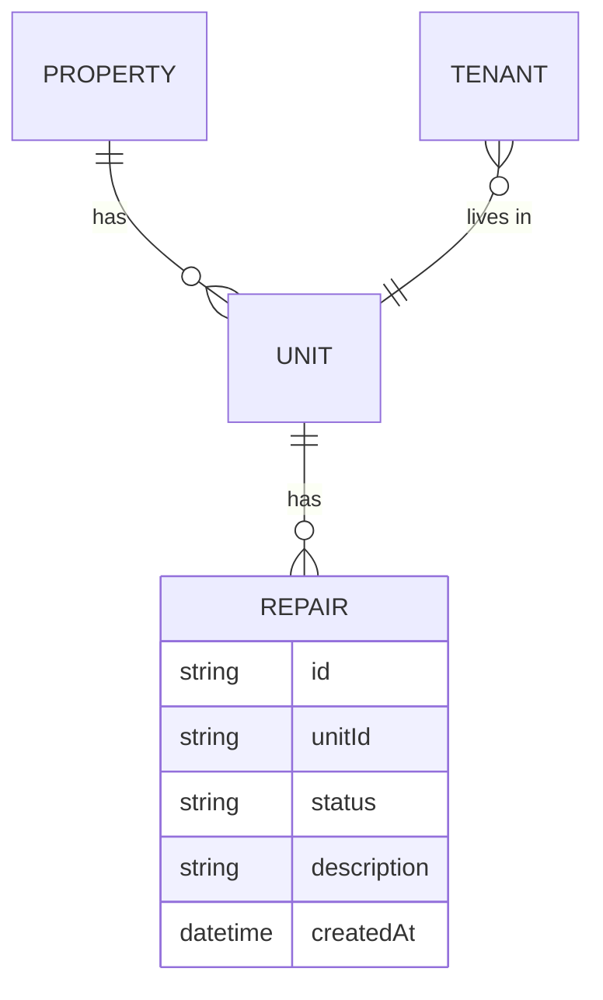

# Capstone: The Design Doc

> **In this lesson:** you turn your approved proposal into a design doc, using the same design method you've used on URL shorteners and news feeds, only this time for a system you're about to build yourself. Your mentor reads it and pushes on it before you write any code.

## Words you need first

- **Design doc.** A short written plan for a piece of software: what it does, how it's put together, and why. Written before the code, and changed when the plan changes.
- **Scope.** What the project will do, and just as important, what it won't.
- **Milestone.** A point where a slice of the project works from end to end and can be shown to someone.
- **Risk.** Something that might not work, or might take far longer than you think. The doc names risks so you can test them first.

## Why write it down first

You've designed systems out loud and on paper in the design lessons. Those were practice. This one you'll live in for weeks.

A design doc saves you from three expensive mistakes:

- **Building the wrong thing.** Writing "who is this for and what do they do with it" in plain words often shows the idea is fuzzy. Better to find out now.
- **Building in the wrong order.** If the part you've never done before turns out to be impossible, you want to know in the first week, not the last.
- **Not being able to explain it.** Every interviewer who looks at your capstone will ask why you built it this way. The doc is where you work that out.

It also does something specific when you work with a coding agent. The agent is fast and has no idea what you're trying to build. Your design doc is the context you give it, milestone by milestone. A clear doc gets clear code. A vague one gets plausible code that solves a slightly different problem.

## Start from your proposal

Your mentor approved your proposal. It already names what you're building and who it's for, and the requirements every capstone meets: data from a real source or one you scraped, an agent inside the product that calls a model and uses tools, and one technology this program never taught you.

The design doc takes that and answers "how, exactly?" Put it in your capstone repository as `DESIGN.md`, at the top level.

## The doc, section by section

Use the design method from the system design lessons. The sections below follow it. Keep the whole thing short enough to read in one sitting. A doc nobody reads helps nobody, including you in three weeks.

### 1. The problem and the person

Two or three sentences. Who has the problem, what they do today, and what your project lets them do instead. Use a real kind of person: "a landlord with six units who tracks repairs in a group chat" is something you can build for. "Users" isn't.

### 2. Requirements and scope

Split it into three lists:

- **Must do.** The few things without which there's no project. Each one written as something a person can do: "A tenant can report a repair from their phone, with a photo."
- **Won't do.** Things a reasonable person might expect that you're leaving out on purpose. "No payments. No mobile app, the site works on a phone browser." This list is what keeps you shipping.
- **Quality bars.** How fast, how reliable, how secure, in numbers where you can. "The agent answers in under 10 seconds. One tenant can never see another tenant's repairs."

### 3. Rough numbers

How many people, how much data, how many requests, how many model calls. Then the one number that matters most for a project with a model in it: **what one typical request costs**, in tokens and dollars, using the math from the model basics lesson.

You don't need to be precise. You need to know whether you're building for ten users or ten thousand, and whether the model bill is pennies or a problem.

### 4. Data model

Your tables or documents, with their fields and how they connect. A small diagram is better than paragraphs:



Say where the data comes from. If it's scraped or pulled from someone else's API, say how often, what happens when the source is down, and whether you're allowed to use it.

### 5. API

The routes your front end or other clients will call: method, path, what goes in, what comes out, and who's allowed. Use what you learned in the API design lessons: real status codes, validation, and what happens on a repeat request.

### 6. The agent

This is the part most capstones get vague about. Be specific:

- **What job does the agent do** that plain code couldn't? If an `if` statement would do it, use an `if` statement.
- **Its tools.** Name each one, what it does, and what it's allowed to change. A tool that reads is low risk. A tool that sends an email, charges a card or deletes something needs a person to confirm first.
- **Its limits.** The most calls per question, and what the person sees when it runs out.
- **Structured output.** Where does your code need a shape it can trust?
- **Evals.** Five to ten cases you'll run against the real model, including at least two where the right answer is "I can't do that" or "that doesn't exist".

### 7. Components

One diagram of the pieces and how a request moves between them: front end, server, database, model, anything else. Then one line for each saying where it runs.

### 8. The new technology

Name it, say why it fits this problem better than what you already know, and say how you'll learn it. Then say what you'll do if it doesn't work out. "If I can't get the vector search running in the first milestone, I'll fall back to Postgres full-text search" is a plan. Having no fallback is a risk.

### 9. The bottleneck, and 10x and 100x

Pick the part that breaks first as use grows. Say what breaks at 10 times your rough numbers, and at 100 times, and what you'd change. You won't build that. You'll be asked about it.

### 10. Tradeoffs

Three to five choices you made, each with what it costs. The same rule as your decision memos: "I chose X, which gets me Y and costs me Z."

### 11. Milestones and risks

Three to five milestones. Each one works end to end and can be demonstrated. The first one goes straight at your biggest risk, usually the new technology or the data source.

For each risk, say how you'll find out early whether it's real.

```order
title: A good first milestone for a repair-tracking app with a vector search engine you've never used
---
Load twenty real repair notes into the new vector search engine
Search them from a script and check the results make sense
Wrap the search in one tool the agent can call
Ask the agent one real question from the terminal and get an answer that uses the tool
Write down what was harder than you expected, and update the design
```

## Common ways design docs go wrong

```match
{
  "title": "What's wrong with this line from a design doc?",
  "note": "Tap the line, then the problem.",
  "pairs": [
    { "left": "The app will use AI to help users manage their tasks.", "right": "Too vague to build or test. Which job, which person, which tools?" },
    { "left": "Must do: login, payments, chat, notifications, an admin panel, a mobile app.", "right": "Scope with no won't-do list. This won't ship." },
    { "left": "Milestone 1: build the whole front end.", "right": "Not end to end, and it avoids the riskiest part." },
    { "left": "I'll use a graph database because it's the best choice.", "right": "A claim with no cost. Best for what, and what does it give up?" },
    { "left": "The agent can delete repairs when a tenant asks.", "right": "A tool that does something irreversible with no person confirming." }
  ]
}
```

## How your mentor checks it

Send your mentor the link to `DESIGN.md` before your next session. They'll read it and then ask you about it, out loud. They're looking for:

- A problem and a person specific enough to build for.
- A won't-do list that shows you made real cuts.
- A cost per request with the arithmetic shown.
- An agent with named tools, a limit, and evals that include failure cases.
- A first milestone that tackles the biggest risk.
- Tradeoffs that each say what they cost.
- That you can explain every section without reading it.

They will find holes. That's the point. Change the doc, commit it, and note what changed and why at the bottom under a heading called `Changes`. Your design will keep changing as you build. A doc with a few honest changes in it shows an engineer at work.

If you can't get one section written after 30 minutes of trying, write down the question that's blocking you and bring it to the session. That's a good use of your mentor's time.

```scenario
{
  "who": "Your mentor",
  "setting": "Reviewing your design doc. They've stopped at the section on the new technology.",
  "ask": "You've picked a vector database you've never used, a scraper for a site you haven't looked at closely, and a front-end library that's new to you. Which of these is your one new technology?",
  "note": "This one comes up a lot. Pick the answer you'd give.",
  "options": [
    { "text": "Fair point. The vector database is the one that matters for the product. I'll do the front end with React, which I know, and I'll look at the site this week to see if scraping it is realistic before I commit.", "verdict": "best", "feedback": "You took the hint: three unknowns at once is how capstones stall. You kept the one that earns its place and turned the scraper into a risk you'll test early." },
    { "text": "All three. I want to learn as much as possible.", "verdict": "weak", "feedback": "Ambition is good. Three unknowns stacked on each other means when something breaks, you won't know which one did it. A finished project teaches you more than three half-finished ones." },
    { "text": "The vector database. The others are small.", "verdict": "ok", "feedback": "Right instinct, but an unfamiliar front-end library and an untested scraper aren't small. Say how you'll check them early, or swap them for things you know." }
  ],
  "debrief": "One new thing, chosen because the problem needs it, tested in the first milestone. Everything else should be boring on purpose."
}
```

```quiz
[
  {
    "q": "Why should the first milestone go straight at the riskiest part of the project?",
    "options": ["So that if it doesn't work, you find out while there's still time to change the plan", "Because the risky part is the most fun", "Because the mentor checks it first", "So the front end has something to show"],
    "answer": 0,
    "explain": "A risk that turns out to be real in the last week sinks the project. In the first week, it's a change to the design doc."
  },
  {
    "q": "Which line belongs in the won't-do list?",
    "options": ["No payments. Landlords settle up outside the app.", "The app must be fast", "Tenants can report repairs", "Use Postgres for the data"],
    "answer": 0,
    "explain": "A won't-do line names something a reasonable person might expect and says you're leaving it out on purpose. The others are a vague quality bar, a must-do, and a design choice."
  },
  {
    "q": "Your agent has a tool that marks a repair as finished and texts the tenant. What does the design doc need to say about it?",
    "options": ["That a person confirms before it runs, because the text can't be unsent", "Nothing, tools are an implementation detail", "Which model will call it", "That it's tested by the evals"],
    "answer": 0,
    "explain": "Tools that change things in the world, especially ones that can't be undone, need a person in the loop. That's a design decision, so it goes in the design doc."
  }
]
```

## Key takeaways

- A design doc is a short plan you write before the code, and change as you learn.
- Follow the design method: requirements and scope, rough numbers, data model, API, components, the bottleneck, tradeoffs, and what changes at 10x and 100x.
- Be specific about the agent: its job, its tools, its limit, and evals that include failures.
- A won't-do list is what makes a project shippable.
- The first milestone works end to end and goes straight at the biggest risk.

## Work with AI

```ai-prompt
title: Interrogate my design doc
---
I'm a career changer about to build my capstone project, and I've written a design doc.
I'll paste it below. Don't rewrite it and don't add features. Act as a skeptical senior
engineer reviewing it. Ask me one question at a time, starting with whatever you think
is weakest: vague requirements, a missing won't-do list, a cost per request I can't
back up, an agent tool that's too powerful, a first milestone that avoids the real
risk, or a tradeoff that doesn't say what it costs. Wait for my answer each time. After
six questions, list the three changes you think would make the doc stronger, and quote
the line each one is about.
```
