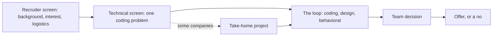

# Career: Every Kind of Interview Round

> **In this lesson:** the five kinds of round you'll meet in software engineering interviews, what each one is really testing, and how to practice each. By-hand coding with no AI. Coding with an AI assistant, where you have to defend code you didn't type. System design. Behavioral. And the take-home project. Most companies use three or four of these, in some order.

## Words you need first

- **Screen.** An early, shorter round, often with a recruiter or one engineer, that decides who gets the full set of interviews.
- **Loop.** The full set of interviews after the screen, often on one day or spread over a week.
- **Rubric.** The list of things interviewers score you on. Most companies have one, even when it's not shared.
- **Signal.** What an interviewer learns about you from something you say or do. Every round is designed to get signal on a few specific things.

## How a hiring process usually runs

The details vary a lot between companies. A common shape:



Ask the recruiter early what the process looks like, what each round covers, and whether AI tools are allowed in the coding rounds. They'll tell you. It's a normal question, and the answer tells you what to practice.

## Round 1: coding by hand, no AI

**What it looks like.** An interviewer gives you a problem, like the interview problems you've done all through the program. You solve it in a shared editor or on a whiteboard, talking as you go. No agent, no autocomplete, often no running the code.

**What it's really testing.** Whether you can take an unclear problem, ask good questions, find an approach, write working code, and check it. And whether you can talk while you do it.

**How to run it.** Use the same steps every time, out loud:

```order
title: Working a by-hand coding problem out loud
---
Repeat the problem in your own words, and ask about anything unclear
Work through one small example by hand, including an edge case
Say an approach and its Big O before writing any code
Write the code, saying what each part does as you go
Trace your example through the code line by line
Name the edge cases and how your code handles each one
```

Some habits that change how you come across:

- **Ask before you code.** Can the input be empty? Are there duplicates? How big can it get? Interviewers count good questions in your favor.
- **Say the simple solution first,** even if it's slow. "The obvious way is a loop inside a loop, which is O(n²). I think a hash map gets it to O(n)." Then write the better one. If you get stuck, you've still shown you can solve it.
- **Think out loud,** including when you're stuck. "I'm not sure how to handle duplicates yet. Let me try an example." An interviewer can help someone they can follow. Silence gives them nothing.
- **Test your own code** before you say you're done. Trace an example. Interviewers notice who checks and who declares victory.

**How to practice.** Keep doing problems by hand from the patterns you learned: frequency counters, two pointers, sliding window, stacks, recursion, binary search, trees, graphs and the rest. Talk out loud, alone, even if it feels silly. Set a timer: give yourself a fixed block, and when it runs out, stop and read a solution, then come back to the same problem a few days later and do it cold. Mock interviews with a classmate or your mentor are worth more than any number of silent problems.

## Round 2: coding with an AI assistant

**What it looks like.** More companies now let you, or ask you to, use an AI assistant in a coding round. Usually it's a slightly bigger task than a by-hand problem: add a feature to a small codebase, fix a bug, build a small API. You can prompt the assistant, accept its code, and run things.

**What it's really testing.** Whether you can direct an agent and judge its work, which is exactly what you've practiced on every project since the web server. The interviewer watches what you ask for, what you accept, what you push back on, and whether you can explain the result.

The trap is obvious: the code appears fast, it looks right, and you accept it. Then the interviewer points at a line and asks why it's there.

**How to run it.**

- **Plan first, out loud.** Read the task and the code before you prompt anything. Say what you think needs to change and how you'll know it works. That's the strongest signal you can give in this round.
- **Small steps.** Ask for one change at a time, so you can read each diff.
- **Read every line before you accept it.** Say what it does. If you don't understand a line, ask the assistant to explain it, then check the explanation makes sense.
- **Run it and test it.** Write or ask for a test, run it, and look at the result yourself.
- **Catch the assistant's mistakes on purpose.** When it does something wrong, say so and say why. "It's using `includes` inside a loop, so that's O(n²). Let me ask for a Set." That moment is often the best signal in the whole round.
- **Own the result.** At the end, walk through the change as if you'd typed it, because now it's yours.

```scenario
{
  "who": "The interviewer",
  "setting": "An AI-assisted coding round. The assistant just wrote a function that removes duplicate orders, and the tests you asked for pass. The interviewer points at one line.",
  "ask": "Why does it sort the orders before removing duplicates?",
  "note": "You accepted the code a minute ago. Pick what you'd say.",
  "options": [
    { "text": "Let me read it again. It sorts by id so duplicates end up next to each other, then keeps each one that differs from the one before. That works, but sorting costs O(n log n) and changes the order. A Set of ids we've seen would do it in one pass and keep the original order. I'd change it.", "verdict": "best", "feedback": "You took a moment, read the code properly, explained what it does, and found a real improvement. That's exactly the judgment this round is looking for." },
    { "text": "The assistant chose that. The tests pass, so it should be fine.", "verdict": "weak", "feedback": "This is the answer the round is designed to catch. Passing tests aren't an explanation, and \"the assistant chose it\" says you didn't review it." },
    { "text": "Sorting makes it faster.", "verdict": "weak", "feedback": "A confident guess that's wrong. Sorting is the slowest part of that function. Taking ten seconds to read the line would have found that." },
    { "text": "I'm not sure. I should have read that more carefully before accepting it.", "verdict": "ok", "feedback": "Honest, and that counts for something. You can go further: read it now, out loud, and reason about it. Recovering in the moment is strong signal too." }
  ],
  "debrief": "Code you accepted is code you wrote. The fix is a habit: read and explain each change before moving on, so the question never catches you."
}
```

**How to practice.** Take a small open-source repository you don't know. Give yourself a small feature to add with your agent, out loud, as if someone were watching. Record it. Then watch it back and count the times you accepted something you didn't read. Do it again until that number is zero.

## Round 3: system design

**What it looks like.** "Design a URL shortener." "Design a news feed." "Design the order system for a busy online shop." A whiteboard or a drawing tool, and a conversation that goes wherever the interviewer steers it.

**What it's really testing.** How you handle an open problem with no single answer: asking about requirements, estimating, making choices and saying what they cost, and changing your design when new facts arrive.

You already have the method from the system design lessons: requirements and scope, rough numbers, data model, API, components, the bottleneck, tradeoffs, and what changes at 10x and 100x. The interview version is that method, out loud, with someone interrupting you.

There's a whole lesson on running one, with two worked examples. For now, know that the interviewer will interrupt and steer you, which is normal, and that "it depends, and here's what it depends on" is a strong answer if you then pick one.

**How to practice.** Do the worked examples in the system design interview lesson. Then design the systems you use every day out loud: a chat app, a ride-hailing app, a photo-sharing app. Draw them. Do mock design interviews with your mentor and with classmates.

## Round 4: behavioral

**What it looks like.** "Tell me about a time you disagreed with a teammate." "Tell me about a project you're proud of." "Tell me about a mistake you made." Sometimes a whole round, sometimes ten minutes inside another.

**What it's really testing.** How you work with people, how you handle things going wrong, whether you learn, and whether you'll be good to work with. For a career changer, this round is often your strongest. You've worked with people for years.

**How to answer.** Use a story with a clear shape. A common one is **STAR**: the **S**ituation, the **T**ask you had, the **A**ction you took, and the **R**esult. Spend most of your time on the action, say "I" and not "we" for what you did, and end with what you learned.

Prepare six to eight stories that cover most questions:

- A project you're proud of. Your capstone, told with the shape you've practiced: what, the hardest part, a decision and its cost.
- A time you disagreed with someone, and how it was resolved.
- A mistake, or a failure, and what you changed afterward.
- A time you had to learn something fast. Your new capstone technology works well here.
- A time you helped someone else, or led without being in charge.
- A time you had to cut scope or meet a deadline.
- Why you're changing careers, and why engineering.

Use stories from your previous career too. A conflict you handled in a hospital, a warehouse or a classroom is just as good as one from a code review, and often more interesting.

```match
{
  "title": "Which story fits this question?",
  "note": "Tap the question, then the story you'd tell.",
  "pairs": [
    { "left": "Tell me about a time you had to learn something new quickly.", "right": "Picking up a vector database for your capstone, and how you tested it in the first milestone" },
    { "left": "Tell me about a mistake you made.", "right": "A bug you shipped, how you found it, and the test you added so it can't come back" },
    { "left": "Tell me about a time you disagreed with someone.", "right": "Pushing back on a manager's plan in your old job, with data, and what happened" },
    { "left": "Tell me about a time you had to deliver with less time than you wanted.", "right": "Cutting a feature from your capstone to ship the core, and writing down why" }
  ]
}
```

**How to practice.** Write each story as five or six bullet points, not a script. Tell each one out loud, to a timer, until it's under two minutes and doesn't need notes. Then have your mentor or a friend ask follow-up questions: "What would you do differently?" "What did the other person think?"

## Round 5: the take-home project

**What it looks like.** A small project you build on your own, at home, and send back. Then often a follow-up call where you walk through it.

**What it's really testing.** How you work when nobody's watching: the decisions you make, the tests you write, how clear your code and README are, and whether you can explain it all.

**How to do it well.**

- **Read the instructions twice,** and ask questions by email if anything is unclear. Asking is a good sign.
- **Respect the stated time limit.** If they suggest a limit, stay close to it and say in the README what you'd do with more. Doing far more than asked doesn't usually help, and some companies count it against you.
- **Make the core work first,** then make it solid, then add extras only if there's time.
- **Write a README** with how to run it, the decisions you made and their costs, what you left out, and what you'd do next. Your decision memos were practice for exactly this.
- **Include tests** for the parts that matter.
- **Ask whether AI tools are allowed.** Many companies allow them now. If they do, use your agent the way you have all along, and be ready to explain every line on the follow-up call, because you will be asked.
- **Be wary of a take-home that looks like unpaid work** on the company's real product, or one with no stated limit that would take days. It's fine to ask about it, and fine to decline.

**How to practice.** Your projects in this program were take-homes with hidden tests. You've done this. Before a real one, do one practice take-home with a strict limit you set yourself, and write the README as if a stranger would grade it.

## Putting a practice plan together

You won't be equally strong at every round. Find your weakest one and give it the most practice. A rough weekly shape while you're searching:

- Several by-hand problems, out loud.
- One AI-assisted practice task, recorded and watched back.
- One system design, drawn and talked through.
- Your behavioral stories, told out loud, a few at a time.
- A mock interview with your mentor or a classmate whenever you can get one.

```quiz
[
  {
    "q": "In a by-hand coding round, you see a slow solution right away but not a fast one. What should you do?",
    "options": ["Say the slow one and its Big O out loud, then look for a faster one, and write the slow one if time runs short", "Stay quiet until you find the fast one", "Write the slow one without mentioning it's slow", "Ask the interviewer for the fast solution"],
    "answer": 0,
    "explain": "Naming the simple solution and its cost shows you can solve it and that you know it can be better. A working slow answer beats an unfinished fast one."
  },
  {
    "q": "In an AI-assisted round, what gives the interviewer the strongest signal?",
    "options": ["Planning out loud before prompting, reading every change, and catching the assistant's mistakes", "Finishing the task as fast as possible", "Never using the assistant, to show you can code alone", "Writing very detailed prompts"],
    "answer": 0,
    "explain": "This round tests whether you can direct an agent and judge its work. Speed with no review is exactly what they're trying to screen out."
  },
  {
    "q": "A behavioral question asks about a disagreement, and your best story is from your previous career in retail. Should you use it?",
    "options": ["Yes. How you handle people matters more than where it happened, and it may be more memorable", "No, only software stories count", "Only if you change it to sound like a software team", "Only for non-technical roles"],
    "answer": 0,
    "explain": "Behavioral rounds are about how you work with people. A real, specific story from any job beats a thin one from a project."
  }
]
```

## Key takeaways

- Ask the recruiter early what each round covers and whether AI tools are allowed.
- By-hand coding: ask questions, say the simple solution first, think out loud, and test your own code.
- AI-assisted coding: plan out loud, take small steps, read every line, catch the assistant's mistakes, and own the result.
- System design is a conversation using the method you already know. Behavioral is stories with a clear shape, and your past career is full of them.
- Take-homes reward a working core, tests, and a README that explains your decisions. Find your weakest round and practice it most.

## Work with AI

```ai-prompt
title: Run a behavioral round on me
---
I'm changing careers into software engineering and I'm preparing for behavioral
interviews. Act as an interviewer at a mid-sized software company. Ask me one
behavioral question at a time, from the common ones: a project I'm proud of, a
disagreement, a mistake, learning something fast, cutting scope. After each answer, ask
one follow-up question an experienced interviewer would ask, and wait for my answer.
Then tell me: did my answer have a clear situation, action and result, did I say "I"
for what I did, was it under two minutes, and what was the most memorable part? Don't
write answers for me. Do five questions.
```
