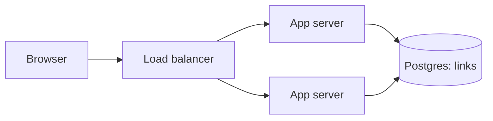
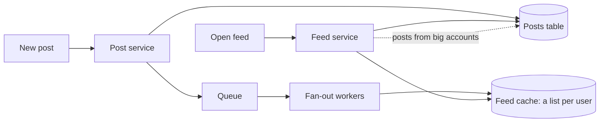

# Career: The System Design Interview

> **In this lesson:** how to run a system design interview out loud, using the design method you already know. You'll read two worked interviews as dialogues, a URL shortener and a news feed, and see what the candidate says at each step and why. Then you do a mock design interview with your mentor.

## Words you need first

- **Requirements.** What the system must do (functional) and how well it must do it: how fast, how reliable, how big (non-functional).
- **Back-of-the-envelope estimate.** A rough calculation, done in your head or on the board, to find out the size of a problem. Close enough is the goal.
- **Read-heavy.** A system that's read far more often than it's written to. Most are.
- **Fan-out.** One action that has to reach many places, like one post that has to appear in thousands of feeds.

## What the interviewer is looking for

There's no single right design, and the interviewer knows it. They're scoring how you think:

- Do you find out what's being asked before you design?
- Can you estimate size, and does it change what you build?
- Do you start simple and then improve, or reach for complicated parts straight away?
- Can you name the bottleneck, and say what each fix costs?
- Do you take hints and change direction without getting defensive?
- Can they follow you?

The last one matters more than most candidates think. A good design that the interviewer can't follow scores worse than a decent one they can.

## The method, as a conversation

You know the steps from the system design lessons. In an interview they sound like this, roughly in this order:

```order
title: A system design interview, step by step
---
Ask questions until the requirements and scope are clear, and write them down
Estimate the rough numbers: users, requests per second, storage
Sketch the data model and the main API calls
Draw the simplest design that works, and walk one request through it
Find the bottleneck, and change the design to fix it, saying what each change costs
Say what changes at 10 times and 100 times the load, and what you'd watch in production
```

Some habits that make it go well:

- **Write as you talk.** Requirements in a list in one corner. Numbers next to them. Boxes and arrows for the design. The board is your notes and the interviewer's map.
- **Say what you're doing.** "I'll spend a minute on requirements, then do some quick numbers." It tells them you have a plan.
- **Check in.** "Does this level of detail make sense, or do you want me to go deeper on storage?" Interviewers often steer, and you want to know where.
- **Pick, then say why.** "It depends" is only half an answer. Finish it: "It depends on whether we need exact counts. If we don't, I'd use a cache and accept counts a few seconds stale."

## Worked interview: a URL shortener

You built a tiny one in the clones lessons. Here's what a strong candidate sounds like when asked to design one in an interview. Read it as a script of what to say, with notes on why.

---

**Interviewer:** Let's design a URL shortener. Something like bit.ly.

**Candidate:** Sure. Before I draw anything, I'd like to pin down what it needs to do. The core is: someone gives us a long URL, we give back a short one, and anyone who visits the short one gets redirected to the long one. Is that the whole scope, or do we also need things like custom short codes, expiry, or click analytics?

> *Why: the candidate states the obvious core in one breath and then asks about the edges. That shows they know what the problem is and that scope is a choice.*

**Interviewer:** Custom codes would be nice. Let's say basic click counts too. No expiry.

**Candidate:** Great. So: create a short link, optionally with a custom code; redirect; and count clicks. For non-functional requirements, I'd guess redirects need to be fast, since they sit in front of every click, and very reliable. Is it fine if click counts lag a little?

**Interviewer:** Yes, counts can be a minute behind.

> *Why: that answer is going to shape the design. The candidate asked because they already suspect counting every click synchronously is the expensive part.*

**Candidate:** Let me do some rough numbers. Say 100 million new links a month. That's roughly 100 million divided by about 2.5 million seconds in a month, so about 40 writes a second. Reads are usually much higher for this kind of thing. Say 100 clicks per link on average, so about 4,000 redirects a second, with peaks maybe five times that. So this is strongly read-heavy.

For storage: each link is a short code, a long URL, a creator and a timestamp. Call it 500 bytes. 100 million a month is 50 gigabytes a month, about 600 gigabytes a year. That fits on one database for a long time.

> *Why: the numbers are rough and the arithmetic is shown. The conclusions are what matter: read-heavy, and storage isn't the problem.*

**Candidate:** For the data model, one main table:

```
links
  code        text, primary key
  long_url    text
  created_by  user id
  created_at  timestamp
```

And the API:

```
POST /links          body: { url, customCode? }   returns { code, shortUrl }
GET  /:code          302 redirect to the long URL, or 404
GET  /links/:code/stats                          returns { clicks }
```

**Interviewer:** How do you make the short codes?

**Candidate:** A few options. I could hash the long URL and take the first seven characters, but then two people shortening the same URL get the same code, and collisions need handling. I could pick random codes and check they're not taken. Or I could use a counter and turn each number into base 62, using letters and digits, which gives short codes with no collisions.

Seven characters of base 62 is about 3.5 trillion codes, which at 100 million a month lasts a very long time. I'd go with random seven-character codes, checked against the table on insert. They're not guessable, which a counter would be, and at 40 writes a second the chance of a collision is tiny and a retry handles it. Custom codes go through the same insert, and if the code is taken we return a `409`.

> *Why: three options, a pick, and the reason, including a downside of the one not picked (guessable codes). This is the shape of every good tradeoff answer.*

**Candidate:** So the simple design is: a load balancer, a few stateless app servers, and one Postgres database. A redirect looks up the code by primary key and returns a 302.



**Candidate:** The bottleneck is the redirect reads. 4,000 a second, peaking at 20,000, all hitting the database. A primary key lookup is fast, but I'd rather not lean on the database for every click. So I'd put a cache in front, Redis or similar, keyed by code. Links never change once created, so the cache is easy to keep correct: there's nothing to invalidate. Popular links will be hit over and over, so the hit rate should be high.

The cost is another piece to run, and a little memory. I think it's clearly worth it here.

**Interviewer:** What about the click counts?

**Candidate:** If every redirect did an `UPDATE` to add one to a counter, the hot links would all be fighting over the same row, and every redirect would wait on a write. Since you said counts can be a minute behind, I'd have the redirect drop a click event onto a queue and return straight away. A worker reads the queue, adds up clicks per code, and writes the totals every few seconds. Redirects stay fast, and counts are slightly behind, which we agreed is fine.

> *Why: the earlier question about lag pays off here. The candidate connects the requirement to the design out loud.*

**Interviewer:** What happens at 100 times the traffic?

**Candidate:** At 100 times, that's around 400,000 redirects a second at normal load. The cache takes most of that, and I'd run several cache nodes and spread codes across them. App servers are stateless, so I add more. Writes become 4,000 a second, which one Postgres can probably still handle, but storage grows to tens of terabytes a year, so I'd split the links table across several databases by code. I'd also put the redirect behind a CDN for the most popular links. And I'd watch cache hit rate, redirect latency at the slow end, and queue depth for the click counter.

**Interviewer:** Good. Let's stop there.

---

Look at what the candidate didn't do: they didn't start with Kafka, microservices or a diagram of twelve boxes. They started with one database and added each piece only when a number or a requirement called for it.

## Worked interview: a news feed

This one is harder, and it's a classic because the interesting part is a real tradeoff with no free answer.

---

**Interviewer:** Design the home feed for a social app. You follow people, and your feed shows their recent posts.

**Candidate:** Let me check the scope. Users can post, follow other users, and open a feed of recent posts from people they follow. Is the feed in time order, or ranked by some relevance score?

**Interviewer:** Time order, newest first, to keep it simple.

**Candidate:** Okay. Do posts include images or video? And roughly how many users, and how many people does a typical user follow?

**Interviewer:** Text and images. Say 200 million daily users. A typical user follows about 200 people. Some accounts have tens of millions of followers.

> *Why: "some accounts have tens of millions of followers" is the most important fact in this problem. The candidate asked about follower counts because they know it decides the design.*

**Candidate:** Thanks, that last part matters a lot. Non-functional: opening the feed should feel instant, say under 200 milliseconds. A new post can take a few seconds to show up in followers' feeds. Is that fair?

**Interviewer:** Yes.

**Candidate:** Rough numbers. 200 million daily users. If each opens the feed ten times a day, that's 2 billion feed reads a day, about 23,000 a second on average, more at peak. If one in ten posts once a day, that's 20 million posts a day, about 230 a second. So it's read-heavy again, around a hundred reads for every write.

Images go in object storage behind a CDN, so the database only stores a link to each. I'll leave images aside from here.

**Candidate:** Data model:

```
users     id, name
follows   follower_id, followee_id, created_at
posts     id, author_id, text, image_url, created_at
```

API:

```
POST /posts                    create a post
POST /users/:id/follow         follow someone
GET  /feed?cursor=...          the newest posts from people I follow, a page at a time
```

The feed uses a cursor for pagination, not page numbers, because new posts arrive at the top while you scroll.

**Candidate:** The simplest design builds the feed when you ask for it. To open my feed: find the 200 people I follow, get each one's recent posts, merge them by time, and return the top 20. That's called **fan-out on read**.

It's simple, and posting is cheap. But it means every feed open does a big query across 200 people's posts, and we have 23,000 feed opens a second. That's the bottleneck. It won't hit 200 milliseconds at this size.

**Candidate:** The other approach is **fan-out on write**. When someone posts, we push the post's id into a precomputed feed list for each of their followers. Each user's feed is a ready-made list, kept in a cache like Redis. Opening the feed is a single read of my list. Very fast.

The cost moves to posting. A user with 200 followers means 200 small writes per post, which is fine: 230 posts a second times 200 is about 46,000 writes a second, spread across cache nodes. But someone with 30 million followers means 30 million writes for one post. That's slow, and if they post a few times an hour, it's a constant flood.

```match
{
  "title": "Fan-out on read or on write?",
  "note": "Tap the situation, then the better fit.",
  "pairs": [
    { "left": "A normal user with 300 followers posts", "right": "Fan-out on write: push into each follower's feed" },
    { "left": "A celebrity with 30 million followers posts", "right": "Fan-out on read: merge their posts in when a follower opens the feed" },
    { "left": "Opening the feed must take under 200 milliseconds", "right": "Precomputed feed lists in a cache" },
    { "left": "A user who hasn't opened the app in a year", "right": "Skip them on write, and build their feed on read when they return" }
  ]
}
```

**Candidate:** So I'd do a hybrid. For most users, fan-out on write: their posts are pushed into followers' cached feed lists by background workers reading from a queue, so posting returns immediately. For accounts above some follower threshold, say a million, we don't fan out. Instead, when you open your feed, we read your precomputed list and merge in recent posts from the few big accounts you follow. That's a small read, since you probably follow only a handful of them.

**Candidate:** Two more things that fall out of this. We only keep the most recent few hundred post ids in each list, since nobody scrolls back further than that from the feed. And we don't fan out to users who haven't been active for a while. If they come back, we build their feed on read once, then keep it updated.



**Interviewer:** What's the downside of your design?

**Candidate:** A few. It's more complicated than either pure approach: two code paths for posts, and the threshold is a number we'll have to tune. The cache holds a lot: 200 million lists of a few hundred ids each is real memory. A deleted post sits in feed lists until we clean it out, so the feed service has to check posts still exist when it reads them. And a new follow doesn't show that person's old posts until we backfill them, which I'd do with a small job when you follow someone.

> *Why: the interviewer asked for weaknesses, and the candidate gave four real ones without getting defensive. Being able to criticize your own design is one of the strongest signals in this interview.*

**Interviewer:** And at 10 times the users?

**Candidate:** The cache grows tenfold, so it's spread across many more nodes, partitioned by user id. The fan-out workers scale by adding more, and the queue absorbs bursts like a big event where everyone posts at once. The posts table gets split by author id. The threshold for big accounts might drop, since fan-out costs rise with more followers per user. I'd watch queue depth, how long fan-out takes from post to feed, cache memory, and feed read latency at the slow end.

---

## When you don't know something

You'll be asked about things you've never used. That's fine. Say what you know and reason from there:

"I haven't run Cassandra myself. What I know is that it's built for very high write volume and spreads data across many machines by a key. If that's right, it could fit the feed lists, since every read and write is by user id. I'd want to check how it handles the list being trimmed."

That's a far better answer than bluffing, and better than "I don't know" with nothing after it.

```scenario
{
  "who": "The interviewer",
  "setting": "Halfway through the news feed design. You've just proposed fan-out on write for everyone.",
  "ask": "One of our users has 40 million followers. What happens when she posts?",
  "note": "You hadn't thought about that. Pick what you'd say.",
  "options": [
    { "text": "That's a real problem with what I drew. Her one post becomes 40 million cache writes, which is slow and floods the workers. I'd change the design: above some follower count we skip fan-out, and merge her recent posts into each follower's feed when they open it. Let me redraw that part.", "verdict": "best", "feedback": "You named the problem precisely, put a number on it, and changed the design on the spot. Taking a hint and adapting is exactly what's being scored." },
    { "text": "The queue will handle it. We'd just add more workers.", "verdict": "weak", "feedback": "It defends the design instead of examining it. More workers make 40 million writes per post faster, and they're still 40 million writes. The interviewer will push again." },
    { "text": "That's an edge case. Most users have far fewer followers.", "verdict": "weak", "feedback": "The interviewer just told you it matters. Big accounts are where social apps get the most traffic, and waving them away ends the conversation badly." },
    { "text": "Hmm, it would be slow. I'm not sure what to do about that.", "verdict": "ok", "feedback": "Honest, and you saw the problem. Push yourself one step further: ask whether the work could happen at read time for accounts like hers." }
  ],
  "debrief": "Interviewers often ask \"what happens when...\" because they've spotted a hole. Treat it as a hint."
}
```

## How to practice

- **Redo both worked examples yourself,** out loud, without reading. Then compare.
- **Use a timer.** Most design rounds run under an hour, so practice inside one. Give requirements and numbers a short slice at the start, so you don't run out of room for the interesting part.
- **Practice on familiar systems.** A chat app, a ride-hailing app, a ticket booking site, a file-sharing service, a notification system, a leaderboard. Pick one, set a timer, and talk.
- **Record yourself.** Watch for long silences, designs that start too complicated, and choices with no reason given.
- **Practice with a person.** Someone who interrupts you is the closest thing to the real round.

## The mock with your mentor

Book a mentor session for a mock system design interview. Your mentor will pick a problem you haven't prepared. Treat it as the real thing: talk the whole time, draw as you go, and run the method.

Afterwards, your mentor will score you on the same things a real interviewer looks for: clarifying requirements, rough numbers, a simple start, finding the bottleneck, tradeoffs with costs, adapting to hints, and how easy you were to follow. Write down the two things to work on, practice them, and ask for another mock when you're ready.

```quiz
[
  {
    "q": "The interviewer says \"design a URL shortener\". What should you do first?",
    "options": ["Ask what it must do and how well, and write the requirements down", "Draw the load balancer and servers", "Pick a database", "Explain how hashing works"],
    "answer": 0,
    "explain": "Scope and requirements shape everything after. Asking first is signal, and it stops you designing the wrong thing."
  },
  {
    "q": "Why does a news feed often use fan-out on write for most users and fan-out on read for very big accounts?",
    "options": ["Pushing one post into millions of feeds is too much work, so those posts are merged in when a feed is opened instead", "Fan-out on read is always faster", "Big accounts post less often", "It saves on database storage"],
    "answer": 0,
    "explain": "Fan-out on write makes reads fast and costs work per follower. For most users that's cheap. For an account with tens of millions of followers it's a flood, so their posts are merged in at read time."
  },
  {
    "q": "The interviewer asks what's wrong with your design. What's the best kind of answer?",
    "options": ["Name real weaknesses and what each costs, calmly, with what you'd do about them", "Say there are no major problems", "Start the design over", "Ask them what they think is wrong"],
    "answer": 0,
    "explain": "Seeing the weak spots in your own design is one of the strongest signals in the interview. Every design has them."
  }
]
```

## Key takeaways

- The interviewer scores how you think: requirements, numbers, a simple start, the bottleneck, tradeoffs, and how you take hints.
- Run the design method out loud, write as you go, and check in about where to go deeper.
- Start with the simplest design that works and add each piece only when a number or a requirement calls for it.
- "It depends" needs a second half: what it depends on, and which way you'd go.
- When asked what's wrong with your design, name real weaknesses and what they cost.

## Work with AI

```ai-prompt
title: Interview me on a system design problem
---
Act as a system design interviewer at a software company. Give me one problem, like a
chat app, a ticket booking site or a leaderboard, and don't tell me what you expect.
Let me drive. Answer my clarifying questions with realistic numbers, but only if I ask.
Interrupt me now and then with a "what happens when..." question about a weak spot,
the way a real interviewer would. Don't give me the answer or hints unless I've been
stuck for a while. When I say I'm done, score me from 1 to 4 on: clarifying
requirements, estimates, starting simple, finding the bottleneck, tradeoffs with costs,
handling your interruptions, and how easy I was to follow. Give one specific example
from my answers for each score.
```
