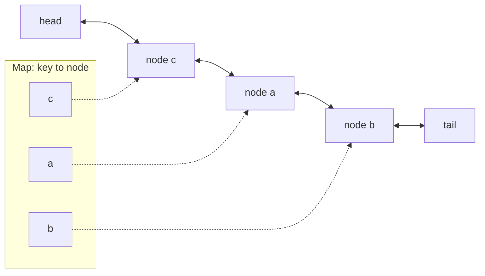

# Clone: A Small Redis-Style Cache

> **In this lesson:** you build a tiny cache like Redis, the in-memory store that sits in front of most busy databases. It has get, set, delete, entries that expire, and a size limit that throws out the least recently used entry, all in constant time. Then you design a cache in front of a real database and face the two hardest problems in caching: keeping it correct when data changes, and surviving the moment a popular entry expires. It's the last of three clones.

## Words you need first

- **Cache.** A small, fast copy of data that's slow to get, kept close by so you don't have to get it again.
- **Hit and miss.** A hit is when the cache has what you asked for. A miss is when it doesn't and you have to fetch it the slow way.
- **TTL.** Time to live: how long an entry stays before it expires and counts as gone.
- **Eviction.** Throwing out an entry to make room, because the cache is full.
- **Doubly linked list.** A chain of items where each one points to the one before it and the one after it.

## What Redis is and why everyone uses one

A database keeps data safely on disk and answers rich questions. That makes each answer slow, compared with memory: a few milliseconds, against well under a millisecond.

When the same question is asked thousands of times a second, like "what's on the product page for the bestselling item?", you don't want to ask the database each time. You ask once, keep the answer in memory, and hand out copies. **Redis** is a server that does exactly this. It holds keys and values in memory, lets entries expire, and evicts old ones when memory fills. Your clone does the same, in one process.

The idea is trading memory for time, which you met in the lesson on speed. Here it's an entire layer of the system.

## Expiry: gone at the exact millisecond

`set(key, value, ttlMs)` stores an entry that expires `ttlMs` from now. Set at 1000 with a TTL of 500, it's there at 1499 and gone at 1500.

Real caches don't run a timer for every entry. They check when you ask: on `get`, if the entry's time is up, treat it as missing and remove it. That's called **lazy expiry**, and it's what the starter asks for.

Two hidden tests are about this. One checks the exact millisecond, so `>` versus `>=` matters again. The other checks that setting a key again replaces its expiry, so an entry set with a TTL and then set again without one never expires.

## Least recently used

A cache has a size limit. When it's full and a new key arrives, something has to go. The common choice is the entry nobody has touched for the longest: the **least recently used**, or LRU.

"Touched" means read with `get` or written with `set`. Each touch moves that key to the front of the line. Eviction takes from the back.

```order
title: What happens on set("e") when the cache holds 4 of 4 entries, most recent first: d, c, b, a
---
"e" isn't in the cache yet, and the cache is full
Find the least recently used entry, which is at the back of the line: a
Remove a from the line and from the lookup table
Make a new entry for e
Put e at the front of the line
The line is now e, d, c, b
```

### Why an array is too slow

The simple version keeps keys in an array in order of use. A `get` finds the key with `indexOf`, cuts it out with `splice` and puts it at the front.

Each of those walks or shifts the array. With 50,000 entries, every single `get` does tens of thousands of steps. A cache exists to be fast, and this one gets slower the more it holds. One hidden test runs 300,000 operations on a cache of 50,000 entries.

### A Map plus a doubly linked list

The classic answer uses two structures together, each doing what it's good at.

- A **doubly linked list** keeps the order. Each node holds a key and value and points to the node before and the node after. Taking a node out of the middle is constant time: point its neighbors at each other. Adding at the front is constant time too.
- A **Map** from key to node finds any node in constant time, so you never walk the list to find something.



The front, just after `head`, is the most recently used. The back, just before `tail`, is the next to be evicted. On `get("b")`: the Map hands you node b at once, you unhook it from its neighbors, and you hook it in after `head`. A handful of steps, whether the cache holds ten entries or ten million.

The `head` and `tail` nodes are empty markers that are always there. They mean the first and last real nodes always have neighbors, so you never have to check for "is this the first one?" when you unhook. Ask your agent to explain why they help before it writes the code.

One shortcut to know about: JavaScript's `Map` remembers the order keys were added, so deleting a key and setting it again moves it to the end. Some people build an LRU cache from that alone. It works in JavaScript. Build the linked list anyway. It's what interviews ask for, it's how caches are built in languages without that `Map` behavior, and you'll explain it in your design.

```match
{
  "title": "Which operation needs which part?",
  "note": "Tap the job, then the part of the cache that makes it fast.",
  "pairs": [
    { "left": "Find the entry for a key", "right": "The Map, which goes straight to the node" },
    { "left": "Move an entry to the front after a get", "right": "The list, by repointing its neighbors and the head" },
    { "left": "Find what to evict", "right": "The node just before tail" },
    { "left": "Decide whether an entry has expired", "right": "The expiry time stored on the node, compared with now" }
  ]
}
```

## A crowd asking for the same thing at once

`getOrLoad(key, loader, ttlMs)` is how most apps use a cache: give me the value, and if you don't have it, run this function to fetch it and keep the result.

Picture the bestselling product's entry expiring during a sale, with 2,000 requests a second for it. In the next tenth of a second, 200 requests all miss, and all 200 run the loader. That's 200 identical database queries at once, for something that was fine a moment ago. It's called a **cache stampede**, and it can take a database down.

The fix is to remember loads that are in progress. The first miss starts the loader and stores the promise of its result. Every other miss for the same key, while that's running, gets the same promise. One query, 200 happy callers. A hidden test sends 100 callers at one missing key and counts loader calls.

And when the loader fails, every waiting caller gets the error, nothing is stored, and the next call tries again. A cache that stores the failure keeps serving the error long after the database has recovered.

## Get the starter

If you did the other clones, you already have the `clones` folder. Don't download it again. If you don't:

```bash
curl -sL https://ai.parsity.io/labs/clones.tar.gz | tar xz
```

Work in `clones/cache`. `cache.js` describes every method, including which ones count as a use and which count as a hit or a miss. `cache.test.js` has five tests.

## Plan before you prompt

Branch, then plan in your own words. Answer:

- **The node.** What each list node holds. Draw the list for a cache holding `a`, `b`, `c`, with `b` most recently used.
- **Each method, step by step.** For `get`, `set` of a new key, `set` of an existing key, `delete` and eviction, list the pointer changes. Draw `delete` of a middle node before and after.
- **Expiry.** Where the expiry time lives, how `get` and `has` check it, and the exact comparison.
- **Stampedes.** What you keep for loads in progress, when a load is removed from it (on success and on failure), and what callers get.
- **Counts.** What counts as a hit, a miss and an eviction. A delete is not an eviction.
- **Tests first.** The exact-millisecond case, an eviction order after several gets, a delete followed by filling up again, and 100 callers on one missing key.

## Check the agent's work

- `indexOf`, `splice`, `shift`, `unshift`, `filter` or `find` in `get`, `set` or eviction. Any of those means a walk through the entries.
- `delete` that removes a key from the Map and forgets to unhook its node, or the other way round. The next eviction then removes the wrong thing. Run your delete-then-fill test.
- An expiry check with `>` where the starter says `>=`, or a falsy check like `if (entry.expiresAt && ...)` that misbehaves when the expiry is 0.
- `getOrLoad` built with `async` and `await` and no record of loads in progress. It works and stampedes.
- A failed load stored in the cache, or never removed from the loads in progress, so the key is stuck.
- `Date.now()` anywhere in `cache.js`.

**You owe five tests.** At least ten must pass. From `clones/cache`:

```bash
node --test
```

If the pointer code has you stuck for more than 30 minutes, put the agent's code aside, draw three boxes on paper with arrows both ways, and move one box to the front by hand, writing down each arrow you change. Then compare with the code.

## Design a cache in front of a database

Open `DESIGN.md`. The starting point: an online shop's product pages read from one Postgres database, five queries a page. During a sale traffic jumps to 2,000 page views a second, and the database falls over. Prices and stock change a few times a minute.

Use the method from the lesson on how to think about a system. Questions to work through:

**Rough numbers.** Queries a second at the sale with no cache. Then with 95 percent of reads hitting the cache. How much does the hit rate have to be for the database to cope?

**Reading through the cache.** The usual shape is called **cache-aside**: the app asks the cache, and on a miss asks the database and puts the answer in the cache. Your `getOrLoad` is exactly this.

**Invalidation.** When a price changes, the cached copy is wrong. You can update the cached copy, or delete it so the next read loads the new one. Think about two price changes landing close together, handled by two servers. Which approach can leave the old price in the cache forever, and which can't?

**TTL as a safety net.** If a delete is ever missed, how long can a wrong price stay up? What decides how short the TTL should be, and what does a short one cost?

**What has to be exact.** Can the product page show a price that's a few seconds old? Can checkout?

**Stampedes at scale.** Your clone shares one load per key inside one process. With 20 app servers, each one can still send its own query. And many keys set at the same moment all expire at the same moment. What would you add?

```scenario
{
  "who": "Your engineering manager",
  "setting": "A customer was shown an old price on a product page after it was changed. Checkout charged the right price.",
  "ask": "Should we just turn the cache off for prices?",
  "note": "More than one answer is defensible. Pick the one you'd say.",
  "options": [
    { "text": "Not yet. Checkout already reads the real price, so nobody was overcharged. I'd delete the cached product whenever its price changes and keep a short TTL as a backstop. Then a missed delete leaves a wrong price up for a few seconds at most.", "verdict": "best", "feedback": "This separates where staleness is acceptable from where it isn't, fixes the actual gap, and puts a bound on the worst case. It keeps the cache that stops the database falling over during sales." },
    { "text": "Yes, correctness matters more than speed.", "verdict": "weak", "feedback": "It sounds responsible, and it brings back the load that took the database down. The follow-up, 'what happens at the next sale?', has no good answer." },
    { "text": "Let's lower the TTL on everything to one second.", "verdict": "ok", "feedback": "It bounds staleness, and it multiplies database load and stampedes for data that rarely changes. Better to target prices and fix invalidation." },
    { "text": "It's a known tradeoff with caching. Prices can be a bit stale.", "verdict": "weak", "feedback": "True in general, and it doesn't say how stale or why that's acceptable here. A customer saw a wrong price, so a manager will want a fix." }
  ],
  "debrief": "Decide where stale data is acceptable and where it isn't, then make the exact path skip the cache."
}
```

Write the design yourself. The grader checks every section has real writing. Your mentor reads it for whether the reasoning holds up.

## Hand it in

```submit
assignment: clone-cache
```

We need `cache.js` and `DESIGN.md` in `clones/cache`, and at least ten passing tests of yours. Ours check expiry at the exact millisecond, eviction order, deleting and refilling, a crowd asking for one missing key, a failing loader, and a big cache under heavy use.

## Stretch

Add stale-while-revalidate to `getOrLoad`: when an entry has expired but is less than some extra time past its expiry, give the caller the old value straight away and start one background load to refresh it. Write down which data you'd use this for and which you never would.

```quiz
[
  {
    "q": "An LRU cache keeps its keys in an array in order of use, and moves a key to the front on each get with indexOf and splice. Tests pass. What's wrong?",
    "options": ["Every get walks and shifts the array, so the cache gets slower the more it holds", "Arrays can't hold strings", "It evicts the wrong key", "Nothing, this is the standard design"],
    "answer": 0,
    "explain": "indexOf and splice are hidden loops over the whole array. A Map to find the node plus a linked list to reorder it makes every operation constant time."
  },
  {
    "q": "A popular entry expires and 200 requests miss at once. What does a cache that shares loads in progress do?",
    "options": ["Runs the loader once and gives all 200 callers the same result", "Runs the loader 200 times", "Returns undefined to all 200", "Refuses requests until the entry is back"],
    "answer": 0,
    "explain": "The first miss stores the promise of the load. Every other miss for the same key waits on that same promise, so the database sees one query."
  },
  {
    "q": "A price changes. Why do many systems delete the cached copy instead of writing the new price into the cache?",
    "options": ["Two writes close together can update the cache in the wrong order and leave the old price there, while a delete just makes the next read load the current one", "Deleting is faster than writing", "Caches can't be updated, only deleted", "It uses less memory forever"],
    "answer": 0,
    "explain": "With updates, the slower of two racing writes can land last and win with stale data. Deleting means the next reader fetches whatever the database says now."
  }
]
```

## Key takeaways

- A cache trades memory for time. Every cache has to answer when entries leave: by expiry, by eviction or by invalidation.
- Lazy expiry checks the time when an entry is read. `>` versus `>=` decides the exact millisecond.
- LRU in constant time is a Map to find the node and a doubly linked list to keep the order.
- When a popular key expires, share one load among everyone waiting, and never store a failed load.
- In front of a database, decide which reads may be a little stale. Delete on write, and keep a TTL as a safety net.

## Work with AI

```ai-prompt
title: Walk the linked list with me
---
I'm a beginner who just built an LRU cache with a Map and a doubly linked list, using empty
head and tail marker nodes. Don't write code. Draw a cache with room for 3 entries in plain
text, then give me six operations one at a time, mixing get, set of a new key, set of an
existing key and delete. After each one, I'll tell you every pointer that changes and what
the list looks like. Correct me when I miss a pointer. Then ask me why the head and tail
markers make delete simpler, and what would go wrong if delete removed the Map entry but
not the node.
```
