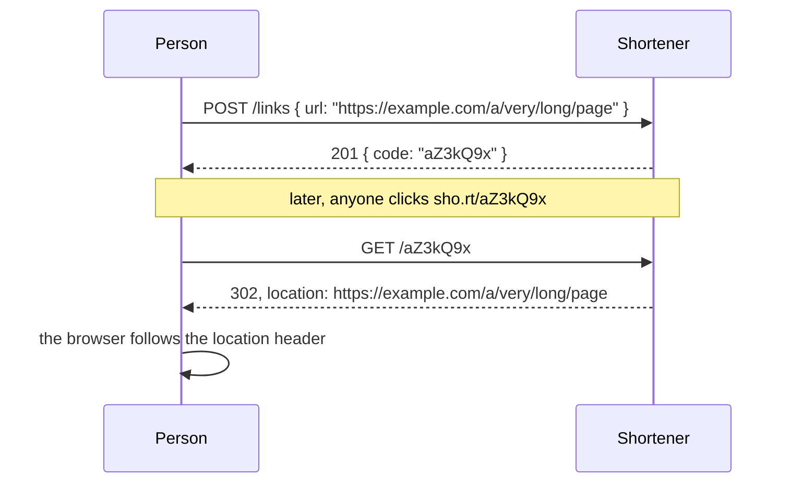

# Clone: A URL Shortener

> **In this lesson:** you build a tiny copy of a service like bit.ly: short codes, what happens when two codes come out the same, redirects, and click counts. Then you use the design method from the last lesson to take it to 100 times the traffic. It's the first of three clones, small copies of real systems you build to understand how the real ones work.

## Words you need first

- **Short code.** The few characters at the end of a short link, like `aZ3kQ9x` in `sho.rt/aZ3kQ9x`. It's the key the service looks up.
- **Redirect.** An answer that says "what you want is over there". The browser reads the address in the `location` header and goes there on its own.
- **Collision.** Two different things getting the same key. Here, two links getting the same short code.
- **Injected.** Passed in from outside instead of reached for directly. When a function takes `now` and `random` as arguments, the time and the luck are injected, and a test can control both.

## Why build clones

You'll be asked to design systems you've never seen the inside of. A URL shortener is the most common warm-up question in design interviews, and a rate limiter and a cache come right after it. Reading about them only gets you so far. Building a small one, with tests that poke at the awkward cases, shows you where the real decisions are.

Each clone has the same shape:

1. **Build it small**, in one process, with everything in memory. Your agent writes the code. You plan it, review every diff, and make it pass hidden tests that look for the classic bugs.
2. **Design it big**, in writing, with the method from the lesson on how to think about a system: requirements and scope, rough numbers, data model, API, components, the bottleneck, tradeoffs, and what you'd do at 10x and 100x.

The code is JavaScript with `require`, like your earlier labs, so the grader can run it with no build step and no packages.

## What a URL shortener does

Two jobs. Make a short code for a long address, and send anyone who visits the code to the long address.



Underneath, it's a lookup table from code to address. You built one of those by hand in the toolkit project. Here you'll use the built-in `Map`, and the interesting parts are everything around it.

## Making short codes

A code is 7 characters, each one of 62: `a` to `z`, `A` to `Z` and `0` to `9`. That gives 62 to the power 7, about 3.5 trillion possible codes.

There are two common ways to pick one.

| Way | How | Good | Bad |
| --- | --- | --- | --- |
| Counter | Number the links 1, 2, 3 and write the number in base 62 | Never collides | Anyone can guess the next code and walk through every link you've made |
| Random | Pick each character at random | Can't be guessed | Two links can get the same code |

The starter picks random codes, and gives you a `makeCode(random)` function that's already written. The collisions are your job.

### Collisions come sooner than you'd think

With 3.5 trillion codes, surely two links never get the same one? This is the birthday problem. In a room of just 23 people, there's an even chance two share a birthday, because what matters is the number of *pairs* of people, and that grows much faster than the number of people.

The same maths says that after about 2.2 million random 7-character codes, there's an even chance two of them already match. A busy shortener makes that many in a few weeks.

So before you store a new code, check it isn't taken. If it is, make another and check again. And put a limit on the tries: if something has gone wrong with `random`, a loop with no limit runs forever. The starter says give up after 10 tries with an error.

There's a worse version of this bug. If you don't check at all, the second link silently replaces the first, and everyone holding the old short link is sent to someone else's page. Nobody gets an error. That's the kind of bug hidden tests are for.

### Custom codes

People can also pick their own code, like `spring-launch`. Two rules: it has to be made of allowed characters, and if it's taken, refuse with `409 Conflict` and leave the existing link alone. A shortener that lets a second person take over `spring-launch` is a phishing tool.

## Only accept real web addresses

What should `shorten("javascript:alert(1)")` do? If you store it, your trusted-looking short link runs someone's code in the browser of whoever clicks it.

Don't write your own pattern for checking addresses. JavaScript has a built-in that parses them properly:

```js
const u = new URL("https://example.com/page?x=1");
u.protocol;   // "https:"
u.hostname;   // "example.com"

new URL("not a url");   // throws an error
```

Parse it, catch the error, and accept only `http:` and `https:`. Anything else is a `400`.

## The redirect, and why its status code matters

There are several redirect status codes, and they differ in one thing that matters a lot here: whether the browser remembers.

```match
{
  "title": "Match the redirect to what the browser does",
  "note": "Tap the status code, then what it means.",
  "pairs": [
    { "left": "301 Moved Permanently", "right": "The browser may remember it and go straight to the new address next time, without asking you" },
    { "left": "302 Found", "right": "The browser asks you every time, and follows it this time" },
    { "left": "404 Not Found", "right": "There's nothing at this address" },
    { "left": "201 Created", "right": "The new link was made" }
  ]
}
```

A `301` is cheaper: the second click from the same browser never reaches your server. But if you count clicks, the second click never reaches your counter either, so your numbers are wrong and nobody can tell. Counting clicks is the whole product for most shorteners, so they use `302` (or `307`, which behaves the same way for this purpose).

That's a real tradeoff, and you'll write about it in your design.

## Time and luck are passed in

Look at how the starter creates a shortener:

```js
const shortener = createShortener({ now: Date.now, random: Math.random });
```

In tests, you pass your own:

```js
let t = 5000;
const s = createShortener({ now: () => t, random: () => 0 });
```

Now a test can make `random` return 0 every time and force a collision on purpose, or set the time to exactly 5000 and check `createdAt`. Nothing waits and nothing depends on luck, so the test gives the same answer every run.

Every clone and the webhooks project use this idea. The rule for your agent: never call `Date.now()` or `Math.random()` inside the code. Always use the ones passed in.

## Get the starter

From the top of your `parsity-labs` repository:

```bash
curl -sL https://ai.parsity.io/labs/clones.tar.gz | tar xz
```

That makes a `clones` folder with all three clones in it: `url-shortener`, `rate-limiter` and `cache`. Download it once. Running the command again later would overwrite your work.

In `clones/url-shortener` you'll find:

- `shortener.js` where the code goes. The comments describe every method and every status code.
- `shortener.test.js` with five tests.
- `server.js` which runs your shortener as a real web server once it works. Already written.
- `DESIGN.md` for the design part.

## Plan before you prompt

Make a branch, then write a short plan in your own words before you give your agent anything. Your plan should answer:

- **Where the links live.** What structure holds them, and how long does finding a code take with 100,000 links? (A hidden test makes 100,000.)
- **The collision loop.** What happens when `makeCode` gives a taken code? How many tries, and what error after that?
- **Checking addresses.** Which inputs are refused? List at least five bad ones.
- **Custom codes.** The allowed characters and lengths, and what happens to the existing link when someone asks for a taken code.
- **The handler.** Each route, each status code, and which ones count a click.
- **Tests first.** The cases you want tested, including at least one that forces a collision by passing in a `random` that always returns 0.

Give the plan to your agent and ask it to write the tests first, then the code. Read the tests before you let it write the code.

## Check the agent's work

Read every diff. Things to look for:

- `Date.now()` or `Math.random()` called directly inside `createShortener`. It must use `now` and `random`.
- `links.find(...)` or any search through an array to look up a code. That's a hidden loop, and it turns 100,000 links into billions of steps.
- A collision loop with no limit, or one that stores the new link without checking.
- An address check written with a regular expression instead of `new URL`.
- The redirect status. If it's `301`, ask the agent why, then decide.
- `stats` or `GET /links/<code>` counting a click.

Then run it for real. From `clones/url-shortener`:

```bash
node --test
node server.js
```

In a second terminal:

```bash
curl -i -X POST localhost:3000/links -H 'content-type: application/json' -d '{"url":"https://example.com/a"}'
curl -i localhost:3000/<the code you got back>
```

Open the short link in a browser too, and watch it land on the long page. Commit when it all passes.

**You owe five tests.** The file has five. Add at least five more of your own, so at least ten pass.

If you're stuck on one bug for more than 30 minutes, write down what you expected, what happened, and the smallest input that shows it, then ask your agent to explain the behavior before it changes anything.

## Design it at 100 times the traffic

Now the big-picture half. Open `DESIGN.md`. The starting point: today the service makes 1,000 links and serves 200,000 redirects a day, on one server, with everything in memory. Design it for 100 times that, with the method from the lesson on how to think about a system. Each heading in the file is one step of the method.

Some things to think about as you go. They're questions, and the answers are yours.

**Rough numbers.** A day has 86,400 seconds. Call it 100,000 to keep the sums easy. Work out new links per second and redirects per second at 100 times, then a busy peak. Notice the ratio of reads to writes. It decides most of the design.

**Data model.** Is a click count one number you add 1 to on every redirect, or a separate record of each click that gets added up later? What does each cost when one link goes viral?

**Components.** Your clone keeps everything in one process's memory. What happens to every link when that process restarts? Where do the links live instead, and what sits in front of that store so a popular link doesn't hit it on every click?

**The bottleneck.** Which step of a redirect is the slowest, and which would break first as traffic grows: making links, looking them up, or counting clicks?

**Codes at scale.** With several servers making codes at once, two of them can pick the same random code at the same moment, and both checks say "free". How would you stop that? Some designs hand each server its own range of numbers to turn into codes. What does that give up?

**Tradeoffs.** `301` versus `302` is one. Exact click counts versus counts that are a few seconds behind is another.

```scenario
{
  "who": "Your product manager",
  "setting": "A launch is coming and the marketing team will post one short link to two million followers.",
  "ask": "Will the shortener survive the launch? Should we buy a bigger server?",
  "note": "More than one answer is defensible. Pick the one you'd say.",
  "options": [
    { "text": "Probably. Redirects are just a lookup. The risky part is writing a click record on every redirect, so I'd move counting off the redirect path and cache that one hot link. That's cheaper than a bigger server.", "verdict": "best", "feedback": "This names the actual bottleneck, the write on every click, and fixes it directly. It also answers the money question with something cheaper. A manager can act on it." },
    { "text": "Yes, buy the biggest server we can. Better safe than sorry.", "verdict": "weak", "feedback": "It might even work, but it spends money without knowing what breaks. The next question, 'what was the problem, exactly?', has no answer." },
    { "text": "Let me load test it first. I'll send it two million fake clicks and tell you what breaks.", "verdict": "ok", "feedback": "Measuring is good, and you should do it. On its own it delays the answer. Pair it with your best guess about the bottleneck, so the test checks a hypothesis." },
    { "text": "We should rewrite it as microservices so each part can scale on its own.", "verdict": "weak", "feedback": "A rewrite before a launch adds risk and doesn't name what breaks. Splitting the system is a big answer to a question nobody has measured yet." }
  ],
  "debrief": "In design questions, find the one thing that breaks first and fix that. Here it's almost always the write on every click. The lookup is cheap."
}
```

Write the design yourself. No agent writes it. An agent may read it afterwards and ask you hard questions, which is the prompt at the end of this lesson. The grader checks that every section has real writing in it. Your mentor reads it for whether the reasoning holds up, and will ask you about it.

## Hand it in

```submit
assignment: clone-url-shortener
```

We need `shortener.js` and `DESIGN.md` in `clones/url-shortener`, and at least ten passing tests of yours. Then ours run, including codes that come out the same, addresses that aren't web links, and a hundred thousand links.

## Stretch

Add expiring links: `shorten(url, code, { expiresInMs })`, where a visit after the expiry gives `410 Gone`. Decide whether an expired code can be reused, and write down why.

```quiz
[
  {
    "q": "Your shortener picks 7 random characters for each code and stores it without checking. It passes every test with 50 links. What goes wrong in production?",
    "options": ["Eventually a new link gets a code that's already used and silently replaces the old link", "Nothing, because there are 3.5 trillion possible codes", "The codes get longer over time", "The server runs out of memory at 50 links"],
    "answer": 0,
    "explain": "Because of the birthday problem, a match becomes likely after a couple of million codes. Without a check, the new link overwrites the old one and nobody sees an error."
  },
  {
    "q": "Why do most shorteners redirect with 302 instead of 301?",
    "options": ["Browsers may remember a 301 and skip the shortener next time, so those clicks are never counted", "302 is faster for the browser", "301 is not allowed for links to other sites", "302 keeps the link secret"],
    "answer": 0,
    "explain": "A 301 tells the browser the move is permanent, so it can go straight to the long address next time. That saves a request and loses the click."
  },
  {
    "q": "Why does createShortener take now and random as arguments instead of calling Date.now and Math.random itself?",
    "options": ["So tests can control time and luck, for example forcing a collision, and get the same result every run", "Because Math.random doesn't work in Node", "To make the code run faster", "So the codes are more random"],
    "answer": 0,
    "explain": "Passing them in lets a test choose them. A random function that always returns 0 forces two links to get the same code, which is how the collision handling gets tested."
  }
]
```

## Key takeaways

- A URL shortener is a lookup table from code to address. The hard parts are around the table: collisions, bad input, redirects and counting.
- Random codes collide much sooner than intuition says. Check before storing, and put a limit on the retries.
- Only accept `http` and `https` addresses, checked with `new URL`. A shortener that stores anything is an attack tool.
- A `301` saves requests and loses click counts. A `302` costs a request and counts every click.
- Pass time and randomness in, so tests can control them.
- Designing for 100 times the traffic starts with the numbers. Here, reads outnumber writes by a lot, and the write on every click is the first thing to break.

## Work with AI

```ai-prompt
title: Interview me on my shortener design
---
I'm a beginner who just built a small URL shortener and wrote a design for 100 times the
traffic: 100,000 new links and 20 million redirects a day. I'll paste my DESIGN.md. Act as
a design interviewer. Don't rewrite it and don't give me answers. Ask me one question at a
time, starting with my rough numbers, then whichever section looks weakest. Push on
anything I say without a reason or a number. After six questions, tell me the two places
my reasoning was thinnest and what I should go and learn to fix each one.
```
