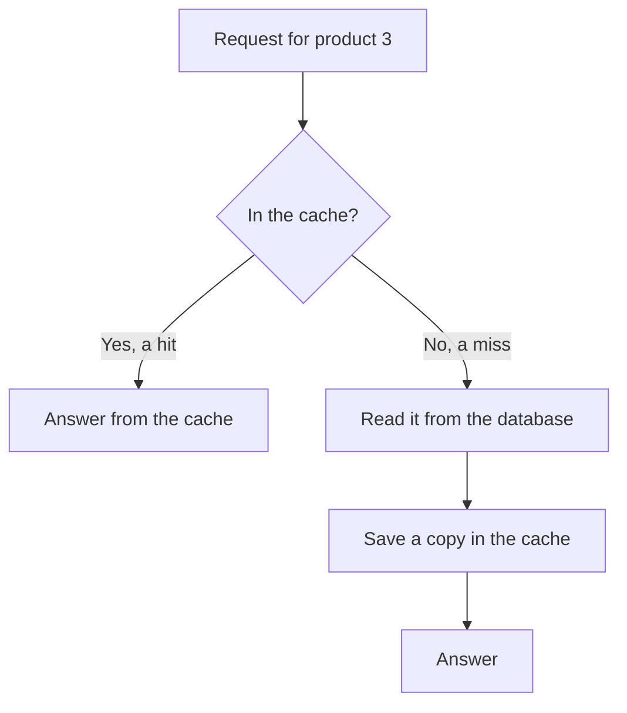

# Databases: Documents and Caches

> **In this lesson:** a second way to store data, as whole JSON documents, and a way to answer the same question faster by keeping a copy nearby. You'll learn when a document fits better than a table, what goes wrong when the same fact is copied into many places, how to stop two writers overwriting each other, and what a cache buys you and costs you.

## Words you need first

- **Document.** One JSON object stored and fetched as a whole, like one order with its items inside it.
- **Document store.** A database that keeps documents by id, instead of rows in tables.
- **Denormalize.** Copy a fact into the places that read it, so you don't have to join to get it.
- **Cache.** A fast copy of data that's slow or costly to get, kept so the next request can skip the slow part.
- **Stale.** Out of date. A stale copy says something that used to be true.

## The same order, two ways

In Postgres, one order with two items is spread across four tables. To show it, you join them back together:

```
orders:       id 41, customer_id 7, status placed
order_items:  order 41, product 3, qty 2, price 2500
              order 41, product 9, qty 1, price 900
products:     3 Desk lamp, 9 Bulb
customers:    7 Ada Lovelace
```

As a **document**, the whole order is one JSON object, stored under its id:

```json
{
  "id": 41,
  "status": "placed",
  "customer": { "id": 7, "name": "Ada Lovelace" },
  "items": [
    { "productId": 3, "name": "Desk lamp", "qty": 2, "priceCents": 2500 },
    { "productId": 9, "name": "Bulb", "qty": 1, "priceCents": 900 }
  ],
  "totalCents": 5900,
  "createdAt": "2026-11-19T15:04:05.000Z"
}
```

One read gets everything about the order. No joins. The items are **embedded**: they live inside the order instead of in a table of their own.

A **document store** is a database built around this: you save a document under a key and get it back by that key. Many exist, and the big cloud providers each sell one. You don't need one to use the idea. Postgres can store a JSON document in a column of type `jsonb`, and a plain JSON file is a document store at its smallest. You'll build that one in the next part of your project.

## What documents are good at

Documents fit when the data is **read and written as one unit**.

- **An order.** Placed once, read whole, rarely changed. Embedding the items means one read for the order page.
- **Things whose shape varies.** A shirt has sizes and colors. A laptop has memory and a screen size. In a table, that's dozens of mostly empty columns or extra tables. In a document, each product has just the fields it needs.
- **Settings and profiles.** One user's preferences, loaded together, saved together.
- **Records of what happened.** An event log entry is written once and never changed.

## What documents are bad at

The trouble starts when the same fact is needed in many documents, or when a question spans many documents.

**Questions across documents.** "How many desk lamps did we sell this month?" With tables, one query with a `SUM` and a `WHERE`. With order documents, you open every order, look inside every items list, and add it up yourself. Document stores have tools to help, and it's still the harder direction.

**Shared facts that change.** Stock is the clearest example. Every order changes it, and every order must see the true number. If stock lived inside each product's document and orders were documents too, every order would need to change two documents at once, safely. That's what tables, foreign keys and transactions are built for.

**Copies that drift.** This is the big one, and it has a name.

## Denormalizing, and drift

To make a document complete on its own, you **denormalize**: copy facts into it. The order document above copies the customer's name and each product's name and price.

Some copies are exactly right. The price on an order should be the price when it was placed. If the lamp goes up to $30 next week, last week's order still cost $25. That copy is a **snapshot**, and it's meant to stay frozen.

Other copies are meant to stay current, and that's where it hurts. Say the customer's document keeps a running count:

```json
{ "id": 7, "name": "Ada Lovelace", "orderCount": 3, "totalSpentCents": 14200 }
```

Reading it is instant. But now every change that affects those numbers has to update the customer document too: placing an order, cancelling one, and anything you add next year, like refunds. Miss one place, and the copy **drifts**: it says 3 orders when the truth is 2, and nothing tells you.

Before you copy a fact into a document, ask two questions:

1. **Is this copy a snapshot, or must it stay current?** Snapshots are safe.
2. **If it must stay current, what is every change that affects it?** Each one must update the copy in the same write as the change itself. If you can't list them all, compute the value when it's asked for instead.

## Two writers, one document

Documents bring their own version of the race you met with stock. A document store saves whole documents. So changing one field usually means: read the document, change it in your code, write the whole thing back.

| Step | Request A | Request B | The customer document says |
| --- | --- | --- | --- |
| 1 | reads: 3 orders | | 3 |
| 2 | | reads: 3 orders | 3 |
| 3 | writes 4 orders | | 4 |
| 4 | | writes 4 orders | 4, should be 5 |

B's write replaced A's. That's a **lost update**, and with whole documents it can wipe out any field at all.

There are two families of fix.

**A lock.** Only one writer at a time. Before reading, take the lock. After writing, release it. Others wait in line. Inside one Node process, the simplest lock is a queue: chain each write onto the end of a promise, so each one starts only when the last has finished.

```js
let queue = Promise.resolve();

function oneAtATime(work) {
  const run = queue.then(work);
  queue = run.catch(() => {});   // a failed write mustn't block the next one
  return run;
}
```

Simple and correct, with a limit. That queue lives in one process. Run two copies of your server against the same file and each has its own queue, so they can still overwrite each other.

**A conflict check.** Don't make anyone wait. Instead, give each document a `version` number. Write only if the version is still the one you read, and add one:

```
read the document: version 12
change it in code
write it only if it's still version 12, and make it version 13
if it isn't 12 any more, someone else wrote first: read it again and redo the change
```

This is called **optimistic** concurrency: you assume clashes are rare, and you detect them instead of preventing them. Most document stores let you make a write conditional like this, and it works across many servers. The cost: every write needs code to retry, and when many writers hit the same document, they keep clashing and retrying.

You've seen both ideas before. The lock is `SELECT ... FOR UPDATE`. The conflict check is a conditional update, with the `WHERE` checking a version number.

## Caching: a copy kept close

A **cache** is a copy of data kept somewhere faster than where it really lives, usually in memory. The product page is viewed ten thousand times an hour and the product changes once a week. Asking the database ten thousand times for the same answer is wasted work.

The most common shape is called **cache-aside**:



Every cache has the same hard problem: the copy can go **stale**. When the product's price changes, the cache still has the old one. You have two ways to deal with that, and most caches use both:

- **Expiry.** Each copy is thrown away after a set time, like 60 seconds. Simple, and the data can be up to 60 seconds old.
- **Invalidation.** When the data changes, delete the cached copy, so the next read fetches the new one. Exact, and you have to remember to do it everywhere the data changes. That's the same drift problem as before, in a new place.

So the real question before caching anything is: **how wrong may this be, and for how long?**

| Data | Fine to cache? |
| --- | --- |
| A product's name and description | Yes. A minute out of date hurts nobody. |
| A product's price on the product page | Usually, with a short expiry, as long as checkout uses the real price |
| Stock, when deciding whether an order can go through | No. Ask the database, and let the conditional update decide. |
| A customer's own order history right after they order | Careful. They expect to see the order they just placed. |

You'll build a small cache with expiry yourself later in the program.

```match
{
  "title": "Table, document or cache?",
  "note": "Tap the data, then where it fits best.",
  "pairs": [
    { "left": "Stock counts that every order changes", "right": "A table, changed with a conditional update" },
    { "left": "A placed order with its items and the prices paid", "right": "A document, read and written whole" },
    { "left": "Product details shown ten thousand times an hour", "right": "A cache with a short expiry" },
    { "left": "Lamps sold per month, counted across every order", "right": "A query over tables, with SUM and GROUP BY" }
  ]
}
```

```scenario
{
  "who": "A senior engineer on another team",
  "setting": "A design review for the orders system.",
  "ask": "Joins are slow. Why not move everything into a document database and embed whatever each page needs?",
  "options": [
    {
      "text": "For orders, embedding fits: we read each one whole and it rarely changes. Stock and customer details are shared and changed by many orders, so as documents we'd copy them around and have to keep every copy right by hand. I'd measure the slow query first. The usual cause is a missing index.",
      "verdict": "best",
      "feedback": "This splits the data by how it's used instead of picking a side, names the drift risk, and points at the most likely real cause of a slow join."
    },
    {
      "text": "Document databases don't support transactions, so we can't.",
      "verdict": "weak",
      "feedback": "Many document stores do support transactions now, and the other engineer will say so. A claim that's easy to disprove ends the conversation in their favor."
    },
    {
      "text": "We could store orders as jsonb in Postgres and keep the rest as tables.",
      "verdict": "ok",
      "feedback": "A good practical answer, since it gets documents without a second database. It skips the 'why': which data suits documents, and whether joins were really the problem."
    }
  ],
  "debrief": "Choose per kind of data: is it read whole, or shared and changed from many places? Most real systems use both."
}
```

```quiz
[
  {
    "q": "Each customer document keeps orderCount, updated when an order is placed. Cancelling an order doesn't touch the customer document. What happens?",
    "options": ["orderCount drifts: it keeps counting cancelled orders and nothing reports the error", "The database corrects it", "It's fine, because cancelling is rare", "The cancel fails"],
    "answer": 0,
    "explain": "A copy that must stay current has to be updated by every change that affects it, in the same write. Miss one and the copy quietly becomes wrong."
  },
  {
    "q": "Two requests read the same document, each changes a different field, and each writes the whole document back. What happens?",
    "options": ["The second write replaces the first, so one change is lost", "Both changes are kept, because they touched different fields", "The second write fails", "The document store merges them"],
    "answer": 0,
    "explain": "Writing the whole document saves the whole of what that request read, including the old value of the field the other request changed. A lock or a version check prevents it."
  },
  {
    "q": "Which data is the worst fit for a cache with a 60-second expiry?",
    "options": ["Stock used to decide whether an order can go through", "A product's description", "The list of product categories", "The shop's opening hours"],
    "answer": 0,
    "explain": "A stale stock count lets orders through for items that are gone. Anything that decides money or stock should come from the source, guarded by the database."
  }
]
```

## Key takeaways

- A document stores a whole thing, like an order with its items, as one JSON object read and written as a unit.
- Documents fit data that's read whole and has varied shapes. Tables fit data that's shared, changed from many places, or questioned across many records.
- Denormalized copies are safe as snapshots. Copies that must stay current drift unless every change updates them in the same write.
- Read, change and write back loses updates when two writers overlap. Fix it with a lock (one at a time) or a version check (detect and retry).
- A cache trades freshness for speed. Decide how wrong the data may be, and for how long, before caching it.

## Work with AI

```ai-prompt
title: Make me choose: table, document or cache
---
I'm learning when to store data in tables, as documents, or in a cache. Describe a
small app, like a ticketing site, a recipe app or a gym's class booking system. Then
give me six kinds of data from it, one at a time. For each, I'll say whether it goes
in a table, a document, or also a cache, and why. Push back on my reason: ask what
happens when it changes, who else reads it, and what goes wrong if a copy is stale or
two writers overlap. Don't give me the answer until I've defended mine. At the end,
tell me which of my choices you'd challenge in a design review.
```
