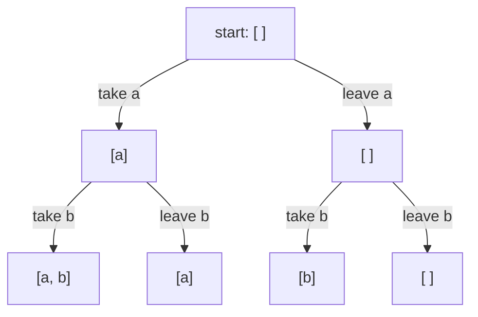

# Interview Problems: Backtracking

> **In this lesson:** backtracking, the pattern for problems that ask for every possible answer: every group, every combination, every arrangement. You make a choice, explore everything that follows from it, undo the choice, and try the next one. You'll draw the choices as a tree, write the three-line heart of every backtracking solution, and solve two classic problems.

## Words you need first

- **Choice.** One decision along the way, such as "take this item or leave it".
- **Decision tree.** A drawing of every sequence of choices. Each branch is one choice, and each path from the top to the bottom is one complete answer.
- **Backtrack.** Undo the last choice so you can try a different one from the same spot.
- **Combination.** A selection where order doesn't matter: `[2, 3]` and `[3, 2]` are the same combination.
- **Prune.** Stop exploring a branch early because it can't lead to a valid answer.

## Every possible answer

Some problems don't ask for the best answer. They ask for all of them: every way to pick a team, every combination of coins that makes a total, every arrangement of letters. There are usually a lot, and you need a system that finds each one exactly once.

The system is to make choices one at a time, and draw them as a tree. Here's every way to pick from `["a", "b"]`, deciding about one item per level:



The four bottom boxes are the four answers. Every path is a different set of choices, so nothing is found twice and nothing is missed.

## Choose, explore, undo

To walk that tree in code, keep one array called `current` that holds the choices you've made so far. At every step:

1. **Choose**: push an item onto `current`.
2. **Explore**: call yourself to make the rest of the choices.
3. **Undo**: pop the item off, so `current` is back how it was, ready for the next choice.

```js
current.push(item);       // choose
explore(/* next step */); // explore
current.pop();            // undo
```

When you reach the bottom of the tree, `current` holds one complete answer. Save a **copy** of it, `[...current]`, because you're about to keep changing `current`. Saving `current` itself saves the same array every time, and at the end they'd all be empty.

## Work one by hand: teams of two

Pick every team of two from `["ana", "ben", "cy"]`. Order doesn't matter: ana and ben is the same team as ben and ana.

To avoid finding a team twice, only ever pick people **after** the last person you picked. So `start` says where in the list you may pick from next.

```js
function teamsOfTwo(people) {
  const teams = [];
  const current = [];
  function pick(start) {
    if (current.length === 2) {
      teams.push([...current]);
      return;
    }
    for (let i = start; i < people.length; i++) {
      current.push(people[i]);   // choose
      pick(i + 1);               // explore, only people after this one
      current.pop();             // undo
    }
  }
  pick(0);
  return teams;
}
```

| Step | current before | start | What happens | teams after |
| --- | --- | --- | --- | --- |
| 1 | [] | 0 | choose ana | |
| 2 | [ana] | 1 | choose ben | |
| 3 | [ana, ben] | 2 | full: save a copy, go back | [ana, ben] |
| 4 | [ana] | 1 | undo ben, choose cy | |
| 5 | [ana, cy] | 3 | full: save a copy, go back | ... [ana, cy] |
| 6 | [ana] | 1 | undo cy, no one left, go back | |
| 7 | [] | 0 | undo ana, choose ben | |
| 8 | [ben] | 2 | choose cy | |
| 9 | [ben, cy] | 3 | full: save a copy, go back | ... [ben, cy] |
| 10 | [] | 0 | undo, choose cy, no one after cy | |

Three teams, each found once. Without `start`, step 7 could pick ben then ana, and you'd have the same team twice.

```order
title: The order of one step in backtracking
---
Check whether current is a complete answer, and if so save a copy
Push one choice onto current
Call yourself to explore what follows from it
Pop the choice off current
Move on to the next choice at this level
```

## Big O: it's big, and that's expected

How many groups can you make from n items? Each item is in or out: 2 choices, n times, so 2ⁿ groups. That's O(2ⁿ) answers, and making each one costs up to n to copy, so O(n × 2ⁿ) overall. Twenty items is about a million groups.

There's no faster answer when the question is "list them all", because just writing the answers down takes that long. What you can do is **prune**: skip branches that can't work. If you're building combinations that add up to 10 and you're already at 12, nothing below that point can help, so go back right away.

## When to reach for it

- The problem says **all**, **every**, or **list the possible**.
- Each answer is built from a **sequence of choices**.
- The inputs are small, often 20 items or fewer. That's a hint from the interviewer that an exponential answer is expected.

```match
{
  "title": "How many answers?",
  "note": "Tap the question, then how many answers there are.",
  "pairs": [
    { "left": "Every group you can make from 3 items, including none", "right": "8" },
    { "left": "Every order you can put 3 items in", "right": "6" },
    { "left": "Every team of 2 from 3 people", "right": "3" }
  ]
}
```

## Open the problems

Use the `problems` folder you downloaded with the first set of interview problems. **Don't download it again.** That would replace your finished answers with empty files. If you have no `problems` folder at all, run `curl -sL https://ai.parsity.io/labs/problems.tar.gz | tar xz` once from the top of `parsity-labs`.

```bash
cd problems/backtracking
node --test
```

Write these by hand, in any language you like while you practice. The version you hand in is JavaScript. Use the seven steps: say it back, ask about the edges, work an example by hand, say the slow answer and its Big O, make it faster, write the code, test it out loud. For backtracking, step three means drawing the decision tree for a tiny input.

**Try it yourself first.** Give each problem 30 minutes of real effort, starting with a drawn decision tree, before you open a hint. Then one hint at a time, with 15 more minutes between them.

## Problem 1: Every possible group

Open `all-groups.js`. Write `allGroups(items)`: every group you can make from the items, from none of them to all of them. Inside a group, keep the original order. `["a", "b"]` gives `[]`, `["a"]`, `["b"]` and `["a", "b"]`, in any order.

Step two: what do zero items give? Is the empty group an answer? (Yes. The comment says "from taking none of them".) How many groups should 4 items give?

<details>
<summary>Hint 1: one decision per item</summary>

Use the take-it-or-leave-it tree from the top of this lesson. Write a helper that takes `i`, the position of the item you're deciding about. When `i` reaches `items.length`, every item has been decided: that's one complete group.

</details>

<details>
<summary>Hint 2: two branches</summary>

At position `i`: push `items[i]` onto `current`, explore `i + 1`, pop it. Then explore `i + 1` again without it. That's "take it" and "leave it".

</details>

<details>
<summary>Hint 3: the empty group and the copy</summary>

The path that leaves every item gives the empty group, so it's found for free. Save `[...current]`, never `current`. Check: zero items should give `[[]]`, one group that's empty.

</details>

## Problem 2: Ways to reach a total

Open `ways-to-total.js`. Write `waysToTotal(numbers, target)`: every combination of the numbers that adds up to the target. You may use a number as many times as you like. `[2, 2, 3]` and `[3, 2, 2]` are the same combination, so give it once. `waysToTotal([2, 3, 6, 7], 7)` gives `[[2, 2, 3], [7]]`.

Draw the tree for `[2, 3]` and target 5 first. Each level picks one more number. Watch for the same combination turning up on two different paths.

<details>
<summary>Hint 1: what does each step track?</summary>

Track `current` and how much is still left to reach the target. Left is 0: that's an answer, save a copy. Otherwise try adding each number.

</details>

<details>
<summary>Hint 2: never the same combination twice</summary>

This is the `start` trick from the teams example. Only pick numbers at the same position or later than the last one you picked. That way `[2, 3]` can be built but `[3, 2]` can't. In the teams example, the next pick started after the last one. Here it starts at the same position, because a number can be used again.

</details>

<details>
<summary>Hint 3: prune</summary>

If a number is bigger than what's left, skip it: no combination with it can work. Without that check you'd explore branches that go below zero. Trace `[2, 3]` with target 5 and check you get `[[2, 3]]` exactly once.

</details>

## Hand it in

When all six tests pass, commit and push.

```submit
assignment: dsa-backtracking
```

Paste the link to your `parsity-labs` repository. We check the `problems/backtracking` folder, including no items, the empty group, eighteen items (262,144 groups), the same combination in a different order, totals that can't be reached, and a total with thousands of combinations.

```quiz
[
  {
    "q": "A backtracking function saves answers with results.push(current) instead of results.push([...current]). What do the results look like at the end?",
    "options": ["Every saved answer is the same array, which is empty by then", "Correct, just slower", "Each answer appears twice", "The function throws an error"],
    "answer": 0,
    "explain": "push(current) saves a reference to the one array you keep changing. After all the undos it's empty, and every saved answer points at it."
  },
  {
    "q": "Why does the team-picking code only pick people after the last one picked?",
    "options": ["So each team is built in one order only, and never found twice", "To make it faster but find the same answers", "Because people later in the list are better", "It doesn't matter where it picks from"],
    "answer": 0,
    "explain": "Ana then ben and ben then ana are the same team. Allowing only later picks means only ana then ben is ever built."
  },
  {
    "q": "A problem asks for every group of items from a list of up to 15. Is an O(2ⁿ) answer acceptable?",
    "options": ["Yes, there are 2ⁿ groups, so listing them can't be faster, and 15 items is small", "No, you should find an O(n) answer", "No, O(2ⁿ) is never acceptable", "Only if you use a Set"],
    "answer": 0,
    "explain": "When the output itself has 2ⁿ answers, writing them down takes that long. A small input limit is often the interviewer telling you this is expected."
  }
]
```

## Key takeaways

- Backtracking finds every answer by making choices one at a time: choose, explore, undo.
- Draw the decision tree first. Each path from top to bottom is one answer.
- Save a copy of `current` at the bottom, never `current` itself.
- To avoid repeats where order doesn't matter, only choose from the current position onward.
- These answers are exponential because the output is. Prune branches that can't work.

## Work with AI

```ai-prompt
title: Draw the decision tree with me
---
I'm a beginner learning backtracking with the pattern choose, explore, undo. Give me
three tiny problems, one at a time, such as every way to arrange 3 letters, every
2-letter code from the letters A and B, or every team of 2 from 4 people. For each,
ask me to draw the decision tree as indented text, then tell you how many answers
there are and whether order matters. Check my tree. Then ask me what one line I'd
change in my code to stop the same answer showing up twice. Don't write code for me.
```
