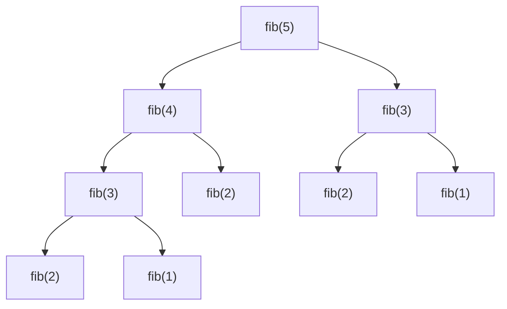

# Interview Problems: Dynamic Programming

> **In this lesson:** dynamic programming, a name that sounds far harder than the idea behind it: when a recursive answer keeps solving the same smaller question over and over, remember each answer the first time. You'll watch a function slow to a crawl from repeated work, fix it two ways, and then solve a classic problem that has the same shape hiding inside it.

## Words you need first

- **Subproblem.** A smaller version of the question you're answering, whose answer helps build the big one.
- **Overlapping subproblems.** When the same subproblem comes up many times in one solution. This is the sign that dynamic programming will help.
- **Memoization.** Remembering the answer to each subproblem the first time you work it out, usually in an object, and looking it up after that. "Memo" as in a note to yourself.
- **Bottom-up.** Working out the smallest answers first and building up to the one you want, usually with a loop and a table.
- **Dynamic programming.** Solving a problem by breaking it into overlapping subproblems and remembering their answers. The name is old and doesn't describe it well. Don't let it scare you.

## A function that does the same work again and again

The Fibonacci numbers start 1, 1, and each one after that is the two before it added together: 1, 1, 2, 3, 5, 8, 13, 21... That rule is recursive, and it's easy to write that way:

```js
function fib(n) {
  if (n <= 2) return 1;
  return fib(n - 1) + fib(n - 2);
}
```

It's correct. Now try `fib(45)`. It takes several seconds. `fib(60)` won't finish today.

Draw the calls for `fib(5)`:



`fib(3)` is worked out twice. `fib(2)` three times. For `fib(45)`, `fib(3)` is worked out hundreds of millions of times. Each call makes two more, so the number of calls roughly doubles with each step up in n: O(2ⁿ). All that work, and only n different questions are ever asked.

That's **overlapping subproblems**: a small number of different questions, each asked a huge number of times.

## Fix one: remember each answer

The first time you work out `fib(30)`, write the answer down. Next time someone asks, read it.

```js
function fib(n, memo = {}) {
  if (n <= 2) return 1;
  if (memo[n] !== undefined) return memo[n];
  memo[n] = fib(n - 1, memo) + fib(n - 2, memo);
  return memo[n];
}
```

Two lines changed. Now each `fib(k)` is worked out once, and every other time it's a lookup. That's n real calculations: O(n). `fib(45)` takes no time at all. This is **memoization**, and it's often the quickest way to fix a slow recursive answer in an interview: write the slow recursion, spot the repeats, add a memo.

## Fix two: build up from the bottom

Or turn it around. You know `fib(1)` and `fib(2)`. From them you can work out `fib(3)`, then `fib(4)`, and so on, up to n, with a loop. Each answer only needs the two before it.

| k | two before | one before | fib(k) |
| --- | --- | --- | --- |
| 1 | | | 1 |
| 2 | | | 1 |
| 3 | 1 | 1 | 2 |
| 4 | 1 | 2 | 3 |
| 5 | 2 | 3 | 5 |
| 6 | 3 | 5 | 8 |
| 7 | 5 | 8 | 13 |

```js
function fib(n) {
  let twoBefore = 1;
  let oneBefore = 1;
  for (let k = 3; k <= n; k++) {
    const here = oneBefore + twoBefore;
    twoBefore = oneBefore;
    oneBefore = here;
  }
  return oneBefore;
}
```

O(n) time and O(1) memory, because you only ever keep the last two answers. No recursion, so no call stack to run out of. This is the **bottom-up** version.

```blanks
{
  "title": "Slide the last two answers along",
  "note": "Inside the bottom-up loop. Order matters.",
  "code": "const here = oneBefore ___1___ twoBefore;\ntwoBefore = ___2___;\noneBefore = ___3___;",
  "blanks": [
    { "options": ["+", "*", "-"], "answer": "+", "explain": "Each Fibonacci number is the two before it added together." },
    { "options": ["oneBefore", "here", "twoBefore"], "answer": "oneBefore", "explain": "Moving one step up, the old one-before becomes the new two-before. Do this before oneBefore changes, or you'll lose it." },
    { "options": ["here", "twoBefore", "oneBefore + 1"], "answer": "here", "explain": "The answer you just worked out is the one-before for the next step." }
  ]
}
```

## How to spot it

Dynamic programming fits when both of these are true:

1. **The answer is built from answers to smaller versions** of the same question. Often: "the ways to reach n come from the ways to reach the step before".
2. **The same smaller versions come up again and again.** Draw the calls for a small input and look for repeats.

Problems that ask "**how many ways**", "the **fewest** steps or coins", "the **most** money" or "the **longest**", where a greedy shortcut doesn't work, are the usual suspects.

And a method that works for the easy ones:

1. Write the slow recursive answer first. Say it's O(2ⁿ).
2. Draw the calls for a small input and point at the repeats.
3. Add a memo. Say it's now O(n).
4. If you have time, turn it into a bottom-up loop.

```order
title: From slow recursion to dynamic programming
---
Write the recursive answer that builds n from smaller versions
Draw its calls for a small n and find the repeated ones
Add a memo so each smaller answer is worked out once
Turn it into a loop that builds from the smallest answers up
```

## Open the problem

Use the `problems` folder you downloaded with the first set of interview problems. **Don't download it again.** That would replace your finished answers with empty files. If you have no `problems` folder at all, run `curl -sL https://ai.parsity.io/labs/problems.tar.gz | tar xz` once from the top of `parsity-labs`.

```bash
cd problems/dynamic-programming
node --test
```

Write it by hand, in any language you like while you practice. The version you hand in is JavaScript. Use the seven steps: say it back, ask about the edges, work an example by hand, say the slow answer and its Big O, make it faster, write the code, test it out loud. Here, steps four and five are the method above.

**Try it yourself first.** Give it 30 minutes of real effort before you open a hint. Start by listing every way up staircases of 1, 2, 3 and 4 steps on paper. Then one hint at a time, with 15 more minutes between them.

## Problem: Ways up the stairs

Open `climb-stairs.js`. A staircase has n steps. Each move, you climb 1 step or 2. Write `climbStairs(n)`: the number of different ways to reach the top. Three steps have three ways: 1 + 1 + 1, 1 + 2, and 2 + 1.

Step two: what's the smallest staircase? (The comment says n is 1 or more.) How big can n get? Our tests use tall staircases, so the slow answer won't pass.

<details>
<summary>Hint 1: think about the last move</summary>

However you reached the top of n steps, your last move was either 1 step or 2 steps. If it was 1, where were you just before? If it was 2?

</details>

<details>
<summary>Hint 2: the recursive answer</summary>

The ways to reach step n are the ways to reach step n - 1 plus the ways to reach step n - 2. What are the answers for 1 step and for 2 steps? Write the slow recursive version and check it against your paper list. Then draw its calls for n = 5. Seen this shape before?

</details>

<details>
<summary>Hint 3: make it fast</summary>

Add a memo, or build up from the bottom with two variables, exactly as with `fib`. Only the starting values are different. Check your answers: 1, 2, 3, 5, 8 for 1 to 5 steps.

</details>

## Hand it in

When all three tests pass, commit and push.

```submit
assignment: dsa-dynamic-programming
```

Paste the link to your `parsity-labs` repository. We check the `problems/dynamic-programming` folder, including a staircase of one step and a staircase of 44 steps, which the plain recursive answer can't climb in time.

## Stretch: houses on a street

Not graded. Do it on paper first. A row of houses each holds some money. You can take from any house, but never from two houses next to each other. What's the most you can take? `[2, 7, 9, 3, 1]` gives 12, from 2, 9 and 1.

Use the method. For the last house, there are two choices: take it, and add the best you could do up to two houses before; or skip it, and keep the best up to the house before. Write the recursion, find the repeats, then build it bottom-up with two variables. Does a greedy idea, such as always taking the biggest house, work here? Find a counterexample.

```quiz
[
  {
    "q": "Why is the plain recursive fib so slow for large n?",
    "options": ["It works out the same smaller fib values over and over, so the calls roughly double with each step up in n", "Adding numbers is slow", "Recursion is always slower than loops", "It isn't slow"],
    "answer": 0,
    "explain": "Only n different questions exist, but each is asked a huge number of times. That's overlapping subproblems, and it's what makes it O(2ⁿ)."
  },
  {
    "q": "What does adding a memo to a recursive answer do?",
    "options": ["Each smaller answer is worked out once and looked up after that", "It removes the base case", "It makes the function stop calling itself", "It sorts the answers"],
    "answer": 0,
    "explain": "The first time an answer is worked out it's saved. Every later call for the same input is an O(1) lookup."
  },
  {
    "q": "Which of these is the strongest sign that dynamic programming will help?",
    "options": ["Drawing the recursive calls shows the same calls appearing many times", "The input is sorted", "The problem asks for every possible answer", "The input is a grid"],
    "answer": 0,
    "explain": "Repeated subproblems are what dynamic programming removes. A problem asking for every answer usually wants backtracking, since there's nothing to reuse."
  }
]
```

## Key takeaways

- Dynamic programming is remembering the answers to smaller questions so you never work one out twice.
- It fits when the answer is built from smaller versions and the same smaller versions repeat.
- Memoization adds a memo to the slow recursion. Bottom-up builds from the smallest answers with a loop.
- Either turns an O(2ⁿ) recursion like `fib` into O(n).
- In an interview: write the slow recursion, draw the calls, point at the repeats, add the memo.

## Work with AI

```ai-prompt
title: Find the repeats with me
---
I'm a beginner learning dynamic programming. My method is: write the slow recursive
answer, draw its calls for a small input, find the repeated calls, add a memo, then
build it bottom-up. Give me one easy counting problem that's different from climbing
stairs and Fibonacci, such as counting paths across a small grid moving only right
or down. Don't give me the answer. Walk me through my method one step at a time,
asking me to do each step and checking it. When I draw the calls, ask me to count how
many times one particular call appears. Don't write code for me.
```
