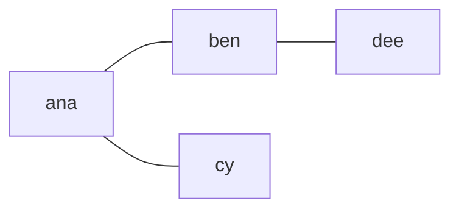

# Interview Problems: Graphs

> **In this lesson:** graphs, the most general way to describe things and the connections between them: people and friendships, cities and roads, web pages and links. You'll learn how to store one, and the two ways to explore it: depth-first, which goes as far as it can before backing up, and breadth-first, which spreads out one step at a time and finds the shortest route. Then two classic problems, one for each.

## Words you need first

- **Graph.** A set of things, called **nodes**, and the connections between them, called **edges**. A tree is a graph with no loops and one root. A general graph can have loops and no top at all.
- **Neighbor.** A node that's one edge away.
- **Adjacency list.** A way to store a graph: for each node, a list of its neighbors.
- **Visited.** A record of the nodes you've already explored, so you never explore one twice.
- **Queue.** First in, first out. You built one by hand. Breadth-first search runs on one.

## Storing a graph

The usual way, and the one in your problems, is an object where each key is a node and each value is the list of its neighbors:

```js
const friends = {
  ana: ["ben", "cy"],
  ben: ["ana", "dee"],
  cy: ["ana"],
  dee: ["ben"],
};
```



Friendship goes both ways, so each one is listed twice: ana lists ben and ben lists ana. Finding a node's neighbors is one lookup: `friends.ana`.

A **grid** is a graph too, even though it doesn't look like one. Each square is a node, and its neighbors are the squares up, down, left and right of it. You don't store the edges. You work them out from the row and column.

## The rule that makes graphs different: visited

Trees only go down, so a walk always ends. Graphs can go round in circles: ana to ben to dee to... and if dee knew ana, back to ana, forever.

Every graph search keeps a **visited** record, usually a `Set`. Before exploring a node, check it. If it's been visited, skip it. If not, mark it and explore. That one habit is what stops infinite loops, and forgetting it is the most common graph bug in interviews.

## Depth-first search

**Depth-first search** (DFS) goes as far as it can down one path, then backs up and tries the next. It's the tree walk you know, plus a visited set. Recursion writes it naturally:

```js
function explore(graph, node, visited) {
  if (visited.has(node)) return;
  visited.add(node);
  for (const neighbor of graph[node] || []) {
    explore(graph, neighbor, visited);
  }
}
```

After `explore(friends, "ana", new Set())`, the visited set holds everyone ana is connected to, by any chain of friends. DFS is good for "can I get there at all?", "which things are connected?" and "how many separate groups are there?".

The `|| []` handles a node with no entry in the object: it has no neighbors.

One warning, the same as for any recursion: a path 100,000 nodes long means 100,000 waiting calls, and the call stack runs out. For huge graphs, use a loop with your own array as a stack instead of recursion, or use breadth-first search.

## Breadth-first search

**Breadth-first search** (BFS) visits the start, then everything one step away, then everything two steps away, and so on, like ripples on a pond. Because it goes in order of distance, **the first time BFS reaches a node is by the fewest steps**. That's why it's the tool for shortest routes.

It uses a queue: take the node at the front, add its unvisited neighbors to the back.

Work it by hand on this graph, from `ana`, keeping track of each node's distance:

```js
const graph = {
  ana: ["ben", "cy"],
  ben: ["ana", "dee", "eve"],
  cy: ["ana", "eve"],
  dee: ["ben"],
  eve: ["ben", "cy", "fay"],
  fay: ["eve"],
};
```

| Step | Take from front | Its unvisited neighbors, added to the back | Queue after | Distances known |
| --- | --- | --- | --- | --- |
| start | | | ana | ana 0 |
| 1 | ana | ben, cy | ben, cy | ben 1, cy 1 |
| 2 | ben | dee, eve | cy, dee, eve | dee 2, eve 2 |
| 3 | cy | (ana and eve already seen) | dee, eve | |
| 4 | dee | (none) | eve | |
| 5 | eve | fay | fay | fay 3 |
| 6 | fay | (none) | (empty) | |

Ana to fay is 3 steps. Depth-first search, by contrast, reaches each node by whatever path it happens to try first. From ana it would go to ben, then dee, back up, then eve, and from eve reach cy as its fifth stop, 3 steps deep, when cy is really ana's direct friend. Mark a node as visited **when you add it to the queue**, as the table does, so it can't be added twice.

**Watch the queue.** `queue.shift()` takes from the front of an array, and you know it moves every other item down one place. On a big graph that turns BFS into O(n²). Keep a `front` position instead, and move it forward as you take items, the way your hand-built queue did.

```order
title: One step of breadth-first search
---
Take the node at the front of the queue
Look up its neighbors
Skip any neighbor that's already been seen
Record each new neighbor's distance as this node's distance plus one
Mark each new neighbor as seen and add it to the back of the queue
```

### Big O for graphs

Both searches visit each node once and look along each edge a fixed number of times. Graph Big O is written with both: **O(V + E)**, where V is the number of nodes and E the number of edges. For a grid of R rows and C columns, that's O(R × C), because each square has at most four neighbors.

The slow answers in graph problems usually come from forgetting visited (exploring the same nodes again and again, or forever), from starting a fresh search for every node, or from `shift` on a long queue.

## When to reach for which

```match
{
  "title": "Depth-first or breadth-first?",
  "note": "Tap the question, then the search that fits best.",
  "pairs": [
    { "left": "The fewest moves from start to finish in a maze", "right": "Breadth-first: the first arrival is the shortest" },
    { "left": "How many separate groups of friends are there?", "right": "Either one, started from each unvisited person" },
    { "left": "Everyone within two steps of me", "right": "Breadth-first, stopping after distance 2" },
    { "left": "Is there any way at all from A to B, on a small graph?", "right": "Depth-first is simplest" }
  ]
}
```

Graph problems often don't say "graph". Listen for: connections, networks, friends of friends, routes, maps, grids, "spreads to neighbors", dependencies.

## Open the problems

Use the `problems` folder you downloaded with the first set of interview problems. **Don't download it again.** That would replace your finished answers with empty files. If you have no `problems` folder at all, run `curl -sL https://ai.parsity.io/labs/problems.tar.gz | tar xz` once from the top of `parsity-labs`.

```bash
cd problems/graphs
node --test
```

Write these by hand, in any language you like while you practice. The version you hand in is JavaScript. Use the seven steps: say it back, ask about the edges, work an example by hand, say the slow answer and its Big O, make it faster, write the code, test it out loud. For graphs, step three means drawing the nodes and edges, or the grid, and tracing the search with the visited set in its own column.

**Try it yourself first.** Give each problem 30 minutes of real effort, with a drawing, before you open a hint. Then one hint at a time, with 15 more minutes between them.

## Problem 1: Count the islands

Open `count-islands.js`. The map is a list of strings, one per row. `"#"` is land and `"."` is water. Land squares touching up, down, left or right are one island. Corners don't count. Write `countIslands(grid)`: how many islands?

Step two: an empty map? All water? A U-shaped island? Land that only touches at corners?

<details>
<summary>Hint 1: the plan</summary>

Go through every square, row by row. When you find land you haven't visited, that's a new island: add one to the count. Then visit every square of that island, so you won't count it again.

</details>

<details>
<summary>Hint 2: visiting an island</summary>

Visiting is depth-first search on the grid. From a square, try the four neighbors: `row + 1`, `row - 1`, `col + 1`, `col - 1`. Skip any that are off the map, are water, or are already visited. A `Set` of strings like `"3,4"` makes a good visited record, because two arrays `[3, 4]` are never equal to each other.

</details>

<details>
<summary>Hint 3: the checks, in order</summary>

Check the row and column are on the map before you read `grid[row][col]`, or you'll read past the edge. Then check it's land, then check it isn't visited. Trace `["#.#", "#.#", "###"]` by hand. It's one island. A shortcut that only looks up and left will count two.

</details>

## Problem 2: How many steps between two people?

Open `degrees-apart.js`. Write `degreesApart(friends, from, to)`: the fewest friend-to-friend steps from one person to another. A person is 0 steps from themselves. If there's no chain of friends at all, give -1.

"Fewest steps" is the signal. Say out loud which search finds the fewest, and why the other one might not.

<details>
<summary>Hint 1: the shape</summary>

Breadth-first search from `from`, recording each person's distance as you find them. The moment you find `to`, its distance is the answer. If the queue empties first, there's no chain.

</details>

<details>
<summary>Hint 2: what to keep</summary>

A queue array with a `front` position, and an object (or a `Map`) from person to distance. The distance object can double as your visited record: if someone has a distance, they've been seen.

</details>

<details>
<summary>Hint 3: the edges</summary>

Check `from === to` first, and give back 0. A person missing from the `friends` object has no friends: `friends[person] || []` handles that. Trace a graph with a circle of three friends and a target in a separate group. It should end with -1, not loop forever.

</details>

## Hand it in

When all six tests pass, commit and push.

```submit
assignment: dsa-graphs
```

Paste the link to your `parsity-labs` repository. We check the `problems/graphs` folder, including U-shaped and hollow islands, corners, an empty map, a 400 by 400 map, a short way and a long way round, circles of friends, people with no friends, and 200,000 people in a line.

```quiz
[
  {
    "q": "A graph search forgets to keep a visited record. What happens on a graph where ana, ben and cy are all friends with each other?",
    "options": ["It goes round the circle forever, or until the call stack overflows", "It runs a bit slower", "It finds the same answer", "It skips cy"],
    "answer": 0,
    "explain": "From ana it reaches ben, from ben it reaches ana again, and so on. Visited is what stops a search going in circles."
  },
  {
    "q": "Why does breadth-first search find the fewest steps?",
    "options": ["It visits everything 1 step away before anything 2 steps away, so the first arrival is by the shortest route", "It tries every path and keeps the shortest", "It uses recursion", "It doesn't, depth-first does"],
    "answer": 0,
    "explain": "BFS works outward in order of distance. Nothing farther is looked at until everything nearer has been."
  },
  {
    "q": "A breadth-first search on 200,000 nodes uses queue.shift() to take from the front. What's the risk?",
    "options": ["Each shift moves every remaining item, which can make the search O(n²)", "shift takes from the back", "Nothing, shift is O(1)", "The queue holds the wrong nodes"],
    "answer": 0,
    "explain": "Removing the first item of an array closes the gap by moving everything down. Keeping a front position avoids moving anything."
  }
]
```

## Key takeaways

- A graph is nodes and edges. Store it as an adjacency list: each node maps to its neighbors.
- Every graph search needs a visited record, or it can loop forever.
- Depth-first goes as deep as it can, then backs up. It's good for "is it connected?" and counting groups.
- Breadth-first spreads out one step at a time with a queue. The first arrival is the shortest route.
- Graph searches are O(V + E). A grid is a graph where neighbors are worked out from the row and column.

## Work with AI

```ai-prompt
title: Trace a search with me
---
I'm a beginner learning graph searches. Give me a small graph of six to eight people
as an adjacency list, with at least one circle and one person who isn't connected to
anyone. Ask me to run breadth-first search from one person by hand, writing a table
with one row per step: the node I take from the front, the neighbors I add, the queue
after, and the distances I know. Check each row. Then ask me to do depth-first search
from the same person and tell you the order I visit people in. Finally ask me why the
two orders differ and which one gives shortest distances. Don't write code for me.
```
