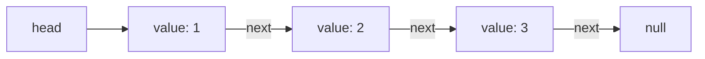

# Interview Problems: Linked Lists

> **In this lesson:** the linked list, a chain of small objects where each one points to the next. You'll learn how it differs from an array, how to walk one, and how to rewire it without losing half of it. Then two classic problems: turning a chain around, and spotting a chain that loops back on itself.

## Words you need first

- **Node.** One link in the chain: a small object holding a `value` and a `next`.
- **Linked list.** A chain of nodes, each pointing to the one after it. The last node's `next` is `null`.
- **Head.** The first node. If you have the head, you can reach every node. An empty list has a head of `null`.
- **Reference.** A way of pointing at an object. `a.next = b` makes `a.next` point at the same object as `b`. Nothing is copied.
- **Cycle.** A chain that loops back to a node it already passed, so it never reaches `null`.

## What a linked list is

An array keeps its items side by side in memory, numbered from 0. A linked list keeps each item in its own small object, and each object knows only where the next one is.

```js
const c = { value: 3, next: null };
const b = { value: 2, next: c };
const a = { value: 1, next: b };   // a is the head: 1 -> 2 -> 3
```



That changes what's fast:

| Job | Array | Linked list |
| --- | --- | --- |
| Get the item at position 5,000 | O(1): jump straight there | O(n): follow 5,000 `next`s |
| Add an item at the front | O(n): everything moves up one place | O(1): new node points at the old head |
| Remove the front item | O(n): everything moves down one place | O(1): the head becomes `head.next` |

You've seen why removing from the front of an array is slow: every other item has to move. A linked list never moves anything. It only changes where one `next` points. That's why queues and the history in some apps are built as chains.

In interviews, linked lists are popular for a different reason: they test whether you can rewire references carefully without losing track of anything.

## Walking a list

Every linked list problem starts with the same loop:

```js
let node = head;
while (node !== null) {
  // do something with node.value
  node = node.next;
}
```

`node` starts at the head and steps along until it falls off the end. There's no position number. If you need one, count it yourself.

The starter folder has helpers in `list.js`: `fromArray([1, 2, 3])` builds a chain and gives back its head, and `toArray(head)` turns a chain back into an array, which makes tests easy to read.

## The danger: losing the rest of the chain

Say you want to cut node `b` out of `a -> b -> c`. One line does it:

```js
a.next = a.next.next;   // a now points at c, and b is skipped
```

Now say you wrote these in the wrong order while rewiring something:

```js
a.next = null;
const rest = a.next;    // null: c and everything after it is gone
```

Once nothing points at a node, you can never reach it again. **Before you change a `next`, save anything you'll still need from it.** That one habit solves most linked list bugs.

## Work one by hand: reversing a chain

Turn `1 -> 2 -> 3` into `3 -> 2 -> 1`, using the same nodes. Walk the chain once with three references:

- `previous`: the node behind you, which the current node should point back to. It starts as `null`, because the old head becomes the new end.
- `node`: the node you're rewiring.
- `next`: saved before you rewire, so you don't lose the rest of the chain.

| Pass | node | save next | point node back at | previous after | node after |
| --- | --- | --- | --- | --- | --- |
| 1 | 1 | 2 | null | 1 | 2 |
| 2 | 2 | 3 | 1 | 2 | 3 |
| 3 | 3 | null | 2 | 3 | null |

When `node` is `null`, you've rewired every node, and `previous` is the new head: 3, which points to 2, which points to 1, which points to `null`.

```order
title: One pass of reversing a chain
---
Save node.next so the rest of the chain isn't lost
Point node.next back at previous
Move previous forward to node
Move node forward to the saved next
```

### Slow and fast

A slow version copies every value into an array, reverses the array, and builds a brand-new chain. That's O(n) time, but O(n) extra memory, and the interviewer asked you to rewire the nodes you were given. The three-reference walk is O(n) time and O(1) extra memory.

There's also a short recursive version, using what you learned in the recursion lesson. It's elegant, and it makes one call per node, so every node adds a note to the call stack. Node runs out of room for those notes at around ten thousand calls, so on a chain of a million nodes the recursive version crashes where the loop doesn't. Our tests keep the reversing chains short enough that a correct recursive answer passes. If you write it recursively, be ready to say in an interview why the loop is safer for long chains.

## When to reach for these techniques

- The input is a linked list, so you can't jump to a position: walk it.
- You need to rewire: save `next` first.
- You need to find something in the middle, or detect a loop: two references moving at different speeds often do it, as you'll see.

```match
{
  "title": "Which is faster here?",
  "note": "Tap the job, then the structure that does it in O(1).",
  "pairs": [
    { "left": "Read the 1,000th item", "right": "An array, by position" },
    { "left": "Add a new item at the very front", "right": "A linked list, by pointing a new node at the head" },
    { "left": "Check whether an item is in the collection", "right": "A Set" }
  ]
}
```

## Open the problems

Use the `problems` folder you downloaded with the first set of interview problems. **Don't download it again.** That would replace your finished answers with empty files. If you have no `problems` folder at all, run `curl -sL https://ai.parsity.io/labs/problems.tar.gz | tar xz` once from the top of `parsity-labs`.

```bash
cd problems/linked-lists
node --test
```

Read `list.js` first. Then write these by hand, in any language you like while you practice; the version you hand in is JavaScript. Use the seven steps: say it back, ask about the edges, work an example by hand, say the slow answer and its Big O, make it faster, write the code, test it out loud. For linked lists, working an example by hand means drawing boxes and arrows and redrawing the arrows after every line.

**Try it yourself first.** Give each problem 30 minutes of real effort, on paper with boxes and arrows, before you open a hint. Then one hint at a time, with 15 more minutes between them.

## Problem 1: Turn a chain around

Open `reverse-list.js`. Write `reverseList(head)`: reverse the chain by changing where each `next` points, and give back the new head. Use the nodes you were given.

You've seen the trace above. The work now is turning it into code without peeking, and handling the edges. Step two: an empty list (`null`)? A list of one node?

<details>
<summary>Hint 1: the variables</summary>

You need `previous`, starting at `null`, and `node`, starting at `head`. Inside the loop you'll make a third, `next`, before anything changes.

</details>

<details>
<summary>Hint 2: the loop</summary>

Loop while `node` isn't `null`. The four lines inside are the four steps in the order exercise above, in that order. Which variable holds the new head when the loop ends?

</details>

<details>
<summary>Hint 3: check the edges by hand</summary>

Trace `reverseList(null)`: the loop never runs. What do you give back? Trace a single node: one pass. Does its `next` end up as `null`?

</details>

## Problem 2: Does the chain loop back?

Open `has-loop.js`. Write `hasLoop(head)`: true if following `next` from the head ever comes back to a node it already passed, false if it reaches `null`.

The trap: walking until you hit `null` never ends on a chain with a loop. You need a way to notice you've been here before.

<details>
<summary>Hint 1: remember where you've been</summary>

Walk the chain and keep a `Set` of what you've passed. If you reach something already in the set, there's a loop. But be careful what you put in the set. Two different nodes can hold the same value. A `Set` can hold the node objects themselves, and it compares them by reference.

</details>

<details>
<summary>Hint 2: a way with no extra memory</summary>

The `Set` answer uses O(n) memory. There's a famous O(1) one. Send two references down the chain: `slow` moves one node at a time, `fast` moves two. If there's no loop, `fast` reaches `null`. If there is, `fast` ends up going round the loop and catches `slow` from behind, like a faster runner lapping a slower one on a track.

</details>

<details>
<summary>Hint 3: the fast pointer's edges</summary>

`fast` moves two steps, so before moving it you have to check both `fast` and `fast.next` aren't `null`. If they meet (`slow === fast`), give back true. Trace a single node that points to itself, and a single node that points to `null`.

</details>

## Hand it in

When all six tests pass, commit and push.

```submit
assignment: dsa-linked-lists
```

Paste the link to your `parsity-labs` repository. We check the `problems/linked-lists` folder, including empty lists, nodes that repeat a value, a long chain to reverse, and chains of 300,000 nodes to check for a loop quickly. Our tests build their own nodes with only `value` and `next`, so don't rely on anything else from `list.js`.

```quiz
[
  {
    "q": "Inside the reversing loop, you set node.next = previous before saving node.next. What happens?",
    "options": ["You lose the rest of the chain, because nothing points to it any more", "The list comes out in the same order", "It works but uses more memory", "JavaScript throws an error"],
    "answer": 0,
    "explain": "node.next was the only reference to the rest of the chain. Overwrite it first and the rest can never be reached."
  },
  {
    "q": "Someone detects a loop by keeping a Set of the values they've seen. Which chain proves them wrong?",
    "options": ["1 -> 2 -> 1 -> null, which has no loop but repeats a value", "1 -> 2 -> 3 -> null", "An empty list", "A single node pointing to itself"],
    "answer": 0,
    "explain": "Two different nodes both hold 1, so a Set of values says \"seen it\" when the chain is fine. A Set of nodes compares the objects themselves."
  },
  {
    "q": "Why can't you get the 500th item of a linked list in O(1)?",
    "options": ["Each node only knows the next one, so you have to follow 500 links", "Linked lists are always sorted", "Nodes are stored in a Set", "You can, with head[500]"],
    "answer": 0,
    "explain": "There's no numbering. The only way to the 500th node is through the 499 before it."
  }
]
```

## Key takeaways

- A linked list is a chain of nodes, each with a `value` and a `next`. The head reaches everything.
- Adding or removing at the front is O(1). Reaching a position is O(n).
- Save `next` before you change it, or you lose the rest of the chain.
- Reversing in place uses `previous`, `node` and a saved `next`: O(n) time, O(1) memory.
- Two references at different speeds detect a loop with no extra memory. Compare nodes, never values.

## Work with AI

```ai-prompt
title: Draw the arrows with me
---
I'm a beginner learning linked lists, where each node is { value, next }. Give me a
four-node chain and a short piece of JavaScript, five lines or fewer, that rewires it,
such as removing a node, inserting one, or swapping two. Don't tell me what it does.
Ask me to describe the chain after each line as text like 1 -> 3 -> null. Include one
snippet that loses part of the chain by changing a next too early, and ask me which
nodes can no longer be reached and how to fix the order. Do four of these. Don't write
my problem solutions.
```
