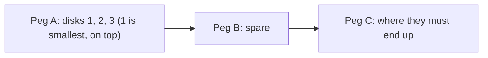

# Interview Problems: Recursion

> **In this lesson:** recursion from zero: a function that solves a problem by calling itself on a smaller version of it. You'll trace it on the call stack, learn why every recursive function needs a base case, and solve two problems with it, including the Towers of Hanoi, a puzzle that's almost impossible with loops and short with recursion.

## Words you need first

- **Recursion.** A function calling itself. Each call works on a smaller piece of the problem.
- **Base case.** The smallest version of the problem, small enough to answer straight away, with no further call. It's what stops the recursion.
- **Recursive case.** Every other version: make the problem smaller, call yourself on it, and build your answer from what comes back.
- **Call stack.** The pile of "I was in the middle of this" notes the computer keeps, one per function call that hasn't finished yet.
- **Stack overflow.** What happens when the call stack runs out of room, usually because a base case was never reached.

## A function that calls itself

You've added up the numbers from 1 to n with a loop. Here's another way to think about it: the total up to 4 is 4 plus the total up to 3. The total up to 3 is 3 plus the total up to 2. And so on, down to the total up to 1, which is just 1.

```js
function sumTo(n) {
  if (n === 1) return 1;          // base case: answer straight away
  return n + sumTo(n - 1);        // recursive case: a smaller version of the same question
}

sumTo(4);   // 10
```

That's the whole idea. Every recursive function has the same two parts:

- A **base case** that answers without calling itself.
- A **recursive case** that calls itself on something smaller, and does a little work with the answer.

## Trace it on the call stack

When `sumTo(4)` runs, it can't finish until `sumTo(3)` gives it an answer, so the computer leaves a note and starts `sumTo(3)`. That one leaves a note too. The notes pile up on the call stack:

| Step | Running | Waiting on the stack, newest first | Gives back |
| --- | --- | --- | --- |
| 1 | sumTo(4) | (none) | needs sumTo(3) |
| 2 | sumTo(3) | sumTo(4) | needs sumTo(2) |
| 3 | sumTo(2) | sumTo(3), sumTo(4) | needs sumTo(1) |
| 4 | sumTo(1) | sumTo(2), sumTo(3), sumTo(4) | 1, the base case |
| 5 | sumTo(2) again | sumTo(3), sumTo(4) | 2 + 1 = 3 |
| 6 | sumTo(3) again | sumTo(4) | 3 + 3 = 6 |
| 7 | sumTo(4) again | (none) | 4 + 6 = 10 |

The calls go down until they hit the base case, then the answers come back up, each waiting call finishing in turn. Newest first: it's a stack.

```order
title: The order things happen in sumTo(2)
---
sumTo(2) starts and checks its base case, which isn't true
sumTo(2) calls sumTo(1) and waits
sumTo(1) hits the base case and gives back 1
sumTo(2) carries on and works out 2 + 1
sumTo(2) gives back 3
```

### When there's no way down

What does `sumTo(0)` do? The base case checks for 1. 0 isn't 1, so it calls `sumTo(-1)`, which calls `sumTo(-2)`, forever. Each call adds a note to the stack. Node has room for roughly ten thousand of them, then it stops with:

```
RangeError: Maximum call stack size exceeded
```

That's a **stack overflow**. Two lessons in it:

- **Check every input reaches a base case.** `if (n <= 1)` would have covered 0. Interviewers often ask "what does your function do with 0?" for exactly this reason.
- **Very deep recursion overflows even when it's correct.** A recursive function on a list of 200,000 items, one call per item, can crash where a loop wouldn't. Recursion is the right tool when the depth stays reasonable, as it does for most nested data.

## How to think recursively

Three questions, in this order:

1. **What's the smallest version I can answer straight away?** That's the base case. Often it's empty, zero or one.
2. **How do I make the problem one step smaller?** Usually: one fewer item, one level less deep, n - 1.
3. **If someone handed me the answer to the smaller version, how would I build my answer from it?**

The third question is the hard one, and there's a trick to it. **Trust the call.** Don't try to follow every level in your head. Assume `sumTo(n - 1)` gives the right answer, and only ask: given that, what do I do? This feels like cheating. It's how everyone who's good at recursion thinks.

```blanks
{
  "title": "Count the items in an array, recursively",
  "note": "items.slice(1) is the array without its first item.",
  "code": "function countItems(items) {\n  if (items.length === ___1___) return ___2___;\n  return ___3___ + countItems(items.slice(1));\n}",
  "blanks": [
    { "options": ["0", "1", "-1"], "answer": "0", "explain": "The smallest array is the empty one. Starting at 1 would never stop for an empty array." },
    { "options": ["1", "0", "items"], "answer": "0", "explain": "An empty array has no items, so its count is 0." },
    { "options": ["items[0]", "items.length", "1"], "answer": "1", "explain": "Trust the call to count the rest. The first item adds one more to that count." }
  ]
}
```

## When to reach for it

- The data has **things inside things of the same kind**: folders in folders, lists in lists, comments with replies, trees.
- The problem can be described as **a smaller version of itself**: "to move n disks, first move n - 1".
- You need to **try every option**, and each option leads to more options.

The slow and fast question works a little differently here. Recursion usually does the same work a loop would, written in a way that matches the shape of the problem. What you have to watch is how many calls it makes. `sumTo(n)` makes n calls: O(n). Some recursive functions make two calls each time, and that number explodes. You'll see one now.

## The Towers of Hanoi

Three pegs. On the first, a stack of disks, biggest at the bottom. Move all of them to the third peg. Two rules: move one disk at a time, and never put a bigger disk on a smaller one.



Try it on paper with three coins of different sizes before reading on. Most people get there with three by trial and error, and get lost with four.

### Thinking about it recursively

Ask the three questions.

1. **Smallest version?** Zero disks: nothing to do. (One disk is easy too: move it.)
2. **One step smaller?** The same puzzle with n - 1 disks.
3. **Given a way to move n - 1 disks, how do I move n?** Look at the biggest disk. It has to get from A to C, and nothing can be on top of it, and nothing smaller can be on C when it lands. So the other n - 1 disks must all be on B at that moment.

That gives a plan in three parts:

- Move the top n - 1 disks from A to B, using C as the spare.
- Move the biggest disk from A to C.
- Move the n - 1 disks from B to C, using A as the spare.

The first and last lines are the same puzzle, smaller, with the pegs swapped around. Trust the call.

Here are the moves for two disks, A to C:

| Move | Disk | From | To | Why |
| --- | --- | --- | --- | --- |
| 1 | small | A | B | move the top 1 disk out of the way, onto the spare |
| 2 | big | A | C | the biggest disk goes straight to the target |
| 3 | small | B | C | move the 1 disk back on top |

With three disks, the "move the top two to B" part is this same three-move dance, with B as the target. Write out all seven moves on paper and check each against the rules.

### Its Big O

Each call with n disks makes two calls with n - 1. The number of moves for n disks is 2 to the power n, minus 1: 1, 3, 7, 15, 31... Each extra disk doubles the work. That's **O(2ⁿ)**, called exponential, and it's the fastest-growing Big O you've met. Twenty disks is over a million moves. Sixty-four, the number in the legend the puzzle comes from, would take longer than the universe has existed at one move a second.

Here, no faster answer exists, because the answer itself is that long. In most other problems, O(2ⁿ) is the slow answer you should be trying to beat.

## Open the problems

Use the `problems` folder you downloaded with the first set of interview problems. **Don't download it again.** That would replace your finished answers with empty files. If you have no `problems` folder at all, run `curl -sL https://ai.parsity.io/labs/problems.tar.gz | tar xz` once from the top of `parsity-labs`.

```bash
cd problems/recursion
node --test
```

Write these by hand, in any language you like while you practice. The version you hand in is JavaScript. Use the seven steps: say it back, ask about the edges, work an example by hand, say the slow answer and its Big O, make it faster, write the code, test it out loud. For recursion, add the three questions to step three.

**Try it yourself first.** Give each problem 30 minutes of real effort, with coins or a drawing for Hanoi, before you open a hint. Then one hint at a time, with 15 more minutes between them.

## Problem 1: Towers of Hanoi

Open `hanoi.js`. Write `hanoi(n, from, to, spare)`: the list of moves that takes n disks from the `from` peg to the `to` peg. Each move is `[fromPeg, toPeg]`, using the peg names you were given. `hanoi(0, ...)` gives `[]`.

<details>
<summary>Hint 1: the base case</summary>

What's the list of moves for zero disks? If your base case is one disk instead, what does your function do when someone asks for zero? Trace it.

</details>

<details>
<summary>Hint 2: three pieces</summary>

The answer for n disks is three lists joined end to end: the moves for n - 1 disks from `from` to `spare`, then the single move `[from, to]`, then the moves for n - 1 disks from `spare` to `to`. Which peg is the spare in each of the two smaller calls?

</details>

<details>
<summary>Hint 3: joining lists</summary>

`[...first, middle, ...last]` makes one array from two arrays and an item in between. `first.concat([middle], last)` does the same. Check your answer for 2 disks against the table above, move by move.

</details>

## Problem 2: Flatten a nested list

Open `flatten.js`. Write `flatten(nested)`: one flat array of every value that isn't an array, in order, however deep the nesting goes. `[1, [2, [3, [4]], 5]]` gives `[1, 2, 3, 4, 5]`.

The rules: use recursion, don't use the built-in `flat` or `flatMap`, and don't change the array you were given.

Step two questions: what about empty arrays inside arrays? What about values like `0`, `null` or `""`? What about a plain object, like `{ a: 1 }`: is that an array?

<details>
<summary>Hint 1: the three questions</summary>

Smallest version: a value that isn't an array. What does it add to the answer? One step smaller: one item of the array. Trust the call: if `flatten(item)` gives you a flat array for any item that is an array, what do you do with it?

</details>

<details>
<summary>Hint 2: telling arrays apart</summary>

`typeof [1, 2]` is `"object"`, but so is `typeof null` and `typeof { a: 1 }`. Use `Array.isArray(x)`, which is true only for arrays.

</details>

<details>
<summary>Hint 3: putting it together</summary>

Make an empty result array. Walk the items. If an item isn't an array, push it. If it is, flatten it and push every value from what comes back. Give back the result. Trace `[1, [], [2, [3]]]` with one row per call.

</details>

## Hand it in

When all six tests pass, commit and push.

```submit
assignment: dsa-recursion
```

Paste the link to your `parsity-labs` repository. We check the `problems/recursion` folder, including zero disks, sixteen disks, nesting 2,000 levels deep and values that look a lot like arrays.

```quiz
[
  {
    "q": "A recursive function's base case is `if (n === 1) return 1`. What happens when it's called with 0?",
    "options": ["It calls itself with -1, -2 and so on until the call stack overflows", "It gives back 0", "It gives back 1", "JavaScript skips the call"],
    "answer": 0,
    "explain": "0 never equals 1, so it keeps calling itself on smaller numbers and never reaches a base case. Each call adds to the call stack until it runs out of room."
  },
  {
    "q": "To move 5 disks from A to C, what has to be true at the moment the biggest disk moves?",
    "options": ["The other 4 disks are all on B", "The other 4 disks are on C", "The other disks can be anywhere", "The biggest disk moves first"],
    "answer": 0,
    "explain": "Nothing can sit on top of it, and nothing smaller can be on C where it lands. The only place left for the other 4 is B."
  },
  {
    "q": "Each call to a function with n makes two calls with n - 1. Roughly how does the number of calls grow?",
    "options": ["It doubles with each step up in n: O(2ⁿ)", "It grows in step with n: O(n)", "O(n²)", "O(log n)"],
    "answer": 0,
    "explain": "One call makes two, each of those makes two, and so on, n levels deep. That's 2 times 2 times 2, n times."
  }
]
```

## Key takeaways

- A recursive function calls itself on a smaller version of the problem, and has a base case that stops it.
- Each unfinished call waits on the call stack. Too many, or a missing base case, overflows it.
- Think with three questions: the smallest version, one step smaller, and how to build your answer if you trust the smaller call.
- Recursion fits nested data and problems defined by a smaller version of themselves.
- Watch how many calls it makes. Two calls per level is O(2ⁿ), which is fine for Hanoi and a warning sign almost everywhere else.

## Work with AI

```ai-prompt
title: Make me trace the call stack
---
I'm a beginner learning recursion. I know the three questions: what's the base case,
how do I make the problem one step smaller, and how do I build my answer if I trust
the smaller call. Give me four tiny recursive JavaScript functions, one at a time,
each six lines or fewer, such as counting down, reversing a string or adding up digits.
For each, give me an input and ask me to write the call stack as a table: one row per
call, what's waiting, and what each call gives back. Include one with a base case that
misses an input, and ask me which input breaks it. Don't explain the answer until I've
tried.
```
