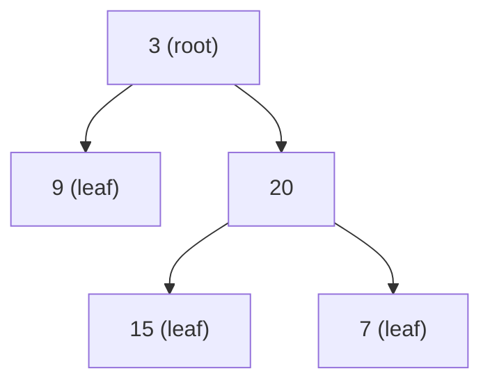

# Interview Problems: Trees

> **In this lesson:** binary trees, where each node can point to two children instead of one. Folders, web pages and company org charts are all trees. You'll learn the words, then the one recursive shape that solves most tree problems, and use it on two classic ones: how tall a tree is, and its mirror image.

## Words you need first

- **Tree.** Nodes connected from the top down, where every node except the top one has exactly one parent, and nothing loops back.
- **Root.** The node at the top. Like the head of a linked list, it reaches everything.
- **Child and parent.** A node's children are the nodes it points to. It is their parent.
- **Leaf.** A node with no children.
- **Binary tree.** A tree where every node has at most two children, called `left` and `right`.

## What a tree looks like in code

A linked list node has one `next`. A binary tree node has a `left` and a `right`, either of which can be `null`.

```js
const tree = {
  value: 3,
  left: { value: 9, left: null, right: null },
  right: {
    value: 20,
    left: { value: 15, left: null, right: null },
    right: { value: 7, left: null, right: null },
  },
};
```



The starter folder has helpers in `tree.js`. `fromArray([3, 9, 20, null, null, 15, 7])` builds that tree from its values read row by row, left to right, with `null` where a node is missing. `toArray(root)` turns a tree back into that form. You'll see trees written this way in interviews too.

## The shape of almost every tree solution

Look at any node. Its left child is the root of a smaller tree. So is its right child. A tree is made of smaller trees, which is exactly the "smaller version of itself" that recursion is good at.

So most tree problems have the same shape:

```js
function solve(node) {
  if (node === null) return /* the answer for an empty tree */;
  const fromLeft = solve(node.left);
  const fromRight = solve(node.right);
  return /* combine node.value, fromLeft and fromRight */;
}
```

Two decisions and you're done: **what's the answer for an empty tree**, and **how do you build a node's answer from its children's answers**. Trust the recursive calls to handle the subtrees.

## Work one by hand: adding up a tree

Add up every value in the tree above. An empty tree adds up to 0. A node's total is its value plus its left total plus its right total.

```js
function total(node) {
  if (node === null) return 0;
  return node.value + total(node.left) + total(node.right);
}
```

The calls go down to the leaves, then answers come back up. One row per call, in the order each one finishes:

| Call on | Left total | Right total | Gives back |
| --- | --- | --- | --- |
| 9 | 0 (null) | 0 (null) | 9 |
| 15 | 0 | 0 | 15 |
| 7 | 0 | 0 | 7 |
| 20 | 15 | 7 | 42 |
| 3 | 9 | 42 | 54 |

Every node is visited once: O(n) time. The call stack holds one note per level, so the extra memory is the height of the tree. For a bushy, balanced tree that's about log n. For a tree that's really a long chain down one side, it's n.

### Slow and fast

Tree answers go slow when they redo work. A common slow way to find a tree's height is to build every path from the root to a leaf as its own array, then take the longest. Each path copies every node above it, so a tree shaped like a long chain does about n²/2 copies: O(n²). The recursive shape visits each node once and passes a single number back up: O(n). When you see yourself copying paths or walking the same nodes again, ask what each child could hand back to its parent instead.

This order, going all the way down one branch before coming back up to try the next, is called **depth-first**. There's another order, row by row, called **breadth-first**. It uses a queue, and graph problems lean on it heavily.

```blanks
{
  "title": "Count the leaves",
  "note": "A leaf has no children at all.",
  "code": "function leaves(node) {\n  if (node === null) return ___1___;\n  if (node.left === null && node.right === null) return ___2___;\n  return leaves(node.left) ___3___ leaves(node.right);\n}",
  "blanks": [
    { "options": ["0", "1", "null"], "answer": "0", "explain": "An empty tree has no leaves. Returning 1 would count every missing child as a leaf." },
    { "options": ["1", "0", "2"], "answer": "1", "explain": "This node has no children, so it is one leaf, and there's nothing below it to count." },
    { "options": ["+", "*", "||"], "answer": "+", "explain": "The leaves of a tree are the leaves on the left plus the leaves on the right." }
  ]
}
```

## When to reach for it

- The input is a tree, or anything nested: folders, a page's elements, an org chart, comments with replies.
- The answer for a node depends on the answers for its children: sizes, heights, totals, "does this subtree contain...".
- You need to change every node the same way.

```match
{
  "title": "Tree words",
  "note": "Tap the word, then what it means.",
  "pairs": [
    { "left": "Root", "right": "The one node with no parent" },
    { "left": "Leaf", "right": "A node with no children" },
    { "left": "Height", "right": "The number of nodes on the longest path from the root down" },
    { "left": "Depth-first", "right": "Go all the way down one branch before trying the next" },
    { "left": "Breadth-first", "right": "Visit every node in one row before the row below" }
  ]
}
```

## Open the problems

Use the `problems` folder you downloaded with the first set of interview problems. **Don't download it again.** That would replace your finished answers with empty files. If you have no `problems` folder at all, run `curl -sL https://ai.parsity.io/labs/problems.tar.gz | tar xz` once from the top of `parsity-labs`.

```bash
cd problems/trees
node --test
```

Read `tree.js` first. Then write these by hand, in any language you like while you practice; the version you hand in is JavaScript. Use the seven steps: say it back, ask about the edges, work an example by hand, say the slow answer and its Big O, make it faster, write the code, test it out loud. For trees, step three means drawing the tree and writing a table like the one above.

**Try it yourself first.** Give each problem 30 minutes of real effort, with a drawing, before you open a hint. Then one hint at a time, with 15 more minutes between them.

## Problem 1: How tall is the tree?

Open `tree-height.js`. Write `treeHeight(root)`: the number of nodes on the longest path from the root down to a leaf. The tree drawn above has a height of 3. An empty tree has a height of 0.

Step two: an empty tree? A single node? A tree that leans all the way down one side?

<details>
<summary>Hint 1: the two decisions</summary>

What's the height of an empty tree? If you know the height of the left subtree and of the right subtree, what's the height of the whole tree?

</details>

<details>
<summary>Hint 2: only one side counts</summary>

The longest path goes down whichever side is taller. `Math.max(a, b)` gives the bigger of two numbers. Then the node itself adds one more to the path.

</details>

<details>
<summary>Hint 3: let null do the work</summary>

If your base case handles `null`, you don't need a separate case for leaves, or checks like `if (node.left !== null)` before each call. Trace a single node: both children are `null`, both give 0, and the node adds 1. Then trace `treeHeight(null)` and make sure it doesn't crash.

</details>

## Problem 2: Mirror a tree

Open `mirror-tree.js`. Write `mirrorTree(root)`: swap the left and right child of every node, so the tree becomes its mirror image. Change the nodes you were given, and give back the root.

Draw the example from the comment in the file and its mirror. Notice that it's more than swapping the root's two children: the subtrees are mirrored inside too.

<details>
<summary>Hint 1: the two decisions</summary>

What's the mirror of an empty tree? For a node, what has to happen to its two children, and what has to happen inside each of them?

</details>

<details>
<summary>Hint 2: swapping without losing one</summary>

Swapping two things needs a third place to hold one while you move the other. Save `node.left`, then set `node.left`, then set `node.right` from what you saved.

</details>

<details>
<summary>Hint 3: where the recursion goes</summary>

Swap the children, and mirror each of them. You can mirror them first and then swap, or swap and then mirror. Both work. Trace a tree with three levels and check that the bottom row comes out reversed, too.

</details>

## Hand it in

When all six tests pass, commit and push.

```submit
assignment: dsa-trees
```

Paste the link to your `parsity-labs` repository. We check the `problems/trees` folder, including empty trees, single nodes, lopsided trees 2,000 levels deep, and a tree of 131,071 nodes. Our tests build their own nodes with only `value`, `left` and `right`.

```quiz
[
  {
    "q": "A tree function starts with `if (node.left === null && node.right === null) return 1`. What breaks?",
    "options": ["Calling it on an empty tree, because null has no left to read", "Trees with two children", "Leaves", "Nothing, it's a fine base case"],
    "answer": 0,
    "explain": "With node equal to null, node.left throws an error. A base case for null handles empty trees and missing children in one line."
  },
  {
    "q": "How much extra memory does a recursive walk of a tree use?",
    "options": ["One call stack note per level, so the height of the tree", "One note per node, always", "None", "O(n²)"],
    "answer": 0,
    "explain": "Only the calls on the current path are waiting at any moment. A balanced tree is about log n tall. A tree shaped like a long chain is n tall."
  },
  {
    "q": "Someone mirrors a tree by swapping only the root's left and right children. Which tree shows the bug?",
    "options": ["Any tree with three or more levels", "A single node", "An empty tree", "A root with two leaf children"],
    "answer": 0,
    "explain": "With two levels, swapping the root's children is the whole job. With three, the children's own children also need swapping, and they weren't."
  }
]
```

## Key takeaways

- A binary tree node has a `value`, a `left` and a `right`. The root reaches everything.
- A tree is made of smaller trees, so recursion fits it naturally.
- Most tree solutions need two decisions: the answer for an empty tree, and how to combine a node with its children's answers.
- Handle `null` in the base case and the leaves take care of themselves.
- A walk visits each node once, O(n), and uses memory equal to the tree's height.

## Work with AI

```ai-prompt
title: Quiz me on tree recursion
---
I'm a beginner learning binary trees, where each node is { value, left, right }. I
solve tree problems by deciding two things: the answer for an empty tree, and how to
build a node's answer from its children's answers. Give me five small tree questions,
one at a time, such as counting nodes, finding the biggest value, or checking whether
a value is in the tree. For each, ask me only for those two decisions in plain words.
Then draw a small tree as text and ask me to trace my idea in a table, one row per
node in the order the calls finish. Don't write code for me.
```
