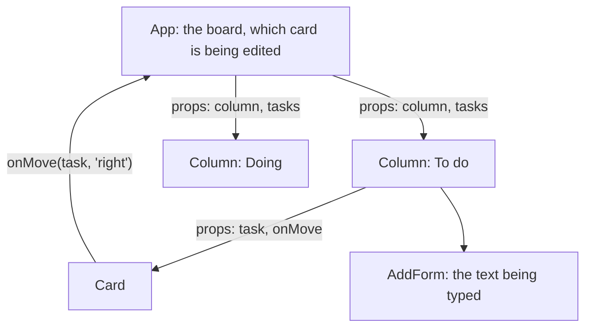
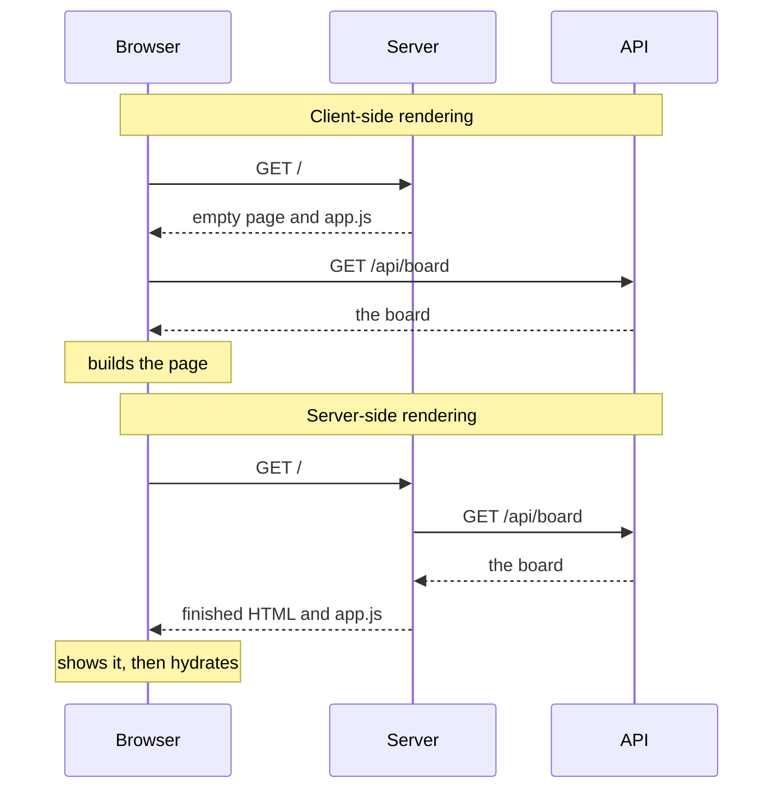

# The Browser: Components, State and Where Rendering Happens

> **In this lesson:** why front-end frameworks exist, and the four ideas every one of them shares: components, props, state and effects. You'll see them in React, learn enough TypeScript to read React code, and learn the decision that matters most: whether a page is built in the browser or on a server. The project after this builds one app both ways.

## Words you need first

- **Framework.** A library that runs your code for you, in its own order, instead of you calling it. React and Next.js are frameworks.
- **Component.** A function that describes one piece of a page, such as a card or a column, and can be used many times.
- **State.** Data that can change while the page is open, such as which card is being edited. When state changes, the page should change.
- **Props.** The inputs a component is given by the component that uses it. Short for properties.
- **Render.** In a framework, to run a component and work out what the page should look like. The framework then changes the DOM to match.

## The problem: two things to keep in step

In plain DOM code, every change is two jobs. Say someone moves a card:

1. Change the data: the card's column is now "doing".
2. Change the page: take the card out of one list and put it in another.

Forget the second job and the page lies. Do the second job slightly differently from the first and the page lies a little. Now multiply by every button on the page. Most bugs in front-end code are the page and the data drifting apart.

You can get rid of the second job with one idea: **write a function that builds the whole page from the data, and call it after every change.** Then the page can't drift, because it's always rebuilt from the truth.

```js
function render(board) {
  root.replaceChildren(...board.columns.map((c) => drawColumn(c, board)));
}
```

That works, and you'll use it in the first version of the project. It has two costs. Rebuilding everything throws away what the person was doing, such as the text in a half-typed input and which element has focus. And on a big page it's slow.

A framework keeps the idea and removes the costs. You still describe the whole page from the data. The framework compares the new description with the last one and changes only the parts of the DOM that differ. People write it like this:

```
page = f(state)
```

The page is a function of the state. You change the state. The framework does the DOM.

## Components

In React, a component is a function that returns what a piece of the page should look like:

```jsx
function Card({ task }) {
  return (
    <li data-task-id={task.id}>
      <span data-field="title">{task.title}</span>
    </li>
  );
}
```

That HTML-looking code inside JavaScript is called **JSX**. A build step turns it into ordinary function calls before the browser sees it. Rules that catch people:

- Curly braces `{ }` drop back into JavaScript: `{task.title}`, `{count + 1}`.
- `class` is spelled `className`, because `class` already means something in JavaScript.
- A component returns one parent element. Wrap siblings in `<>` and `</>` when you don't want an extra element.
- Text in curly braces is always shown as text. `{task.title}` is safe from the `innerHTML` attack, because React uses `textContent` for you.

Components use other components like tags:

```jsx
function Column({ column, tasks }) {
  return (
    <section data-column={column.id}>
      <h2>{column.title}</h2>
      <ul>
        {tasks.map((task) => (
          <Card key={task.id} task={task} />
        ))}
      </ul>
    </section>
  );
}
```

`tasks.map(...)` turns an array of data into an array of cards. The `key` tells React which card is which between renders, so when a card moves it moves the right element. Use something that belongs to the item, like its id. The position in the array changes when cards move, so it makes a bad key.

## Props: inputs from the parent

`{ task }` and `{ column, tasks }` above are **props**. The parent decides them, the child reads them. A child never changes its props. If something needs to change, the child asks the parent, by calling a function the parent passed down:

```jsx
<Card task={task} onDelete={() => deleteTask(task.id)} />

function Card({ task, onDelete }) {
  return (
    <li>
      {task.title}
      <button onClick={onDelete}>Delete</button>
    </li>
  );
}
```

Data goes down through props. Requests to change it come back up through functions. That one-way flow is what makes a React page easy to follow: to find out why something shows, you look up the tree, never sideways.

## State: data that changes

A component remembers something between renders with `useState`:

```jsx
import { useState } from "react";

function Counter() {
  const [count, setCount] = useState(0);
  return <button onClick={() => setCount(count + 1)}>Clicked {count} times</button>;
}
```

`useState(0)` gives back the current value and a function to change it. Calling `setCount` asks React to render the component again, and on that next render `count` has the new value. Inside the current render, `count` keeps the value it started with.

Functions whose names start with `use` are called **hooks**. They only work inside components, at the top level, never inside an `if` or a loop.

### Never change state in place

React decides whether something changed by checking if it got a different object. So this does nothing visible:

```jsx
board.tasks.push(newTask);   // changes the old array
setBoard(board);             // same object as before, so React skips the render
```

Make a new object with the change in it:

```jsx
setBoard({ ...board, tasks: [...board.tasks, newTask] });
```

`...` copies the old contents into a new object or array. This is called an **immutable update**. Watch for methods that change an array in place, because agents use them on state all the time: `push`, `pop`, `splice`, `sort`, `reverse`. Copy first, as in `[...tasks].sort(...)`, or use ones that make new arrays: `map`, `filter`, `concat`.

```blanks
{
  "title": "Rename a task without changing the old state",
  "note": "Each blank is a choice an agent gets wrong regularly.",
  "code": "function rename(id, title) {\n  setBoard((board) => ({\n    ...board,\n    tasks: board.tasks.___1___((t) => (t.id === id ? ___2___ : t)),\n  }));\n}",
  "blanks": [
    { "options": ["map", "forEach", "find"], "answer": "map", "explain": "map gives back a new array with one item per task. forEach gives back nothing, and find gives back one task." },
    { "options": ["{ ...t, title }", "Object.assign(t, { title })", "(t.title = title, t)"], "answer": "{ ...t, title }", "explain": "The other two change the old task object in place, which is the same mistake as push on the array." }
  ]
}
```

### Where state lives

Put each piece of state in the lowest component that every user of it sits under. If two sibling components need the same data, it moves up to their parent, which passes it down to both. That's called **lifting state up**.



The board lives in `App`, because every column needs it and a move changes two columns. The text in an add form lives in that form, because nothing else cares about it until it's sent.

```match
{
  "title": "Which component should own this state?",
  "note": "For a board made of App, Column, Card and AddForm.",
  "pairs": [
    { "left": "Every task on the board, which a move changes in two columns", "right": "App" },
    { "left": "The text typed into one column's add box", "right": "That column's AddForm" },
    { "left": "Whether one card's options menu is open", "right": "That Card" },
    { "left": "A task's title, shown on its card", "right": "No new state: the card gets it as a prop" }
  ]
}
```

### Inputs React controls

A text box has its own value inside the browser. In React you usually keep that value in state instead, and give it back to the input:

```jsx
const [title, setTitle] = useState("");
<input value={title} onChange={(e) => setTitle(e.target.value)} />
```

That's a **controlled input**. The state is the truth, so clearing it is `setTitle("")`. Reaching into the page with `document.querySelector` to read or clear the input works by accident, fights React, and is the first thing a reviewer will flag.

## Effects: talking to the outside world

Rendering should only describe the page. Anything that reaches outside, such as fetching data, starting a timer or listening to the whole window, goes in an **effect**, which React runs after the page is on screen:

```jsx
import { useEffect, useState } from "react";

function Board({ api }) {
  const [board, setBoard] = useState(null);

  useEffect(() => {
    let current = true;
    api.getBoard().then((b) => {
      if (current) setBoard(b);
    });
    return () => {
      current = false;      // this render's answer is no longer wanted
    };
  }, [api]);

  if (!board) return <p>Loading...</p>;
  return <Columns board={board} />;
}
```

- The array at the end, `[api]`, lists what the effect depends on. React runs it again only when one of those changes. An empty array means once, when the component first appears.
- The function returned from the effect is the **cleanup**. React calls it before running the effect again or when the component goes away. Here it stops a late answer from overwriting a newer one.
- In development, React's `StrictMode` runs every effect twice on purpose, to flush out effects that break when that happens. Seeing two requests in the Network panel is expected.

Most code doesn't need an effect. If you can work something out from props or state during render, do that instead.

## Enough TypeScript to read it

React code is usually written in **TypeScript**: JavaScript plus labels that say what kind of value each thing holds. The labels are checked by a tool and then removed. They never run.

```ts
type ColumnId = "todo" | "doing" | "done";

type Task = {
  id: string;
  title: string;
  column: ColumnId;
  position: number;
  note?: string;
};

function tasksIn(board: Board, column: ColumnId): Task[] {
  return board.tasks.filter((t) => t.column === column);
}
```

How to read it:

| You see | It means |
| --- | --- |
| `title: string` | `title` holds a string |
| `"todo" \| "doing" \| "done"` | One of exactly these three strings. `\|` means "or" |
| `note?: string` | `note` may be missing |
| `(board: Board, column: ColumnId): Task[]` | Takes a board and a column id, gives back an array of tasks |
| `useState<Board \| null>(null)` | State that holds a board, or null until it loads |
| `document.getElementById("root")!` | "I promise this isn't null." The `!` switches the check off, so use it rarely |
| `import type { Task } from "./board"` | Import only the label, not any code |
| `.ts` and `.tsx` | TypeScript files. `.tsx` may contain JSX |

The payoff: when you or an agent call `moveTask(board, "a", "dooing", 0)`, the editor underlines `"dooing"` before you ever run it. `npm run typecheck` runs the same check across the whole project.

## Where rendering happens

Every page you've built so far was put together in the browser. There are three places the work of turning data into HTML can happen, and choosing between them is a real engineering decision.

**In the browser.** The server sends a nearly empty HTML page and a JavaScript bundle. The bundle runs, fetches the data, and builds the page. This is called **client-side rendering**.

**On the server, for each request.** The server runs your components, fetches the data, and sends finished HTML. The person sees content as soon as the HTML arrives. Then the JavaScript loads and attaches the event listeners to the HTML that's already there, which is called **hydration**. This is **server-side rendering**.

**Once, when you build.** The HTML is made ahead of time and served as plain files. Fast and cheap, but the data is only as fresh as the last build. This is **static generation**.



What each one costs:

| | In the browser | On the server, per request | At build time |
| --- | --- | --- | --- |
| First thing the person sees | A blank page or a spinner | The content | The content |
| Data freshness | Live | Live | As of the last build |
| What you host | Plain files | A server that runs code on every visit | Plain files |
| Cost as traffic grows | Low: files are cheap to serve | Grows with every visit | Low |
| Secrets, like an API key | Can't be used: everything is visible to the person | Stay on the server | Stay on the build machine |
| Search engines and link previews | See an empty page unless they run JavaScript | See the content | See the content |

Clicking, typing and dragging always happen in the browser, whichever you pick. The choice is about the first load.

```match
{
  "title": "Where should this page be rendered?",
  "note": "Tap the page, then the best fit.",
  "pairs": [
    { "left": "A marketing page that changes once a month and must load fast everywhere", "right": "At build time" },
    { "left": "An internal admin tool behind a login, used by 20 people", "right": "In the browser" },
    { "left": "A public product page whose stock count changes every minute and must show in search results", "right": "On the server, per request" }
  ]
}
```

## React with Vite, and Next.js

You'll use both in the project, and the difference is mostly about that table.

**React with Vite.** React only renders components. **Vite** is the tool around it: a development server that reloads the page as you save, and a build command that bundles everything into a few plain files. The result renders in the browser. You choose and add everything else yourself, such as how to load data and how to handle more than one page.

**Next.js.** A framework built on React that makes the other choices for you. Each folder in `app/` is a page. Components run on the server by default and can fetch data before any HTML is sent. Components that need state or clicks are marked with `"use client"` at the top of their file and run in the browser too. It needs a running server, or a host that runs one for you.

```jsx
// app/page.tsx: runs on the server. It can await data.
export default async function Page() {
  const board = await loadBoard();
  return <Board initialBoard={board} />;
}
```

```jsx
// components/Board.tsx: runs in the browser too, so it can have state and clicks.
"use client";
export default function Board({ initialBoard }) {
  const [board, setBoard] = useState(initialBoard);
  // ...
}
```

You'll build exactly this split in the last part of the project, and decide in writing whether it was worth it.

```scenario
{
  "who": "A product manager on your team",
  "setting": "Planning a small internal dashboard. The team has only used React with Vite before.",
  "ask": "Everyone online says Next.js is the modern way. Shouldn't we just use it for everything from now on?",
  "note": "More than one answer is defensible. Pick the one you'd say.",
  "options": [
    { "text": "Not for this one. It's an internal tool behind a login, so it doesn't need search engines or a fast first load for strangers, and plain files are the cheapest and simplest thing to host. I'd reach for Next.js when a page is public, needs fresh data in the first HTML, or has to keep a key off the browser.", "verdict": "best", "feedback": "It names what Next.js actually buys and checks this project against it. It also leaves a clear rule for next time, which is what a manager wants." },
    { "text": "Sure, it's what most new projects use, so it'll be easier to hire for.", "verdict": "weak", "feedback": "Popularity is a real factor, but this skips the cost: a server to run and pay for, and a harder model of what runs where. The next question, 'what do we get for that?', has no answer." },
    { "text": "Next.js is faster, so yes.", "verdict": "weak", "feedback": "Faster at the first load, for people seeing a page for the first time. For a tool people keep open all day, that matters little, and the claim doesn't survive a follow-up." },
    { "text": "Let's build one small screen both ways and compare.", "verdict": "ok", "feedback": "A fair instinct, and it's what you're about to do in the project. For a decision this size, though, the tradeoffs are known well enough to answer now." }
  ],
  "debrief": "The choice is about the first load: who sees it, how fresh it must be, and whether anything must stay secret. Everything after the first load runs in the browser either way."
}
```

## Try it

No hand-in for this lesson. Before the project starts, see the difference with your own eyes. You'll need an internet connection for the downloads.

```bash
npm create vite@latest try-vite -- --template react-ts
cd try-vite
npm install
npm run dev
```

If the first command asks whether to install and start now, answer no, so you run each step yourself. Open the address `npm run dev` prints. Then, in a second terminal tab, look at what the server actually sent:

```bash
curl http://localhost:5173/
```

Find the `<div id="root">` in the output. It's empty. Everything you saw in the browser was built there by JavaScript. Open `src/App.tsx`, change some text, save, and watch the page update without a reload.

Then read the code with fresh eyes. Find a component, a prop, a piece of state and a hook. Find one type annotation and say out loud what it means. You can delete the folder afterwards.

```quiz
[
  {
    "q": "You call board.tasks.push(newTask) and then setBoard(board). The page doesn't change. Why?",
    "options": ["React got the same object back, so it decided nothing changed and skipped the render", "push is too slow for React", "setBoard only works with strings", "React needs a key on the board"],
    "answer": 0,
    "explain": "React compares objects by identity. Make a new board with the change in it: { ...board, tasks: [...board.tasks, newTask] }."
  },
  {
    "q": "Two sibling components both need to read and change the same list. Where does the list go?",
    "options": ["In their nearest shared parent, which passes it down as props along with functions to change it", "In each component, kept in sync with effects", "In a global variable both import", "In localStorage, read by both"],
    "answer": 0,
    "explain": "Lifting state up keeps one copy of the truth. Two copies kept in sync is how pages start to lie."
  },
  {
    "q": "A page is rendered in the browser. What does curl get from its server?",
    "options": ["A nearly empty HTML page and a script tag. The content is built later by JavaScript in the browser", "The finished page with all the content", "Only JSON", "Nothing, because curl can't load React"],
    "answer": 0,
    "explain": "With client-side rendering the server sends the shell. That's why search engines and link previews often see an empty page."
  }
]
```

## Key takeaways

- Most front-end bugs are the page and the data drifting apart. Frameworks fix it by building the page from the state every time.
- A component is a function from props and state to a description of the page. Data goes down as props, change requests come up as functions.
- Change state by making new objects and arrays. In-place changes such as `push`, `splice` and `sort` make React miss the update.
- Fetching and other outside work go in effects, which run after render and can clean up after themselves.
- TypeScript adds labels that a checker reads and then removes. Read `name: type` as "name holds a type".
- Rendering can happen in the browser, on the server per request, or at build time. The choice trades first-load speed, freshness, hosting cost and secrecy.

## Work with AI

```ai-prompt
title: Where should it render, and where should the state live?
---
I'm a beginner who just learned React components, props, state, effects, and the
difference between rendering in the browser, on the server per request, and at build
time. Describe four small apps to me, one at a time, each in two or three sentences:
who uses it, how often the data changes, and whether anything must stay secret. For
each, ask me two things and wait: where I'd render the first load and why, and which
component should own its main piece of state. Push back on my reasoning with one
follow-up question before you tell me what you'd choose. Don't write any code.
```
