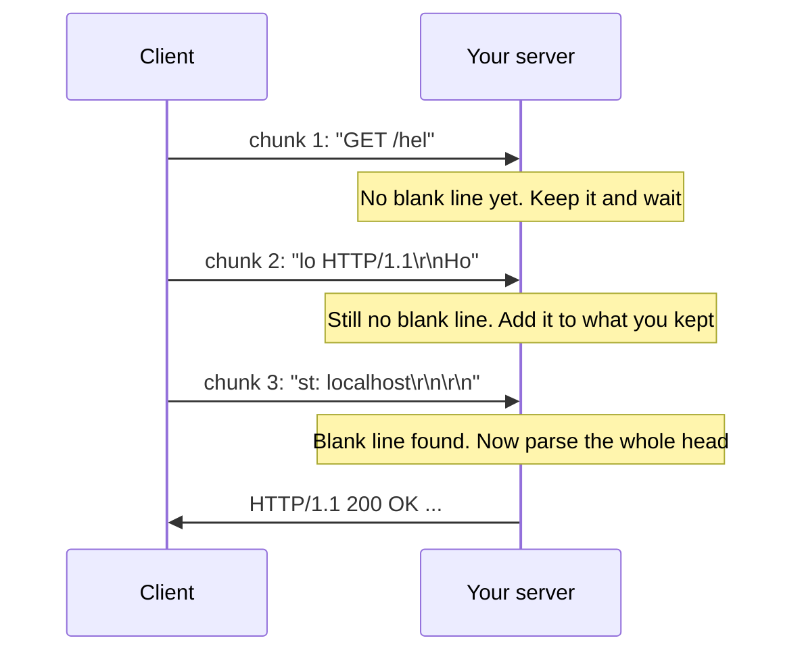

# Project: HTTP from Scratch. A Server on a Raw Connection

> **In this lesson:** your second project starts, and it's your first with an agent. Across two milestones you'll build your own version of the core of Express, the most used web server library for Node, on nothing but a raw TCP connection. In this first milestone your server accepts connections, reads requests that can arrive in pieces, and sends back responses that any browser or HTTP client accepts.

## Words you need first

- **Socket.** One open TCP connection, seen from your program's side. You read the bytes that arrive on it and write bytes back.
- **Buffer.** Node's name for a chunk of raw bytes. Data from a socket arrives as Buffers.
- **Parse.** To read text in a known format and pull out its parts. Parsing a request means turning its text into a method, a path, headers and so on.
- **Handler.** A function you register for one kind of request. The server calls it when a matching request arrives and sends back whatever it returns.

## What you're building

Here's a complete web server in Express:

```js
const express = require("express");
const app = express();

app.get("/hello", (req, res) => {
  res.send("Hello, " + (req.query.name || "stranger"));
});

app.listen(3000);
```

Seven lines, and a lot is hidden. Something accepts TCP connections. Something collects bytes until a whole request has arrived. Something reads the request line and the headers, splits off the query string, finds the right function, and writes a response with the right status line and the right `Content-Length`.

By the end of this project you'll have written every one of those somethings. Here's the same server in yours:

```js
const { createServer } = require("./server.js");
const server = createServer();

server.route("GET", "/hello", (req) => {
  return { status: 200, body: "Hello, " + (req.query.name || "stranger") };
});

server.listen(3000);
```

You won't replace Express at work. You'll understand what it's doing, which means you can debug it when it surprises you, and judge an agent's code that uses it.

## How this project works

This is your first project with an agent, and the rules from the agent lessons now apply for real.

- **You plan first.** `PLAN.md` in the project folder has a section for each milestone. Fill in the milestone 1 section yourself, in plain words, before you ask for any code.
- **The agent writes the code.** One small piece at a time, on a branch.
- **You review every diff and can explain every line.** Your mentor will open `server.js`, point at a line and ask why it's there.
- **You choose the test cases.** The agent may write the test code. You read every line of it.
- **No `node:http`, no Express, no npm packages.** The point is to build what they'd do for you. A hidden check looks for them.

## Reading from a socket

Here's the smallest TCP server, the same shape as `listen.js` from the networking lessons:

```js
const net = require("node:net");

const server = net.createServer((socket) => {
  socket.on("data", (chunk) => {
    // chunk is a Buffer: some of the bytes the client sent
  });
});

server.listen(3000, () => {
  console.log("port", server.address().port);
});
```

A few more things you'll see in your agent's code:

| Code | What it does |
| --- | --- |
| `socket.write(data)` | Sends bytes to the client |
| `socket.end(data)` | Sends the last bytes and closes the connection |
| `socket.on("error", fn)` | Runs `fn` when the connection breaks. Without it, a client hanging up badly crashes your whole server |
| `server.listen(0)` | Port 0 asks the operating system for any free port. Tests use this so they never clash |
| `server.address().port` | The port actually being used |
| `server.close(fn)` | Stops accepting new connections, then calls `fn` once the existing ones have closed |

## A request can arrive in pieces

You learned that TCP delivers a stream and keeps no message in one piece. Here's what that means for a server.

A request ends its headers with a blank line, the four bytes `\r\n\r\n`. Until you've seen those four bytes, you don't have the whole head of the request. On your laptop it almost always arrives in one chunk. On a slow phone network, or from a test that sends it in pieces on purpose, it won't.



So each connection needs somewhere to keep the bytes it has received so far, and the code checks for the blank line after every chunk.

Keep the bytes as Buffers until you've found the blank line. `Buffer.concat([a, b])` joins two Buffers, and `buffer.indexOf("\r\n\r\n")` finds the blank line. Turning each chunk into text as it arrives can split a character like é, which takes two bytes, down the middle.

## Parsing the head

Once you have the head, it's text:

```
GET /search?q=cats&page=2 HTTP/1.1\r\nHost: localhost:3000\r\nAccept: */*
```

Split it on `\r\n` into lines. The first line splits on single spaces into the method, the target and the version. The target splits at the `?` into the path and the query string.

Every other line is a header. Here's a trap agents fall into regularly: `Host: localhost:3000` has two colons. Splitting the line on every colon throws away `:3000`. Split at the **first** colon only.

```blanks
{
  "title": "Read one header line",
  "note": "line is a string like \"Host: localhost:3000\".",
  "code": "const colon = line.___1___(\":\");\nconst name = line.slice(0, colon).___2___();\nconst value = line.slice(colon + 1).___3___();",
  "blanks": [
    { "options": ["indexOf", "lastIndexOf", "split"], "answer": "indexOf", "explain": "indexOf finds the first colon. lastIndexOf would split Host: localhost:3000 at the colon before 3000, and split cuts at every colon." },
    { "options": ["toLowerCase", "toUpperCase", "trim"], "answer": "toLowerCase", "explain": "Header names ignore capital letters, so store them lowercased. Then headers.host works whether the client sent Host or HOST." },
    { "options": ["trim", "toLowerCase", "toString"], "answer": "trim", "explain": "Values can have spaces around them. Values do care about capital letters, so trim them and leave the letters alone." }
  ]
}
```

The query string, `q=cats&page=2`, becomes `{ q: "cats", page: "2" }`. Characters that can't appear in a URL are sent encoded: a space is `%20` (or `+` in a query string), é is `%C3%A9`. Node has two built-ins that decode them, `decodeURIComponent` and `URLSearchParams`. Ask your agent which it used and why.

## Writing the response

You wrote one by hand in the last lesson:

```
HTTP/1.1 200 OK\r\n
Content-Type: text/plain; charset=utf-8\r\n
Content-Length: 5\r\n
Connection: close\r\n
\r\n
hello
```

`Connection: close` tells the client you'll close the connection after this response. Keeping it open for more requests is faster, and also more work. You'll decide about that in the next milestone.

Two things to get right:

- **The reason phrase matches the code.** 200 is `OK`, 201 is `Created`, 404 is `Not Found`, 500 is `Internal Server Error`.
- **`Content-Length` counts bytes.** Build the body as a Buffer and use its `.length`, or use `Buffer.byteLength` on the string. A string's `.length` counts letters, and it's wrong the moment someone's name has an accent in it.

```order
title: What your server does with one request
---
Each chunk that arrives is added to this connection's own store of bytes
After each chunk, the server looks for the blank line that ends the headers
Once it's found, the head is parsed into a method, a path, a query and headers
The server finds the handler for that method and path, or prepares a 404
It waits for the handler's answer, which may be a promise
It formats the response with the right status line and byte count, sends it and closes the connection
```

## The brief

Get the starter. From the top of your `parsity-labs` repository:

```bash
curl -sL https://ai.parsity.io/labs/http-server.tar.gz | tar xz
cd http-server
node --test
```

Four tests fail. Read `README.md` and the comments in `server.js` before anything else. They're the full contract, and the hidden tests hold you to it.

You're building three functions. Keep their names exactly as they are.

**`parseRequest(head)`** takes the text of a request up to the blank line and gives back:

```js
{
  method: "GET",
  target: "/search?q=cats",
  path: "/search",             // no query string, with %20 and friends decoded
  query: { q: "cats" },        // {} when there's no query string
  version: "HTTP/1.1",
  headers: { host: "localhost:3000" }   // names lowercased, values trimmed
}
```

**`formatResponse({ status, headers, body })`** gives back a Buffer with the whole response. `status` defaults to 200. `body` may be a string, a Buffer, or a plain object, which is sent as JSON. Every response has `Content-Length` and `Connection: close`. A string gets `Content-Type: text/plain; charset=utf-8`, an object gets `application/json; charset=utf-8`, unless the caller gave a `Content-Type` of their own.

**`createServer()`** gives back an object with:

- `route(method, path, handler)`: exact paths like `/hello` for now.
- `listen(port)`: a promise of the port actually used. `listen(0)` picks a free one.
- `close()`: a promise that finishes once the server has stopped.

A handler gets `{ method, path, query, headers }` and returns `{ status, headers, body }`, or a promise of one. A path nobody registered gets a 404. After every response, the server closes the connection.

## Working with your agent, step by step

1. **Plan.** Fill in the milestone 1 section of `PLAN.md`. Write the cases as "given this, I should get that". Include at least one you think the agent might get wrong.
2. **Branch.** `git switch -c http-server-1`.
3. **`parseRequest` first.** Give the agent your plan and ask for `parseRequest` only. Read the diff. Ask it to prove the colon case and the query case. Commit.
4. **`formatResponse` next.** Same loop. Ask it to show you the exact bytes for a body containing `café`, and check the `Content-Length` yourself.
5. **The server.** Ask for `createServer`. In the diff, find where each connection keeps its bytes, and where the code checks for the blank line. If you can't find them, ask.
6. **Your four tests.** Add at least four to `server.test.js`, from your plan. Then break the code on purpose and make sure each new test fails.
7. **Try it for real.** `node start.js`, then in another terminal:

```bash
curl -v "http://localhost:3000/hello?name=Ada"
```

Read every line curl prints. Then open the same address in your browser.

8. **Merge.** Push the branch, open a pull request on your own repository, read the Files changed tab, merge it and pull `main`.

If one case has you stuck for more than 30 minutes, stop asking the agent to "fix it" and look at the bytes yourself. Add `console.log(JSON.stringify(chunk.toString()))` where chunks arrive and compare what's there with what your code expects.

## Hand it in

We grade your `main` branch, so merge your pull request first. We need `http-server/server.js`, and at least 8 passing tests in the `http-server` folder.

```submit
assignment: http-server-1
```

Ours check harder cases: requests that arrive in several pieces, header values with colons in them, query strings with encoded characters, bodies with letters outside plain English, handlers that take a while to answer, a real HTTP client talking to your server, and two servers running at once. If a category fails, find the case in your own words, add a test for it that fails, then fix it with your agent.

```quiz
[
  {
    "q": "Your server works perfectly with curl on your laptop. A hidden test sends the same request in three pieces, and your server answers 400. What's the most likely cause?",
    "options": ["It parses the first chunk as if it were the whole request, instead of collecting chunks until the blank line arrives", "The test sends an invalid request", "The port is wrong", "curl adds headers the test doesn't"],
    "answer": 0,
    "explain": "On a fast local connection the head usually arrives in one chunk, which hides the bug. TCP never promised that. Collect until you see \\r\\n\\r\\n."
  },
  {
    "q": "The agent's formatResponse uses body.length for Content-Length. Every test passes. When does it break?",
    "options": ["When the body has characters that take more than one byte, like é or €, so the length is too small and the client cuts the body short", "When the body is empty", "When the status is 404", "It never breaks"],
    "answer": 0,
    "explain": "A string's length counts letters. Content-Length counts bytes. They only agree for plain English text."
  },
  {
    "q": "A request has the header Host: localhost:3000. The parsed headers say host is \"localhost\". What did the code do?",
    "options": ["Split the line on every colon and kept only the second part, losing :3000", "Lowercased the value", "Trimmed too much", "Read the wrong line"],
    "answer": 0,
    "explain": "Split at the first colon only. Everything after it, colons included, is the value."
  }
]
```

## Key takeaways

- A web server is a loop over connections: collect bytes, find the end of the head, parse it, call a handler, write a response.
- TCP keeps no request in one piece. Each connection keeps its own bytes until the blank line arrives.
- Split headers at the first colon. Lowercase the names, trim the values.
- `Content-Length` counts bytes. Keep bodies as Buffers and the count takes care of itself.
- Your agent wrote the code. You planned it, chose the cases, read every line, and you can explain every one.

## Work with AI

```ai-prompt
title: Make me explain my own server
---
I'm a beginner. My coding agent wrote server.js for a small HTTP server on a raw
TCP socket in Node, from a plan I wrote. I reviewed it, and I need to be able to
explain every line. I'll paste the file. Don't fix or improve anything. Pick one
line or a small block at a time, starting with the parts that handle chunks of
data and find the end of the headers, and ask me what it does and what would break
without it. Wait for my answer. If I'm vague or wrong, ask a sharper follow-up
instead of telling me the answer. After ten questions, list the lines I couldn't
explain so I can study them.
```
