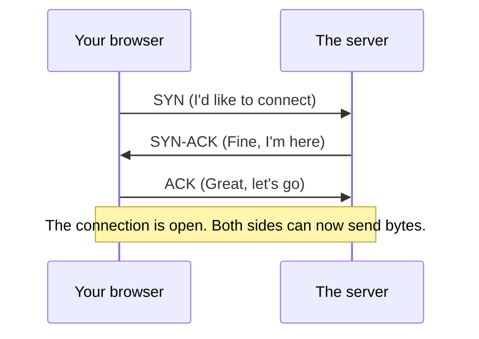

# The Web: What Happens When You Type a URL

> **In this lesson:** the journey a request takes before any website code runs. You'll learn what an IP address is, how a name like `example.com` becomes one, what a port is, and what TCP does for you. Then you'll open a connection to a program you wrote and read, with your own eyes, the text your browser sends. This is the ground the next project is built on.

## Words you need first

- **IP address.** A number that identifies one machine on a network, like `203.0.113.42`. Every message on the internet is addressed with one.
- **Domain name.** A human-friendly name for a machine, like `example.com`.
- **DNS.** The Domain Name System. The internet's phone book: it turns a domain name into an IP address.
- **Port.** A number from 0 to 65535 that picks one program on a machine. The IP address gets you to the building. The port gets you to the apartment.
- **TCP.** The Transmission Control Protocol. A set of rules that gives two programs a reliable, two-way stream of bytes between them, even though the network underneath loses and reorders things.

## The pieces of a URL

Take this one apart:

```
https://shop.example.com:443/orders/7?view=full
```

| Part | Here | What it's for |
| --- | --- | --- |
| Scheme | `https` | Which rules to speak. `https` is HTTP, encrypted |
| Host | `shop.example.com` | Which machine. A name that DNS turns into an IP address |
| Port | `443` | Which program on that machine. Usually left out, because `https` means 443 and `http` means 80 |
| Path | `/orders/7` | Which thing you want from that program |
| Query | `view=full` | Extra details about how you want it |

Every one of those parts is used by a different step of the journey. By the end of the next project, you'll have written the code that reads the last two.

## IP addresses

Every machine on a network has an address. The common kind, IPv4, is four numbers from 0 to 255 with dots between them: `142.250.80.46`. There aren't enough of those for every device on Earth, so a newer kind, IPv6, uses much longer addresses like `2607:f8b0:4004:c07::64`. You'll see both.

One address matters more to you than the rest: **`127.0.0.1`**, also called **localhost**. It always means "this same machine". When you run a server on your laptop and visit `localhost`, the request never leaves your computer.

## DNS: turning a name into an address

Computers route by number. People remember names. DNS connects the two.

When your browser needs `shop.example.com`, it asks a **DNS resolver**, a server that looks names up, usually run by your internet provider or a company like Google or Cloudflare. The resolver finds the answer and hands back an IP address, along with a **TTL** (time to live): how many seconds the answer may be remembered. Your computer and the resolver both keep the answer for that long, so most lookups are instant.

Try it. Node has DNS built in:

```bash
node -e "require('node:dns').lookup('example.com', (err, address) => console.log(err ? err.code : address))"
```

`node -e` runs the JavaScript you give it in quotes, without a file. You'll see an IP address. Now change `example.com` to a name that doesn't exist, like `no-such-site-12345.com`, and run it again. You get the error code `ENOTFOUND`. That's what a browser shows as "this site can't be reached".

Two things worth remembering for later:

- If DNS fails, your server never hears about it. Its logs are empty, because the request never left the user's machine.
- When a company moves its site to new servers, people keep going to the old address until their cached answer runs out. That's why DNS changes "take a while".

## Ports: one machine, many programs

A machine runs many programs that talk on the network: a web server, a database, maybe an email server. An IP address alone can't say which one you mean. A port number does.

| Port | Usually |
| --- | --- |
| 80 | Web traffic, plain HTTP |
| 443 | Web traffic, HTTPS |
| 22 | SSH, logging in to another machine |
| 5432 | Postgres, a database |
| 3000 | Whatever you're building on your laptop today |

Only one program can **listen** on a port at a time. Listening means "I'm ready to accept connections on this port." If a second program tries, it gets an error called `EADDRINUSE`, "address in use". You'll meet it the first time you start your server twice.

## TCP: a reliable pipe made from unreliable parts

The internet moves data in small separate pieces called **packets**. Packets can arrive out of order, arrive twice, or not arrive at all.

TCP hides all of that. Before any data moves, the two sides do a short **handshake**: three messages that agree a connection is open.



After that, TCP numbers every byte, resends anything lost and puts everything back in order. Each side sees one clean stream of bytes.

Here's the part that will matter in the next project. **TCP gives you a stream of bytes, and it doesn't keep your messages in one piece.** If the browser sends 500 bytes, your program might receive them as one chunk of 500, or two chunks of 300 and 200, or five chunks of 100. TCP promises the order and nothing about where the chunks break. Code that assumes "one chunk is one request" works on your laptop and fails on a slow network.

## Encryption, briefly

The `s` in `https` means the HTTP is wrapped in **TLS** (Transport Layer Security). Right after the TCP handshake, the server proves who it is with a **certificate**, and the two sides agree on keys. From then on nobody in between can read or change what's sent. The next lesson covers what you need to know about it.

## The whole journey

Step through a request from start to finish. Then turn on **Break it here** and see what each step looks like when it fails.

```visual
request-journey | One request, from typing the URL to the answer coming back
```

```order
title: What happens after you type https://shop.example.com/orders/7 and press Enter
---
The browser asks DNS for the IP address of shop.example.com
The browser opens a TCP connection to that address on port 443
TLS: the server shows its certificate and both sides agree on keys
The browser sends the request: GET /orders/7 with its headers
The server's code runs and builds a response
The response travels back over the same connection and the browser shows it
```

```match
{
  "title": "Which step broke?",
  "note": "Tap what the user sees, then the step that failed.",
  "pairs": [
    { "left": "\"This site can't be reached. DNS address could not be found\"", "right": "DNS: the name has no address" },
    { "left": "\"Connection refused\"", "right": "TCP: nothing is listening on that port" },
    { "left": "A warning that the certificate isn't valid for this site", "right": "TLS: the server couldn't prove who it is" },
    { "left": "A page that says 404 Not Found", "right": "Your server answered, and it has nothing at that path" },
    { "left": "A page that says 500 Internal Server Error", "right": "Your server's code threw an error" }
  ]
}
```

That table is a debugging tool. When something "doesn't work", the first question is how far the request got. Only the last two rows ever show up in your server's logs.

## See it for yourself

You're going to listen on a port and read what your browser sends. This is by hand and short. Make a folder outside your labs repository:

```bash
mkdir -p parsity/net-play
cd parsity/net-play
```

Create `listen.js` and type this in:

```js
const net = require("node:net");

const server = net.createServer((socket) => {
  console.log("Someone connected");
  socket.on("data", (chunk) => {
    console.log(JSON.stringify(chunk.toString()));
  });
});

server.listen(4000, () => {
  console.log("Listening on port 4000");
});
```

Line by line:

- `require("node:net")` loads Node's built-in tools for TCP.
- `net.createServer(...)` makes a server. The function you pass runs once for every new connection, and `socket` is that connection: the two-way pipe.
- `socket.on("data", ...)` runs your function each time a chunk of bytes arrives. `chunk.toString()` turns the bytes into text.
- `JSON.stringify` prints the text with invisible characters made visible, so you'll see `\r\n` where the line breaks are.
- `server.listen(4000, ...)` starts listening on port 4000.

Run it:

```bash
node listen.js
```

Now open your browser and go to `http://localhost:4000/hello?name=ada`. Look at your terminal. You'll see something like:

```
"GET /hello?name=ada HTTP/1.1\r\nHost: localhost:4000\r\nUser-Agent: Mozilla/5.0 ...\r\nAccept: text/html...\r\n\r\n"
```

You may see more than one connection, and a second request for `/favicon.ico`. Browsers often open a spare connection in case they need it, and ask every site for its little tab icon.

That's an HTTP request. Plain text, sent over TCP. The method, the path and query you typed, then a line per header, each ending in `\r\n`, and an empty line at the end. Every website you've ever visited started with text like this.

Notice the browser is still spinning. Your program read the request and never answered, so the browser is waiting. Answering is what the next project is about.

Two more experiments:

1. Leave it running, open a second terminal in the same folder and run `node listen.js` again. Read the error. That's `EADDRINUSE`: port 4000 is taken.
2. Stop the first one with Ctrl+C and refresh the browser. Now you get "connection refused" straight away. No program is listening, so the TCP handshake fails.

Keep `listen.js`. You'll use it again in the next lesson.

## Why this matters at scale

Every step before your code costs time. DNS might need a round trip to the resolver. TCP needs one round trip for its handshake. TLS needs one or two more. Across a country a round trip takes tens of milliseconds, and across an ocean more.

So before your server has read one byte, a new visitor far away may already have waited a noticeable fraction of a second. That's why browsers keep connections open and reuse them, why DNS answers are cached, and why big sites put copies of their files in data centers close to their users. You'll make decisions about all three later in the program.

```quiz
[
  {
    "q": "A user says your site is down. You check your server's logs and there's no sign of their request at all. Which step most likely failed?",
    "options": ["Something before your code, like DNS or the connection, so the request never arrived", "Your code threw an error", "Your server returned a 404", "The database was slow"],
    "answer": 0,
    "explain": "Your logs only see requests that reach your program. An empty log points at DNS, the network, or nothing listening on the port."
  },
  {
    "q": "A browser sends a 600-byte request to your server. How might your program receive it?",
    "options": ["As one chunk or as several smaller ones, in order, with no promise about where the chunks break", "Always as one chunk of 600 bytes", "As 600 chunks of one byte", "In a random order"],
    "answer": 0,
    "explain": "TCP delivers a stream. The order is guaranteed and the chunk boundaries aren't. Your code has to collect chunks until it has a whole request."
  },
  {
    "q": "You start your server and get EADDRINUSE. What does it mean?",
    "options": ["Another program is already listening on that port, often an older copy of your own server", "Your IP address is wrong", "DNS couldn't find localhost", "The port number is too big"],
    "answer": 0,
    "explain": "Only one program can listen on a port. Stop the other one, or pick a different port."
  }
]
```

## Key takeaways

- A URL names a scheme, a host, a port, a path and a query. Each is used by a different step of the journey.
- DNS turns a name into an IP address, and caches the answer for a while.
- A port picks one program on a machine. Only one program can listen on a port.
- TCP gives two programs a reliable, ordered stream of bytes. It doesn't keep your messages in one piece.
- An HTTP request is plain text sent over that stream. You've now seen one arrive.

## Work with AI

```ai-prompt
title: Where did my request die?
---
I'm a beginner who just learned how a web request travels: DNS, an IP address, a
port, a TCP connection, TLS, and then the server's code. Act as a teammate
describing a problem. Give me one short symptom at a time, the way a real user or
coworker would describe it ("the page just spins", "I get a certificate warning on
my phone but not my laptop"). Ask me which step most likely failed and what I'd
check first. Wait for my answer. Then tell me whether I'm right, and what the real
cause might be. Do six, and make at least two of them ambiguous so I have to ask
you a question before I can answer.
```
