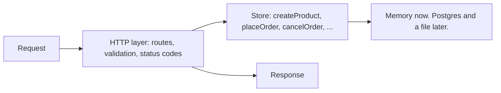

# Project: Orders Under Load. The API

> **In this lesson:** you start your fourth project, an order and inventory API that has to stay correct when many requests arrive at once. In this first part there's no database yet. You'll plan the feature, have your agent build it against a written contract, review every diff, and hand in an API that passes tests you can't see.

## Words you need first

- **Contract.** The written agreement about what an API accepts and returns. Here, it's the project's README.
- **In memory.** Kept in your program's variables. Gone when the program stops.
- **Store.** The part of your code that saves and loads data. The rest of the app asks it for things and doesn't care how it keeps them.
- **Cents.** Money as a whole number of the smallest unit. `2500` cents is $25.00.

## The project

A small online shop needs an API. Shops add products with a price and a stock count. Customers place orders. Each order takes stock. Orders can be cancelled, which puts the stock back.

That sounds simple, and the first version is. The project is about what happens next: storing it properly, two customers buying the last item at the same moment, and choosing between two very different ways to store the same data.

| Part | What you add | Hands in |
| --- | --- | --- |
| The API | Every route, all data in memory | orders-1 |
| Postgres | The same API, stored in tables, with migrations | orders-2 |
| At the same moment | Many requests at once never oversell | orders-3 |
| Documents | The same data as JSON documents, and your decision memo | orders-4 |

All four parts live in one folder, `orders`, in your `parsity-labs` repository. Each part builds on the last. Do them in order.

As in your last two projects, your agent writes most of the code. Your job is the part that makes it work: planning, reading every diff, testing the cases the agent forgot, and being able to explain every line. The hidden tests are written to catch the mistakes agents make when nobody plans.

## Get the starter

From the top of your `parsity-labs` repository:

```bash
curl -sL https://ai.parsity.io/labs/orders.tar.gz | tar xz
cd orders
npm install
npm test
```

Five tests run and five fail. The app answers every request with `501 Not Implemented` until you build it.

What's in the folder:

| File | What it is |
| --- | --- |
| `README.md` | The contract. Every route, shape, rule and status code. |
| `src/app.js` | `createApp()`, which you'll build |
| `src/migrate.js` | Empty until the Postgres part |
| `test/orders.test.js` | Five tests, and a small client that starts the app for each test |
| `server.js` | Starts the API on port 3000 so you can try it with curl |
| `MEMO.md` | Your decision memo, for the last part |

## Read the contract first

Open `README.md` and read all of it before you plan anything. Then read it again. Everything the hidden tests check is written there. Nothing is a trick.

Some rules worth noticing, because each one is easy to get wrong:

- **Money is whole cents.** `priceCents: 2500`. Never `25.00`.
- **Types are checked, never converted.** `"5"`, `2.5` and `-1` are all rejected for a stock count.
- **An order is all or nothing.** If any item can't be filled, no stock is taken for any item.
- **Cancelling gives stock back exactly once.** A second cancel is a 409.
- **A retried order with the same `Idempotency-Key` returns the same order** and takes no more stock.
- **Lists come a page at a time**, with a cursor. A customer's orders are newest first.
- **Customers carry totals**: how many placed orders, and how much they've spent. Cancelled orders don't count.

## Shape the code so you can swap the storage

You'll change how data is stored twice in this project: memory, then Postgres, then documents in a file. If storage code is mixed into your route handlers, each change means rewriting everything.

So split the app in two:



- The **HTTP layer** reads the request, validates it, calls the store, and turns the result or the error into a response. It never touches data directly.
- The **store** has one function per thing the app does: `createProduct`, `getProduct`, `listProducts`, `placeOrder`, `cancelOrder`, and so on. It knows nothing about HTTP.

When the store needs to say "no", it throws an error that carries a status code, and the HTTP layer turns that into a response:

```js
class AppError extends Error {
  constructor(status, message) {
    super(message);
    this.status = status;
  }
}

// in the store
throw new AppError(409, `not enough stock for product ${productId}`);
```

One place in the HTTP layer catches every error. An `AppError` becomes its status and message. Anything else is a bug: log it, and answer `500` with `{ "error": "internal error" }`. The server keeps running either way.

## Plan the feature first

Don't open your agent yet. Create `orders/PLAN.md` and write, in your own words:

1. **The routes**, as a table, copied from the README in your own layout. One line each.
2. **The store's functions**, with what each takes and returns.
3. **Every error case**, grouped by status code. For each route, which codes can it return?
4. **Your decisions.** These aren't settled by the README. Pick one answer for each and say why:
   - How does `placeOrder` make sure an order is all or nothing?
   - Where do idempotency keys live, and what's stored with each one? How do you tell "same request" from "different request"?
   - What's inside a cursor, and how do you stop a client inventing one?
   - Are customer totals worked out when asked for, or kept up to date as orders change?
5. **The tests you'll add**, as a list of one-line descriptions.

Then give your agent the README and your plan, and ask it to build one piece at a time: the HTTP layer and products first, then customers, then orders, then cancelling, retries and pages. Review each diff before you move on, and commit after each piece.

## Reading the agent's diffs

These are the mistakes the hidden tests are built around. Look for each one in every diff:

- **Converting instead of checking.** `Number(body.qty)`, `parseInt(...)` or `+body.stock` make bad input look fine.
- **Taking stock as it goes.** A loop that checks and decrements item by item has already taken stock from item one when item two turns out to be short.
- **Counting from the wrong place.** Offset pagination on a newest-first list repeats items when a new one arrives.
- **Cancelling without checking the status.** Stock comes back twice.
- **Retries that create a second order.** Or keys remembered without the request, so a different request with the same key is treated as a retry.
- **Errors that aren't JSON**, or a missing catch, so one bad body crashes the server.
- **Totals that count cancelled orders.**

If you can't explain a line of the diff, ask the agent what it does and why, then decide whether you agree. Don't accept code you can't explain. Your mentor will point at a line and ask.

```blanks
{
  "title": "Validate a quantity without converting it",
  "note": "Every blank is a real decision.",
  "code": "function checkQty(qty, i) {\n  if (typeof qty !== ___1___ || !Number.___2___(qty) || qty < ___3___) {\n    throw new AppError(___4___, `items[${i}].qty must be a whole number, 1 or more`);\n  }\n}",
  "blanks": [
    { "options": ["\"number\"", "\"string\"", "\"integer\""], "answer": "\"number\"", "explain": "typeof gives \"number\" for numbers. There is no \"integer\" type in JavaScript, and a string is exactly what you want to reject." },
    { "options": ["isInteger", "isNaN", "parseInt"], "answer": "isInteger", "explain": "Number.isInteger rejects 1.5 and NaN. parseInt converts, which is the thing you're trying to avoid." },
    { "options": ["1", "0", "-1"], "answer": "1", "explain": "An order for zero of something isn't an order. The contract says 1 or more." },
    { "options": ["400", "409", "422"], "answer": "400", "explain": "The input itself is wrong, whatever the current state. That's a 400." }
  ]
}
```

## Try it by hand

Start the server with `npm start`, and in another terminal:

```bash
curl -s -X POST localhost:3000/products -H 'content-type: application/json' \
  -d '{"name": "Desk lamp", "priceCents": 2500, "stock": 1}'

curl -s -X POST localhost:3000/customers -H 'content-type: application/json' \
  -d '{"name": "Ada", "email": "ada@example.com"}'

curl -s -i -X POST localhost:3000/orders -H 'content-type: application/json' \
  -H 'Idempotency-Key: first-try' \
  -d '{"customerId": 1, "items": [{"productId": 1, "qty": 1}]}'
```

Run the last one again. You should get the same order back, and the stock should still be 0. Change `qty` to 2 with the same key and you should get a 422. Then send a body that isn't JSON at all, and check the server answers with a 400 and keeps running.

## Your tests

The starter has 5 tests. You owe at least 10. Before you write each one, ask what could go wrong:

- What does each route do with a missing field, a field of the wrong type, and a number out of range?
- What happens to stock when the second of three items is short?
- What happens on a second cancel?
- What does a retry with the same key and body return? With a different body?
- Does walking every page of a list give each item exactly once?
- Do totals drop a cancelled order?

From inside `orders`:

```bash
npm test
```

**When you're stuck.** Give each problem 30 minutes of real effort, including drawing what the data looks like before and after. Then ask your agent to explain the idea you're missing, without writing the fix. Bring anything that survives a whole sitting to office hours or your mentor.

## Hand it in

Commit and push the `orders` folder, then paste the link to your `parsity-labs` repository.

```submit
assignment: orders-1
```

We need `orders/src/app.js` and at least 10 passing tests of yours. Then ours run: validation, the right status code for each failure, all-or-nothing orders, cancelling, retries, pages and customer totals. If a category fails, read that part of the README again, find the case, write a test that shows it, then fix it.

```quiz
[
  {
    "q": "An order has two items. The agent's code loops over them: check stock, take stock, next item. The second item is short. What's wrong?",
    "options": ["The first item's stock was already taken, so a failed order changed the data", "Nothing, because it returns a 409", "It should return 400 instead", "The loop should go backwards"],
    "answer": 0,
    "explain": "All or nothing means checking every item before taking anything, or undoing what was taken. Returning the right code isn't enough if the data already changed."
  },
  {
    "q": "Why keep route handlers apart from the code that stores data?",
    "options": ["Because the storage will change twice in this project, and only the store should have to change", "Because Node requires it", "To make the app faster", "Because tests can't call route handlers"],
    "answer": 0,
    "explain": "With a clean split, swapping memory for Postgres means writing a new store with the same functions. The routes, validation and status codes stay as they are."
  },
  {
    "q": "A retry arrives with an Idempotency-Key the server has seen, but the body asks for 3 lamps where the first asked for 1. What should happen?",
    "options": ["A 422 and no change, because the same key was used for a different request", "A new order for 3 lamps", "The original order is changed to 3 lamps", "The original order is returned"],
    "answer": 0,
    "explain": "A key means 'this exact request'. A different body under the same key is a client bug. Refuse it and change nothing."
  }
]
```

## Key takeaways

- The README is the contract. Read it twice before planning, and give it to your agent with your plan.
- Split the HTTP layer from the store, so storage can change without touching routes.
- Plan the feature first: routes, store functions, error cases, decisions and tests.
- An order is all or nothing. Check everything before taking anything.
- Review every diff against a list of known mistakes. Don't accept a line you can't explain.

## Work with AI

```ai-prompt
title: Review my plan before any code exists
---
I'm building an order and inventory API with a coding agent. I wrote a plan before
any code: the routes, the store's functions, every error case by status code, my
decisions about all-or-nothing orders, idempotency keys, cursors and customer totals,
and a list of tests. I'll paste the README contract and then my plan. Don't write
code and don't rewrite my plan. Compare them and tell me: which rules from the
contract does my plan not cover, which of my decisions has a hole (give me a
concrete request that breaks it), and which tests are missing. Ask me about one gap
at a time and wait for my answer.
```
