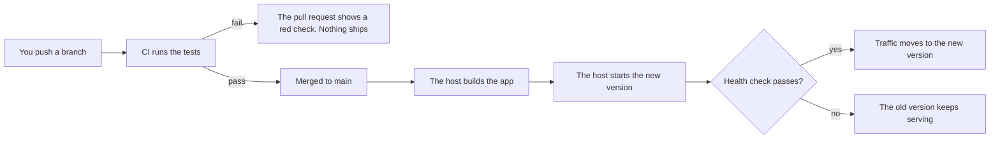

# Shipping: From Your Laptop to Everyone Else

> **In this lesson:** what changes when your code leaves your laptop and runs on a computer you'll never see. You'll learn where settings and secrets live, what CI/CD does, what a container is, how to read logs you didn't watch being written, what it all costs, and the difference between serverless and a server that runs all the time. The next project puts every piece of it to work.

## Words you need first

- **Deploy.** To put a version of your code somewhere other people can use it.
- **Host.** A company whose computers run your code for you, such as Vercel, Render or Fly.io.
- **Environment.** One place your app runs, with its own settings. Your laptop is one. The live site is another.
- **Environment variable.** A named setting handed to a program when it starts, from outside the code.
- **Secret.** A setting that gives power to whoever has it: a password, an API key, a token.

## What changes when code leaves your laptop

On your laptop, you start the app, you watch it, and when it crashes you see the error and start it again. You're the only user.

Once it's deployed, all of that flips:

| On your laptop | Deployed |
| --- | --- |
| You start it | The host starts it, whenever it decides to |
| You watch the terminal | Nobody is watching. Logs are all you get |
| One user, you | Many users at once, at any hour |
| Settings typed into the code are fine | The code is the same everywhere, so settings have to come from outside |
| A crash means you restart it | A crash has to restart itself, and someone has to find out |
| It's free | Every hour it runs and every request it answers costs something |

Almost everything in this lesson exists to deal with one of those rows.

## Environments: same code, different settings

Most teams run the same code in at least three places:

| Environment | Who uses it | What's different |
| --- | --- | --- |
| Local, or development | You, on your laptop | Fake data, loud error messages, a test database |
| Preview, or staging | Your team, before release | A copy of production with test data |
| Production | Real users | Real data, real money, quiet error messages |

The rule that makes this work: **the code is identical in every environment, and only the settings change.** The database address, the port, the API keys, whether to show detailed errors. If you find yourself writing `if (onMyLaptop)` in the code, a setting is missing.

"It works on my machine" is what people say when two environments differ in a way nobody wrote down. A different Node version. A file that exists only on one laptop. A setting that was typed in once and forgotten.

## Settings come from the environment

An **environment variable** is a setting handed to a program when it starts. You can try it now:

```bash
PORT=4000 node -e "console.log(process.env.PORT)"
```

That prints `4000`. `process.env` is an object holding every environment variable the program was given. Every value in it is a string, or `undefined` if it wasn't set.

So a server reads its port like this:

```js
const port = Number(process.env.PORT) || 3000;
```

On your laptop nothing sets `PORT`, so you get 3000. On a host, the host sets `PORT` to whatever port it wants you on. Same code, different setting.

### Where settings live

Typing `PORT=4000` before every command gets old. Locally, people keep settings in a file called `.env`:

```
PORT=4000
ADMIN_TOKEN=some-long-random-string
DATABASE_URL=postgres://localhost/orders
```

Node 22 can read it for you with `node --env-file=.env server.js`.

The `.env` file is never committed. It goes in `.gitignore`. Instead, you commit a file called `.env.example` that lists every setting the app reads, with the secret values left empty. A new teammate copies it to `.env` and fills it in.

On a host, you type the settings into the host's settings page. The host hands them to your app as environment variables when it starts it.

```match
{
  "title": "Where does it live?",
  "note": "Tap the setting, then where it belongs.",
  "pairs": [
    { "left": "The real database password for production", "right": "The host's settings page, and nowhere else" },
    { "left": "The list of every setting the app reads, with no values", "right": ".env.example, committed to Git" },
    { "left": "Your local database password", "right": ".env on your laptop, ignored by Git" },
    { "left": "How many items to show per page", "right": "The code, or a setting with a default" }
  ]
}
```

### Secrets

A secret is a setting that gives power to whoever reads it. A database password lets someone read every customer's data. An API key lets someone spend your money.

Three rules:

- **Never commit a secret.** Programs scan GitHub around the clock for keys pushed by mistake, and they're quick. Deleting the file in the next commit doesn't help, because the old commit still holds it.
- **If one leaks, replace it.** Make a new key, put it in the host's settings, then revoke the old one. Assume the old one is already in someone else's hands.
- **Fail fast when one is missing.** If production starts without a required secret, the app should refuse to start, with a message that names the missing setting. A crash at startup is loud and is caught at once. A login page that quietly accepts an empty password is caught by an attacker.

Never put a secret's *value* in an error message or a log line. Its *name* is fine.

## CI/CD: the checks and the delivery

Two terms you'll hear in every engineering team:

- **CI, continuous integration.** Every time someone pushes code, a computer runs the tests automatically. If they fail, everyone knows before the change is merged.
- **CD, continuous delivery** (or deployment). Every time the main branch changes and the tests pass, the code is built and deployed automatically.

Together they make a **pipeline**, a series of steps every change goes through:



What this buys you is a guarantee: nobody, human or agent, can skip the tests on the way to production. When an agent writes most of your code, that guard matters even more.

Many hosts also make a **preview deployment** for every branch: a private copy of the app at its own address, so you can click through a change before it's merged.

## Health checks

A **health check** is a small route, usually `/health`, that answers "I'm up" quickly. Hosts call it all the time:

- After starting a new version, to decide whether to send it traffic.
- While it runs, to decide whether to restart it.
- During a deploy, to decide whether to roll back.

A good one is fast, needs no login, is never cached, and never shows settings or secrets. It often reports which version is running, which turns "did my deploy actually go out?" into a one-line check.

## Containers, from zero

Your app needs more than its own code to run. It needs a particular version of Node, an operating system, and sometimes other programs installed. On your laptop those are already there. On a host's computer, they might not be, or they might be different versions.

A **container** packages your app together with everything it needs to run, so it runs the same on any computer that can run containers.

Three words go together:

| Word | What it is | The class you already know |
| --- | --- | --- |
| **Dockerfile** | A text file of instructions for building the package | The source code of a class |
| **Image** | The built package: your code, Node, and a small operating system, frozen | The class itself |
| **Container** | One running copy of an image | An instance made with `new` |

You build an image once and can start as many containers from it as you like, on your laptop or on a host, and each one behaves the same.

A small Dockerfile looks like this:

```dockerfile
FROM node:22-alpine
WORKDIR /app
COPY . .
USER node
CMD ["node", "server.js"]
```

| Line | What it does |
| --- | --- |
| `FROM node:22-alpine` | Start from an image someone else built: Node 22 on Alpine, a very small Linux |
| `WORKDIR /app` | Work inside a folder called `/app` |
| `COPY . .` | Copy your project's files into it |
| `USER node` | Run as an ordinary user, not the all-powerful `root` |
| `CMD ["node", "server.js"]` | The command that runs when a container starts |

A container is lighter than a whole virtual computer. It shares the host machine's operating system core and keeps only its own files and processes separate. That's why one machine can run dozens of them.

**Docker** is the most common tool for building and running containers. You'll install it and write a real Dockerfile in the second half of the next project.

## Logs: the only witness

When something goes wrong in production, you weren't there. The logs are what you have.

Everything your app prints with `console.log` goes to the host, which stores it and lets you search it. So what you print matters.

A log line like this is hard to use:

```
got a request GET /api/notes?token=abc123
```

You can't search it by status, it doesn't say how long the request took, and it just leaked a token.

A **structured log** prints one JSON object per line:

```json
{"time":"2026-11-19T10:04:12.481Z","method":"GET","path":"/api/notes","status":200,"ms":12.4}
```

Now the host's log search can find every request with status 500, or every request slower than a second. Two rules:

- **One line per request**, written when the response is finished, so it knows the status and the time taken.
- **Never log what's secret.** Not headers, not request bodies, not query strings. Any of them can carry a password or a token, and logs are read by many people and kept for a long time.

### Averages hide the slow requests

When you measure speed, the average hides the slow requests your users complain about. Engineers use **percentiles** instead.

Sort 100 response times from fastest to slowest:

- The **median**, or 50th percentile, is the one in the middle. Half were faster.
- The **95th percentile**, written p95, is the 95th. Only five were slower.

If the median is 40 ms and p95 is 900 ms, most requests are quick and one in twenty is painfully slow. That one in twenty is a real person. You'll measure both on your own deploys.

## Serverless versus a server that's always running

There are two common ways a host can run your app.

**A long-running server.** Your app starts once and stays running, answering request after request. It's a process like the one you start with `node server.js`, on a computer in a data center. You pay for every hour it runs, busy or idle.

**Serverless functions.** There's still a server, but you never manage it. The host keeps your code on the shelf and starts a copy when a request arrives. If many requests arrive, it starts many copies. If none arrive for a while, it stops them all. You pay per request and for the time each one takes.

| | Long-running server | Serverless |
| --- | --- | --- |
| Starts | Once, then stays up | When requests arrive |
| You pay for | Every hour it's up | Each request and its duration |
| Quiet night | You still pay | Close to nothing |
| Sudden spike | You add more copies, or it slows down | The host starts more copies for you |
| Memory between requests | Stays, until a restart | May vanish at any moment, and each copy has its own |
| Long jobs and open connections | Fine | Limited by a time cap per request |
| Database connections | A few, reused | Each copy opens its own, and many copies can run out the database's limit |

### Cold starts

When a serverless host has no copy of your function running and a request arrives, it has to start one first. That first request waits for the start. It's called a **cold start**.

```order
title: What a cold start does before your code answers
---
A request arrives and no copy of the function is running
The host finds a machine with room and loads your code onto it
The JavaScript runtime starts
Your file's top-level code runs: requires, setup, reading settings
Your handler runs and answers the request
The copy stays warm for a while, so the next requests skip all of this
```

A cold start is often a fraction of a second and sometimes several seconds, depending on the host, the size of your code and what your top-level code does. Long-running servers have a version of the same thing: some cheap plans put an app to sleep when nobody uses it, and waking it up can take longer than a serverless cold start. You'll measure both rather than take anyone's word for it.

## What it costs

Every host prices differently and changes its prices, so what's worth learning is the shape of the costs. Here is the shape with round, made-up prices. Look up real ones on the host's pricing page before you decide anything.

Say a small always-on server costs $10 a month, and serverless costs $1 per million requests plus duration, which we'll call another $1 per million for a fast app.

| Requests a month | Server | Serverless |
| --- | --- | --- |
| 100,000 | $10 | about $0.20 |
| 10 million | $10, if one server can keep up | about $20 |
| 1 billion | maybe $200 for several servers | about $2,000 |

At low or spiky traffic, serverless is far cheaper. At high, steady traffic, paying per request overtakes paying for machines. Where the lines cross depends entirely on the real prices and how heavy your requests are, which is why you do the arithmetic for your own case.

Costs people forget:

- **The database**, which is often more than the app.
- **Bandwidth**, the data you send out. Images and video add up fast.
- **Logs**, which some hosts charge to keep.
- **Your time.** A setup that needs an engineer every week isn't cheap even if the bill is.

Free plans exist and their limits change often. Before you put a card on any host, find its spending limit or billing alert and turn it on.

```scenario
{
  "who": "A founder you're helping",
  "setting": "A call about where to host their new app, which has about 200 users.",
  "ask": "Serverless scales forever and costs nothing when it's quiet. Why wouldn't we put everything on it?",
  "options": [
    { "text": "For an app this size it's a good default. It's cheap while traffic is low and spiky, and we don't manage servers. The things to watch are cold starts on the first request, the time limit per request, and the database running out of connections if traffic jumps. If we end up with high, steady traffic, a server can get cheaper, and we'd check the numbers then.", "verdict": "best", "feedback": "It agrees where it should, names the specific costs, and says what would change the answer. That's a decision someone can act on." },
    { "text": "Serverless is a trap. Cold starts make it slow and the bills explode. Get a proper server.", "verdict": "weak", "feedback": "Cold starts and bill spikes are real, but for 200 users the bill is tiny and cold starts are usually acceptable. A blanket 'never' falls apart at the first follow-up question." },
    { "text": "Sure, it scales forever. Let's do it.", "verdict": "weak", "feedback": "It doesn't scale forever. The database behind it doesn't, the time limit per request doesn't change, and per-request pricing can overtake a server at high, steady traffic. Agreeing without the costs sets up a nasty surprise." },
    { "text": "It depends on a lot of things. We should do a full comparison of every host before deciding.", "verdict": "ok", "feedback": "It does depend, but at 200 users the decision is cheap to reverse. Naming the default and what would make you revisit it is more useful than a study." }
  ]
}
```

```quiz
[
  {
    "q": "Your app works locally but crashes on the host with 'cannot connect to database'. The connection string is typed into the code and points at localhost. What's the real fix?",
    "options": ["Read the connection string from an environment variable, set it in the host's settings, and keep the local one in .env", "Change the string in the code to the production database before each deploy", "Commit a .env file with the production string", "Ask the host to install Postgres on localhost"],
    "answer": 0,
    "explain": "The code should be identical everywhere, with settings coming from outside. Editing the code per deploy breaks the moment you forget, and a committed .env puts the password in Git."
  },
  {
    "q": "You pushed an API key to GitHub an hour ago, then deleted it in a new commit. What should you do?",
    "options": ["Make a new key, put it in the host's settings, and revoke the old one", "Nothing. It's deleted now", "Make the repository private", "Rename the variable"],
    "answer": 0,
    "explain": "The old commit still holds the key, and scanners may already have it. The only safe move is to replace it and revoke the leaked one."
  },
  {
    "q": "A serverless app answers most requests in 50 ms, but the first request after a quiet hour takes 1.8 seconds. What's the most likely reason?",
    "options": ["A cold start: no copy was running, so the host had to start one first", "The database lost the data", "The code has an O(n²) loop", "The health check is cached"],
    "answer": 0,
    "explain": "After a quiet spell the host stops every copy. The next request waits while one starts and runs your top-level code. The requests after it are fast because the copy stays warm."
  }
]
```

## Key takeaways

- The code is the same in every environment. Settings come from environment variables, and secrets never go in Git.
- Fail fast: if production is missing a required setting, refuse to start and name the setting, never its value.
- CI runs the tests on every change. CD deploys main when they pass. Together, nobody skips the tests.
- A container packages your app with everything it needs. Dockerfile, image and container are like source, class and instance.
- Logs are one JSON line per request with no secrets. Judge speed by the median and p95, not the average.
- Serverless costs little when quiet and starts copies for you, with cold starts and per-request limits. A running server costs the same every hour and keeps memory between requests.

## Work with AI

```ai-prompt
title: Price it both ways with me
---
I'm learning to compare serverless hosting with an always-on server. Give me an app
in two sentences: what it does, how many users, and when they use it. Don't give me
prices. Ask me what I'd need to know to estimate the monthly cost each way, and wait.
Then give me round, clearly made-up prices and ask me to do the arithmetic myself,
showing my steps. Check my numbers. Then change one thing about the app, such as
steady traffic all day or a big spike once a week, and ask whether my choice changes
and why. Push back if I ignore the database, cold starts or bandwidth.
```
