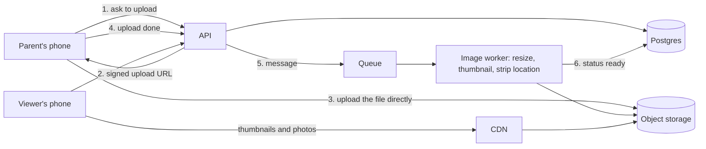

# System Design: A Method for Any System

> **In this lesson:** a step-by-step method for designing a system you've never seen, the same method used in every design lesson after this one and in design interviews. You'll learn to pin down what's being asked, estimate with rough numbers, and find the part that breaks first. Then you'll watch the method worked from start to finish on a photo-sharing app, and record yourself designing one of your own.

## Words you need first

- **Requirement.** Something the system must do (functional) or a quality it must have, such as speed or privacy (non-functional).
- **Back-of-the-envelope estimate.** Arithmetic with rounded numbers, rough enough to do on scrap paper, that tells you the size of a problem.
- **Throughput.** How much work a system handles per second, such as requests per second.
- **Bottleneck.** The part of a system that hits its limit first and holds everything else back.
- **Tradeoff.** A choice where getting more of one thing means getting less of another.

## Why a method

Ask a beginner to "design Instagram" and they start drawing boxes: a load balancer, five services, a cache, two databases. It looks impressive, and nobody can say whether any of it was needed, because nobody asked what the system has to do or how big it is.

A design is a chain of reasons. Each box is there because a number or a requirement put it there. The method below makes you build that chain in order, so every choice traces back to something you can defend. It works on a whiteboard in an interview, in a document at work, and for your capstone.

## The method

Eight steps, always in this order.

```order
title: The design method
---
Requirements, and what's out of scope
Rough numbers
Data model
API
Components
The bottleneck
Tradeoffs
What changes at 10 and 100 times the traffic
```

### 1. Requirements, and what's out of scope

Start by asking questions until you can write two short lists.

**Functional requirements**: what a user can do. Three to five verbs. "Upload a photo." "See an album." Not twenty.

**Non-functional requirements**: the qualities. For each, a rough target:

- **Scale:** how many users, how much data.
- **Speed:** how fast must the important actions feel?
- **Availability:** how bad is it if it's down for an hour?
- **Consistency:** what must never be wrong or stale?
- **Privacy and safety:** who must never see what?
- **Cost:** who pays, and how much is too much?

Then write **out of scope**: things you're choosing not to design. It's the most underrated list. Saying "comments and search are out of scope" out loud is what lets you design the rest properly in the time you have.

### 2. Rough numbers

Turn the requirements into a few numbers. You only need the right size, never an exact answer. These come up every time:

- **Requests per second**, on average and at peak. Peak is usually two to ten times the average.
- **Reads compared with writes.** Most systems read far more than they write, and the ratio shapes everything.
- **Storage**: size of one item, times items per day, times days you keep it.
- **Bandwidth**: how many bytes go out per second.

A few numbers make the arithmetic easy. They're rounded on purpose.

| Fact | Rounded |
| --- | --- |
| Seconds in a day | 86,400, call it 100,000 |
| 1 million a day | about 12 a second, call it 10 |
| Seconds in a month | about 2.5 million |
| A row of text data | a few hundred bytes to a few KB |
| A phone photo | 2 to 5 MB |
| A resized web photo | a few hundred KB |
| A thumbnail | tens of KB |
| Reading from memory | well under a microsecond |
| A request within one data center | under a millisecond |
| A request across a continent | tens of milliseconds |
| A request across an ocean | 100 milliseconds or more |
| One Postgres server, simple indexed queries | thousands a second |
| One Node server, simple requests | hundreds to a few thousand a second |

Those last two depend heavily on hardware and on the query. Treat them as "is this a hundred, a thousand, or a hundred thousand?", which is the only question the estimate is answering.

```blanks
{
  "title": "Size a problem on scrap paper",
  "note": "Round as you go. Only the size matters.",
  "code": "Users upload 50,000 photos a day.\n50,000 / 100,000 seconds = about ___1___ uploads a second on average\nSaturday afternoon is 10 times busier: about ___2___ a second at peak\nEach original is 4 MB: 50,000 x 4 MB = ___3___ of new photos a day",
  "blanks": [
    { "options": ["0.5", "5", "50"], "answer": "0.5", "explain": "50,000 divided by 100,000 is a half. Half an upload a second is tiny for any server." },
    { "options": ["5", "0.05", "500"], "answer": "5", "explain": "Ten times 0.5 is 5. Still small. Peaks matter more once the average is large." },
    { "options": ["200 GB", "20 GB", "2 TB"], "answer": "200 GB", "explain": "50,000 times 4 MB is 200,000 MB, which is 200 GB. Every day. That number, not the request rate, is what this design will be about." }
  ]
}
```

### 3. Data model

List the things the system stores, their important fields, and how they relate. Then, for each screen or action, write the query it needs. **The queries decide the indexes**, and sometimes decide between a table and a document. You did this in the orders project.

### 4. API

Write the handful of endpoints that serve the functional requirements: method, path, what goes in, what comes out. Decide pagination, which calls need a login, and which must be safe to repeat. If an endpoint doesn't serve a requirement, it doesn't belong yet.

### 5. Components

Now draw boxes. Start with the simplest thing that could meet the requirements, usually one app and one database, and add a box only when a requirement or a number demands it. For each box, be able to say which number or requirement put it there.

### 6. The bottleneck

Walk your numbers through the drawing. At peak, which box hits its limit first? The database? Bandwidth? A slow job? A provider's rate limit? There's always one. Finding it is the point of the exercise, and it's often not where people expect.

### 7. Tradeoffs

For every important choice, say what you gave up. "We upload straight to storage, which takes the bytes off our servers and makes the upload flow more complicated." A design with no costs listed hasn't been thought through.

### 8. What changes at 10 and 100 times the traffic

Multiply the numbers and walk them through again. What breaks first, and what would you change, in what order? A good answer changes as little as it can: the cheapest fix for the first thing that breaks, then the next.

## Worked example: Snapshot

Here's the method from start to finish on one prompt.

> **Design Snapshot**, an app where parents in youth sports clubs share photos from games. Each team has albums. Parents upload from their phones, and only members of the team can see the photos.

### 1. Requirements

Questions worth asking first: How many clubs and parents? Photos or video too? Who can delete a photo? Do people want the original file back? Are there rules about children's photos?

Say the answers come back like this, and write the lists.

**Functional:**

- A team admin creates an album for a game.
- A team member uploads photos to an album from a phone.
- A team member sees an album as a grid of thumbnails and opens any photo full size.
- An uploader or team admin deletes a photo.

**Non-functional:**

- Scale: 500,000 parents, about 100,000 using it on a given day.
- Speed: an album's grid shows in about a second, on a phone.
- Uploads must survive a weak signal at a sports field. A photo, once uploaded, is never lost.
- Privacy: only team members see a team's photos. Photos of children must not reveal where they were taken.
- Cost: a small company. Storage must not grow without limit.

**Out of scope:** video, comments and likes, search, face recognition, editing, prints, notifications.

### 2. Rough numbers

- 100,000 daily users. One in ten uploads on a given day, about five photos each: **50,000 photos a day.**
- Uploads: 50,000 a day is about **0.5 a second**. Saturday afternoon, after games, is ten times busier: **about 5 a second.**
- Storage for originals at 4 MB: **200 GB a day, about 73 TB a year.**
- Each photo also gets a display version of about 400 KB and a thumbnail of about 30 KB: about 22 GB a day more.
- Viewing: each daily user opens about three albums of 40 photos and opens ten photos full size. That's 12 million thumbnails and 1 million display photos a day.
- Bandwidth out: 12 million × 30 KB is 360 GB, plus 1 million × 400 KB is 400 GB. **About 760 GB a day**, roughly 9 MB a second on average and several times that on a Sunday evening.
- Album pages: 300,000 a day, about 3 a second, maybe 20 at peak.
- Photo records in the database: about 500 bytes each, 25 MB a day. **About 9 GB a year.**

Look at what the numbers say. The database work is tiny: a few writes a second and a few dozen reads. The bytes are huge. This design is about moving and storing files, and the numbers told us that before we drew a single box.

### 3. Data model

```
users        id, email, name
teams        id, club_name, name
memberships  user_id, team_id, role ('member' or 'admin')       unique (user_id, team_id)
albums       id, team_id, title, game_date, created_by
photos       id, album_id, uploader_id, status, original_key, display_key,
             thumb_key, width, height, created_at
```

`status` is one of `uploading`, `processing`, `ready` or `failed`, because a photo exists in the database before its file is ready. The `_key` fields are names of files in storage. The bytes never go in the database.

Queries:

- Album grid: photos in one album, newest first, 50 at a time. Index on `(album_id, created_at)`.
- Every request: is this user a member of this team? The unique index on `(user_id, team_id)` answers it.

This is relational data with clear links between users, teams and albums, so Postgres fits well.

### 4. API

```
POST   /albums/:albumId/photos          -> { photoId, uploadUrl }
POST   /photos/:photoId/complete        -> 202 Accepted
GET    /albums/:albumId/photos?cursor=  -> { photos: [{ id, status, thumbUrl, displayUrl }], nextCursor }
DELETE /photos/:photoId                 -> 204
```

Every call checks membership first. The upload is in two steps, and the next section explains why.

### 5. Components

Three new ideas, each put there by a number or a requirement.

**Object storage** is a service that stores files by name, cheaply and in practically unlimited amounts, and serves them over HTTP. Amazon S3, Google Cloud Storage and Cloudflare R2 are examples. It's where the 73 TB a year goes.

**A signed upload address.** Uploading 4 MB from a phone at a sports field can take a long time. If those bytes pass through our servers, each slow upload holds a connection open for all that time, and a serverless function might hit its time limit. Instead, the server asks the storage service for a **signed URL**: a link that lets whoever has it upload one specific file, for a few minutes. The phone uploads straight to storage. Our server only handles two small requests. Viewing works the same way: the API hands out short-lived signed links to the thumbnail and display files.

**A CDN** keeps copies of files on servers near users. 760 GB a day served from our own servers would be slow and costly. Served from a CDN in front of storage, it's what CDNs are built for.

And from the shipping and architecture lessons: **a queue and a worker** make the display version and thumbnail after each upload, and strip location data out of the photo's hidden details, which phones add and the privacy requirement forbids.



### 6. The bottleneck

Walk the peak through it:

- **API and database:** 5 uploads and 20 album pages a second at peak. One small app and one Postgres server handle that with plenty to spare.
- **Image processing:** say resizing takes about a second of computer time per photo. At 5 photos a second, about 5 workers are busy at peak. If there are only 2, the queue grows on Saturday afternoon and photos sit at `processing` for longer. That's the first thing to feel strain, and the queue means it slows down instead of failing.
- **Storage cost:** 73 TB a year, growing every month, forever. This is the bottleneck that matters most to a small company. Nothing breaks. The bill just keeps climbing.

### 7. Tradeoffs

| Choice | What it buys | What it costs |
| --- | --- | --- |
| Upload straight to storage with a signed URL | No slow uploads tying up our servers | A two-step upload, and a cleanup job for uploads that never finish |
| Process images in a worker | Fast uploads, and Saturday peaks are absorbed | A photo shows as "processing" for a few seconds. The uploader should see their own photo straight away, from the phone's copy |
| Keep originals for 60 days, then delete them and keep only the display version | Storage grows about a tenth as fast as it would if we kept everything | Parents can't download the full original after 60 days. Say so in the app |
| Private files with signed links | Only members can open a photo, even with a copied link, once it expires | More work than public links, and links expire mid-session if they're too short |
| Postgres for metadata | Memberships and albums are naturally relational, and it's tiny | One more thing to run. At this size, not a real cost |

### 8. At 10 and 100 times

**10 times**, a million daily users: 500,000 photos a day, 50 uploads a second at peak, 7.6 TB out a day.

- The database is still comfortable. Album pages at about 200 a second at peak are fine with the right index.
- Workers: about 50 at peak. Add more workers automatically when the queue gets long, and fewer when it's short.
- Storage and CDN bills are now the main cost of the business. The 60-day rule and moving old originals to a cheaper, slower storage class matter more than any code.

**100 times**, ten million daily users: 5 million photos a day, 500 uploads a second at peak, about 2,000 album pages a second at peak, 900 GB of metadata a year.

- Album reads: add read-only copies of the database, called read replicas, and a cache for album listings. Remember that a parent who just uploaded must see their own photo, so read their own album from the main database for a short while.
- Photos table: billions of rows. Consider splitting it by team across several databases, which is called sharding.
- Workers: hundreds at peak. A managed image service might now be cheaper than running our own.
- New requirements appear that were out of scope: moderation, abuse reports, and per-club storage limits or pricing. At this size someone will upload something they shouldn't, and the design has to handle it.

Notice what didn't change: the core shape. Signed uploads, a queue, workers and a CDN were right at the start and are still right at 100 times. The numbers were large enough from day one to decide them.

```quiz
[
  {
    "q": "You're asked to design a system and immediately start drawing a load balancer, three services and a cache. What did you skip?",
    "options": ["Requirements and rough numbers, which are what justify each box", "The API", "Choosing a programming language", "Nothing, drawing first is fine"],
    "answer": 0,
    "explain": "Every box should trace back to a requirement or a number. Without them you can't say whether any of those boxes were needed."
  },
  {
    "q": "In the Snapshot example, why don't photos go in the database?",
    "options": ["The bytes are huge and served at high volume, which object storage and a CDN do cheaply. The database keeps only small records pointing at them", "Databases can't store binary data", "Postgres is too slow for any reads", "Photos are out of scope"],
    "answer": 0,
    "explain": "The estimate showed the database work is tiny and the file work is enormous. Each goes to the system built for it."
  },
  {
    "q": "A design handles today's traffic. At 100 times, what does a good answer do first?",
    "options": ["Find what breaks first and apply the smallest change that fixes it, then look for the next thing", "Rewrite everything as microservices", "Add a cache in front of every component", "Buy the largest database server available"],
    "answer": 0,
    "explain": "Scaling is a sequence: the first bottleneck, its cheapest fix, then the next. Changing everything at once is expensive and usually fixes things that weren't broken."
  }
]
```

## Your turn: explain a design out loud

This is an explanation video. Pick one prompt and design it with the eight steps, on paper or in a drawing tool such as [Excalidraw](https://excalidraw.com/).

- **Volunteer shifts.** A large charity runs one big event a year with 2,000 shifts and 30,000 volunteers. Sign-ups open at noon on one day, and the popular shifts fill in moments. Each shift has a fixed number of spots.
- **Restaurant waitlist.** Guests at 400 restaurants join a waitlist from their phone by scanning a code at the door, see their place in line, and get a text message when their table is ready. Staff manage the list from a tablet.

Then record your screen and yourself walking through it, step by step, with your drawing on screen. Keep it under ten minutes. Say your numbers out loud and show the arithmetic. Say where the bottleneck is and what you'd change at 100 times.

You don't need the right answer, because there isn't one. You need every box to have a reason you can say out loud. If you notice yourself saying "and then we'd probably add a cache" with no number behind it, stop and find the number, or take the cache out.

Bring the recording and your drawing to your next mentor session. Your mentor will ask about the step you rushed.

## Key takeaways

- Design in order: requirements and out of scope, numbers, data model, API, components, bottleneck, tradeoffs, then 10 and 100 times.
- Rough numbers decide the design. Round hard: 100,000 seconds in a day, peak is a few times average.
- Every box needs a reason you can point to: a requirement or a number.
- There's always a bottleneck, and it's often money or bytes rather than requests.
- A tradeoff names what you gave up. A design with no costs listed isn't finished.
- At 10 and 100 times, fix the first thing that breaks with the smallest change, then look again.

## Work with AI

```ai-prompt
title: Be my design interviewer
---
I'm practicing system design with this method: requirements and out of scope, rough
numbers, data model, API, components, bottleneck, tradeoffs, then 10 and 100 times
the traffic. Give me a one-sentence design prompt, the kind an interviewer would give.
Don't design anything yourself. Answer my clarifying questions as the interviewer
would, with specific numbers when I ask. Let me drive through every step, one at a
time. If I add a component without a reason from my requirements or numbers, ask me
which one justifies it. If my arithmetic is off by more than a factor of ten, ask me
to redo it. At the end, tell me which step I was weakest on and why, in two sentences.
```
