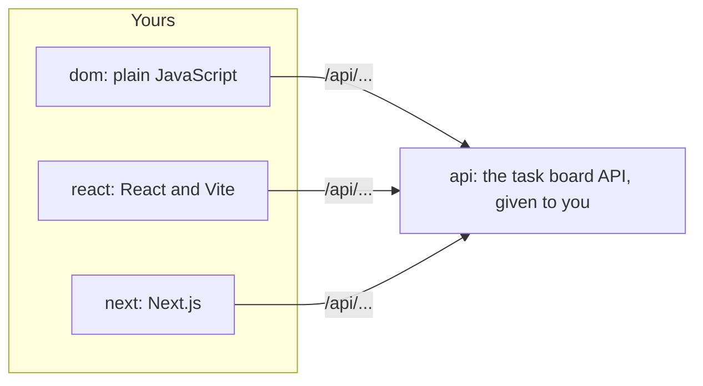

# Project: Task Board. The Plain DOM Version

> **In this lesson:** you start your third project, one app built three ways. First, a task board in plain JavaScript and the DOM, with no framework, talking to an API we give you. You'll plan it, have your agent build it, review every change, and hand it in to tests that try the things real people do to a board.

## Words you need first

- **Package.** Code someone else published for others to use, downloaded with `npm`.
- **API client.** The one small module in an app that talks to the server. Everything else asks it.
- **Page contract.** An agreement about what the page contains, so tests can find things. Here it's a list of `data-` attributes.
- **Single source of truth.** One place where a piece of data lives. Everything else is worked out from it.
- **Render function.** A function that builds the page from the data, called again after every change.

## One app, three ways

For the rest of this part of the program you'll build the same task board three times:

1. In plain JavaScript and the DOM. This lesson.
2. In React, built with Vite. Then you'll make it cope with a slow, unreliable server.
3. In Next.js, with the first load done on the server.

The board stays the same: three columns, cards you can add, edit, delete and move. What changes is how much work you do and where the work happens. By the end you'll have felt each one, and you'll write a decision memo on which you'd pick and why. That memo is the real point of the project. Anyone can follow a framework tutorial. Fewer people can say what a framework costs.



## Get the files

From the top of your `parsity-labs` repository:

```bash
curl -sL https://ai.parsity.io/labs/taskboard.tar.gz | tar xz
```

You now have a `taskboard` folder holding all three versions and the API:

```
taskboard/
  README.md      the page contract and the API client contract, for all three
  api/           the task board API: node:http, no packages
  dom/           this milestone
  react/         the next two milestones
  next/          the last milestone
```

Read `taskboard/README.md` now, all of it. The tests depend on every line.

### Start the API

The API is a tiny server that keeps the board in memory. It uses only Node's built-in `node:http` module, which does the request parsing you wrote by hand in the web server project, so there's nothing to install. Open a terminal tab just for it:

```bash
cd taskboard/api
node server.js
```

Leave it running. In another tab, try it:

```bash
curl http://localhost:4000/api/board
curl -X POST http://localhost:4000/api/tasks -H "Content-Type: application/json" -d '{"title":"Try the API","column":"doing"}'
curl -X PATCH http://localhost:4000/api/tasks/t1 -H "Content-Type: application/json" -d '{"column":"todo","position":0}'
curl -X POST http://localhost:4000/api/tasks -H "Content-Type: application/json" -d '{"title":"   "}'
```

The last one is refused with a 400 and a reason. Your page has to show reasons like that. `taskboard/api/README.md` lists every route and every rule. Restarting the server puts the board back to its five starting cards.

### Install the test tools

The tests for this version use a package called `jsdom`: a pretend browser that runs in Node, so tests can click your buttons with no real browser.

```bash
cd taskboard/dom
npm install
```

Three things to know about packages, since this is your first project with one:

- `package.json` lists the packages a project needs.
- `npm install` downloads them into a folder called `node_modules`. It's large, and it's never committed. The `.gitignore` in each folder already leaves it out.
- `package-lock.json` records the exact version of every package that was installed. Commit it. The grader installs from it, so it gets exactly what you had.

Then open http://localhost:4000/ in your browser. The API serves the `dom` folder too. For now the page says the board isn't written yet.

## What you're building

| File | What goes in it |
| --- | --- |
| `api.js` | `createApi(baseUrl, fetchFn)`: the API client. Four methods, each returning a promise. |
| `app.js` | `mountBoard(root, api)`: builds the whole board inside `root` and keeps it up to date. |

`main.js` is already written. It's three lines: make an API client for `/api`, find the `#board` element, call `mountBoard`. The tests skip it and call `mountBoard` themselves, with a pretend API, so your board must only ever talk to the server through the `api` it's given.

### The page contract, in short

The full list is in `taskboard/README.md`. The heart of it:

```html
<section data-column="todo">
  <h2>To do</h2>
  <ul>
    <li data-task-id="t3">
      <span data-field="title">Show the columns and cards</span>
      <button data-action="left" disabled>&lt;</button>
      <button data-action="up" disabled>^</button>
      <button data-action="down">v</button>
      <button data-action="right">&gt;</button>
      <button data-action="edit">Edit</button>
      <button data-action="delete">Delete</button>
    </li>
  </ul>
  <form data-form="add"><input name="title" /><button>Add</button></form>
</section>
```

Tags, classes and layout are yours to choose. The `data-` attributes are not.

## The shape that works

You've met every piece of this in the lessons on the browser and on frameworks. Here they come together.

**One state object.** All the data the page shows lives in one object: the board from the server, whether it's loading, the current error message, which card is being edited. It's the single source of truth.

**One render function.** `render()` builds the whole board from the state with `createElement` and `textContent`, and swaps it in with `replaceChildren`. It never reads anything from the page.

**Listeners attached once.** When `mountBoard` starts, it attaches one `click` and one `submit` listener to `root`, and never again. They use `closest` to find which button and which card.

**After every change, load the board again.** When a move succeeds, don't try to work out the new positions yourself. Ask the server for the board and render what it says. That costs one extra request per change and removes a whole family of bugs, because the page can never disagree with the server. Later in the project you'll make changes show before the server answers, and see what that costs.

```order
title: What happens when someone clicks the right arrow on a card
---
The click bubbles up from the button to the board's single click listener
The listener uses closest to find the button's data-action and the card's data-task-id
It calls api.updateTask with the next column
The API client sends a PATCH and waits for the answer
The board asks the API for the whole board again and stores it in the state
render() rebuilds the columns from the state, with the card in its new place
```

## Plan the feature first

Before your agent writes a line, write a short plan in your own words. Put it in the description of the pull request you'll open at the end, so it lives next to the code it describes. Cover:

- **The state.** Every field in your state object, and what each one is for.
- **The events.** For each button and form: what it sends to the API, and what the page does after.
- **The failures.** What the person sees when a request is refused. What happens on the top card's up button, or the To do column's left button. What a title of only spaces does.
- **The order you'll build in.** Small steps, each one tested before the next.

A good order: the API client and its tests first, because everything else stands on it. Then showing the board. Then one action at a time.

## Build it with your agent

Make a branch, then work in small steps:

```bash
git switch -c taskboard-dom
```

Give your agent the plan and point it at `taskboard/README.md`, `taskboard/api/README.md` and the tests. Ask for one step at a time. After each step, run the tests and read the diff before you accept it.

```bash
npm test
```

Agents make the same handful of mistakes in DOM code. Check every diff for these:

- **`innerHTML` with a title in it.** Titles come from people. They go in with `textContent`.
- **`addEventListener` inside `render`.** Listeners on `root` are attached once.
- **Buttons that don't know where they are.** Up on the top card, down on the bottom one, left in To do, right in Done. They should be disabled or missing, so they never send a request the server will refuse.
- **Errors that only reach the console.** The person can't see the console. A failed request shows its reason in an element with `data-role="error"`.
- **`res.json()` on a 204.** A successful delete has no body, and reading JSON from nothing throws.
- **Checking `res.ok`.** `fetch` only fails when the network does. A 400 or a 500 comes back as an answer, and your client has to turn it into a rejected promise.

If your agent's code does something you can't explain, ask it to explain, then decide whether you agree. You'll be asked about any line of this.

Then try it in a real browser. Restart the API with `node server.js --flaky 0.5` and click around. Half your changes should fail, each with a message, and the board should never show a card somewhere the server doesn't have it.

## Your tests

The folder comes with 8 tests. Add at least 3 of your own, so you have at least 11. Good ones to write:

- Moving a card down, then back up.
- Left from the Doing column lands at the end of To do.
- A failed add shows the server's reason.

The helpers in `tests/helpers.js` give you the pretend API and functions to click and type. Read the existing tests and copy their shape.

## Hand it in

Commit, push your branch, open a pull request on your own repository with your plan as the description, read the whole diff one more time, and merge it. Then paste the link to your `parsity-labs` repository.

The grader looks in `taskboard/dom` for `app.js`, `api.js` and `package-lock.json`, installs the packages, and runs your tests, then ours.

```submit
assignment: taskboard-dom
```

Ours use the same pretend API and the same page contract. They try titles that look like HTML, the buttons at the edges of the board, a server that refuses changes, an API client facing errors and empty answers, and a board that has redrawn many times before you click. If a category fails, read its name, think about what your code does in that case, and fix it.

## Stretch

Drag and drop. Let people drag a card to another column or another place in its column, using the browser's `draggable` attribute and the `dragstart`, `dragover` and `drop` events. Keep the buttons: people using a keyboard need them, and so do the tests. Drag and drop can't be checked automatically in a pretend browser, so show it working to your mentor.

```quiz
[
  {
    "q": "After a successful move, why load the whole board again instead of updating the page yourself?",
    "options": ["It guarantees the page shows exactly what the server has, at the cost of one extra request", "Because the API doesn't send anything back after a move", "Because the DOM can't move an element between lists", "Because render only works with data from getBoard"],
    "answer": 0,
    "explain": "The server renumbers positions after every change. Asking for the board again means you never have to repeat that logic in the page, and the page can't drift."
  },
  {
    "q": "Your API client calls res.json() for every answer. Which request breaks?",
    "options": ["A successful delete, because a 204 has no body and reading JSON from nothing throws", "Loading the board, because it's too large", "Adding a task, because the server sends 201", "None of them"],
    "answer": 0,
    "explain": "A 204 means success with no content. Check for it before reading the body."
  },
  {
    "q": "The server answers a PATCH with 400 and { error: \"Title can't be empty\" }. What should your API client do?",
    "options": ["Reject with an Error whose message is the server's text and whose status is 400", "Resolve with { error: ... } so the caller can check it", "Retry the request", "Ignore it, because fetch only rejects on real failures"],
    "answer": 0,
    "explain": "fetch resolves for any answer, including errors. The client turns a failed status into a rejection, so the rest of the code can use try and catch."
  }
]
```

## Key takeaways

- A page contract made of `data-` attributes lets tests, and teammates, find things without caring how the page looks.
- Keep one state object, one render function, and listeners attached once. That's the shape a framework gives you for free.
- Loading the board again after each change is the simplest way to never disagree with the server. It costs a request.
- `fetch` only rejects when the network fails. Your API client turns error statuses into rejections, with the server's reason.
- Titles from people go in with `textContent`. Buttons that can't act are disabled, not left to send requests that fail.

## Work with AI

```ai-prompt
title: Question me about my DOM board
---
I'm a beginner. I planned a task board in plain JavaScript and the DOM, and a coding
agent wrote most of it while I reviewed every change. I'll paste my app.js and api.js.
Don't rewrite anything and don't fix anything. Act as a senior engineer reviewing my
pull request. Ask me one question at a time about specific lines: why a listener is
attached where it is, what happens if a request fails halfway through, what a title
full of HTML would do, what happens on the top card's up button. Wait for my answer
each time. If my answer is wrong or vague, quote the line and ask a follow-up. After
six questions, tell me which parts of my own code I understand least.
```
