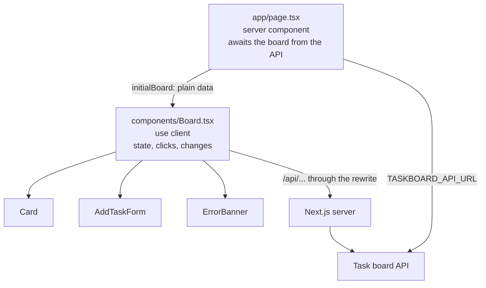

# Project: Task Board. Next.js and Where Rendering Belongs

> **In this lesson:** the third and last version of the board. In Next.js, the first load happens on the server, so the page arrives with every card already in it, and the buttons and forms still run in the browser. You'll split the board into server and client parts, keep configuration on the server, handle an API that's down, and write the decision memo that closes the project.

## Words you need first

- **Server component.** A component that runs only on the server. It can await data before any HTML is sent, and none of its code reaches the browser.
- **Client component.** A component that runs in the browser as well, so it can have state and handle clicks. Its file starts with `"use client"`.
- **Hydration.** The browser attaching event listeners and state to HTML the server already sent, so it becomes interactive.
- **Environment variable.** A named setting given to a program when it starts, such as `TASKBOARD_API_URL`. Read in Node as `process.env.TASKBOARD_API_URL`.
- **Rewrite.** A rule that makes a server pass some requests on to another address, without the browser knowing.

## See the difference first

Keep the API running. Start your React version with `npm run dev` in `taskboard/react`, then ask its server for the page the way a search engine would:

```bash
curl -s http://localhost:5173/ | grep -c data-task-id
```

`0`. The HTML has an empty `<div id="root">`, and every card is built later by JavaScript in the browser. Someone on a slow phone stares at a blank page until the bundle downloads, runs, and fetches the board.

By the end of this lesson the same command against your Next.js version prints the number of cards on the board.

## Set it up

```bash
cd taskboard/next
cp ../react/src/board.ts lib/board.ts
cp ../react/src/api.ts lib/api.ts
cp ../react/src/components/AddTaskForm.tsx ../react/src/components/TitleEditor.tsx ../react/src/components/ErrorBanner.tsx components/
npm install
npm run dev
```

Open http://localhost:3000/. Your board logic and API client come across unchanged, and the tests check that they still pass the same cases. That's the payoff for keeping them free of React.

| File | What goes in it |
| --- | --- |
| `app/page.tsx` | The page. A server component that loads the board |
| `components/Board.tsx` | The board in the browser. A client component |
| `app/error.tsx` | What shows when the page can't load. You create it |
| `next.config.ts` | Already sets up the rewrite from `/api/...` to the task board API |
| `MEMO.md` | Your decision memo |

## Server components and client components

In Next.js, every component is a server component unless its file starts with `"use client"`. The two kinds can do different things:

| | Server component | Client component |
| --- | --- | --- |
| Runs | On the server, once per request | On the server for the first HTML, then in the browser |
| Can be `async` and `await` data | Yes | No |
| `useState`, `useEffect`, `onClick` | No | Yes |
| Can read `process.env.TASKBOARD_API_URL` | Yes | No. It doesn't exist in the browser |
| Its code is sent to the browser | No | Yes |

The line between them is the `"use client"` at the top of a file. Everything that file imports runs in the browser too, so your hand-written components need no marker of their own when only `Board.tsx` uses them.

A server component can render a client component and pass it props. Those props travel from the server to the browser inside the page, so they must be plain data: strings, numbers, arrays, objects. A function can't make that trip.



```match
{
  "title": "Server or client?",
  "note": "Tap the code, then where it belongs.",
  "pairs": [
    { "left": "const board = await api.getBoard() inside the page", "right": "A server component" },
    { "left": "const [editing, setEditing] = useState(null)", "right": "A client component" },
    { "left": "process.env.TASKBOARD_API_URL", "right": "Only on the server" },
    { "left": "<Board initialBoard={board} />", "right": "Made on the server, used in the browser" }
  ]
}
```

## Loading the board on the server

`app/page.tsx` becomes an `async` function that loads the board and hands it to the client part:

```tsx
export default async function Page() {
  const board = await loadTheBoard();   // your API client, with the API's full address
  return <Board initialBoard={board} />;
}
```

Three details decide whether it works.

**The server needs a full address.** In the browser, `/api/board` means "on the site I'm on". On the server there's no site around the code, so a relative address fails with an error about parsing the URL. Read the API's address from `process.env.TASKBOARD_API_URL`, and fall back to `http://localhost:4000/api` when it isn't set. Keeping the address in configuration means the same code works on your laptop and on a real server, where the API lives somewhere else.

**Render on every request.** The starter has `export const dynamic = "force-dynamic"`. Without it, `next build` decides the page never changes and renders it once, at build time. That fetches the board while you build, so the board is frozen at whatever it was then, and if the API isn't running the build fails with `ECONNREFUSED`. Try removing it and running `npm run build` to see for yourself, then put it back.

**Load it once per request.** Fetch inside `Page`. A fetch at the top of the file, outside any function, runs once when the server starts and every visitor gets that same old board forever.

## The board in the browser

`components/Board.tsx` starts from the board the server sent:

```tsx
"use client";
export default function Board({ initialBoard, api = browserApi }: Props) {
  const [board, setBoard] = useState(initialBoard);
  // ...the same changes as your React version
}
```

Most of your React `App` moves here: the optimistic changes, the undo, the error banner. Two things are different.

- **No loading state, and no fetch when it first appears.** The server already sent the board. An effect that loads it again on mount makes a second request for data you have, and can briefly flash the cards back to an older version. The loading message and retry button from your React version are replaced by the server load and the error page below.
- **Changes go through this Next.js server.** The browser calls `/api/tasks/...` on port 3000, and the rewrite in `next.config.ts` passes it on to the API. The browser never learns the API's real address.

## When the API is down

If the board can't be loaded, `Page` throws. Next.js then shows `app/error.tsx` in its place, if you've made one. Create it:

- It must start with `"use client"`, because it gets a `reset` function to try again, and functions only exist in the browser.
- It gets `{ error, reset }` as props.
- Use your `ErrorBanner`, with `reset` as the retry.

Stop the API and reload to test it. In development you'll see Next.js's own error overlay first. Close it to see your page.

## Keeping things on the server

Look at what crossed to the browser: the board as data, and the code for `Board.tsx` and what it imports. The API's address didn't. If the API needed a secret key, the same would hold: the server could read it from an environment variable and add it to its requests, and no visitor could ever find it in the page. A page rendered only in the browser has no such place to hide anything. Next.js only sends an environment variable to the browser if its name starts with `NEXT_PUBLIC_`, so never give a secret that prefix.

```scenario
{
  "who": "A teammate",
  "setting": "Reviewing your pull request for the Next.js board.",
  "ask": "Why is Board a client component? Wouldn't it be faster to make everything a server component?",
  "note": "More than one answer is defensible. Pick the one you'd say.",
  "options": [
    { "text": "The first load already happens on the server, in page.tsx, so the cards arrive in the HTML. Board has to be a client component because it holds state and handles clicks, and server components can't do either. Only Board and the components it uses are sent to the browser.", "verdict": "best", "feedback": "It separates the two jobs, first load and interaction, and says why each lives where it does. It also answers the hidden worry about how much code goes to the browser." },
    { "text": "Next.js gives an error if you use useState in a server component.", "verdict": "ok", "feedback": "True, and a good start, but it explains the rule without the reason. The teammate's real question is whether the split is worth it." },
    { "text": "Server components can't be interactive, so we can't use them for anything on this board.", "verdict": "weak", "feedback": "Half right and half wrong: the page is a server component and does the most valuable job, loading the board before any HTML is sent." },
    { "text": "We could use server actions for everything instead.", "verdict": "weak", "feedback": "Server actions can run the changes on the server, but something in the browser still has to hold the board and react to clicks. It changes where requests go, not whether you need a client component." }
  ],
  "debrief": "The first load and the interaction are two jobs. In Next.js each goes where it's cheapest and safest: loading on the server, clicking in the browser."
}
```

## Plan, then build with your agent

Branch first:

```bash
git switch -c taskboard-next
```

Write your plan in the pull request description: which files are server components and which are client components, where `TASKBOARD_API_URL` is read, how the page loads the board, what happens when it can't, and what moves from your React `App` into `Board`.

Then have your agent port the board. Review every diff for:

- `"use client"` at the top of `app/page.tsx`. Then the page can't await data on the server and the cards vanish from the HTML.
- An effect in `Board` that loads the board when it first appears.
- `process.env` read in a client component or anything it imports.
- A relative address, like `/api`, used for the server's fetch.
- A fetch at the top level of a file, outside `Page`.

Check it the way a search engine would:

```bash
curl -s http://localhost:3000/ | grep -c data-task-id
```

You should see the number of cards on the board. Then stop the API and reload, and start it with `--slow 1500 --flaky 0.3` and use the board.

Last, a production build has to pass:

```bash
npm run build
npm run typecheck
```

Our tests can't run a full Next.js build, so bring it to your mentor session and run `npm run build` there.

## Your tests

`tests/next.test.mjs` has 7 tests. Add at least 3 of your own, so you have at least 10. Good ones: the page's HTML after a card was added to the pretend server, the board in the browser deleting a card, the error page showing a message.

## Write your decision memo

Open `MEMO.md`. It has five questions about where the first load happens, where changes happen, what each version cost you, hosting and traffic, and which version you'd pick for a real tool.

The same rules as every memo:

- **Your own words.** No agent writes it. An agent may read it afterwards and tell you where it's unclear.
- **Say what it costs.** "Server rendering is faster" is half an answer. "The first page shows the cards at once, and in exchange every visit runs code on a server we pay for" is a whole one.
- **Short.** A paragraph per question. Pick a position.

Our check only makes sure every question has a real answer. Your mentor reads the memo and will ask you to defend it.

## Hand it in

Commit, push, open the pull request, review it, merge, and paste your repository link. The grader looks in `taskboard/next` for `app/page.tsx`, `components/Board.tsx`, `lib/board.ts`, `lib/api.ts`, `MEMO.md` and `package-lock.json`.

```submit
assignment: taskboard-next
```

Ours render your page the way the Next.js server would, with a pretend API behind it, and read the HTML. They check that the cards are in it, that each request sees the board as it is now, that the address comes from `TASKBOARD_API_URL`, and what happens when the API is down. They check which files are marked `"use client"` and what each side imports, that the board doesn't load itself again in the browser, that changes still work, and that every memo question has an answer.

When this passes, your third project is done.

## Tell the story

At your next mentor session, without notes:

- What you built, in two sentences.
- The hardest part, and how you got through it.
- One decision you made and what it cost. The memo's last question is a good one to use.

## Stretch

Run the API with `--slow 2000` and add `app/loading.tsx`. Next.js shows it straight away while `page.tsx` waits for the board, then swaps in the real page. Compare what a person sees now with the React version. This can't be checked by a test, so show your mentor.

```quiz
[
  {
    "q": "You add \"use client\" to app/page.tsx and load the board in an effect. What changes for someone on a slow phone?",
    "options": ["The first HTML has no cards, so they see an empty page until the JavaScript downloads, runs and fetches the board", "Nothing, Next.js renders it on the server anyway", "The page loads faster because less runs on the server", "The build fails"],
    "answer": 0,
    "explain": "A client component still produces HTML on the server, but an effect only runs in the browser. The data, and so the cards, arrive late."
  },
  {
    "q": "page.tsx calls fetch(\"/api/board\") and fails with an error about parsing the URL. Why?",
    "options": ["On the server there's no page around the code, so a relative address means nothing. It needs the full address of the API", "The rewrite in next.config.ts is broken", "The API is down", "Server components can't use fetch"],
    "answer": 0,
    "explain": "In the browser, /api/board is relative to the site. On the server it has nothing to be relative to. That's why the address comes from TASKBOARD_API_URL."
  },
  {
    "q": "Why does next build fail with ECONNREFUSED when force-dynamic is removed and the API isn't running?",
    "options": ["Next.js decides the page never changes and renders it during the build, which fetches the board from an API that isn't there", "next build always needs the API", "force-dynamic turns on TypeScript", "The rewrite runs during the build"],
    "answer": 0,
    "explain": "Without it, the page is rendered once at build time. That also means the board would be frozen at whatever it was during the build."
  }
]
```

## Key takeaways

- In Next.js, components run on the server unless their file starts with `"use client"`. Everything a client file imports goes to the browser too.
- Load the first board in a server component and pass it down as plain data. The HTML arrives with the cards in it, and the browser doesn't load it again.
- The server needs the API's full address, from configuration. Environment variables stay on the server unless you name them `NEXT_PUBLIC_`.
- Render per request when the data changes. A page rendered at build time is frozen, and fails to build if its data isn't there.
- Logic kept free of a framework, like `board.ts` and `api.ts`, moves between versions unchanged.

## Work with AI

```ai-prompt
title: Defend my memo
---
I'm a beginner. I built the same task board three ways: plain DOM, React with Vite,
and Next.js with the first load on the server. I wrote a decision memo about where
rendering and data loading should happen and which version I'd pick. I'll paste it.
Don't rewrite it and don't add points. Play a skeptical senior engineer in a design
review. Ask me one hard question at a time about a specific claim I made, quoting it,
for example about cost, speed, what happens at 100 times the traffic, or what changes
if the board had to be public. Wait for my answer each time. After five questions,
tell me which of my claims held up and which I couldn't defend.
```
