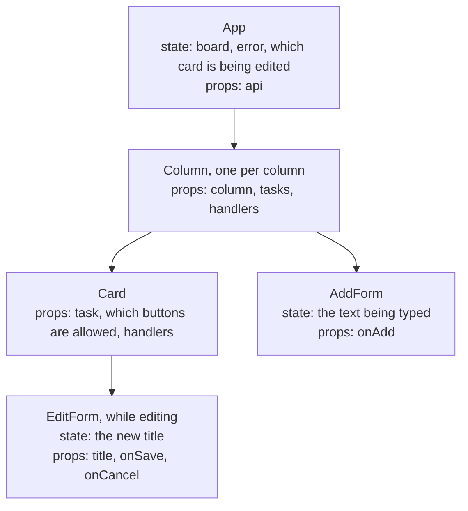

# Project: Task Board. React and Components

> **In this lesson:** the second version of the board, in React with Vite and TypeScript. You'll split the board's rules out into plain functions that never change their input, plan a tree of components and decide where each piece of state lives, then have your agent build it while you review for the mistakes React code attracts.

## Words you need first

- **Pure function.** A function whose answer depends only on what you pass in, and which changes nothing outside itself. Same input, same output, every time.
- **Component tree.** The components of a page drawn as a family tree: App at the top, the pieces it uses below it.
- **Bundler.** A tool that takes many source files, including TypeScript and JSX, and turns them into a few files a browser can load. Vite is one.
- **Proxy.** A server that passes requests on to another server.

## What changes, and what doesn't

The page contract and the API client contract are exactly the same as in the DOM version. The tests even share most of their checks. What changes is who keeps the page in step with the data.

| | DOM version | React version |
| --- | --- | --- |
| Building the page | Your `render()`, by hand | React, from your components |
| After a change | You call `render()` | You change state, React re-renders |
| Clicks | One delegated listener, `closest` to find the card | `onClick` on each button, with the task already in hand |
| The text in an input | Read from the page | Kept in state |
| Board rules | Left to the server | In `board.ts`, as pure functions |

That last row is new. In the DOM version you loaded the board again after every change and let the server do the arithmetic. This time the page needs to know the rules itself, because in the next milestone it will show changes before the server has answered.

## Set it up

```bash
cd taskboard/react
npm install
```

Start the API in its own tab if it isn't running: `node ../api/server.js`. Then:

```bash
npm run dev
```

Open http://localhost:5173/. The page is served by Vite's development server. Any request to `/api/...` is passed on to the API on port 4000, which `vite.config.ts` sets up. So your code calls `/api/board`, the same as the DOM version, and never needs to know the API's real address.

| File | What goes in it |
| --- | --- |
| `src/board.ts` | Board logic: `tasksIn`, `addTask`, `moveTask`, `renameTask`, `removeTask` |
| `src/api.ts` | The API client, with types |
| `src/App.tsx` | The `App` component, which gets the `api` as a prop |
| `src/components/` | Any other components you plan |

`src/main.tsx` starts the app and you don't change it. Like `main.js` before, the tests skip it and render `<App api={...} />` themselves with a pretend API.

## Board logic as pure functions

Open `src/board.ts`. It has the types for a board and five functions to fill in. Each takes a board and gives back a **new** board. None of them may change the board or the tasks they were given.

```ts
const after = moveTask(before, "t3", "doing", 0);
// before is exactly as it was. after is a new board with t3 at the top of Doing.
```

Three reasons to keep the rules here, outside any component:

- **They're easy to test.** No page, no React, no server. Call a function, check the answer.
- **They move with you.** In the Next.js version you'll copy this file across unchanged.
- **React needs new objects.** Change state in place and React doesn't notice. Functions that always return new objects make that mistake impossible.

The rules must match the server's exactly, or the page and the server will disagree:

- Positions in a column run 0, 1, 2 with no gaps, after every change.
- A position past the end of a column means the end. Below 0 means 0.
- An id that isn't on the board changes nothing.

### The move that catches everyone

Moving a card **down within its own column** is where most first attempts go wrong. Take To do with `[a, b, c]` and move `a` to position 2. The answer is `[b, c, a]`.

The trap is inserting before removing: put `a` at index 2 of `[a, b, c]` and you get `[a, b, a, c]`, then remove the first `a` and you have `[b, a, c]`, one place short. Take the card out first, then insert it into what's left:

```
start:          [a, b, c]
take a out:     [b, c]
insert at 2:    [b, c, a]
renumber:       b=0, c=1, a=2
```

```blanks
{
  "title": "Move a task without changing the old board",
  "note": "This is the core of moveTask, for a move within one column.",
  "code": "const others = tasksIn(board, column).___1___((t) => t.id !== id);\nconst at = Math.max(0, Math.min(position, others.___2___));\nconst moved = [...others.slice(0, at), task, ...others.slice(at)];\nconst renumbered = moved.map((t, i) => ___3___);",
  "blanks": [
    { "options": ["filter", "find", "splice"], "answer": "filter", "explain": "filter makes a new array without the task. splice would cut it out of an array that might be shared with the old board." },
    { "options": ["length", "length - 1", "length + 1"], "answer": "length", "explain": "After taking the task out, inserting at others.length puts it at the very end, which is where a position past the end belongs." },
    { "options": ["({ ...t, position: i })", "(t.position = i, t)", "t"], "answer": "({ ...t, position: i })", "explain": "Setting t.position directly changes the task object the old board still holds. Copy it with the new position." }
  ]
}
```

## Plan the components

Before any code, draw your component tree on paper, and next to each component write its props and any state it owns. A tree that works:



Decide, and write down:

- **Where the board lives.** In `App`, because a move changes two columns.
- **How `App` loads it.** An effect that calls `api.getBoard()` once, with a cleanup so a late answer can't land after the component has gone.
- **What happens after a change.** For this milestone, the simple way is fine: send the change, then load the board again, as in the DOM version. Or apply the change with your board functions and replace it with the server's answer. Pick one and say why.
- **How a card knows which buttons to allow.** Its column's place in the board and its own place in its column.

```match
{
  "title": "Spot the bug in each line from an agent's diff",
  "note": "Tap the line, then what's wrong with it.",
  "pairs": [
    { "left": "board.tasks.sort((a, b) => a.position - b.position)", "right": "sort changes the array in place, so it rearranges state React already has" },
    { "left": "{tasks.map((t, i) => <Card key={i} task={t} />)}", "right": "The key is the position, which changes when cards move" },
    { "left": "const input = document.getElementById(\"new-title\")", "right": "Reads the page around React instead of keeping the text in state" },
    { "left": "useEffect(() => { api.getBoard().then(setBoard); })", "right": "No dependency array, so it fetches again after every render" }
  ]
}
```

## Build it with your agent

Branch first:

```bash
git switch -c taskboard-react
```

Give your agent your plan, the two READMEs, and the tests in `tests/milestone-2.test.mjs`. A good order:

1. `api.ts`: port your DOM version's client to TypeScript. The logic shouldn't change, only the types.
2. `board.ts`, one function at a time, with tests.
3. `App` showing the board.
4. Each action, one at a time.

After each step:

```bash
npm test
npm run typecheck
```

Read every diff. Beyond the four bugs in the exercise above, look for:

- **`fetch` anywhere outside `api.ts`.** Every request goes through the client the component was given.
- **`dangerouslySetInnerHTML`.** React's name for `innerHTML`, and named that way for a reason. There's no need for it on this board.
- **State copied into more state.** If something can be worked out from the board during render, such as the tasks in one column, work it out. Don't store it twice.
- **Types switched off.** `any`, or `!` and `as` scattered around to make errors go away. Ask the agent what the error was, and fix that.

Then try it in the browser, and run `npm run build` once to see the plain files Vite makes in `dist/`. That folder is what you'd put on a server.

If you're stuck on a bug for more than 30 minutes, write down what you expected, what happened, and the smallest change that shows it. Then ask your agent to explain the cause before it changes anything.

## Your tests

`tests/milestone-2.test.mjs` has 10 tests. Add at least 4 of your own in a new file in `tests/`, so you have at least 14. Write at least two for `board.ts` directly. Good cases: moving to the end of a column with a huge position, renaming a task that doesn't exist, removing the only card in a column.

Leave `tests/milestone-3.test.mjs` switched off for now. It's for the next milestone.

## Hand it in

Commit, push, open a pull request with your plan and component tree as the description, review the whole diff, and merge. Then paste your repository link.

The grader looks in `taskboard/react` for `src/App.tsx`, `src/board.ts`, `src/api.ts` and `package-lock.json`.

```submit
assignment: taskboard-react-1
```

Ours check your board logic against the server's rules over a long run of random changes, make sure it never changes the board it was given, try your API client against errors and empty answers, run the board on screen with a pretend API, and look for code that reaches into the page around React.

```quiz
[
  {
    "q": "To do holds [a, b, c]. moveTask moves a to position 2 in the same column. What's the right answer?",
    "options": ["[b, c, a]", "[b, a, c]", "[a, b, c]", "[c, b, a]"],
    "answer": 0,
    "explain": "Take a out first, leaving [b, c], then insert at position 2, which is the end. Inserting before removing is the classic off-by-one."
  },
  {
    "q": "Why must moveTask return a new board instead of changing the one it got?",
    "options": ["React compares state by identity, so an edited old board looks unchanged and the page doesn't update", "TypeScript doesn't allow changing objects", "New objects are faster to create than editing old ones", "The server needs the old board"],
    "answer": 0,
    "explain": "A new object tells React something changed. It also means the old board is still there, untouched, which you'll need when a change has to be undone."
  },
  {
    "q": "Where should the board's state live in App, Column, Card and AddForm?",
    "options": ["App, because moving a card changes two columns", "Each Column, holding its own cards", "Each Card, holding itself", "AddForm, because it adds cards"],
    "answer": 0,
    "explain": "State lives in the lowest component that every user of it sits under. Only App sits above both columns a move touches."
  }
]
```

## Key takeaways

- The rules of the board live in pure functions that return new boards. They're easy to test and they move between frameworks unchanged.
- Moving within a column means taking the card out before putting it back. Inserting first is off by one.
- Plan the component tree and where each piece of state lives before anyone writes code.
- Review React diffs for in-place changes to state, keys taken from positions, code reaching around React into the page, and effects with no dependency list.
- Vite serves your code while you work and builds it into plain files to host.

## Work with AI

```ai-prompt
title: Break my board logic
---
I'm a beginner. I wrote pure functions for a task board in TypeScript: tasksIn, addTask,
moveTask, renameTask and removeTask. Positions in each column run 0, 1, 2 with no gaps.
A position past the end means the end, below 0 means 0, and an unknown id changes
nothing. None of the functions may change the board they're given. I'll paste my
board.ts. Don't fix it and don't write tests for me. Give me eight short scenarios, one
at a time, each a starting board and one call. For each, ask me to work out the exact
result by hand, positions included, and wait. Then tell me whether my code would give
the same answer and, if not, which line is responsible.
```
