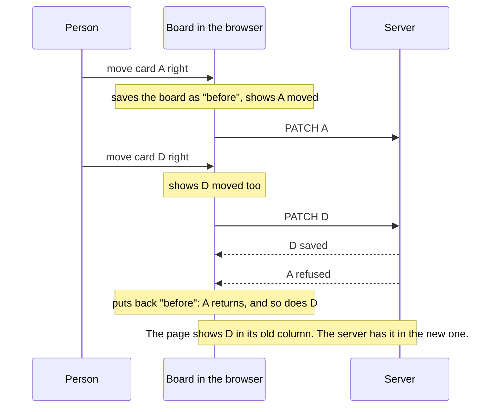

# Project: Task Board. Slow Servers, Failures and Instant Changes

> **In this lesson:** real servers are slow and sometimes say no. You'll make your React board show what's happening while it waits, show what went wrong when something fails, and show changes the moment someone clicks, undoing them cleanly when the server refuses. You'll also write three small components entirely by hand.

## Words you need first

- **Loading state.** What the page shows while it waits for data it doesn't have yet.
- **Error state.** What the page shows when a request failed, and what the person can do about it.
- **Optimistic update.** Showing a change on the page before the server has confirmed it, on the bet that it will.
- **Rollback.** Undoing an optimistic change when the server refuses it.
- **Race condition.** A bug that depends on which of two things finishes first.

## Watch your board struggle

Stop the API with Ctrl+C and start it again like this, from `taskboard/react`:

```bash
node ../api/server.js --slow 1500 --flaky 0.3
```

Every answer now takes a second and a half, and about 3 changes in 10 fail with a 503. Reload your board and use it for a minute. Look for:

- What shows during the first second and a half? Probably nothing, or something that looks broken.
- When you click right on a card, how long until anything happens? Do you click again because nothing moved?
- When a change fails, what do you see? Is the card where the server thinks it is?
- Stop the API completely and reload. What does the person get?

Write down what you saw. Those notes are the start of your plan.

## Three states for data you're waiting on

Data that comes from a server is always in one of three states, and the page needs something to show for each:

| State | What the page shows |
| --- | --- |
| Loading | A message with `data-role="loading"`. No half-drawn columns. |
| Failed | The reason, in an element with `data-role="error"`, and a `<button data-action="retry">` |
| Ready | The board |

Retrying should go back to loading and try again, and it should be able to fail again. The person can press it as many times as they like.

## Changes that show at once

Right now a click waits for the server before anything moves. At a second and a half per answer, the board feels broken. An optimistic update flips the order:

1. Change the board in state, straight away, with your functions from `board.ts`.
2. Send the change to the server.
3. If it succeeds, there's nothing more to do.
4. If it fails, undo the change and show why.

This is why you wrote the board's rules as pure functions. `moveTask(board, id, "doing", 1)` gives you the new board instantly, with the same positions the server will work out.

### New cards don't have an id yet

The server makes up a task's id. Until it answers, an optimistic card needs a temporary one, such as `temp-1`. When the real task comes back, swap the temporary id for the real one. Two things follow:

- Swap it, don't add the server's task as well. Otherwise the card shows twice.
- A card with a temporary id can't be moved, edited or deleted yet, because the server has never heard of `temp-1`. Disable its buttons until it's saved.

### Undoing only what failed

Here's the bug that most first attempts have. To undo a failed change, the obvious plan is to remember the whole board from before the change and put it back:

```ts
const before = board;
setBoard(moveTask(board, id, to, at));
try {
  await api.updateTask(id, { column: to, position: at });
} catch (err) {
  setBoard(before);      // puts back the whole board as it was
}
```

That works when there's one change at a time. Now picture two:



Restoring the old board undid a change that worked. The page now disagrees with the server, and the person has no idea.

Two ways to do it properly:

- **Undo only that change.** Keep what you need to reverse it, such as the card's old column and position, and apply the reverse to the board as it is now. `setBoard((current) => moveTask(current, id, oldColumn, oldPosition))`. Note the function form of `setBoard`: it gets the latest board, not the one from when the click happened.
- **Ask the server.** On a failure, load the whole board again and take its word for everything. Simpler, but changes still on their way can briefly vanish and come back.

Either is defensible. Pick one, and be able to say what the other would have cost.

```order
title: A move the server refuses, done properly
---
The person clicks right on a card
The board in state changes at once, using moveTask, and the card shows in its new column
The board remembers the card's old column and position, and sends the PATCH
The server answers with a 503
The board applies the reverse move to the current board, leaving any other changes alone
The reason shows in the error message, and the person can dismiss it
```

```scenario
{
  "who": "Your product manager",
  "setting": "Reviewing the board after you made changes optimistic.",
  "ask": "I moved a card and it jumped back a second later with an error. Isn't that worse than just waiting? Can we turn this off?",
  "note": "More than one answer is defensible. Pick the one you'd say.",
  "options": [
    { "text": "Almost every change succeeds, so for nearly every click it now feels instant instead of taking a second. The jump back only happens when the server refuses, and it comes with the reason, so nobody is left thinking a change saved when it didn't. If refusals become common, that's a server problem worth fixing, and we'd see it in the error reports.", "verdict": "best", "feedback": "It weighs the common case against the rare one, explains the safety net, and points at the real fix if the rare case isn't rare. That's the tradeoff, said plainly." },
    { "text": "We can turn it off for moves and keep it for adding cards.", "verdict": "ok", "feedback": "A reasonable compromise, but it doesn't explain why either choice is right, so the same question comes back next week." },
    { "text": "That's how all modern apps work.", "verdict": "weak", "feedback": "True of many apps, but it's an appeal to fashion. It doesn't answer whether the jump is acceptable here." },
    { "text": "The server was set to fail on purpose, so it won't happen for real.", "verdict": "weak", "feedback": "Real servers fail too: deploys, timeouts, validation. Promising it won't happen invites a much harder conversation later." }
  ],
  "debrief": "Optimistic updates trade a rare, visible correction for a common, invisible wait. They're worth it when failures are rare and the undo is honest."
}
```

## Three components by hand

This part is yours alone. Write these three components with no agent writing any of the code. An agent may explain a concept, such as how `useRef` works, but not write or fix your component. Your mentor will ask you to walk through each one line by line, so they'll know.

The exact props and behavior are in `taskboard/react/README.md`. In short:

**`src/components/AddTaskForm.tsx`.** Props: `onAdd(title)`, which may return a promise. A form that sends the trimmed title, ignores blank ones, and empties its input. While the promise from `onAdd` is still waiting, adding again does nothing, so a double click can't add two cards.

**`src/components/TitleEditor.tsx`.** Props: `title`, `onSave(title)`, `onCancel()`. A form whose input starts with the current title and has focus, so the person can type straight away. Saves the trimmed title and ignores a blank one. The Escape key cancels without saving.

**`src/components/ErrorBanner.tsx`.** Props: `message`, and optional `onRetry()` and `onDismiss()`. Shows nothing when there's no message. Otherwise the message in an element with `data-role="error"`, with a retry button only when `onRetry` is given and a dismiss button only when `onDismiss` is given.

Each is a default export. Then use all three in your board.

Things you'll need, each explained in React's documentation at react.dev:

- A controlled input, from the lesson on frameworks.
- `onKeyDown` and `event.key === "Escape"`.
- The `autoFocus` attribute.
- A way to know an add is still waiting. State works if you also disable the button. `useRef` gives you a value that changes without causing a render, which is useful when two clicks land before React has drawn anything.
- Returning `null` from a component to show nothing.

If you're stuck on one for more than 30 minutes, write down what you expect each line to do and test that belief with `console.log`. Bring anything that survives a whole sitting to office hours.

## Plan, then build the rest with your agent

On a new branch:

```bash
git switch -c taskboard-react-2
```

Write your plan in the pull request description:

- How `App` tracks loading, failed and ready.
- For each change, what you apply at once, what you send, and exactly how you undo it.
- How a temporary card becomes a real one.
- Which of the two undo approaches you chose, and what the other would cost.

Then have your agent build the loading, error and optimistic parts, using your three hand-written components. Review every diff for:

- Rollbacks that put back a saved copy of the whole board.
- `setBoard(something based on board)` where the function form, `setBoard((b) => ...)`, is needed because other changes may have landed in between.
- A new card that appears twice once the server answers.
- Buttons on unsaved cards that send requests with a temporary id.

Then run the API with `--slow 1500 --flaky 0.3` again and repeat the checks from the start of this lesson.

## Your tests

Open `tests/milestone-3.test.mjs` and change `const ON = false;` to `const ON = true;`. Its 6 tests now run with the others. Add at least 3 more of your own, so you have at least 23 in total. Good cases: a failed delete brings the card back in the same place, retry after a failed load, Escape in the title editor.

```bash
npm test
npm run typecheck
```

## Hand it in

Commit, push, open the pull request, review it, merge, and paste your repository link. The grader looks in `taskboard/react` as before. Make sure the three components are at exactly the paths above.

```submit
assignment: taskboard-react-2
```

Ours hold the pretend server's answers back so they can look at your page while it waits, then refuse some changes and accept others, including two changes in flight at once. They also try your three components on their own: blank titles, a double click, Escape, and a banner with nothing to say.

Your mentor checks the part a test can't: that you wrote the three components yourself and can explain every line.

```quiz
[
  {
    "q": "Two moves are on their way. The second succeeds, then the first is refused. The board puts back a copy saved before the first move. What's wrong?",
    "options": ["The second move is undone on the page even though the server saved it, so the page and server now disagree", "Nothing, the board is back where it started", "The first move is saved twice", "The server will reject the second move too"],
    "answer": 0,
    "explain": "The saved copy is from before both moves. Undo only the change that failed, applied to the current board."
  },
  {
    "q": "An optimistic new card has the id temp-1. The person clicks its delete button before the server answers. What should happen?",
    "options": ["Nothing, because its buttons stay disabled until the server sends its real id", "A DELETE for temp-1 goes to the server", "The card is deleted from the page only", "The add is cancelled on the server"],
    "answer": 0,
    "explain": "The server has never heard of temp-1, so any change sent with it would fail. Wait for the real id."
  },
  {
    "q": "Why use setBoard((current) => ...) when undoing a change, instead of setBoard(...) with the board your click handler saw?",
    "options": ["Other changes may have landed since the click, and the function form always starts from the latest board", "It's faster", "TypeScript requires it", "The plain form doesn't cause a render"],
    "answer": 0,
    "explain": "The board in your click handler is a snapshot from when the click happened. The function form gets whatever the state is now."
  }
]
```

## Key takeaways

- Data from a server is loading, failed or ready. The page shows something honest for each, and failure offers a way out.
- Optimistic updates make the common case instant and the rare failure visible. The undo has to be exact.
- Undo only the change that failed, applied to the current state. Restoring an old copy throws away other changes.
- A new card has no real id until the server answers. Swap the temporary id, and don't let it be changed until then.
- `useRef` holds a value that changes without a render, which is what you want for "is this already in flight?"

## Work with AI

```ai-prompt
title: Race my board
---
I'm a beginner. My React task board shows changes before the server answers and undoes
them if the server refuses. I'll describe how my undo works in plain words, and paste
my App.tsx if you ask. Don't change my code. Invent five timelines, one at a time, each
a short list of clicks and server answers in a specific order, for example: move A
right, move B up, B succeeds, A fails. For each, ask me to say exactly what my board
shows at the end, and whether it matches what the server has. Wait for my answer. If
I'm wrong, show me the step where my reasoning went off. Make at least two of the
timelines involve a card that was just added and doesn't have its real id yet.
```
