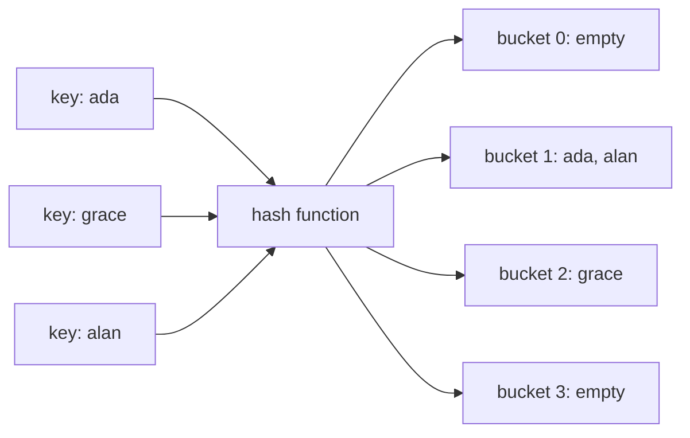

# Project: By-Hand Toolkit. A Stack, a Queue and a Hash Map

> **In this lesson:** the three data structures behind most of the software you use, and how to build each one. You'll learn what a class is, why taking an item off the front of a list can be slow, and how a hash map finds a key among a million without searching. This is the second of three parts.

## Words you need first

- **Data structure.** A way of organizing values so that certain things are fast.
- **Class.** A template for making objects that carry their own data and functions.
- **Instance.** One object made from a class.
- **Hash.** A number worked out from a piece of data, used to decide where to put it.

## Why these three

You could keep everything in one big array. It would work, and for many jobs it would be slow or awkward.

A data structure is a deal: it makes a few operations fast by giving something else up. Knowing which deal fits the job is a decision you'll make on every project, and one that agents get wrong when nobody tells them how big the data will be.

| Structure | The rule | Real uses |
| --- | --- | --- |
| Stack | Last in, first out | Undo, the browser's back button, the call stack |
| Queue | First in, first out | Print jobs, messages waiting to be sent, tasks for workers |
| Hash map | Look up a value by a key | Finding a user by email, counting things, caching |

## Classes

So far you've made objects by writing them out. A **class** is a template for making many objects of the same kind, each with its own data.

```js
class Counter {
  constructor() {
    this.count = 0;
  }

  add() {
    this.count = this.count + 1;
  }

  value() {
    return this.count;
  }
}

const a = new Counter();
const b = new Counter();
a.add();
a.add();
a.value();   // 2
b.value();   // 0
```

- `new Counter()` makes a fresh instance and runs `constructor` once to set it up.
- `this` means "the instance this method was called on". `a.add()` changes `a`'s count, not `b`'s.
- Functions inside a class are called methods. They're written without the word `function`.

You built the same idea with `makeCounter`. A class is the more common way to write it.

## Stack: last in, first out

Picture a pile of plates. You add to the top and take from the top.

- `push(item)` puts one on top.
- `pop()` takes the top one off.
- `peek()` looks at the top one without taking it.

An array already does this well, because adding and removing at the **end** of an array is fast. Nothing else has to move.

## Queue: first in, first out

Picture a line at a shop. You join at the back and leave from the front.

- `enqueue(item)` joins the back.
- `dequeue()` leaves from the front.

Here's the trap. Arrays have a built-in for removing the first item, called `shift`. It works. But when you remove the first item of an array, **every other item has to move down one place** to close the gap.

```
before:  [a, b, c, d, e]
shift:      [b, c, d, e]     b, c, d and e each moved one place left
```

On five items you'll never notice. On a queue of 200,000, each removal moves up to 200,000 items, so emptying the queue is O(n²). You know what that means now.

So how do you take from the front without moving everything? That's the design question for this milestone, and the answer is yours to find. One hint: you don't have to actually remove anything to stop counting it.

## Hash map: finding without searching

You've used a plain object as a lookup table and a `Set` to remember what you've seen. Both are fast at any size. Now you'll see how that's possible.

Start with the slow way. Keep pairs in an array and search:

```js
const pairs = [["ada", 36], ["grace", 85], ["alan", 41]];
```

Finding a key means checking pairs one at a time. That's O(n). With a million keys, a lookup is up to a million steps.

A hash map gets to O(1) with one idea: **work out where the key lives from the key itself.**

1. Make an array of empty slots, called **buckets**. Say 8 of them.
2. Write a **hash function** that turns any key into a number from 0 to 7.
3. To store a key, hash it and put the pair in that bucket.
4. To find a key, hash it and look in that one bucket. You don't look at the others.

A simple hash function adds up the character codes of the key and takes the remainder:

```js
"cab".charCodeAt(0)   // 99, the code for "c"

function hash(key, bucketCount) {
  let total = 0;
  for (let i = 0; i < key.length; i++) {
    total = total + key.charCodeAt(i);
  }
  return total % bucketCount;
}
```

The remainder keeps the answer inside the array, however long the key is.

In the picture below, the bucket numbers are made up to show the idea. Work out the real ones by hand with the function above and you'll get different buckets.



### When two keys land in the same bucket

They will. That's a **collision**, and it's normal. There are more possible keys than buckets, so some have to share.

The usual fix: each bucket is a small array of pairs. To find a key, go to its bucket, then check the few pairs in there for an exact match.

Two things follow from this, and both matter for your design:

- **A weak hash function piles keys up.** The one above gives `"listen"` and `"silent"` the same number, because they have the same letters. A better one makes position count, for example by multiplying the running total by 31 before adding each character. Take the remainder at every step, not only at the end, so the number stays small and exact on long keys.
- **Too few buckets makes it slow again.** With 8 buckets and 80,000 keys, each bucket holds about 10,000 pairs and you're back to searching. Real hash maps grow: when they get crowded, they make a bigger array of buckets and move everything across.

How many buckets you start with, and what your hash function does, are your decisions. You'll explain them in your memo.

```match
{
  "title": "Which structure fits?",
  "note": "Tap the job, then the structure.",
  "pairs": [
    { "left": "Undo the last thing the user did, then the one before", "right": "Stack" },
    { "left": "Send emails in the order people signed up", "right": "Queue" },
    { "left": "Find a customer's record from their email address", "right": "Hash map" }
  ]
}
```

## The brief

Open `toolkit/structures/structures.js`. Write three classes. The comments list every method.

- **`Stack`**: `push`, `pop`, `peek`, `size`, `isEmpty`.
- **`Queue`**: `enqueue`, `dequeue`, `peek`, `size`, `isEmpty`. `dequeue` has to stay fast on a very long queue.
- **`HashMap`**: `set`, `get`, `has`, `delete`, `size`. Keys are always strings.

**The rule for the hash map:** don't use the built-in `Map`, and don't use a plain object as the lookup table. Build it from arrays, with buckets and a hash function. You may use arrays and their `push`.

**You owe eight tests.** The file comes with eight. Add at least eight more. Before writing each class, list what could go wrong:

- What does each method do on an empty structure?
- Is `0` or `false` a value someone might store? Does your `has` still say yes?
- What happens when a key is set, deleted and set again?
- Do two keys in the same bucket stay separate? You can force a collision in a test by picking keys with the same letters.

From inside `toolkit/structures`:

```bash
node --test
```

Build them in order: stack, then queue, then hash map. Commit after each.

**When you're stuck.** Give each class 30 minutes of real effort first, including a drawing. Draw the buckets and walk a key through by hand. After that, an agent may explain a concept and may not write code. Bring anything that survives a whole sitting to office hours or your mentor.

## Hand it in

```submit
assignment: toolkit-structures
```

We need at least 16 passing tests of yours. Then ours run, including a very long queue and a hash map holding 50,000 keys.

## Stretch

Make your hash map grow. When the number of keys passes some share of the bucket count, make twice as many buckets and move every pair to its new place. Test that nothing goes missing. This is how real ones work, and it's a favorite interview question.

```quiz
[
  {
    "q": "A queue built on an array uses shift() to take from the front. It works in every test. Where does it break?",
    "options": ["On long queues, because every removal moves all the remaining items", "On empty queues", "When items are strings", "It doesn't break"],
    "answer": 0,
    "explain": "shift closes the gap by moving everything down one place. That's fine on ten items and painful on hundreds of thousands."
  },
  {
    "q": "Two different keys hash to the same bucket. What should happen?",
    "options": ["Both are kept in that bucket, and lookups check the pairs inside for an exact match", "The second replaces the first", "The map throws an error", "The second is dropped"],
    "answer": 0,
    "explain": "Collisions are normal. The bucket holds several pairs, and you compare keys inside it to find the right one."
  },
  {
    "q": "A hash map has 8 buckets and never grows. What happens as it fills with 100,000 keys?",
    "options": ["Lookups slow down, because each bucket becomes a long list to search", "It runs out of room and stops", "Nothing changes, lookups stay instant", "Keys start overwriting each other"],
    "answer": 0,
    "explain": "It still works, but every bucket holds thousands of pairs, so each lookup is a long search. Enough buckets, or growing, keeps buckets short."
  }
]
```

## Key takeaways

- A data structure makes some operations fast by giving something else up.
- A class is a template. Each instance made with `new` has its own data, reached through `this`.
- Adding and removing at the end of an array is fast. Removing from the front moves everything.
- A hash map works out where a key lives from the key itself, so it doesn't have to search.
- Collisions are normal. A good hash function and enough buckets keep them short.

## Work with AI

```ai-prompt
title: Walk a key through a hash map with me
---
I'm a beginner building a hash map by hand. I'm not allowed to have you write code for
it. Act as a tutor. Give me a tiny hash map with 4 buckets and a simple hash function
described in words. Then give me five keys, one at a time, and ask me which bucket
each lands in and what the buckets look like afterwards. Include a collision. Then ask
me what happens to lookup speed if I add ten thousand more keys, and what I could do
about it. Correct my reasoning in plain words.
```
