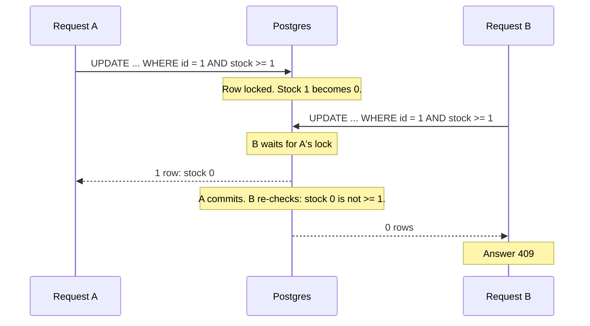

# Databases: Transactions and Race Conditions

> **In this lesson:** why code that is correct for one request can sell the same item twice when two requests arrive together, and the tools a database gives you to stop it. You'll learn transactions, what isolation means in plain words, and two ways to take the last item safely: a conditional update and a row lock. Then you'll record a short video explaining a race condition with a drawing.

## Words you need first

- **Race condition.** A bug that only happens when two things run at overlapping times, and the result depends on which one gets there first.
- **Transaction.** A group of database statements that succeed together or fail together.
- **Atomic.** Done as one indivisible step. Nothing can see it half done, and it can't stop halfway.
- **Isolation.** How much one transaction can see of another transaction that hasn't finished yet.
- **Lock.** A claim on a row that makes other transactions wait until it's released.

## One lamp, two customers

A shop has one desk lamp left. Here's an obvious way to take an order, the kind an agent writes when nobody mentions concurrency:

```js
async function takeStock(db, productId, qty) {
  const r = await db.query("SELECT stock FROM products WHERE id = $1", [productId]);
  const stock = r.rows[0].stock;
  if (stock < qty) throw new AppError(409, "not enough stock");
  await db.query("UPDATE products SET stock = $1 WHERE id = $2", [stock - qty, productId]);
}
```

With one customer at a time, it's correct. Now two customers press "buy" at the same moment:

| Step | Request A | Request B | Stock in the database |
| --- | --- | --- | --- |
| 1 | reads stock: 1 | | 1 |
| 2 | | reads stock: 1 | 1 |
| 3 | 1 is enough, so writes 0 | | 0 |
| 4 | | 1 is enough, so writes 0 | 0 |

Both orders succeed. Stock says 0. One lamp has been sold twice. One customer is about to get an apology email.

Nothing in that code is wrong line by line. The bug lives in the **gap between reading and writing**. B read the stock in that gap, before A's write landed.

### Why this happens in Node

You learned that JavaScript does one thing at a time. So how do two requests overlap?

Every `await` hands control back to the event loop. While request A waits for the database to answer its `SELECT`, the event loop is free, so it starts on request B. B sends its own `SELECT`. Then A's answer comes back, then B's. Each `await` is a gap another request can step into.

So any time your code reads something, awaits, and then writes based on what it read, ask: **what if another request ran in that gap?**

This is a **lost update**: two requests both read the same value, both write, and one write silently replaces the other. Overselling is the expensive version. Counters that are wrong by a few, and settings that quietly revert, are the common ones.

```order
title: Put the oversell in the order it happens
---
Request A reads the stock and sees 1
Request A awaits, so the event loop starts request B
Request B reads the stock and also sees 1
Request A writes stock 0 and saves its order
Request B writes stock 0 and saves its order, so one lamp is sold twice
```

## Transactions: all or nothing

Before fixing the race, there's a second problem. An order for a lamp and a bulb takes stock from two rows and inserts three more. If the server crashes after the first, or the bulb turns out to be sold out, you're left with half an order.

A **transaction** groups statements so they succeed or fail as one:

```sql
BEGIN;
UPDATE products SET stock = stock - 1 WHERE id = 1;
UPDATE products SET stock = stock - 1 WHERE id = 2;
INSERT INTO orders (customer_id, status) VALUES (7, 'placed');
COMMIT;
```

- `BEGIN` starts it.
- `COMMIT` makes every change permanent at once. Other connections see all of it or none of it.
- `ROLLBACK` throws every change away, as if none of it happened. A crash before `COMMIT` rolls back on its own.

From code, a helper usually does the `BEGIN`, `COMMIT` and `ROLLBACK` for you, and rolls back if your function throws:

```js
await db.transaction(async (tx) => {
  await tx.query("UPDATE products SET stock = stock - $1 WHERE id = $2", [1, lampId]);
  await tx.query("UPDATE products SET stock = stock - $1 WHERE id = $2", [1, bulbId]);
  throw new AppError(409, "changed my mind");   // both updates are undone
});
```

Inside the function, use `tx.query`. The transaction lives on one connection, and `tx` is that connection.

So a transaction makes an order **atomic**. Does it also fix the oversell? Surprisingly, no. That's what isolation is about.

## Isolation, in plain words

Isolation answers one question: **while my transaction is running, what can I see of other transactions?**

Postgres, by default, uses a level called **read committed**. In plain words: each statement sees everything that was committed before that statement started, and nothing that wasn't.

Run the lamp race again, with each request inside its own transaction:

| Step | Transaction A | Transaction B |
| --- | --- | --- |
| 1 | `BEGIN`, reads stock: 1 | |
| 2 | | `BEGIN`, reads stock: 1 (A hasn't committed anything) |
| 3 | writes stock 0, `COMMIT` | |
| 4 | | writes stock 0, `COMMIT` |

Same result. Each transaction is atomic, and both still read 1, because at the moment each one read, 1 was the truth. A transaction alone doesn't close the gap between your read and your write.

Postgres has stricter levels. The strictest, **serializable**, promises that the result is the same as if the transactions had run one after the other. When it spots two that can't be lined up that way, it cancels one with a serialization error, and your code has to retry it. That works, and it means writing retry code and handling a new kind of failure.

Most teams reach for one of two simpler tools first.

## Fix one: a conditional update

Stop reading the stock into JavaScript at all. Let the database check and change it **in one statement**:

```sql
UPDATE products
SET stock = stock - $1
WHERE id = $2 AND stock >= $1
RETURNING stock;
```

Read the `WHERE`. The row is only updated if there's enough stock. If there isn't, nothing changes, and `RETURNING` gives back zero rows. That's your 409.

Why can't two of these both win? When Postgres updates a row, it **locks** it until the transaction ends. A second `UPDATE` on the same row waits. When the first commits, the second re-checks its `WHERE` against the new value, finds `stock >= 1` is now false, and updates nothing.



The check and the write are now one atomic step. There's no gap for anyone to step into.

For an order with several items, run one conditional update per item inside a transaction. If any returns zero rows, throw, and the transaction rolls back the items already taken. Atomic and race-free.

The same shape fixes other races:

| Race | Conditional write |
| --- | --- |
| Two cancels of one order | `UPDATE orders SET status = 'cancelled' WHERE id = $1 AND status = 'placed' RETURNING id` |
| The same retry arriving twice | `INSERT INTO idempotency_keys (key, ...) VALUES ($1, ...) ON CONFLICT (key) DO NOTHING RETURNING key` |
| Two sign-ups with one email | A `UNIQUE` constraint, and treat the error as a 409 |

In each, the database decides who wins, in one step, and the loser finds out from the result.

## Fix two: lock the row first

Sometimes the decision is too complicated for a `WHERE` clause. Maybe stock depends on a reservation in another table, or on rules that are easier to write in JavaScript.

Then you lock the row while you read it:

```js
await db.transaction(async (tx) => {
  const r = await tx.query("SELECT stock FROM products WHERE id = $1 FOR UPDATE", [productId]);
  if (r.rows[0].stock < qty) throw new AppError(409, "not enough stock");
  await tx.query("UPDATE products SET stock = stock - $1 WHERE id = $2", [qty, productId]);
});
```

`FOR UPDATE` locks the row as it's read. Any other transaction that tries to lock or change that row waits until this transaction commits or rolls back. By the time request B gets to read the stock, A has finished, and B reads the true number.

It costs more than it looks:

- **Everyone waits for the slowest.** The lock is held for the whole transaction. If your code calls a payment service while holding it, every other order for that product waits for the payment service too.
- **Deadlocks.** Transaction A locks the lamp, then wants the bulb. Transaction B locked the bulb, then wants the lamp. Each waits for the other forever. Postgres notices and cancels one. The usual prevention: always lock rows in the same order, for example by product id.

The second point applies to conditional updates on several rows too. Sort the items by product id before updating them.

## Which one?

| | Conditional update | `SELECT ... FOR UPDATE` | Serializable |
| --- | --- | --- | --- |
| How it stops the race | Check and write in one statement | Others wait while you decide | The database cancels one of two clashing transactions |
| Lock held for | One statement | The whole transaction | No locks, checks at commit |
| Fits when | The rule fits in a `WHERE` | The rule needs code or other tables | Many different rules, and you can retry |
| Watch out for | Rules that don't fit in a `WHERE` | Slow work while locked, deadlocks | Writing retry code for every transaction |

For "take stock if there's enough", the conditional update is the usual answer. It's one statement, holds a lock for the shortest time, and makes the race impossible.

```blanks
{
  "title": "Take stock in one safe step",
  "note": "Every blank is a real decision.",
  "code": "const r = await tx.query(\n  `UPDATE products\n   SET stock = stock ___1___ $1\n   WHERE id = $2 AND ___2___\n   RETURNING stock`,\n  [qty, productId],\n);\nif (r.rows.length === ___3___) throw new AppError(409, \"not enough stock\");",
  "blanks": [
    { "options": ["-", "+", "="], "answer": "-", "explain": "Taking stock subtracts the quantity from the current value, in the database. Setting it to a number you worked out in JavaScript brings the race back." },
    { "options": ["stock >= $1", "stock > 0", "qty <= stock"], "answer": "stock >= $1", "explain": "The row must hold at least the quantity asked for. stock > 0 lets an order for 3 take the last 1 and go negative. There is no qty column." },
    { "options": ["0", "1", "-1"], "answer": "0", "explain": "When the WHERE doesn't match, nothing is updated and RETURNING gives back no rows. That's how you know there wasn't enough." }
  ]
}
```

## A note on PGlite

PGlite, the Postgres you use in tests, has a single connection and runs one transaction at a time. That makes a transaction safer there than on a real server. If you wrap the read-then-write version in a transaction, it can pass on PGlite and still oversell on a real Postgres server with many connections.

So test the behavior, and also read the code for the shape that's safe everywhere: a conditional update, a locked row, or a serializable transaction. The hidden tests in your project check both.

## Explain it out loud

This lesson comes with an explanation video. Record your screen and yourself, and explain this in your own words:

> Two customers try to buy the last lamp at the same moment. Show how the read-then-write code sells it twice, then show how the conditional update stops it.

Draw it as you go. Two columns, one per request, time going down the page, and the stock value in the middle, like the tables above. Paper held up to the camera is fine. Cover:

- Where the gap is, and why an `await` lets the other request in.
- Why wrapping the code in a transaction doesn't fix it on its own.
- What the database does when the second `UPDATE` reaches a row the first one locked.

Keep it under five minutes. If you find yourself reading the lesson out loud, stop, put it away, and try again from your drawing. Bring the recording to your next mentor session. Your mentor will ask what happens with `SELECT ... FOR UPDATE` instead, so be ready.

```quiz
[
  {
    "q": "Code reads stock, checks it in JavaScript and writes the new value, all inside one transaction, on Postgres's default isolation level. Can two requests still sell the last item twice?",
    "options": ["Yes, because each transaction's read sees the committed value 1 before either writes", "No, transactions stop all races", "No, because Postgres locks every row a transaction reads", "Only if the server has more than one CPU"],
    "answer": 0,
    "explain": "Read committed lets each statement see what was committed when it started. Both reads see 1. A plain SELECT takes no lock, so nothing makes the second request wait."
  },
  {
    "q": "Two requests run UPDATE products SET stock = stock - 1 WHERE id = 1 AND stock >= 1 at the same moment, with stock at 1. What happens?",
    "options": ["One updates the row and the other waits, re-checks the WHERE, and updates nothing", "Both update it and stock becomes -1", "Postgres throws an error for both", "Both update it and stock becomes 0"],
    "answer": 0,
    "explain": "Updating a row locks it. The second update waits, then re-checks its condition against the committed value, 0, which fails, so it returns no rows."
  },
  {
    "q": "A handler locks a product row with SELECT ... FOR UPDATE, then calls a payment service that takes two seconds, then commits. What's the problem?",
    "options": ["Every other order for that product waits behind the lock for the whole two seconds", "The lock is released before the payment finishes", "FOR UPDATE doesn't work inside a transaction", "Nothing, this is the recommended pattern"],
    "answer": 0,
    "explain": "A row lock lasts until the transaction ends. Slow work while holding it makes everyone queue. Keep transactions short, and do slow calls before or after."
  }
]
```

## Key takeaways

- A race condition hides in the gap between reading a value and writing one based on it. In Node, every `await` is a gap.
- A transaction makes several statements atomic: all of them, or none.
- Under Postgres's default isolation, a transaction alone doesn't stop two requests reading the same old value.
- A conditional update checks and writes in one statement, so there's no gap. Zero rows back means you lost.
- `SELECT ... FOR UPDATE` makes others wait while you decide. Keep it short, and lock rows in a fixed order to avoid deadlocks.
- PGlite runs one transaction at a time, so test the behavior and also check the code uses a shape that's safe on a real server.

## Work with AI

```ai-prompt
title: Find the race in my code
---
I'm learning about race conditions in a Node app that uses Postgres. Write me short
async JavaScript functions, one at a time, each under fifteen lines, that read and
write a database with db.query. Some have a race condition and some don't: a counter,
a seat booking, a coupon that can be used once, a cancel that refunds money, a
username sign-up. For each, ask me whether two requests at the same moment can break
it. If I say yes, I have to describe the exact interleaving step by step, then write
the fix myself. Don't show me the fix. Tell me whether my interleaving is real and
whether my fix closes the gap.
```
