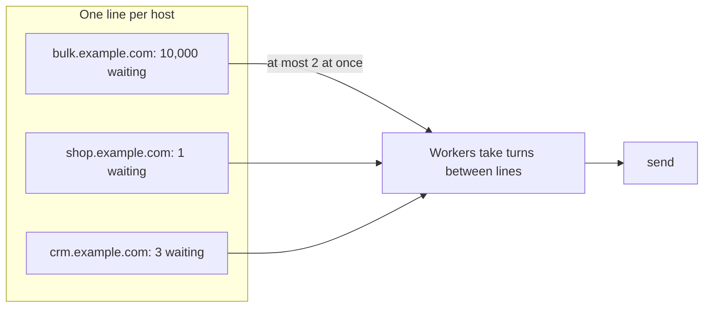
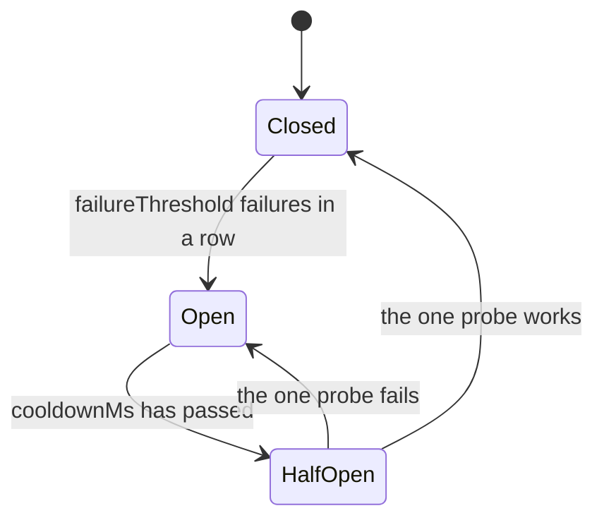

# Project: Reliable Webhooks. Outages, Bursts and the Memo

> **In this lesson:** the subscribers fight back. One never answers. One asks you to slow down. One gets ten thousand events at once. One is down for six hours. You'll add timeouts, a limit per subscriber, respect for `Retry-After`, and a circuit breaker, so one bad subscriber can't hurt anyone else. Then you finish the project with a decision memo on the oldest question in messaging: at least once, or exactly once. This is the last of three parts.

## Words you need first

- **Timeout.** A limit on how long you'll wait for an answer before treating the attempt as failed.
- **Head-of-line blocking.** When the job at the front of a line is stuck, and everything behind it waits, even jobs that could have gone straight away.
- **Retry-After.** A header a server sends with a `429` or `503` saying how many seconds to wait before trying again.
- **Circuit breaker.** A switch that stops sending to a server after it fails several times in a row, then tests it carefully before carrying on. Named after the switch in a fuse box.
- **At-least-once and exactly-once.** Two promises a messaging system can make: every message arrives one or more times, or every message arrives one time only.

## A subscriber that never answers

Some servers don't fail. They just never answer. The connection opens, and nothing comes back. Your `send` promise never settles.

With five workers, five of those and your whole system has stopped: every worker is waiting forever, and every other subscriber's events sit in the line behind them.

The fix is a timeout. Race the send against the clock:

```js
const timedOut = clock.sleep(timeoutMs).then(() => "timed out");
const answer = await Promise.race([send(request), timedOut]);
```

Whichever settles first wins. If the timer wins, the attempt has failed, the worker is freed, and the delivery is retried like any other failure. If the real answer turns up later, it's ignored. That delivery was already counted, and counting it again would put it in both lists.

## A burst for one subscriber

A big customer runs a bulk import, and 10,000 events for their URL land in your queue at once. Behind them, one `order.paid` event for a different customer.

With one shared line, that urgent event waits behind all 10,000. If the big customer's server is slow, it could wait an hour. That's head-of-line blocking.

The fix has two parts:

- **A line per host.** A host is the server part of a URL, like `hooks.shop.example.com`. Each host gets its own line, and workers take turns between the lines that have work, so one long line can't starve the rest.
- **A limit per host.** `perHostConcurrency` caps how many sends go to one host at once. Your workers stay free for everyone else, and you don't flood one customer's server just because you have the capacity.



## Being told to slow down

In the rate limiter clone, you sent `429` and a `retry-after` header. Now you're on the receiving end.

When a subscriber answers `429` with `retry-after: 30`, it's telling you about all your traffic to it. So:

- That delivery's next attempt waits 30 seconds, instead of the backoff wait, even if 30 seconds is longer than your cap.
- Nothing else goes to that host until the 30 seconds are up.
- Other hosts carry on as normal.

A `429` with no `retry-after` is retried with your normal backoff.

The common mistake is honoring the header for the one delivery that got the `429` while every other delivery to the same host keeps going. One hidden test sends three events to a host that answers `429` once, and checks nothing reaches it before the time is up.

## A subscriber that's down for hours

A subscriber's server is down for six hours. You have thousands of events for it. With retries alone, each delivery tries maybe ten times, every attempt fails, and every one ends in the dead letters. That's tens of thousands of requests sent to a server that's off, and a pile of dead letters someone has to resend by hand.

A circuit breaker notices the pattern and stops.



- **Closed** is normal: sends go through. Each failure in a row adds one to a count. Any success, or any other answer that proves the server is up, resets it.
- **Open**: nothing is sent to that host. Its deliveries wait in its line, and waiting doesn't use up their attempts. That's the whole point. A delivery shouldn't die because the breaker was protecting it.
- **Half-open**: after the cooldown, exactly one send goes through as a probe. If it works, the breaker closes and the waiting deliveries flow again. If it fails, the breaker opens for another full cooldown.

What counts as a failure for the breaker: `send` throwing, a timeout, `408`, or `500` to `599`. A `404` or a `429` means the server is up and answering, so they don't count.

```order
title: A subscriber goes down and comes back, with a threshold of 3 and a cooldown of 30 seconds
---
Three sends in a row fail, so the breaker opens
For 30 seconds nothing is sent to that host, and its deliveries wait without using attempts
The cooldown ends and the breaker lets exactly one probe through
The probe fails, so the breaker opens for another 30 seconds
The next probe works, so the breaker closes
The waiting deliveries flow again, within the per-host limit
```

## At least once, or exactly once

You saw in the last milestone that a lost answer leaves the sender unable to tell whether a delivery arrived. So every messaging system has to choose what it promises:

| Promise | How | What it costs |
| --- | --- | --- |
| At most once | Send once, never retry | Some events are lost for good |
| At least once | Retry until you hear success | Some events arrive more than once |
| Exactly once | At least once, plus a receiver that skips keys it has already handled | Storage and care on the receiving side, and a promise the sender can't keep on its own |

Nearly every real webhook system, Stripe's and GitHub's included, promises at least once and gives every delivery a key so the receiver can do the work exactly once. Your system now does the same. Your memo explains that choice in your own words, and what it costs.

Also notice what's still missing. Everything you've built lives in one process's memory. If that process restarts during the six-hour outage, every event waiting for that subscriber is gone. That's a broken promise. The memo asks what you'd change.

## Switch on the milestone

In `outages.test.js`, change `const MILESTONE_3 = false;` to `true`.

## Plan before you prompt

This milestone may change how your dispatcher is shaped. A single queue from the first milestone can't take turns between hosts, so your agent may need to replace it with a line per host inside the dispatcher. That's normal. Keep `queue.js` working, because the first milestone's tests still use it.

Branch, and plan:

- **The timeout.** How the race works, what happens to a late answer, and how you make sure one delivery can't end up in both lists.
- **State per host.** Write the shape: its line of waiting deliveries, how many sends are in flight, when a `retry-after` pause ends, the breaker's state, its count of failures in a row, and when it may next probe.
- **Choosing the next send.** When a worker is free, how it picks a host, and every reason a host is skipped.
- **Waking up.** When a host is paused or its breaker is open, what makes the dispatcher try that host again once the time is up, using `clock.sleep`.
- **The breaker.** Each state change and what causes it, and how you make sure only one probe is in flight.
- **Tests first.** A host that never answers alongside one that does. One slow host with a hundred events, and one fast host with one. A `429` with `retry-after` while other deliveries to that host are waiting. An outage where you count every send to the dead host.

## Check the agent's work

- A timeout built with `setTimeout`, or no timeout on the default path.
- A late answer that's counted after its timeout.
- A `retry-after` that delays only the one delivery.
- A per-host limit checked only for the delivery at the front of one shared line. That's still head-of-line blocking.
- A breaker that's shared by all hosts instead of one per host.
- Open-breaker waiting that adds to `attempts`, or dead-letters deliveries.
- A half-open state that lets every waiting delivery through at once.
- The first two milestones' tests still pass. Run everything:

```bash
node --test
node demo.js
```

At least 22 tests across the folder must pass. Write at least six new ones for this milestone.

If a breaker test has you stuck for more than 30 minutes, record the time and result of every `send` and write the breaker's state next to each line by hand.

```scenario
{
  "who": "Your CTO",
  "setting": "A large customer's webhook endpoint has been down since early this morning. They're asking what happened to their events.",
  "ask": "Did we lose their events? And did their outage slow down anyone else?",
  "note": "More than one answer is defensible. Pick the one you'd say.",
  "options": [
    { "text": "Nothing's lost. Their breaker opened after a few failures, so we're sending one probe every 30 seconds instead of thousands of requests, and their events are waiting without using up retries. Everyone else has their own line and limit, so nobody else was slowed down. The real risk is that the waiting events live in memory, so a restart today would lose them. Moving them to a database is the next change I'd make.", "verdict": "best", "feedback": "It answers both questions with what the system actually does, and then names the remaining risk before anyone asks. Volunteering the weak spot is what makes the rest believable." },
    { "text": "We retried each event ten times and then moved them to the dead letters. We can resend them when they're back.", "verdict": "ok", "feedback": "Honest, and nothing is lost if the dead letters are kept. But it means a manual resend and tens of thousands of wasted requests during the outage. A breaker would have avoided both." },
    { "text": "That's their outage. There's nothing for us to fix.", "verdict": "weak", "feedback": "True and unhelpful. The CTO asked whether the customer's events are safe and whether other customers were affected. Answer those." },
    { "text": "Everything's fine, our system is very reliable.", "verdict": "weak", "feedback": "Says nothing checkable. The next question, 'how do you know?', needs exactly the details this answer leaves out." }
  ],
  "debrief": "Good answers about reliability say what happened, what didn't happen, and what's still at risk."
}
```

## Write your decision memo

Open `webhooks/MEMO.md`. It has five questions: at least once or exactly once, your retries, a subscriber that's down, being a good neighbor to other people's servers, and what breaks at 100 times the traffic.

The same rules as every memo:

- **Your own words.** No agent writes it. An agent may read it afterwards and tell you where it's unclear.
- **Say what it costs.** Every choice here has a price: memory, delay, duplicate work, or wasted requests.
- **Use your numbers.** Your base delay, cap, attempts, breaker threshold and cooldown, and how long a delivery can keep trying in the worst case.

The grader checks that every section has real writing in it. Your mentor reads it for the reasoning and will ask you about it.

## Hand it in

```submit
assignment: webhooks-3
```

We need `queue.js`, `dispatcher.js`, `receiver.js` and `MEMO.md` in `webhooks`, and at least 22 passing tests of yours. Ours check a subscriber that never answers, being told to slow down, a burst for one subscriber, a long outage, and probing after an outage.

When this passes, the project is done.

## Tell the story

At your next mentor session, explain this project out loud, without notes:

- What you built, in two sentences.
- The hardest part, and how you got through it.
- One decision and what it cost. The breaker settings, or at least once, are good choices.

Then have your mentor play a subscriber and describe an outage. Walk through what your system does, minute by minute.

## Stretch

Make your dispatcher pace itself before anyone says `429`: give each host a token bucket, like the one from the rate limiter clone, and send to it no faster than its bucket allows. Then add support for `retry-after` given as a date instead of a number of seconds, which the HTTP standard also allows.

```quiz
[
  {
    "q": "Your dispatcher has 5 workers and no timeout. Five subscribers' servers accept the connection and never answer. What happens?",
    "options": ["Every worker waits forever, so no other subscriber gets anything", "Those five deliveries fail and the rest carry on", "Node closes the connections after a minute", "The breaker opens and fixes it"],
    "answer": 0,
    "explain": "A send that never settles holds its worker forever. A timeout turns 'no answer' into a failure, frees the worker, and lets the delivery be retried."
  },
  {
    "q": "A subscriber answers 429 with retry-after: 60. Your dispatcher waits 60 seconds before retrying that delivery, but keeps sending the other 500 events for that subscriber. What's wrong?",
    "options": ["Retry-After is about all your traffic to that server, so nothing should go there until the 60 seconds are up", "Nothing, that's correct", "It should retry that delivery straight away", "It should dead-letter all 500"],
    "answer": 0,
    "explain": "The subscriber is telling you it's overloaded. Pausing only one delivery ignores the message and keeps the overload going."
  },
  {
    "q": "Why should waiting behind an open circuit breaker not use up a delivery's attempts?",
    "options": ["Otherwise a long outage turns every waiting delivery into a dead letter, even though nothing was sent", "Because attempts are expensive to count", "So the breaker closes sooner", "It should use them up, so deliveries die faster"],
    "answer": 0,
    "explain": "The breaker exists to hold deliveries safely while a server is down. If waiting cost attempts, the breaker would cause the losses it's meant to prevent."
  }
]
```

## Key takeaways

- A send that never answers is worse than one that fails. Always race it against a timeout, and ignore answers that arrive late.
- A line and a limit per host stop one slow or busy subscriber from holding up everyone else.
- `Retry-After` applies to everything you send to that server.
- A circuit breaker stops wasted requests during an outage, holds deliveries without using up their attempts, and tests recovery with one probe.
- The sender alone can promise at least once. Exactly once needs the receiver, through idempotency keys.
- Anything held only in memory is lost on restart. A durable queue is the next step at scale.

## Work with AI

```ai-prompt
title: Run an outage drill with me
---
I'm a beginner who built a webhook dispatcher with retries, jitter, a per-host limit,
Retry-After handling, a circuit breaker and a timeout. Don't write code. Play the world. Tell
me my settings are: 5 workers, 2 per host, base delay 1 second, cap 60 seconds, 10
attempts, timeout 10 seconds, breaker threshold 5, cooldown 30 seconds. Then describe one
event at a time over a pretend hour: a subscriber goes down, another starts answering 429
with retry-after 120, a third gets a burst of 5,000 events, the first comes back, and our
own process restarts. After each, ask me what my system does next and what each subscriber
sees. Point out anything I get wrong, then ask which setting I'd change first and why.
```
