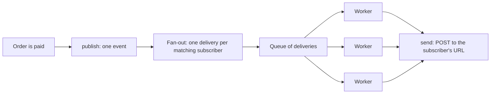

# Project: Reliable Webhooks. A Job Queue With Workers

> **In this lesson:** a new project starts. You'll build the part of a company's system that tells other companies' servers when something happens, and keeps working when those servers are slow, broken or overwhelmed. This first milestone is the engine underneath: a job queue with workers and a limit on how much runs at once. It's the first of three parts.

## Words you need first

- **Webhook.** A message one system sends to another system's URL when something happens, like "this order was paid". The receiver signs up once by giving you a URL.
- **Job queue.** A line of work waiting to be done, so the code that creates the work doesn't have to wait for it to finish.
- **Worker.** The part that takes a job off the queue and does it.
- **Concurrency limit.** The most jobs allowed to run at the same moment.
- **Fan-out.** One event turning into many deliveries, one for each subscriber who wants it.

## What you're building

When a payment goes through at Stripe, Stripe sends a webhook to the online shop's server, and the shop marks the order paid and sends the receipt. GitHub sends webhooks when code is pushed, which is how a test run starts. Shopify sends them when an order is placed. Almost every company that other software builds on sends webhooks.

Sending one is just an HTTP POST. Sending millions reliably is a hard problem:

- Subscribers' servers are slow, go down for hours, come back, and get overwhelmed.
- Your own system can't freeze because one subscriber did.
- An event that's lost might be a payment nobody hears about.
- An event sent twice might be a customer charged twice.

This project has three milestones, all in one folder:

| Milestone | You add | The question it answers |
| --- | --- | --- |
| A job queue with workers | A queue, workers, a concurrency limit, fan-out | How do I do lots of slow work without doing it all at once? |
| Retries and duplicate deliveries | Retries with backoff and jitter, dead letters, idempotency keys, a receiver | What happens when a send fails, and what if it's sent twice? |
| Outages, bursts and the memo | Timeouts, Retry-After, per-subscriber limits, a circuit breaker, a decision memo | What happens when a subscriber is down for hours, or asks me to slow down? |

Do them in order. Each one builds on the last, and each has its own hidden tests.

## Why a queue at all

The simple version sends webhooks right inside the request that caused them:

```js
app.post("/orders/:id/pay", async (req, res) => {
  await markPaid(req.params.id);
  for (const sub of subscribers) {
    await fetch(sub.url, { method: "POST", body: JSON.stringify(event) });
  }
  res.send("ok");
});
```

If one subscriber takes 30 seconds to answer, the customer paying waits 30 seconds. If it's down, the payment request fails, even though the payment worked. Your system's speed now depends on the slowest server of every company that subscribed.

A queue separates the two. The request records the work and answers straight away. Workers do the slow part in the background.



## Why limit how much runs at once

You know from the lesson on code that waits that `Promise.all` starts everything at once. With 50,000 deliveries queued after a big sale, that's 50,000 open network connections from one process. You'd run out of memory or connections, and you'd hit your subscribers with a flood.

So a queue has a fixed number of workers, say 5. Each one takes the next job, does it, and comes back for another. Never more than 5 at once, however long the line gets.

Three details make or break a queue, and the hidden tests check each one:

- **Count a job as running the moment it starts.** If the running count goes up only after something has been awaited, a burst of `add` calls all see "0 running" and all start at once.
- **A failing job must free its worker.** If a job throws and the code that frees the worker never runs, that worker is gone for good. Lose five and the queue stops, silently. Use `try` and `finally`, or a `.then` with both paths, so the worker is freed whatever happens.
- **Taking from the front must stay fast.** You built a queue that does this in the toolkit project. The same idea applies. A hidden test adds 100,000 jobs.

### Knowing when the work is done

`onIdle()` gives back a promise that resolves when nothing is waiting *and* nothing is running. Both halves matter. "The line is empty" is true the moment the last job starts, long before it finishes. Tests and shutdown code that trust that will act too early.

```order
title: A queue with 2 workers is given jobs A, B and C
---
add(A): a worker is free, so A starts and the running count becomes 1
add(B): a worker is free, so B starts and the running count becomes 2
add(C): both workers are busy, so C waits in line
A finishes, frees its worker, and C starts
B finishes, and nothing is waiting
C finishes, nothing is waiting or running, so onIdle resolves
```

## Time and the network are passed in

Your dispatcher never calls the real network and never waits for real. `createDispatcher` takes:

- `send`, a function that delivers one webhook and gives back `{ status, headers }`. In real use it would be an HTTP POST. In tests it's a fake that can succeed, fail, throw, take a long time, or never answer at all.
- `clock`, with `now()` and `sleep(ms)`. The starter's `fake-clock.js` gives you a clock where `await clock.advance(60000)` moves a pretend minute forward instantly and wakes every `sleep` that was due, in order.

You used injected time in the clones. Here it matters even more: in the next milestones you'll test an hour of retries and a six-hour outage, and those tests have to finish in milliseconds and give the same result every time. The rule for your agent: never call `setTimeout` or `Date.now()` anywhere except through `clock`.

## Get the starter

From the top of your `parsity-labs` repository:

```bash
curl -sL https://ai.parsity.io/labs/webhooks.tar.gz | tar xz
```

That makes a `webhooks` folder that all three milestones share. Download it once. Running the command again later would overwrite your work.

Read `dispatcher.js` first. Its comments describe the whole system, milestone by milestone, so you can see where you're going. For this milestone you need:

- `queue.js`: the `JobQueue`.
- `dispatcher.js`: `subscribe`, `publish`, `onIdle`, `delivered` and `deadLetters`, with `concurrency`. In this milestone, any answer outside 200 to 299, or a `send` that throws, goes straight to the dead letters: a list of deliveries that won't be tried again. Every delivery ends up in exactly one of the two lists. Nothing is ever lost.

`queue.test.js` and `dispatcher.test.js` have five tests between them. `retries.test.js` and `outages.test.js` are for later milestones and are switched off at the top. Leave them off for now.

## Plan before you prompt

Make a branch. Write a plan in your own words, and keep it in your notes for the next milestones. It should say:

- **The queue's state.** What it stores, and how taking from the front stays fast.
- **Starting a job.** Exactly when the running count goes up, and every path by which it comes down, including a job that throws before it awaits anything.
- **onIdle.** When it resolves, what happens to several callers waiting on it, and what happens if work is added after the queue went idle.
- **Fan-out.** How `publish` decides which subscribers get an event, what one delivery holds, and what it gives back.
- **Failure.** How a delivery ends up in `delivered` or `deadLetters`, and what the reason says. A delivery whose `send` throws must not disappear.
- **Tests first.** At least: the most jobs running at once, measured inside a fake job; a job that throws while another is queued behind it; `onIdle` while a job is still running.

Then give your agent the plan. Ask it to write the tests first and explain each one, then the code.

## Check the agent's work

Read every diff. Look for:

- `Promise.all` over every job, or a loop that calls the work function for everything at once.
- `this.running++` placed after an `await`.
- A `try` with no `finally`, or a `.then` with no rejection handler, around the work.
- `shift()` on a big array to take the next job.
- `onIdle` that checks only the waiting line, or that polls with `setTimeout`.
- A `send` result read as `res.status` with no check that `res` exists.
- `setTimeout`, `setInterval` or `Date.now()` anywhere.

Then run the tests and the demo. From `webhooks`:

```bash
node --test
node demo.js
```

`demo.js` sends a few events to a pretend subscriber that fails half the time, using the real clock. For now, half the deliveries should end up dead. In the next milestone they'll be retried.

**You owe five tests.** At least ten must pass. Commit when they do.

If one bug has you stuck for more than 30 minutes, add a `console.log` of the running count at every change, run one small test, and read the order of the lines. Then ask your agent to explain what you see before it changes anything.

## Hand it in

```submit
assignment: webhooks-1
```

We need `queue.js` and `dispatcher.js` in `webhooks`, and at least ten passing tests of yours. Ours check the order jobs start in, the limit on how many run at once, failing jobs, knowing when the work is done, fan-out to the right subscribers, subscribers that answer with errors, and a hundred thousand jobs.

## Stretch

Add `pause()` and `resume()` to the `JobQueue`: paused, it starts nothing new but lets running jobs finish. Then write down where a real system would use it. Deploying a new version is one answer. Find another.

```quiz
[
  {
    "q": "Why do webhook systems put deliveries on a queue instead of sending them inside the request that caused the event?",
    "options": ["So a slow or broken subscriber can't make your own request slow or fail", "Because HTTP can't be sent from inside a request", "Queues make the network faster", "So the events arrive in alphabetical order"],
    "answer": 0,
    "explain": "Recording the work and answering straight away means your system's speed no longer depends on the slowest subscriber. Workers do the slow part separately."
  },
  {
    "q": "A queue's worker code is: running++; await work(job); running--; next(). What happens after five jobs throw?",
    "options": ["With a limit of 5, every worker is lost and the queue stops forever, with no error", "Nothing, the errors are ignored", "The queue restarts itself", "The five jobs are retried"],
    "answer": 0,
    "explain": "A thrown error skips running-- and next(). Each failure permanently uses up a worker. A finally block, or handling both outcomes of the promise, frees it whatever happens."
  },
  {
    "q": "onIdle resolves as soon as the waiting line is empty. When does that go wrong?",
    "options": ["When the last jobs have started but not finished, so code waiting on onIdle acts before the work is done", "Never, an empty line means the work is done", "Only when the queue has one worker", "When jobs are added in the wrong order"],
    "answer": 0,
    "explain": "A job leaves the line when it starts. The work is only done when nothing is waiting and nothing is running."
  }
]
```

## Key takeaways

- A webhook is a POST to someone else's server when something happens. Sending them reliably at scale is a hard problem.
- A queue lets the code that creates work answer straight away, while workers do the slow part.
- A fixed number of workers puts a ceiling on how much runs at once, however long the line is.
- A failing job must always free its worker, and every delivery must end up somewhere.
- Done means nothing waiting and nothing running.
- Pass the clock and the network in, so tests of hours of behavior run in milliseconds.

## Work with AI

```ai-prompt
title: Find the bug in this queue
---
I'm a beginner building a job queue with a concurrency limit for a webhook system. Don't
look at my code and don't write any. Write me four short JavaScript job queues, each about
fifteen lines, each with one realistic bug: for example a running count that goes up too
late, a worker that's lost when a job throws, an onIdle that resolves too early, or
taking from the front of a big array. Show me one at a time. For each, I'll tell you the
bug, a test that would catch it, and the fix in words. Tell me if I'm right, and if I
found a different real bug, say so.
```
