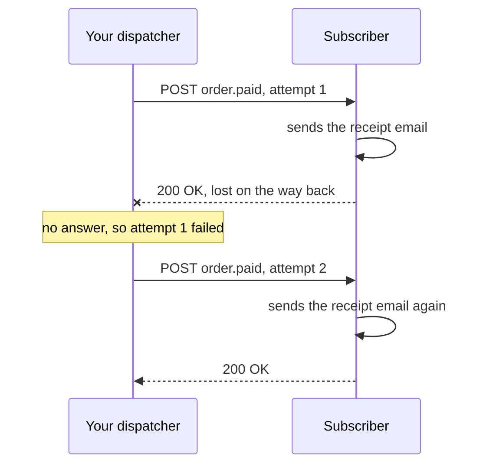

# Project: Reliable Webhooks. Retries and Duplicate Deliveries

> **In this lesson:** deliveries that fail get tried again, with waits that grow and a random part so a crowd of retries doesn't hit a server all at once. Deliveries that keep failing are set aside with a reason, so nothing is lost. Then the hard part: a retry can deliver the same event twice, so you'll give every delivery an idempotency key and build the receiving side that makes sure each one's work happens once. This is the second of three parts.

## Words you need first

- **Retry.** Trying a failed delivery again later.
- **Exponential backoff.** Waiting longer after each failure, roughly doubling each time: one second, two, four, eight.
- **Jitter.** A random part added to each wait, so retries that failed together don't all come back together.
- **Dead letter.** A delivery that has failed for good and is set aside, with its reason, for a person to look at.
- **Idempotency key.** A label that's the same on every copy of one delivery, so the receiver can tell "I've already done this one".

## Which failures are worth retrying

Not every failure will get better. A server that's restarting will answer in a minute. A URL that doesn't exist never will, and retrying it only wastes everyone's time.

```match
{
  "title": "Retry it or give up?",
  "note": "Tap the answer from the subscriber, then what your dispatcher should do.",
  "pairs": [
    { "left": "503 Service Unavailable", "right": "Retry later: the server is overloaded or restarting" },
    { "left": "The connection was refused or reset, so send threw", "right": "Retry later: the network or the server may be back soon" },
    { "left": "404 Not Found", "right": "Dead-letter now: the URL is wrong, and waiting won't fix it" },
    { "left": "429 Too Many Requests", "right": "Retry later and slow down: the server is up but you're sending too much" },
    { "left": "200 OK", "right": "Delivered: record it and move on" }
  ]
}
```

The rule for this milestone, from the starter: retry when `send` throws, and on `408`, `429` and `500` to `599`. Anything else outside 200 to 299 goes to the dead letters at once.

## Waiting longer each time

If a server is struggling, hitting it again immediately makes it worse. So each wait is longer than the last. With a base delay of one second and a cap of one minute, the longest each wait can be:

| Before attempt | Longest wait |
| --- | --- |
| 2 | 1 second |
| 3 | 2 seconds |
| 4 | 4 seconds |
| 5 | 8 seconds |
| 6 | 16 seconds |
| 7 | 32 seconds |
| 8 and after | 60 seconds, the cap |

The cap matters. Without it, the wait before attempt 20 could be 3 days.

## Why a random part

Picture a subscriber that goes down for ten seconds. In that time, 5,000 deliveries to it fail. With plain exponential backoff, all 5,000 wait exactly one second and come back at exactly the same moment. The server, just back up, gets 5,000 requests at once and falls over again. Then all 5,000 wait exactly two seconds. That's a **retry storm**, and your own retries are causing the outage.

Jitter spreads them out. The most common version, called full jitter, picks a random wait between zero and the longest wait in the table:

```js
const longest = Math.min(maxDelayMs, baseDelayMs * 2 ** (attempts - 1));
const wait = Math.floor(random() * longest);
```

Now the 5,000 retries arrive spread over a whole second instead of in one instant. Another version waits half the longest time plus a random part of the other half. Either is fine. Pick one and be able to say why. One hidden test fails 100 deliveries at the same moment and counts how many different moments the retries land on.

Remember to use the `random` passed in, never `Math.random()`, so tests can control it.

## Giving up without losing anything

After `maxAttempts`, a delivery goes to the dead letters with how many attempts it had and why the last one failed. Nothing disappears. In a real system, someone looks at the dead letters, fixes the cause (the subscriber changed their URL, say), and sends them again.

A test you should write: a mix of successes, failures and errors across many deliveries, then check that every delivery is in exactly one of the two lists, and that the attempts add up to the number of times `send` was called.

## Duplicates are unavoidable

Here is the uncomfortable part. Look at what happens when the network drops the answer:



From where your dispatcher sits, "the request never arrived" and "it arrived, the work was done, and the answer got lost" look exactly the same. If you retry, sometimes you deliver twice. If you never retry, sometimes you deliver zero times. There's no third option for the sender alone. You'll write about this in the memo at the end of the project.

So both sides help. The sender puts an **idempotency key** on every attempt: the same key for every attempt of one delivery, and a different key for every other delivery. The receiver remembers keys it has finished, and when a key comes back, it answers `200` without doing the work again.

What makes a good key? Something you can work out again from the delivery itself, such as the event id and the subscription id together. A random key made fresh on each attempt is useless: every retry looks new.

Publishing the same event id twice is the sender's own duplicate. The starter says a repeat `publish` queues nothing and gives back 0.

## The receiving side

`receiver.js` is the subscriber's half: a function that receives a webhook and runs `handle(event)`, the real work, once per key.

The obvious version has a bug you've seen before:

```js
async receive({ headers, body }) {
  const key = headers["idempotency-key"];
  if (done.has(key)) return { status: 200 };
  await handle(JSON.parse(body));
  done.add(key);
  return { status: 200 };
}
```

Two copies arrive at nearly the same time. Both check `done`. Neither key is there yet, because the first is still inside `handle`. Both run `handle`. Two emails. It's check-then-act again, the race from the lesson on transactions, in a new place.

The fix: also remember keys that are **in progress**, with the promise of their result. A copy that arrives while its key is in progress waits on that same promise and gets the same answer. And if `handle` throws, the key must not be remembered as done, or a retry could never succeed.

In a real system, the "done" keys live in a database table with the key as a unique column, so two servers can't both claim one. In this project they live in memory.

## Switch on the milestone

In `retries.test.js`, change `const MILESTONE_2 = false;` to `true`. Four new tests will now run, and fail until you've built this milestone.

## Plan before you prompt

Branch, and add to your plan from the last milestone:

- **The decision after each attempt.** For each kind of answer, delivered, retry or dead letter, written as a small table.
- **The wait.** Your formula, worked out for attempts 2 to 8 with `random()` returning 0.5, base 1000 and cap 5000. Check none is over the limits in the table above.
- **Where a waiting retry lives.** How a delivery waits with `clock.sleep` and goes back into the line, and how `onIdle` knows it isn't finished.
- **The key.** What it's made from, and why every attempt gets the same one.
- **The receiver.** What it stores, the four cases from the starter, and what happens to two copies arriving together.
- **Tests first.** A test that records the time of every `send` and checks the gaps. A test with two copies of one request sent to the receiver at once. A test where the receiver does the work and the answer is lost.

## Check the agent's work

- A wait that doesn't use `random`, or uses `Math.random()` directly.
- A wait with no cap, or one that can go over the cap once jitter is added.
- A retry done with a loop and `await clock.sleep` *inside the worker*. That holds a worker the whole time it waits. Waiting deliveries should free their worker and rejoin the line.
- `onIdle` resolving while retries are still waiting.
- A new key on each attempt, such as one from `Math.random()` or the current time.
- The receiver adding the key to `done` before `handle` succeeds, or never removing a failed key from in progress.
- Every `4xx` retried, or none.

From `webhooks`:

```bash
node --test
node demo.js
```

In the demo, failures should now be retried with the same key, and nearly every delivery should end up delivered.

At least 16 tests across the folder must pass. Write at least six new ones for this milestone.

If you're stuck for more than 30 minutes on a timing test, print `clock.now()` at every `send` and compare the gaps with your table.

```scenario
{
  "who": "A product manager",
  "setting": "A customer complained that they received the same order.paid webhook twice and their system emailed a receipt twice.",
  "ask": "Can't we just make sure we only ever send each webhook once?",
  "note": "More than one answer is defensible. Pick the one you'd say.",
  "options": [
    { "text": "Not without sometimes sending it zero times. When an answer gets lost, we can't tell whether they got it. So we retry, and every copy has the same idempotency key. If their system checks that key, the receipt goes out once. I'll send them our guide on it.", "verdict": "best", "feedback": "This is honest about the real limit, explains it in one concrete case, and gives the customer a fix that works today. It's what Stripe and GitHub tell their customers too." },
    { "text": "Yes, I'll stop retrying deliveries.", "verdict": "weak", "feedback": "It removes the duplicates by losing events instead. The next complaint is a paid order nobody heard about, which is worse." },
    { "text": "That's their bug. They should handle duplicates.", "verdict": "ok", "feedback": "Technically fair, and it'll land badly with a customer. Say why duplicates happen and hand them the key to dedupe on." },
    { "text": "Yes, I'll add a check so we never send the same event id twice.", "verdict": "weak", "feedback": "You can stop yourself publishing an event twice, and you should. You can't stop a retry after a lost answer from arriving twice. This promises something the system can't keep." }
  ],
  "debrief": "The sender can promise at least once. Exactly-once processing needs the receiver's help, through idempotency keys."
}
```

## Hand it in

```submit
assignment: webhooks-2
```

We need `queue.js`, `dispatcher.js` and `receiver.js` in `webhooks`, and at least 16 passing tests of yours. Ours check retries until it works, waits that grow, a hundred deliveries failing at the same moment, giving up without losing anything, errors that will never succeed, the same delivery sent twice, a receiver getting copies, a receiver that fails partway, and a reply lost on the way back.

## Stretch

Add `redrive(eventId)`, which takes that event's dead letters and queues them again with a fresh set of attempts and the same idempotency keys. Write a test for an event whose subscriber was down, then fixed.

```quiz
[
  {
    "q": "A subscriber is down for ten seconds and 5,000 deliveries fail. Every retry waits exactly one second, then two, then four. What happens when it comes back?",
    "options": ["All 5,000 retries hit it at the same instant and it falls over again", "The retries arrive one at a time", "Nothing, because the waits are growing", "The deliveries are lost"],
    "answer": 0,
    "explain": "Without jitter, everything that failed together comes back together. A random part spreads the retries over the whole wait."
  },
  {
    "q": "Why must every attempt of one delivery carry the same idempotency key?",
    "options": ["So the receiver can recognize a retry of something it already handled and skip the work", "So the request is smaller", "Because keys are expensive to make", "So the dispatcher can retry faster"],
    "answer": 0,
    "explain": "A fresh key on every attempt makes every retry look new, so a lost answer turns into the work being done twice."
  },
  {
    "q": "A receiver checks whether a key is done, then awaits the work, then marks the key done. Two copies arrive together. What happens?",
    "options": ["Both pass the check before either is marked done, so the work runs twice", "The second copy is blocked by the first", "JavaScript runs them one after another, so it's safe", "The second copy is rejected with a 409"],
    "answer": 0,
    "explain": "It's check-then-act. While the first copy awaits the work, the second runs its check and sees nothing. Remembering keys in progress closes the gap."
  }
]
```

## Key takeaways

- Retry failures that might get better: errors, timeouts, `408`, `429` and `5xx`. Dead-letter the ones that won't.
- Waits grow exponentially up to a cap, and a random part keeps a crowd of retries from becoming a storm.
- Nothing is lost: every delivery ends up delivered or in the dead letters with a reason.
- A lost answer makes duplicates unavoidable for the sender. An idempotency key that's the same on every attempt lets the receiver do the work once.
- Receivers must remember keys in progress as well as keys done, or two copies arriving together both do the work.

## Work with AI

```ai-prompt
title: Argue with me about duplicates
---
I'm a beginner building a webhook system with retries and idempotency keys. Don't write
code. Play a skeptical senior engineer. Give me four short situations, one at a time,
where a webhook might be delivered twice or not at all: for example a timeout, a crash
after the work but before saving the key, two copies arriving at once, and a receiver that
remembers keys for only one day. For each, ask me what happens with my design and what I'd
change. Push back when my answer hides a gap. At the end, tell me which situation I
understood least.
```
